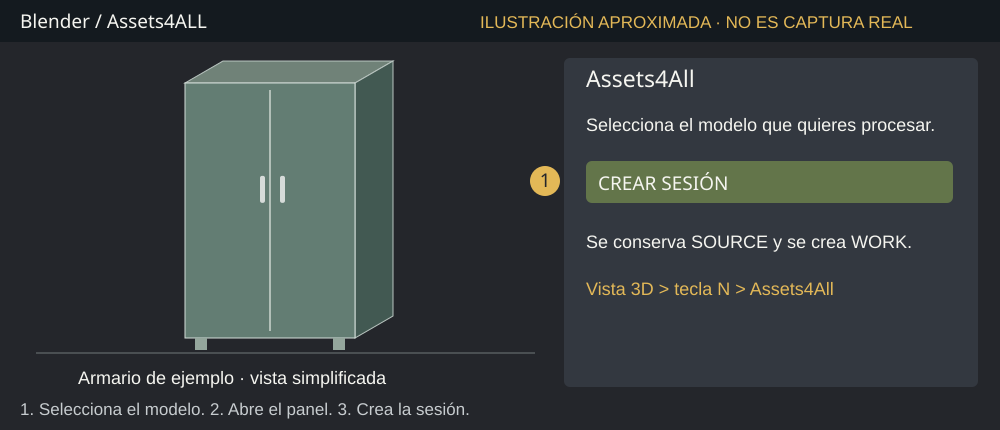
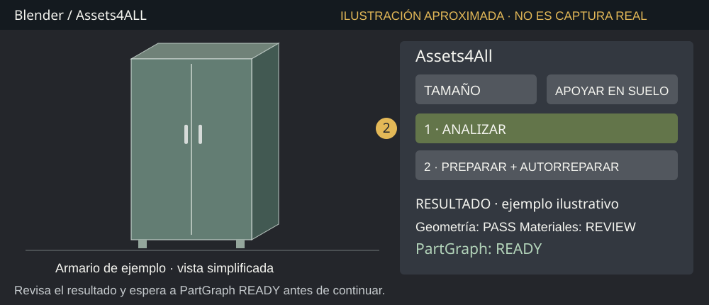
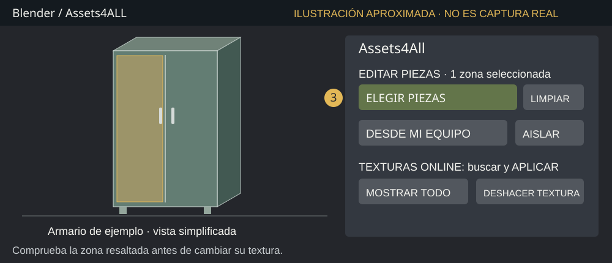
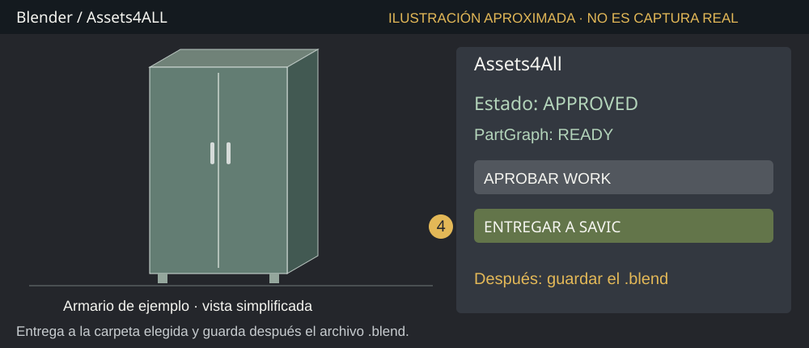
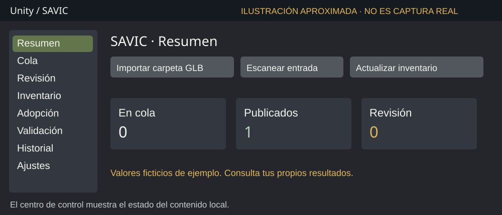
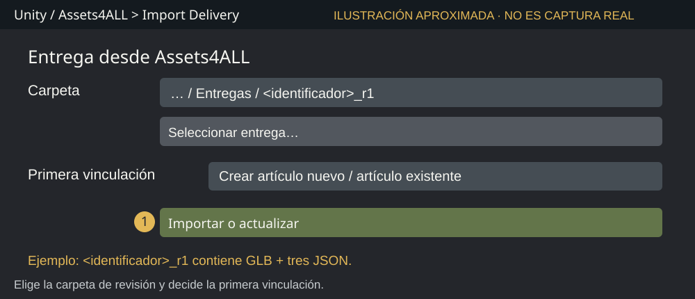
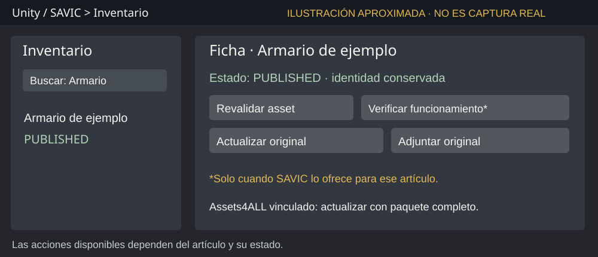
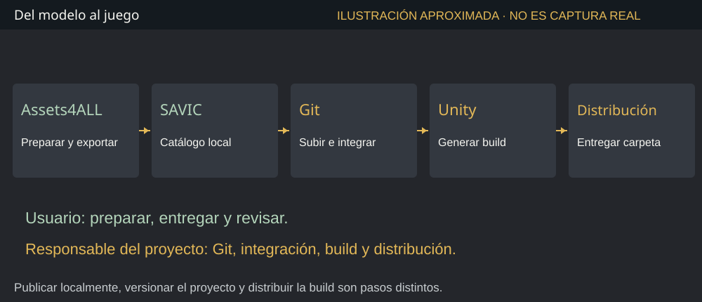
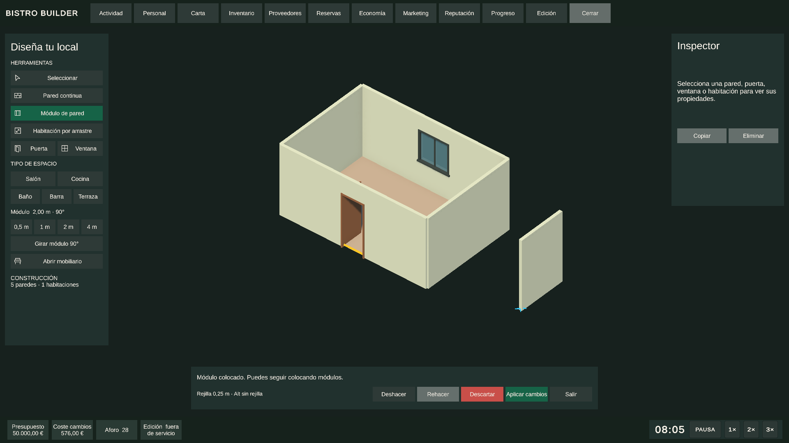

# Bistro Builder - Project Knowledge Bundle

Generated from every tracked source .md in the repository.
This is a single ingestion point for agents; original files remain authoritative.

## Mandatory precedence
1. ENTRYPOINT and CANONICAL.
2. Integrated code and public contracts when they describe verified behavior.
3. SUPPORTING and TECHNICAL_EVIDENCE.
4. HISTORICAL and THIRD_PARTY only for context and traceability.

Historical material never overrides a later canonical decision.

---

## SOURCE: AGENTS.md

Category: ENTRYPOINT

# Bistro Builder — instrucciones para agentes

Esta raíz contiene la fuente de verdad técnica y de producto del proyecto.

## Ingesta Markdown obligatoria
Antes de modificar código en una sesión nueva:
1. Leer **completo** `docs/PROJECT_KNOWLEDGE_BUNDLE.md`.
2. Consultar `docs/ALL_MARKDOWN_INDEX.md` para localizar la fuente original de cada decisión.
3. Si el bundle/índice no existe o algún `.md` fuente ha cambiado, ejecutar `Tools/BistroBuilder/RefreshMarkdownKnowledge.ps1` y volver a leer el bundle.
4. Si no se puede ejecutar el script, enumerar todos los `.md` versionados con Git y leerlos respetando la precedencia siguiente.

Los dos archivos generados (`ALL_MARKDOWN_INDEX.md` y `PROJECT_KNOWLEDGE_BUNDLE.md`) no son fuentes independientes: derivan del resto del corpus Markdown.

## Precedencia documental
1. `ENTRYPOINT`: este `AGENTS.md` y `docs/README.md`.
2. `CANONICAL`: decisiones vigentes y documentos de `00_PRODUCT`, `10_ARCHITECTURE`, `20_GAME_SYSTEMS`, `30_UI_UX`, `40_TESTING` y `90_DECISIONS`.
3. Contratos públicos y comportamiento comprobable del código integrado.
4. `SUPPORTING` y `TECHNICAL_EVIDENCE`.
5. `HISTORICAL` y `THIRD_PARTY`, solo para contexto/trazabilidad.

Una fuente histórica nunca prevalece sobre una decisión canónica posterior.
## Reglas obligatorias
- No reabrir sistemas cerrados salvo regresión demostrable o nueva decisión explícita.
- No duplicar autoridades entre sistemas. Respetar `docs/10_ARCHITECTURE/AUTHORITY_MATRIX.md`.
- Mantener arquitectura modular, data-driven y sin hardcode específico por asset.
- BBSIS decide viabilidad espacial; Interaction & Reservation derechos lógicos; Navigation rutas/tráfico; Animation representación; Gameplay/IA intención y resultado.
- Modo Edición funciona fuera de servicio y no simula obreros construyendo.
- No introducir agua, extracción, gas o ventilación como simulaciones jugables salvo decisión posterior explícita.
- Los cambios deben ser no destructivos, idempotentes cuando corresponda y acompañados de validadores/autotests.
- Ningún PASS se declara solo por compilar: aplicar `docs/40_TESTING/ACCEPTANCE_AND_VALIDATION.md`.
- Al encontrar contradicciones, conservar evidencia y actualizar la fuente canónica; no borrar historia.
- Si una decisión de producto/arquitectura cambia, actualizar los `.md` afectados y regenerar índice + bundle en el mismo commit.

## Estado vivo
`docs/00_PRODUCT/ROADMAP.md` es el índice operativo de bloques y sistemas transversales. Si cambia el estado real de una rama o integración, actualizarlo en el mismo cambio.

---

## SOURCE: docs/README.md

Category: ENTRYPOINT

# Bistro Builder — documentación canónica

Consolidación iniciada el **12/09/2026** a partir de documentación del repositorio, DOCX históricos y decisiones de chats desde abril de 2026. Los originales no se eliminan.

## Leer en este orden
1. [`00_PRODUCT/PRD.md`](00_PRODUCT/PRD.md) — producto y alcance.
2. [`00_PRODUCT/ROADMAP.md`](00_PRODUCT/ROADMAP.md) — estado vivo.
3. [`10_ARCHITECTURE/SYSTEM_MAP.md`](10_ARCHITECTURE/SYSTEM_MAP.md) — mapa de sistemas.
4. [`10_ARCHITECTURE/AUTHORITY_MATRIX.md`](10_ARCHITECTURE/AUTHORITY_MATRIX.md) — fronteras de autoridad.
5. [`90_DECISIONS/DECISION_REGISTER.md`](90_DECISIONS/DECISION_REGISTER.md) — decisiones vinculantes/superadas.
6. [`30_UI_UX/UI_UX_DEFINITIVE.md`](30_UI_UX/UI_UX_DEFINITIVE.md) y [`30_UI_UX/CAMERA_369.md`](30_UI_UX/CAMERA_369.md).
7. [`20_GAME_SYSTEMS/CONSTRUCTION_AUTHORING.md`](20_GAME_SYSTEMS/CONSTRUCTION_AUTHORING.md) para Modo Edición player-ready.
8. [`40_TESTING/ACCEPTANCE_AND_VALIDATION.md`](40_TESTING/ACCEPTANCE_AND_VALIDATION.md) — definición de PASS.

## Fuente de verdad
Una decisión posterior y explícita prevalece sobre una propuesta antigua. Los documentos legacy permanecen como trazabilidad, no como autoridad cuando contradicen el Decision Register o un documento canónico más reciente.

## Chats sin artefacto
Las decisiones que solo vivían en conversaciones están registradas en [`99_HISTORY/CHAT_SOURCE_REGISTER.md`](99_HISTORY/CHAT_SOURCE_REGISTER.md). No se transcriben chats completos: se conserva la decisión, su estado y su impacto técnico.

## Ideas no canónicas
[`90_DECISIONS/OPEN_QUESTIONS_AND_LEGACY_IDEAS.md`](90_DECISIONS/OPEN_QUESTIONS_AND_LEGACY_IDEAS.md) separa brainstorming histórico de requisitos vigentes.

## Historia y auditoría
Ver [`99_HISTORY/LEGACY_SOURCE_REGISTER.md`](99_HISTORY/LEGACY_SOURCE_REGISTER.md) y [`40_TESTING/DOCUMENTATION_MIGRATION_AUDIT_20260912.md`](40_TESTING/DOCUMENTATION_MIGRATION_AUDIT_20260912.md).
## Ingesta global para agentes
`PROJECT_KNOWLEDGE_BUNDLE.md` concatena todos los `.md` fuente versionados del proyecto en orden de precedencia y es el punto único de ingestión para Astra/Codex/agentes compatibles.

`ALL_MARKDOWN_INDEX.md` mantiene el inventario y trazabilidad hacia cada archivo original, incluidos Markdown situados en la raíz o dentro de `Assets/`.

Regenerar ambos con:

`Tools/BistroBuilder/RefreshMarkdownKnowledge.ps1`

Los archivos originales siguen siendo la fuente editable; el bundle es un artefacto derivado para contexto.

---

## SOURCE: docs/00_PRODUCT/ACTIVE_BRANCHES.md

Category: CANONICAL

# Bistro Builder — Ramas activas

**Fecha:** 2026-10-05
**Objetivo:** que el usuario no tenga que memorizar decenas de ramas técnicas.

## Regla simple

Para el trabajo normal de Bistro Builder solo existe **una MASTER del proyecto**:

**MASTER = `integration/master-current-20260918`**

Las demás ramas son ramas de trabajo. Cuando un trabajo se valida, se integra deliberadamente en MASTER. No se crea otra rama que compita conceptualmente con MASTER.

## Lo único que hay que recordar

| Nombre humano | Rama / repositorio | Para qué sirve | Quién la toca |
|---|---|---|---|
| **MASTER** | `integration/master-current-20260918` | Base estable acumulativa de Bistro Builder y origen de builds globales | Solo integraciones validadas |
| **EDITOR V2** | `feature/editor-v2` | Desarrollo controlado de Editor V2 | Hilo/agente de Editor V2 |
| **SAVIC** | `feature/savic-v1` | Desarrollo y hardening de SAVIC | Agente responsable de SAVIC |
| **ASSETS4ALL** | repositorio Assets4All; rama activa observada `feature/v0.1.19-pof2a-universal-scale` | Desarrollo de Assets4All / Boundary AI | Agente responsable de Assets4All |

## Worktrees principales

- MASTER:
  `C:\Users\mruperez\ProyectoBB\BistroBuilder_MasterIntegration_20260918`

- EDITOR V2:
  `C:\Users\mruperez\ProyectoBB\BistroBuilder_EditorV2`

- SAVIC:
  `C:\Users\mruperez\ProyectoBB\BistroBuilder_SAVICV1`

- Assets4All:
  `C:\Users\mruperez\Assets4All_LocalGate\candidate`

## Ramas de agentes

Puede haber ramas temporales como `codex/*`, `wip/*`, `validation/*`, `fix/*` o ramas de integración de prueba.

**El usuario no tiene que recordar sus nombres.**

Reglas:

1. el agente que crea una rama temporal es responsable de saber para qué sirve;
2. antes de integrar, se compara contra MASTER;
3. no se hace merge masivo de una rama vieja solo para rescatar una mejora;
4. una rama temporal no se convierte en una segunda MASTER;
5. cuando el trabajo queda absorbido y no contiene WIP exclusivo, puede archivarse/eliminarse en una limpieza Git separada y auditada;
6. nunca se borra una rama o worktree con cambios no publicados sin auditarlo primero.

## Assets4All → SAVIC

La conexión Assets4All → SAVIC ha superado el gate de Editor V2 mediante evidencia compuesta de cinco familias y el puente está versionado de forma aislada en ambos extremos. Esto desbloquea B1, pero no autoriza por sí solo un merge a MASTER.

A fecha de este documento no se designa una rama puente como nueva autoridad canónica. El resultado deberá integrarse de forma controlada:

**Assets4All → contrato estable → adaptador SAVIC → SAVIC → Bistro Builder**

Cuando los agentes terminen:

1. estabilizar primero SAVIC;
2. identificar exactamente qué commits pertenecen al puente Assets4All → SAVIC;
3. integrar el puente sobre la versión estable de SAVIC;
4. ejecutar el gate completo de cinco familias;
5. solo después incorporar el resultado validado a MASTER.

## Regla para futuros chats y agentes

Si existe duda sobre qué rama usar:

**no preguntar al usuario que recuerde el nombre.**

El agente debe:

1. leer este documento;
2. comprobar el estado real de Git;
3. comprobar worktrees y cambios locales;
4. trabajar sobre la rama humana correspondiente;
5. actualizar este documento cuando cambie una rama activa.

## Builds

La build global que representa el estado acumulativo del proyecto se genera desde **MASTER**.

Una build de una feature se etiqueta como build de prueba de esa feature y nunca sustituye conceptualmente a MASTER.

## Estado actual

- MASTER: estable y limpia al iniciar B0 Editor V2.
- EDITOR V2: creada desde MASTER + documentación canónica; B0 cerrado sin cambios funcionales.
- SAVIC: trabajo activo en paralelo; existen cambios locales/agentes y no se deben tocar desde Editor V2.
- Assets4All: trabajo activo en repositorio separado.

Con esta política, el usuario solo necesita decir **MASTER**, **EDITOR V2**, **SAVIC** o **ASSETS4ALL**. Los nombres técnicos secundarios quedan bajo responsabilidad de los agentes.


## Proyecto conjunto Editor V2 + SAVIC — 2026-10-14

La ruta de revisión viva es `C:\Users\mruperez\ProyectoBB\BB_EditorV2_SAVIC`, un enlace al worktree `editor-v2-galeria-fiel/BistroBuilder` de `codex/editor-v2-galeria-viva`. Integra R9 y el receptor Assets4All–SAVIC mediante un delta contrastado y respaldado; ambos chats deben continuar sus cambios sobre este mismo worktree. La evidencia R9 independiente se conserva. MASTER continúa siendo `integration/master-current-20260918`.

Instrucciones para el usuario: [Proyecto unificado](../PROYECTO_UNIFICADO_EDITOR_V2_SAVIC.md). Evidencia conjunta: [Validación](../40_TESTING/EDITOR_V2_SAVIC_UNIFIED_20261014.md).

---

## SOURCE: docs/00_PRODUCT/BRANCH_AUDIT_20260918.md

Category: CANONICAL

# Bistro Builder — Auditoría de ramas e integración
**Fecha:** 2026-09-18
**Base auditada:** `integration/production-all-current-20260918`
**Rama maestra creada:** `integration/master-current-20260918`
**Objetivo:** mantener una única base acumulativa y decidir qué trabajo puede integrarse sin reintroducir código antiguo.

## Criterios usados
- Ancestro Git: si la rama ya está contenida en producción, no se vuelve a mezclar.
- Equivalencia de parche: se usa `git cherry` para detectar trabajo ya integrado con otro hash.
- Merge-tree: simulación de merge sin tocar el working tree para detectar conflictos.
- Estado real del worktree: se revisan cambios sin commit, además de los commits.
- Evidencia de validación: build, autotest o validadores existentes.
- Regla conservadora: una rama antigua no se integra entera solo porque contenga una mejora útil.

## Rama maestra
Se creó `integration/master-current-20260918` desde la producción vigente.
Punto inicial: `bc1543b feat(furniture): harden authoring workflow`.
La rama fue publicada en origin y se usa desde ahora como base acumulativa.

## Integrado durante esta auditoría
### Catalog UI V1
Rama: `feature/catalog-ui-v1`.
Estado previo: limpia, 7 commits exclusivos, 12 archivos de contribución y merge simulado limpio.
Validación: build Windows correcta, `Build Finished, Result: Success`.
Resultado: integrada en la maestra con `e4796e22 merge(catalog): integrate validated catalog UI v1`.
## Ya contenido en producción — no volver a mezclar
- `feature/dish-images-catalog`: su historial comprometido ya es ancestro de producción.
- `feature/18n-construction-authoring-v1`: contenido comprometido ya absorbido.
- `feature/bbplfs-v1`: ya absorbido.
- `integration/ui-combined-final-20260917-v2`: ya absorbido.
- `integration/astra-chat-live-20260914`: ya absorbido.
- Economía V1, horarios/personal, reservas, marketing/reputación/progresión, clientes avanzados y comandas avanzadas: ramas canónicas ya absorbidas.

## Sistemas cuyo nombre de rama engaña
### Clima
El worktree `BistroBuilder_ClimateV1` mostraba 24 archivos staged como nuevos porque su base es antigua.
Comparación de blobs: los 24 archivos son idénticos byte a byte a producción.
Producción además contiene el commit integrado `5f9d64ce playtest: integrate climate weather v1`.
Decisión: no merge; Clima ya está dentro.

### Animación
La rama original conserva commits no equivalentes, pero producción contiene una reconstrucción posterior:
- `0191ab50 animation: rebuild character interaction animation v1`
- `7278c19f animation: harden runtime bootstrap and final V1 validation`
- `04f3de98 animation: finalize integrated V1 scene and legacy gate compatibility`
Decisión: no reintroducir los commits antiguos `1887d66` / `6441c31`.

### Interaction & Reservation
Los seis commits exclusivos de la rama tienen parches equivalentes en producción.
Producción contiene además `f23e6378 interaction: restore logical reservation system v1`.
Decisión: no merge.

### Navigation & Crowd Flow
Todos los parches específicos de la rama auditada tienen equivalentes en producción.
Producción incluye `49df2207`, `90b13e62`, `76199b61` y el hardening posterior.
Decisión: no merge.
## UI / iconografía
### UI visual polish
Los commits de HUD, selección de mesa y corrección del parpadeo están ya integrados en producción con otros hashes:
`195d74d3`, `4b27c92c`, `ce0072c6`, `cf962809`, `4067376f`, `4d6095d6`.
Solo aparece una diferencia de patch-id en un test, no en la funcionalidad.
Decisión: no merge de la rama completa.

### 21A UI/UX definitiva
La rama es una base vieja y produce conflictos add/add contra los mismos sistemas ya existentes.
Los commits finales de cierre/navegación tienen equivalentes en producción.
Decisión: conservar como referencia histórica; no merge.

### 21B Iconography
Producción ya contiene 169 assets bajo Iconography, catálogo runtime y `BBIconographyRuntime`.
El merge de la rama antigua genera numerosos conflictos add/add en metas y recursos.
Decisión: no merge de rama completa; cualquier icono nuevo se compara individualmente.

## Bloques 12–17 y BBSIS
- Cocina avanzada: el core está en producción; la rama antigua contiene principalmente hardening de harness/batch y entra con conflicto de escena.
- Camareros avanzados: producción contiene las restauraciones y rutas profesionales; la rama antigua entra con múltiples add/add.
- Front of House: core restaurado en producción; el único commit de metadata no justifica mezclar toda la rama y el archivo ya existe.
- Fin de servicio: todos sus commits auditados tienen equivalentes en producción.
- Nueva partida: producción ya contiene V2 (`a4304711`) y el arreglo de startup/local vacío (`6b99e907`); no traer V1/V2 antiguas otra vez.
- BBSIS: producción contiene rebuild e incremental hardening (`765167dd`, `c9e52556`, `423b3bfc`).
Decisión: no merge masivo de ninguna de estas ramas antiguas.
## Playtest/all-current y fixes agregados
`playtest/all-current-20260912` y `fix/empty-premises-boundary-scroll-access` son agregados sobre bases antiguas.
Contienen UI 21A/21B, scroll, BBSIS y new-game que producción ya posee en implementaciones posteriores.
El merge simulado produce muchos conflictos add/add.
Producción ya contiene:
- `50022910 21C: implement scoped internal scrolling`
- `ffa3e23f 21C: make menu scrolling universal and clean UI artifacts`
- `62201886 18N: fix empty premises boundaries and scroll access`
- `e8b1f21b fix(edit-mode): restore premises floor and remove select mode`
Decisión: no merge de estos agregados.

## Worktrees con cambios locales sin commit
### BistroBuilder raíz
Rama: `feature/dish-images-catalog`.
Estado observado: 52 archivos tracked modificados + 115 untracked.
Mezcla UI/UX, construcción, documentación, settings y herramientas.
Decisión: NO integrar en bloque. Debe separarse por sistema y validar cada bloque.

### CatalogUIV1
Después de la build validada aparecieron cambios locales nuevos en:
- `RestaurantPlaceableCatalogPanel.cs`
- `RestaurantEditInteractionController.cs`
- `BistroBuilderUiShell.cs`
- nuevo `BistroBuilderUiShell.EditModeChrome.cs`
Ese WIP no forma parte del merge estable `e4796e22`.
Decisión: mantener fuera hasta compilar, revisar encoding/UI y validar visualmente.

### ConstructionAuthoringV1
Los cambios locales actuales son principalmente ProjectSettings, URP/TMP, metadatos ThirdParty y solución IDE.
No hay nuevo bloque funcional de código pendiente en ese worktree.
Decisión: no subir automáticamente.

### OpeningV2 / UIUXDefinitive
Los cambios locales restantes son probes, settings, scripts auxiliares y reportes.
No representan una versión canónica superior al contenido integrado.
Decisión: no subir automáticamente.
## Política de integración desde hoy
1. Todo sistema nuevo parte de `integration/master-current-20260918`.
2. Se desarrolla en una rama propia.
3. Se exige worktree limpio o cambios claramente acotados.
4. Se valida compilación y, cuando exista, autotest/build funcional.
5. Se simula merge contra la maestra.
6. Si está estable, se integra y se hace push automáticamente.
7. Una rama vieja no se mergea completa para rescatar una sola corrección.
8. Los cambios locales mezclados se separan primero por sistema.
9. La build global se genera siempre desde la rama maestra.
10. Producción histórica queda como referencia; la maestra pasa a ser el punto de acumulación actual.

## Estado tras la auditoría
- Maestra creada y publicada.
- BBFFVAS ya incluido por la base de producción.
- Catalog UI V1 validado e integrado.
- Clima confirmado presente.
- Animation V1 confirmado integrado mediante reconstrucción posterior.
- Interaction/Reservation confirmado presente.
- Navigation/BBSIS y bloques canónicos principales confirmados presentes.
- Ramas agregadas/antiguas marcadas para no merge masivo.
- WIP local identificado y aislado de la maestra.

## Cierre de consolidación — 2026-09-19
Durante la separación del WIP se detectaron dos mejoras válidas que habían quedado fuera de la rama acumulativa por integraciones posteriores.

### Recuperación de Construcción
- Recuperada la reutilización de paredes compartidas al crear habitaciones mediante `ConstructionWallCoverage.AppendUncovered`.
- Recuperado el alta runtime de `BistroBuilderConstructionPlayerPanel`.
- Añadida/restaurada cobertura de regresión para habitaciones que reutilizan límites existentes.
- Commit de recuperación: `e14fc4d7`.
- Merge en maestra: `7ca5ed7c`.
- Validación Unity 6000.3.19f1: **32/32 escenarios, 341 assertions, 0 fallos**.

### Recuperación de Navegación
- Los rebuilds de topología disparados por edición quedan diferidos mientras un `Load` está restaurando el restaurante.
- El rebuild pendiente se ejecuta al terminar la carga, evitando topologías intermedias.
- Se conserva el hardening moderno de navegación; no se recuperó la versión antigua completa.
- Commit de recuperación: `a295d578`.
- Merge en maestra: `6999e779`.
- Save/Load real de Navigation 17: **PASS, exit code 0**.

### Build final de la maestra
- Rama validada: `integration/master-current-20260918`.
- Unity: `6000.3.19f1`.
- Resultado: **Build Successful / Build Finished, Result: Success**.
- Player total: **163038680 bytes**.
- Warnings: **13**.
- Pantalla: `FullScreenWindow`, resolución nativa activa.
- Salida: `Builds/Windows/BistroBuilder_Playtest/BistroBuilder.exe`.

La rama `integration/master-current-20260918` queda como base acumulativa canónica para el siguiente trabajo estable.

---

## SOURCE: docs/00_PRODUCT/PRD.md

Category: CANONICAL

# Bistro Builder — PRD canónico

**Producto:** videojuego/gestor de restaurantes 3D para PC instalable.
**Experiencia base:** vista superior oblicua/isométrica, comedor y cocina en la misma escena, gestión durante servicio y construcción/edición fuera de servicio.

## Objetivo
Permitir al jugador crear, operar y hacer crecer restaurantes creíbles mediante decisiones de layout, carta, personal, compras, servicio, economía y reputación, con sistemas conectados y legibles en lugar de micromanagement físico innecesario.

## Pilares
- **Construir y adaptar:** habitaciones, paredes, puertas, mobiliario/equipamiento y decoración mediante Modo Edición profesional.
- **Operar:** clientes, comandas, cocina, camareros, entrada/sala/barra y resolución de incidencias durante el servicio.
- **Gestionar:** carta, inventario FEFO, proveedores, personal, horarios, reservas, marketing, finanzas y progresión.
- **Decidir bajo presión:** capacidad de cocina, esperas, prioridades, satisfacción, caja y reputación deben producir trade-offs claros.
- **Escalar sin fragilidad:** arquitectura modular, data-driven, persistible, validable y extensible sin hardcode por asset.

## Requisitos de producto vinculantes
- La construcción estructural debe ser comprensible y jugable; no basta con poder mover mesas y sillas.
- El Modo Edición solo está disponible fuera de servicio; construcción instantánea, sin obreros simulados.
- Espera general mediante lista virtual; espera física solo en barra cuando corresponda.
- Cocina comunica Fluida/Cargada/Saturada/Bloqueada y permite reducir entrada, pausar nuevas comandas por plato y priorizar hasta 3 comandas.
- Gestión de camareros por zonas con asignación automática por cercanía, carga y prioridad; jefe de sala opcional.
- `Caja` significa dinero del servicio y `Satisfacción` la satisfacción del servicio.
- No se simulan como gameplay agua, extracción, gas ni ventilación; tampoco zonas de personal jugables.
- La presentación visual base es común a todos los locales salvo excepciones explícitas.

## Requisitos de calidad
- Guardado/carga coherente entre sistemas y servicios activos.
- Operaciones frecuentes de edición deben responder sin pausas perceptibles injustificadas.
- Sistemas cerrados deben disponer de validadores/autotests y pruebas funcionales, no solo compilación.
- UI clara, sobria y operativa; información accionable antes que decoración.

## Fuera de alcance por defecto
Ideas históricas no ratificadas posteriormente —por ejemplo avatar detallado, simulaciones técnicas de instalaciones o complejidad física ornamental— no son requisitos hasta decisión explícita.

---

## SOURCE: docs/00_PRODUCT/ROADMAP.md

Category: CANONICAL

# Bistro Builder — roadmap vivo

**Corte documental:** 12/09/2026. `CERRADO` significa cierre dentro del alcance declarado; una regresión posterior puede abrir hardening sin invalidar todo el diseño.

| Área | Estado canónico | Nota |
|---|---|---|
| 365B/C/D Seating, snapping e indicadores | CERRADO | PASS |
| 366/366B Save/Load estructura + `game.general` | CERRADO | PASS |
| 367A–F Carta, comandas, preparación, consumo, compartidos/pases | CERRADO | PASS en su alcance |
| 2.2 Inventario/Almacén V1 | CERRADO | FEFO, lotes, recepciones, mínimos/previsión, UI |
| 2.3 Proveedores V1 | CERRADO | mercado, formatos/ofertas, pedidos, storage, compra Inteligente |
| 3 Economía y Finanzas | CERRADO | cierre formal 28/08/2026 |
| 4 Personal | CERRADO | arquitectura laboral separada de agentes operativos |
| 5 Horarios y Turnos | CERRADO | cierre posterior prevalece sobre auditorías antiguas pendientes |
| 6 Reservas | CERRADO | capacidad, disponibilidad, servicio, persistencia, UI, Queen |
| 7 Marketing / 8 Reputación / 9 Progresión | CERRADO V1 | rama consolidada 7–9 |
| 10 Clientes / 11 Comandas / 12 Cocina / 13 Camareros avanzados | CERRADO V1 | ramas específicas integradas/hardened |
| 14 Entrada, Sala y Barra | CERRADO V1 | espera virtual general; barra con espera física |
| 15 Fin de servicio/día | CERRADO V1 | rama específica |
| 16 Nueva partida/apertura | CERRADO V1 + hardening | existe V2 de apertura |
| 17 Navegación V1 | CERRADO V1 + hardening | Crowd Flow transversal continúa integración/regresiones |
| 18 Modo Edición/Construcción | CORE V1 CERRADO; EDITOR V2 B0 PASS; GATE A4A→SAVIC PASS; B1 PASS; B2 PASS; B3 PASS | Selección común validada 28/28 y consumida por la barra de edición; regresiones B2/Core/Scene/Lifecycle/Queen PASS; B4 Undo/Redo global desbloqueado |
| 21A UI/UX definitiva | EN DESARROLLO | diseño vinculante y rama propia; cierre aún no ratificado |

## Sistemas transversales
- **BBSIS v1:** COMPLETO, VALIDADO Y CERRADO; hardening solo ante regresión real.
- **Interaction & Reservation v1:** IMPLEMENTADO, VALIDADO Y CERRADO; auditoría destructiva futura antes de vertical slice/beta.
- **Character & Interaction Animation v1:** INTEGRADO, VALIDADO Y SUBIDO; futuras ampliaciones son V2/hardening.
- **Navigation & Crowd Flow:** contratos de autoridad fijados; implementación/hardening activo sin duplicar BBSIS ni Animation.
- **BBPLFS:** desarrollo activo en `feature/bbplfs-v1`.
- **Climate & Weather:** implementación V1 existente; cierre final pendiente de validación/ratificación.
- **BB Furniture Finishes & Variants Authoring System (BBFFVAS):** IMPLEMENTACIÓN TÉCNICA V1 ACTIVA; núcleo, autoría, Acabado Automático, miniaturas, publicación, runtime binding e importación Smart Assets/Asset Studio BB validados en Unity 6000.3.19f1. Integración en producción pendiente.

## Integración actual
`playtest/all-current-20260912` contiene trabajo posterior a `integration/chat-final-20260911` y, al crear esta documentación, tenía conflictos de merge sin resolver. Esta rama documental se aisló deliberadamente para no tocar esa integración.

## Actualización 24/09/2026 — Nueva partida
Diseño marfil clásico de tres opciones aprobado y maqueta interactiva incorporada en integration/master-current-20260918. Pantalla nativa integrada con tres preparaciones, creación/carga y menú de retorno; no cambia el cierre funcional del servicio de apertura. Fuente: [Nueva partida](../30_UI_UX/NEW_GAME_APPROVED.md).

## Actualización UI — 25/09/2026
Barra superior del modo normal adaptada a la preview V3 en la rama codex/topbar-responsive-approved: composición nativa compacta, iconos originales independientes y hover. 66 comprobaciones PASS en siete resoluciones (800×600 a 3840×2160, incluido ultrawide). Candidata a revisión visual del usuario antes de integrar.

## Revisión visual UI — 26/09/2026
La revisión del usuario detectó nitidez insuficiente en la build por preferencias antiguas de resolución (1280×720 ampliado a pantalla completa). Corregido el arranque y la transición a pantalla completa para solicitar píxeles nativos; retirado también el dock antiguo superpuesto. Regresión responsive: 67 comprobaciones PASS. La revisión visual final sigue pendiente antes de integrar.

## Revisión UI — 28/09/2026
Ampliado el área útil de los iconos sin aumentar la barra, mejorado el filtrado al reducirlos y reforzado el texto. Hover y pulsación responden desde su evento, con asentamiento de 90 ms. 77 comprobaciones PASS; pendiente de conformidad visual del usuario e integración.

## Revisión UI — 29/09/2026
La candidata `codex/topbar-responsive-approved` incorpora `f86f97da` de `integration/master-current-20260918` para conservar las secciones actuales de edición, las miniaturas y las correcciones de paredes. Se corrigen solapamientos, selectores sin texto, contraste de Reputación y duplicación de acciones iniciales. La integración de esta candidata continúa pendiente de conformidad visual; no se declara cerrado 21A. [Evidencia y alcance](../40_TESTING/UI_VIDEO_AUDIT_2026-09-29.md).
## Integración UI autorizada — 29/09/2026
El usuario aprueba subir las correcciones de `9b70eafc` a `integration/master-current-20260918`. Se integra con el cambio remoto `702b7175` de Universal Preview V2 conservando ambos trabajos. El recorrido de UI combinado mantiene 305 comprobaciones PASS. Esto sustituye el estado pendiente de aprobación de la candidata; no declara cerrado el conjunto de 21A.

## Plan Editor V2 — 05/10/2026
Se aprueba el plan maestro de evolución del Modo Edición sin reescritura total. La implementación queda secuenciada por gates: primero B0 (baseline/protección), después cierre de la conexión Assets4All → SAVIC y, una vez superado ese gate, B1–B16 de Editor V2. BBSIS, Navigation, Finance, Save/Load, SAVIC, Placement, Construction Authoring, cámara 369 y Universal Preview conservan sus autoridades; Editor V2 añadirá coordinación común sin duplicarlas. Fuente: [Editor V2 Master Plan](../20_GAME_SYSTEMS/EDITOR_V2_MASTER_PLAN.md).

## Editor V2 B3 - 06/10/2026
B3 Selección común queda cerrado en PASS. Furniture, Construction y Surfaces proyectan su selección especializada a un contrato común con identidad, tipo y capacidades; la barra de edición usa ese contrato para habilitar acciones sin duplicar autoridades. Gate B3 28/28; regresiones B2 22/22, Core 84/84, Scene 77/77, Lifecycle 20/20 y Queen exit 0. B4 Undo/Redo global queda desbloqueado. Fuente: [Editor V2 B3 Selección común](../40_TESTING/EDITOR_V2_B3_COMMON_SELECTION_20261006.md).

## Editor V2 — Galería Viva nativa — 10/10/2026

Implementado el catálogo nativo a partir de la referencia detallada del usuario, con búsqueda, categorías, favoritos, recientes, ámbito, precios y ordenación reales sobre B9. Se desactivan los renderizadores anteriores del catálogo y el diagnóstico IMGUI provisional. B8/B10 y colocación provisional conservan sus autoridades. Validación nativa: 61 comprobaciones PASS; B9: 42/42 con 10.000 definiciones; capturas GPU en 1920 × 1080 y 1280 × 720 y build Windows independiente. La aprobación visual del conjunto y los productos fotografiados de la maqueta continúan pendientes. [Evidencia y alcance](../40_TESTING/EDITOR_V2_GALERIA_VIVA_NATIVE_20261010.md).
## Editor V2 — revisión gráfica R2 — 11/10/2026

La entrega visual del 10/10 queda rechazada por el usuario. R2 corrige medidas, marcos anidados, herramientas inferiores cortadas y coexistencia de inspectores B8/arquitectura. Ficha nativa compartida, acciones iniciales en menú V2, tipografía SDF y filtros canónicos; 106 comprobaciones Play Mode PASS. Vista de revisión HTML/CSS/JavaScript con controles funcionales y capturas completas en 4K. No se declara identidad visual por píxel ni se publican las ocho mesas de la imagen en el catálogo real; escena 3D y aceptación gráfica siguen pendientes. Trabajo aislado sin integración a principal. [Evidencia R2](../40_TESTING/EDITOR_V2_REFERENCE_R2_20261011.md).

## Editor V2 — R3 y pantalla completa — 11/10/2026

Disponible una nueva revisión separada con resolución nativa a pantalla completa, F11, catálogo medido desde la referencia completa, marcos sin restos de texto dibujado, fuentes SDF y selección de tarjetas coherente con B8. 106 comprobaciones nativas y 16 de navegador PASS; prueba GPU de pantalla completa y vuelta a ventana. R3 no cierra la igualdad visual ni sustituye los modelos del prototipo por los de la ilustración. [Evidencia R3](../40_TESTING/EDITOR_V2_REFERENCE_R3_20261011.md).


## Editor V2 — R4 Windows nativo — 12/10/2026

Destino de ejecución aclarado: EXE Unity de Windows; la revisión HTML es únicamente un banco de comparación. R4 incorpora medidas, iconos vectoriales SDF, pie sin divisores añadidos, tarjeta crema, corrección del recorte de precios y ficha ornamental en la interfaz nativa. 134 comprobaciones Play Mode y regresión B9 42/42 PASS; build sin errores (13 advertencias), capturas GPU, arranque directo y pantalla completa nativa 1920 × 1080. Igualdad visual absoluta y contenido artístico de la referencia siguen abiertos; rama sin integrar. [Evidencia R4 Windows](../40_TESTING/EDITOR_V2_REFERENCE_R4_WINDOWS_20261012.md).


## Editor V2 — R5: barra inferior compacta — 12/10/2026

Petición gráfica del usuario aplicada al EXE nativo: pie de 85 unidades, unido al borde inferior y al ancho de pantalla, papel opaco bajo las leyendas, títulos de 16 y botones de 54. 147 comprobaciones Play Mode PASS; build sin errores (13 advertencias), capturas reales GPU, pantalla completa 1920 × 1080 y regreso a ventana verificados. R4 se conserva como historia y la rama permanece sin integrar. [Evidencia R5 Windows](../40_TESTING/EDITOR_V2_FOOTER_R5_WINDOWS_20261012.md).


## Editor V2 — R6: cabecera y selector de luz — 12/10/2026

Petición gráfica aplicada al EXE nativo: cabecera al borde superior/ancho completo, papel opaco con marco encima y logo contenido. Corregido el enlace a la etiqueta de Día/Atardecer/Noche que antes sobrescribía el glifo del sol. 184 comprobaciones Play Mode PASS; build sin errores (13 advertencias), capturas reales de los tres presets y regreso a Día en 1920 × 1080, tamaños de ventana y retorno desde pantalla completa verificados. Se conserva el pie R5. Rama sin integrar. [Evidencia R6 Windows](../40_TESTING/EDITOR_V2_HEADER_R6_WINDOWS_20261012.md).


## Editor V2 — R7: botones de barra inferior — 13/10/2026

Mejora solicitada de los once botones: relieve fino, alineación común y estados de hover/pulsación/selección. Eliminar utiliza burdeos y una nueva papelera SDF, con estado desactivado legible y diferenciado. Se conserva la autoridad de disponibilidad/acciones y la geometría de las barras R5/R6. 293 comprobaciones Play Mode PASS; build Windows sin errores (13 advertencias), capturas GPU de los estados y fullscreen físico 1920 × 1080. Rama sin integrar. [Evidencia R7 Windows](../40_TESTING/EDITOR_V2_TOOLBAR_R7_WINDOWS_20261013.md).


## Editor V2 — R8: paneles, edición de ficha y scroll de Asientos — 13/10/2026

Título Catálogo, doce iconos SDF originales con relieve, fuentes aprobadas y etiquetas uniformes. Ficha centrada con centímetros, proporciones, presets y XYZ activos sobre creación/placement/BBSIS/historial/guardado canónicos. La nueva corrección de Asientos añade tarjetas uniformes, nombres multilínea, precios visibles, viewport dentro del marco y scroll de latón. 381 comprobaciones Play Mode PASS; regresión espacial PASS y B8 75/75 PASS; build Windows sin errores y revisión de capturas reales, fullscreen físico 1920 × 1080 con F11. EXE R8 separado; la rama sigue sin integrar y no se certifica igualdad absoluta de la referencia. [Evidencia R8](../40_TESTING/EDITOR_V2_PANELS_R8_WINDOWS_20261013.md).


## Editor V2 — R9: fotografía de sillas — 13/10/2026

Mejora solicitada tras aceptar el formato R8: cámara elevada, asiento visible, encuadre uniforme y seis miniaturas reales 1024 × 1024 centradas. Evolución del generador canónico SAVIC, GUID/prefabs/materiales preservados y reparación demostrada de la ficha Roja enlazada a otra silla. 56 comprobaciones de render y 393 de UI Play Mode PASS; build Windows sin errores y captura GPU de seis fichas, scroll, 1280 × 720 y fullscreen. Entrega EXE R9 independiente; rama sin integrar. [Evidencia R9](../40_TESTING/EDITOR_V2_CHAIR_PHOTOS_R9_WINDOWS_20261013.md).


## Proyecto conjunto Editor V2 + SAVIC — 2026-10-14

La ruta de revisión viva es `C:\Users\mruperez\ProyectoBB\BB_EditorV2_SAVIC`, un enlace al worktree `editor-v2-galeria-fiel/BistroBuilder` de `codex/editor-v2-galeria-viva`. Integra R9 y el receptor Assets4All–SAVIC mediante un delta contrastado y respaldado; ambos chats deben continuar sus cambios sobre este mismo worktree. La evidencia R9 independiente se conserva. MASTER continúa siendo `integration/master-current-20260918`.

Instrucciones para el usuario: [Proyecto unificado](../PROYECTO_UNIFICADO_EDITOR_V2_SAVIC.md). Evidencia conjunta: [Validación](../40_TESTING/EDITOR_V2_SAVIC_UNIFIED_20261014.md).

---

## SOURCE: docs/10_ARCHITECTURE/ASSETS4ALL_SAVIC_DELIVERY.md

Category: CANONICAL

# Assets4ALL → SAVIC: entrega versionada V1

Contrato implementado en la rama de trabajo `codex/assets4all-savic-exchange`. Assets4ALL conserva la autoridad sobre SOURCE, WORK y la segmentación; SAVIC conserva clasificación, catálogo, autoría jugable, BBSIS y SaveGame.

## Guía básica de usuario

Para seguir el procedimiento sin conocimientos de programación, consultar la [guía de Assets4ALL y SAVIC](../GUIA_USUARIO_ASSETS4ALL_Y_SAVIC.md). Contiene ilustraciones aproximadas, no capturas reales. Los PDF separados están en [manual de Assets4ALL](../manuales/Manual_Usuario_Assets4ALL.pdf) y [manual de SAVIC](../manuales/Manual_Usuario_SAVIC.pdf).

Para vincular por primera vez una corrección a un artículo existente, exportar inicialmente fuera de `ContentInbox/Deliveries` y seleccionar el artículo mediante Import Delivery antes de activar la detección automática. Una vez vinculado, las siguientes revisiones del mismo UUID pueden usar la carpeta de entregas automática.

## Flujo de uso

1. En Blender, crear la sesión, analizar, esperar a PartGraph READY y aprobar WORK.
2. Pulsar **ENTREGAR A SAVIC** y elegir una carpeta. Para detección automática, usar `ContentInbox/Deliveries` del proyecto Unity.
3. En Unity, abrir **Tools → Bistro Builder → SAVIC → Assets4ALL → Import Delivery** y seleccionar la carpeta de revisión.
4. Para corregir un artículo ya publicado, vincularlo explícitamente en su primera entrega. Después, las revisiones del mismo UUID actualizan ese artículo automáticamente.
5. Guardar el `.blend`: contiene el UUID y el historial de revisiones. Una nueva importación independiente de otro GLB no infiere la identidad del artículo anterior.

## Archivos y verificaciones

La carpeta final `<assetUuid>_r<revision>` se publica mediante rename tras completar `model.glb`, `asset4all.json`, `partgraph.json` y `delivery.json`. Las carpetas `.pending-*` quedan fuera de la ingesta.

`delivery.json` usa `schemaId=assets4all.savic-delivery`, versión 1, UUID independiente del SHA del modelo, revisión secuencial, fingerprint padre, SHA-256 de cada archivo, hash físico de WORK, generación y revisión de PartGraph, y correspondencia `PartKey → nodeName/sourceUid/triangleCount`. El fingerprint es SHA-256 del objeto JSON canónico con las claves `asset4all.json`, `model.glb`, `partgraph.json` y sus hashes.

Blender exporta clones de las caras exactas de cada pieza, conserva materiales/UV de BMesh, verifica cobertura completa y disjunta y compara los triángulos emitidos. SOURCE y WORK físicos se verifican antes y después. Las normales de exportación se recalculan; no se certifica la preservación de normales personalizadas. Los extras globales de escena se excluyen del GLB para que repetir una entrega no incorpore su propio historial.

SAVIC verifica hashes, contrato, PartGraph, nodos y triángulos del GLB y del modelo importado. Archiva el paquete y la fuente. La evidencia Assets4ALL tiene un registro propio; no se presenta como metadatos Meshy. La membresía se conserva, mientras los roles inciertos siguen como hipótesis y no crean contratos jugables. Una familia sin suficiente evidencia puede quedar en revisión.

## Actualizaciones y protección del trabajo

La publicación de cada revisión pasa por los módulos y gates existentes. Un candidato usa repositorio separado y conserva `savicId`, `canonicalContentId`, GUID de catálogo y fuentes anteriores. Solo un candidato publicado puede sustituir el hash de la fuente canónica. La sustitución consume la API canónica `ReplaceSourceRevision` y su historial `sourceRevisions`, conservando la actualización de GLB/FBX que ya estaba en desarrollo. `assets4AllRevisions` retiene la evidencia externa de cada paquete. El GLB de una revisión histórica vuelve a la misma identidad al pasar por la ingesta convencional.

Se conservan nombre, descripción, precio, condiciones económicas y materiales editados sobre nodos Assets4ALL. La pérdida de una pieza con material protegido bloquea la actualización; V1 solicita resolver su linaje. Las miniaturas de artículos genéricos se generan con el material protegido aplicado. No se afirma implementación completa de BBFFVAS ni reconocimiento universal de familias.

Un diario durable en `SAVIC/Transactions/Assets4All` protege los archivos publicados y catálogos. Ante fallo se restauran los bytes anteriores; al arrancar se recuperan transacciones incompletas. Los recibos se escriben en `SAVIC/Receipts/Assets4All`; distinguen publicación, repetición sin cambios y revisión MODEL/GAME. La detección automática respeta la pausa de SAVIC y no trabaja durante Play Mode o compilación.

## Cómo llega al repositorio y al juego distribuido

El recorrido es **Assets4ALL → entrega local → SAVIC → catálogo del proyecto Unity → Git → integración → build → distribución**. El estado `PUBLISHED` significa publicación en el proyecto local; no implica un push a GitHub ni una actualización del ejecutable de los jugadores.

### Proyecto y carpetas de esta instalación

- Proyecto Unity conectado: `C:\Users\mruperez\ProyectoBB\BB_SavicPresentation`.
- Destino de exportación automática desde Blender: `C:\Users\mruperez\ProyectoBB\BB_SavicPresentation\ContentInbox\Deliveries`.
- Archivo del paquete y fuentes: `ContentSource/Assets4All` y `ContentSource/SHA256` dentro del proyecto.
- Manifiestos canónicos: `SAVIC/Manifests`.
- Artefactos publicados: `Assets/Generated/BistroBuilder/SAVIC/Published`, con sus dependencias y archivos `.meta`.
- Catálogo principal de colocables: `Assets/Data/Restaurant/EditMode/Catalog/RestaurantPlaceableCatalog_Main.asset`.
- Remoto Git configurado: [twinslopment/BistroBuilder](https://github.com/twinslopment/BistroBuilder).

Con Unity abierto, fuera de Play Mode, sin compilación en curso y con SAVIC sin pausar, la carpeta de entregas se procesa automáticamente. Para la primera vinculación a un artículo existente, usar **Tools → Bistro Builder → SAVIC → Assets4ALL → Import Delivery**, seleccionar la subcarpeta `<assetUuid>_r<revision>` y elegir el artículo. Las siguientes revisiones conservan esa vinculación. Guardar el `.blend` conserva UUID e historial.

`PUBLISHED` permite encontrar el artículo en el catálogo de Modo Edición. `NEEDS_REVIEW` requiere resolver la causa indicada antes de publicarlo; aprobar WORK en Assets4ALL no certifica por sí solo todos los contratos jugables de SAVIC.

### Entrega por Git y generación del ejecutable

1. Revisar y hacer commit de los archivos correspondientes a la entrega: fuentes archivadas, manifiestos, artefactos publicados, dependencias, `.meta` y modificaciones de los catálogos afectados. Acotar el commit al cambio validado y conservar los GUID; no incluir en bloque trabajos ajenos ni carpetas temporales.
2. Hacer push de la rama al remoto del juego. `.gitattributes` configura Git LFS para los GLB de `ContentSource` y de `Assets/Generated/BistroBuilder/SAVIC/SourceMirror`; la subida y la descarga requieren también sus objetos LFS.
3. Integrar el cambio validado en la rama acumulativa vigente del juego, siguiendo la [política de integración](../00_PRODUCT/BRANCH_AUDIT_20260918.md). Un push publica la rama; no modifica por sí solo otras ramas ni otros checkouts locales.
4. Abrir el proyecto integrado y generar la build con **Tools → Bistro Builder → Build → Windows Playtest**. El [script de build](../../Assets/Editor/BistroBuilder/Build/BistroBuilderPlaytestBuild.cs) genera `Builds/Windows/BistroBuilder_Playtest/BistroBuilder.exe` respecto a la raíz del proyecto desde el que se ejecuta.
5. Distribuir la carpeta completa de la build, incluido el ejecutable y sus datos, por el canal elegido. Un `.exe` generado anteriormente conserva el contenido de su build y necesita una nueva versión para incorporar los cambios.

El puente instalado automatiza la entrega y publicación local. No ejecuta commit, push, integración de ramas, generación de builds ni subida a una plataforma de distribución. `Builds/` está excluido de Git; versionar el proyecto y distribuir su build son operaciones distintas.

## Cómo aplicar cambios de código de SAVIC a esta conexión

El receptor pertenece al propio proyecto Unity, en `Assets/Editor/BistroBuilder/SAVIC`. Assets4ALL entrega un paquete de archivos y SAVIC lo interpreta con el código presente en ese checkout. La conexión no contiene una copia independiente de SAVIC dentro del complemento Blender.

| Cambio | Qué actualizar |
|---|---|
| Validación, clasificación o publicación interna de SAVIC, manteniendo sus interfaces y el formato de entrega | Integrar el código en el proyecto Unity conectado. Unity recompila y los siguientes procesados usan la versión nueva. El complemento Assets4ALL puede mantenerse. |
| Interfaces internas utilizadas por el puente, por ejemplo repositorio, historial de fuentes o publicación | Adaptar también los consumidores del puente y comprobar una entrega real y una actualización del mismo artículo. |
| Archivos, campos, unidades o estructura que Assets4ALL debe enviar | Actualizar exportador y receptor de forma coordinada; generar el paquete actualizado del complemento e instalarlo en Blender. Mantener compatibilidad con entregas anteriores o implementar una migración explícita. |
| Comportamiento o datos que deben llegar a jugadores de una build existente | Integrar, validar y generar/distribuir una nueva build. El código situado en `Assets/Editor` se ejecuta en el editor; sus cambios de publicación llegan al jugador mediante los artefactos generados incluidos en la build. |

### Puntos de mantenimiento

- [SavicAssets4AllService.cs](../../Assets/Editor/BistroBuilder/SAVIC/Intake/SavicAssets4AllService.cs): verificación del paquete, importación, revisiones, conservación de ajustes, recuperación y detección de entregas.
- [SavicAssets4AllModels.cs](../../Assets/Editor/BistroBuilder/SAVIC/Intake/SavicAssets4AllModels.cs): modelos de datos del intercambio.
- [SavicAssets4AllEvidence.cs](../../Assets/Editor/BistroBuilder/SAVIC/Intake/SavicAssets4AllEvidence.cs): evidencia de piezas y comprobación del modelo importado.
- [SavicManifestRepository.cs](../../Assets/Editor/BistroBuilder/SAVIC/Core/SavicManifestRepository.cs): `CommitAssets4AllRevision` y la API canónica `ReplaceSourceRevision`.
- Exportador Blender: `C:\Users\mruperez\Assets4All_LocalGate\v029\blender_extension\assets4all\savic_delivery.py`.

El contrato externo actual es `schemaId=assets4all.savic-delivery`, `schemaVersion=1`. El receptor comprueba expresamente esa versión. Cambiarla solo en el exportador provocaría el rechazo de la entrega; una evolución incompatible requiere soporte en el receptor y un plan para los paquetes archivados. La revisión de un artículo (`revision`) y la versión del formato (`schemaVersion`) tienen funciones diferentes.

### Procedimiento de actualización

1. Desarrollar e integrar los cambios en la rama y el checkout que realmente abre Unity. Si SAVIC se modifica en otra carpeta o rama, llevar esos cambios al proyecto conectado mediante Git; no basta con el push del origen.
2. Esperar a la recompilación de Unity y resolver cualquier incompatibilidad del puente. Actualizar e instalar el complemento Blender solo cuando cambie su exportador o el contrato de entrega.
3. Verificar una primera entrega y una nueva revisión con un artículo real: publicación, identidad y GUID conservados, ajustes manuales, rechazo de paquetes inválidos y recuperación ante fallo. Para cambios relevantes de publicación, comprobar además catálogo, colocación y SaveGame y ejecutar las regresiones SAVIC aplicables. Los helpers disponibles se enumeran en la sección de evidencia de este documento.
4. Reprocesar los artículos ya publicados afectados si el cambio debe regenerar sus artefactos o validaciones. Cambiar código no los regenera automáticamente; repetir una entrega idéntica puede devolver `UNCHANGED` y tampoco fuerza ese reprocesado. Utilizar las operaciones canónicas de SAVIC y comprobar el resultado.
5. Versionar el cambio validado, actualizar esta documentación y regenerar índice/bundle. Integrar en la rama del juego y generar una nueva build cuando deba llegar a los jugadores.

## Evidencia real del 05/10/2026

Modelo: armario Meshy previamente publicado, `8a5c37cab8eb4366ab675afa66af65ad`. Blender 5.1.1: exportación, repetición idempotente, reapertura del `.blend`, cambio de acabado y corrección de escala/suelo, SOURCE intacto y diez PartKeys conservadas. Unity 6000.3.19f1: primera vinculación, revisiones 2 y 3, Editor nuevo, reprocesado, ajustes de catálogo y material protegidos, 18 identidades sin duplicados, GLB histórico duplicado, rechazo de GLB corrupto y revisión antigua. Una cuarta entrega real verifica además la integración con la API de revisiones y las dependencias actuales del proyecto de uso.

Prueba Play Mode sobre `Prototype_Restaurant`: colocación mediante Edit Mode y catálogo principal; SaveGame con revisión 1; Editor cerrado; actualización a revisión 3; carga de esa misma partida con ItemId/InstanceId y acabado conservados; eliminación del slot de diagnóstico y Console sin Error/Exception/Assert durante el test y cleanup. Prueba destructiva: fallo de material protegido tras comenzar publicación, restauración de archivos y recuperación de diario interrumpido.

Helpers reproducibles: `tools/blender_savic_delivery_probe.py`, `SavicAssets4AllAcceptance`, `SavicAssets4AllSaveGameAcceptance`. Logs y JSON reales quedan en la copia de aceptación `assets4all-savic`; este documento no certifica todas las familias ni una jornada completa de IA.

---

## SOURCE: docs/10_ARCHITECTURE/AUTHORITY_MATRIX.md

Category: CANONICAL

# Bistro Builder — matriz de autoridad

| Decisión / estado | Autoridad | No debe decidirlo |
|---|---|---|
| Intención y prioridad de tarea | Gameplay / IA | Animation, Navigation, BBSIS |
| Derecho lógico a usar/asignar/poseer | Interaction & Reservation | BBSIS, Navigation, Animation |
| Viabilidad y reserva espacial | BBSIS | Interaction, Navigation, Animation |
| Ruta, velocidad, heading y llegada | Navigation & Crowd Flow | BBSIS, Animation |
| Pose visual, blending, IK, gaze, recovery | Character Animation | Gameplay, BBSIS, Navigation |
| Estado de comanda y líneas | Order domain | Cocina, UI, Animation |
| Estado/preparación de cocina | Kitchen domain | UI, Animation |
| Empleado, salario, experiencia | Staff | Waiter runtime, Finance |
| Tarea operativa de camarero | WaiterTaskCoordinator | Staff, UI |
| Turno planificado | Staff Schedule | Staff roster, Waiter runtime |
| Caja y ledger | Finance | Staff, Suppliers, UI |
| Stock/lotes/FEFO | Inventory | Suppliers, Kitchen UI |
| Mercado/ofertas/pedidos proveedor | Suppliers | Inventory, Finance |
| Reserva de cliente/capacidad | Reservations | Seating visual, UI |
| Estructura colocada del restaurante | Edit/Structure domain | UI, BBPLFS |
| Condición meteorológica global | Climate | mesa individual, zona exterior individual |

## Reglas de frontera
- `EmployeeId` y `WaiterId` son identidades distintas; el binding de sesión las conecta.
- Wait Ticket se reserva a colas semánticas reales; no sustituye reservas espaciales.
- Claims/Spatial Leases pertenecen solo a BBSIS.
- UI emite comandos y presenta snapshots; no muta estado canónico directamente.
- BBPLFS propone/genera layout, pero la estructura final debe pasar por las mismas reglas de edición y validación.
- La persistencia conserva estados de cada autoridad; no crea un dominio alternativo.

---

## SOURCE: docs/10_ARCHITECTURE/BBPLFS.md

Category: CANONICAL

# BB Procedural Layout & Furnishing System (BBPLFS)

**Estado canónico:** sistema transversal en desarrollo activo, rama `feature/bbplfs-v1`.

## Objetivo
Generar y distribuir layouts/furnishing de restaurante de forma procedural sin convertirse en un editor paralelo ni saltarse las autoridades canónicas del proyecto.

## Reglas vinculantes
- El resultado debe terminar integrado en el proyecto y subido a su rama correspondiente.
- BBPLFS propone/genera; la estructura final se valida mediante los mismos contratos de Modo Edición/BBSIS que una edición manual.
- No duplica pathfinding, reservas espaciales, economía, persistencia ni Presentation.
- Debe producir resultados editables posteriormente por el jugador.
- El pipeline debe ser modular, determinista cuando se requiera reproducibilidad y compatible con assets data-driven.

## Integraciones
- BBSIS: viabilidad espacial y contratos.
- Navigation/Crowd: circulación y rutas resultantes.
- Edit Mode: materialización/edición del layout final.
- Economía: costes cuando el flujo de juego los aplique.
- Persistence: estructura y furnishing mediante formatos canónicos.

## Cierre
No declarar cerrado hasta demostrar generación, validación, edición manual posterior, persistencia y ausencia de autoridad duplicada en un escenario de restaurante representativo.

---

## SOURCE: docs/10_ARCHITECTURE/BBSIS.md

Category: CANONICAL

# BB Spatial Interaction System (BBSIS)

**Estado canónico:** V1 COMPLETO, VALIDADO Y CERRADO. No reabrir diseño salvo regresión demostrable.

## Autoridad
BBSIS es la única autoridad de **viabilidad y reserva espacial** para interacciones. No decide intención de gameplay, derechos lógicos, navegación ni animación.

## Conceptos vinculantes
- separación estricta `Render ≠ Spatial`;
- `Adaptive Spatial Proxy` para representación espacial robusta;
- `Spatial Contracts` como requisitos de interacción;
- traits y matriz de compatibilidad;
- `Claims / Spatial Leases` para exclusividad espacial temporal;
- `Spatial Episodes` como ciclo de una interacción espacial;
- `Work Edges`, `Ports` y `Seat Bays` como interfaces de uso;
- `Dynamic Sweep` para volumen requerido durante movimiento/interacción;
- `Mobility Envelope` y `Carry Envelope`;
- `Spatial Gates`, `Critical Routes` y `Flow Quality`;
- LOD lógico y perfiles de tuning data-driven.

## Reglas
- Interaction & Reservation no replica Claims/Leases.
- Navigation puede consultar viabilidad pero conserva autoridad de trayectoria.
- Animation representa la resolución espacial sin modificarla.
- Modo Edición y BBPLFS deben validar contra contratos espaciales comunes.
- Puertas y sillas pueden cambiar su ocupación espacial durante episodios relevantes; no se simulan mediante física por bisagra como autoridad de gameplay.

## Evolución
Cambios futuros deben tratarse como hardening/V2 y demostrar que respetan contratos públicos y compatibilidad con sistemas ya integrados.

---

## SOURCE: docs/10_ARCHITECTURE/CHARACTER_ANIMATION.md

Category: CANONICAL

# BB Character & Interaction Animation System

**Estado canónico:** V1 INTEGRADO, VALIDADO Y SUBIDO. Cualquier ampliación futura se trata como V2/hardening.

## Arquitectura vinculante
`Gameplay decide → BBSIS valida → Navigation llega → Animation representa`.

## Autoridad
Animation controla únicamente representación visual del personaje: selección de Motion Recipe equivalente, blending, layers/masks, IK/constraints visuales, gaze, progreso visual, interruptibilidad, recovery y LOD.

## Modelo de datos
- `Motion Recipes` como recetas de representación;
- `Interaction Family Profile` para familias de interacción;
- `Asset Interaction Descriptor` para capacidades visuales del asset;
- `Runtime Resolved Plan` como plan visual resuelto en ejecución.

## Reglas
- No decide navegación, reservas espaciales, derechos lógicos ni ownership de props.
- No cambia el resultado de gameplay.
- No almacena una segunda verdad sobre seating, workstation o custody.
- Debe tolerar interrupciones, cancelaciones y rehidratación de estado sin romper las autoridades externas.
- El pipeline de authoring/validación debe ser no destructivo y disponer de validadores.

## Integraciones
Navigation proporciona movimiento lógico y llegada; BBSIS anchors/puertos válidos; Interaction puede exponer el derecho lógico; sistemas de objetos exponen su estado. Animation traduce esos hechos a una representación creíble sin apropiarse de ellos.

---

## SOURCE: docs/10_ARCHITECTURE/INTERACTION_RESERVATION.md

Category: CANONICAL

# BB Interaction & Reservation System

**Estado canónico:** V1.0 IMPLEMENTADO, VALIDADO Y CERRADO. Existe una auditoría destructiva futura obligatoria antes de vertical slice/beta.

## Autoridad
Coordina derechos **lógicos**, no espaciales. Gameplay/IA solicita; Interaction concede/revoca; BBSIS conserva toda autoridad espacial.

## Primitivas públicas V1
- `Logical Assignment`: relación lógica actor/recurso/función.
- `Task Claim`: derecho lógico temporal sobre una tarea.
- `Use Permit`: permiso de uso de un recurso.
- `Custody`: posesión/transferencia lógica de objetos o resultados.
- `Wait Ticket`: solo para colas semánticas reales.

Todas utilizan el `Logical Grant Kernel`, con handles generacionales, holder, resource/scope, generation/epoch, reason codes, dependencias, invalidación y liberación idempotente.

## Reglas vinculantes
- No almacenar posiciones, volúmenes, rutas, Claims ni Spatial Leases de BBSIS.
- No decidir pathfinding ni circulación.
- No decidir resultado de gameplay ni representación visual.
- Seating lógico, workstations y recursos compartidos usan grants; su accesibilidad física se valida por BBSIS.
- Cancelación, destrucción, fin de turno o pérdida de acceso deben liberar/inutilizar grants sin derechos fantasma.
- Exclusividad real implica un único owner lógico cuando el recurso lo exige.

## Auditoría futura
Antes de vertical slice/beta ejecutar carga prolongada, Save/Load en transferencias, cancelaciones encadenadas, edición con recursos activos, replay determinista, búsqueda de locks legacy y perfil CPU/GC. El objetivo es 0 grants huérfanos y 0 duplicidades exclusivas.

---

## SOURCE: docs/10_ARCHITECTURE/NAVIGATION_CROWD.md

Category: CANONICAL

# BB Navigation & Crowd Flow System

**Estado canónico:** diseño especializado cerrado en sus fronteras; implementación/hardening transversal activo. El Bloque 17 Navegación V1 figura cerrado, pero Crowd Flow continúa integración y regresiones.

## Autoridad
Responsable de rutas, circulación y tráfico humano. Prioridad de diseño: **robustez → gameplay → rendimiento → naturalidad → simulación**.

## Familias contempladas
Clientes, camareros, cocineros, resto de personal, grupos, repartidores y carritos.

## Responsabilidades
- calcular y actualizar trayectoria;
- velocidad lógica y heading;
- llegada y replanificación;
- separación/circulación y resolución de bloqueos;
- coste de rutas y gestión de tráfico;
- tratamiento coherente de grupos y agentes con distintos envelopes.

## Fronteras vinculantes
- BBSIS decide si el espacio/episodio es físicamente válido y sus Claims/Leases.
- Interaction & Reservation decide derechos lógicos sobre destino/recurso.
- Animation representa locomoción; no decide trayectoria.
- Gameplay/IA decide qué destino/acción persigue el actor.

## Casos espaciales obligatorios
Las puertas ocupan espacio durante apertura y las sillas cambian ocupación al sentarse/levantarse. Navigation debe consumir esa realidad espacial sin convertirse en autoridad de bisagras, asientos o contratos BBSIS.

## Cierre/hardening
No declarar cierre transversal definitivo mientras existan fixes activos de deadlocks/separación o integración. Las regresiones deben resolverse en esta autoridad, sin parches de movimiento dentro de Animation, Staff o sistemas de servicio.

---

## SOURCE: docs/10_ARCHITECTURE/PERSISTENCE.md

Category: CANONICAL

# Bistro Builder — persistencia y Save/Load

## Estado
La base 366/366B y los hitos funcionales 367 asociados están validados dentro de su alcance. La persistencia continúa siendo una preocupación transversal: cada nuevo sistema debe integrarse en el SaveGame universal, no crear guardados paralelos.

## Principios vinculantes
- Cada dominio conserva su snapshot versionado y una identidad estable.
- Los proveedores definen fases coherentes de Prepare / Apply / Finalize cuando existen dependencias.
- La prevalidación debe poder rechazar datos inválidos antes de mutar estado vivo.
- Guardar durante servicio activo debe permitir reconstruir bindings y estado operativo sin duplicados.
- Las referencias de escena no sustituyen IDs persistentes.
- Un Load debe ser determinista respecto al snapshot cargado y no depender de búsquedas tardías o temporizadores arbitrarios.

## Secciones conocidas
- `game.general`: base general 366B.
- estructura del restaurante y seating.
- `service.runtime`: servicio activo y agentes/órdenes operativos.
- `staff.state`: empleados persistentes.
- `staff.schedule`: planificación de turnos.
- `finance.runtime`: autoridad financiera.
- estados de inventario, proveedores, reservas, progresión y demás dominios integrados.
- `climate.runtime`: estado climático V1 cuando su rama se integre/cierre.

## Regla de integración
Si un sistema necesita restaurar una relación entre dos autoridades, debe persistir identificadores/estado mínimo y reconstruir el binding en el orden correcto. No serializar GameObjects como sustituto del dominio.

## Gate
Todo sistema nuevo o ampliado debe demostrar round-trip, carga cruzada cuando aplique, Save/Load en estados no triviales y ausencia de duplicación o corrupción tras repetición.

---

## SOURCE: docs/10_ARCHITECTURE/SYSTEM_MAP.md

Category: CANONICAL

# Bistro Builder — mapa canónico de sistemas

## Principio central
Cada sistema tiene una autoridad explícita. Integrar significa consumir contratos públicos, no copiar estado ni crear una segunda fuente de verdad.

## Cadena runtime
`Gameplay/IA → Interaction & Reservation → BBSIS → Navigation → Animation → sistema de dominio`.

## Capas principales
| Capa | Responsabilidad |
|---|---|
| Gameplay / IA | intención, prioridades y resultado de gameplay |
| Interaction & Reservation | asignaciones, permisos lógicos, custody y colas semánticas reales |
| BBSIS | viabilidad espacial, contratos, claims/leases, puertos, sweeps y gates |
| Navigation & Crowd Flow | rutas, velocidad lógica, heading, llegada, circulación y tráfico humano |
| Character Animation | representación visual, motion recipes, blending, IK, gaze y recovery |
| Sistemas de dominio | clientes, comandas, cocina, personal, inventario, economía, reservas, etc. |
| Presentation/UI | lectura y comandos; nunca autoridad del estado de dominio |
| Persistence | snapshots versionados y orden de rehidratación entre autoridades |

## Sistemas transversales adicionales
- **BBPLFS:** generación y distribución procedural de layouts y furnishing; consume contratos canónicos.
- **Modo Edición/Construcción:** edición estructural del restaurante fuera de servicio.
- **Climate & Weather:** condiciones globales simplificadas; interior confortable.
- **UI Design System:** lenguaje visual común sin redefinir reglas de negocio.
- **BBFFVAS — Acabados y Variantes de Mobiliario:** herramienta interna de autoría para definir, completar, validar y publicar acabados/variantes visuales sin duplicar geometría; no es UI de jugador.

## Regla de integración
Un sistema puede proyectar datos derivados de otro, pero no poseer la fuente original. Finanzas recibe nómina calculada por Personal; Horarios filtra elegibilidad pero no crea empleados; Animation representa custody pero no la decide.

## Persistencia
Los proveedores de Save/Load deben conservar identidad estable, ser versionados y respetar dependencias de Apply/Finalize. No se permiten serializadores paralelos para el mismo estado canónico.

---

## SOURCE: docs/20_GAME_SYSTEMS/CLIMATE.md

Category: CANONICAL

# BB Climate & Weather System

**Estado:** implementación V1 existente en rama propia; cierre final pendiente de validación/ratificación.

## Decisiones vinculantes
- Lluvia, nieve y viento son fenómenos simples: no existen subtipos jugables.
- No se simula dirección de lluvia, nieve ni viento.
- Todas las mesas exteriores reciben la misma condición meteorológica base, sin diferencia por norte/sur/este/oeste.
- La temperatura exterior es uniforme para todas las zonas exteriores.
- Pérgola y parasol usan una lógica de cobertura equivalente dentro del alcance actual.
- El interior se considera confortable; no se simulan extremos térmicos interiores.
- Clima estándar pseudoaleatorio; evitar meteorología extrema o microclimas innecesarios.

## Arquitectura V1 existente
Núcleo determinista, estados globales, forecast de 5 días, integración con GameClock/calendario, persistencia `climate.runtime`, controlador visual, BB Climate Studio, instalador, validador y autotests.

## Regla de integración
Climate publica una condición global y sus efectos de gameplay. Terraza/FOH/cliente consumen esa condición; ninguna mesa genera su propio clima ni calcula dirección local.

En el HUD de modo normal/servicio, **Climatología se muestra en la barra horizontal inferior**, junto a **Velocidad** y `Caja`. Esta ubicación es parte de la composición UI vinculante y no debe duplicarse en la barra superior.

## Gate de cierre
Compilación limpia, instalación idempotente, validación/autotests, prueba visual y funcional de cambio climático, round-trip de persistencia y ausencia de regresiones en terraza/servicio.

---

## SOURCE: docs/20_GAME_SYSTEMS/CONSTRUCTION_AUTHORING.md

Category: CANONICAL

# Bistro Builder — Construction Authoring / hardening de Bloque 18

## Estado reconciliado
El núcleo lógico de Bloque 18 llegó a cerrar una batería reportada de 84/84 autotests y se declaró V1 cerrado en un punto del desarrollo. Playtests posteriores demostraron que **la experiencia de construcción todavía no estaba lista para jugador**, por lo que Construction Authoring/18N continúa como hardening y UX activa.

## Núcleo ya cubierto
- paredes con IDs estables y uniones T/X;
- habitaciones automáticas, split/merge y `RoomId`;
- openings/puertas sobre segmentos;
- geometría y casos cóncavos;
- Undo/Redo y modelo Draft/Baseline;
- persistencia y restauración;
- integración con Economía, BBSIS y Navigation.

## Problemas reales detectados en playtest
- mover o eliminar mesas/sillas podía dejar la aplicación pensando;
- `Confirmar`, `Validar` y `Guardar` no daban feedback perceptible suficiente;
- la pantalla inicial de diseño podía permanecer visible/bloqueando;
- no era evidente cómo crear una pared o una habitación desde la UI;
- tener infraestructura correcta no bastaba para explicar al jugador qué podía hacer.

## Decisiones de hardening
- preservar núcleo autoritativo existente; no reconstruir BBACS/BBSIS/Nav/SaveGame desde cero;
- previews son no autoritativos y nunca hacen commit por sí solos;
- selección directa, snapping visible, recálculo/recentrado topológico y Undo por gesto;
- puertas/ventanas usan `Openings` + segmentos, no CSG como autoridad;
- V1 no incluye múltiples pisos, tejados, paredes curvas ni CAD avanzado;
- auditar cambios locales y ramas antes de integrar; nunca descartar trabajo ajeno automáticamente.

## Gate player-ready
Un usuario debe poder abrir Modo Edición y, sin conocer el código, crear una habitación/pared, añadir una puerta, colocar/mover/eliminar mobiliario, entender validez/coste, confirmar, guardar, cargar y continuar editando con respuesta fluida y feedback inequívoco.

---

## SOURCE: docs/20_GAME_SYSTEMS/EDIT_MODE.md

Category: CANONICAL

# Bistro Builder — Modo Edición / Construcción

**Estado reconciliado:** arquitectura/core V1 cerrados en su alcance; **Editor V2 dispone de plan canónico aprobado y su implementación todavía no ha comenzado**. Construction Authoring/UX continúa siendo la base que debe evolucionarse, no reescribirse.

## Objetivo de producto
El jugador debe poder partir de un local y comprender cómo **crear habitaciones/paredes**, modificar estructura, colocar puertas y mobiliario, reorganizar elementos y confirmar cambios sin conocer herramientas técnicas internas.

## Reglas vinculantes
- Solo fuera de servicio.
- Construcción instantánea: no hay obreros construyendo ni tiempos artificiales.
- Barra superior y panel inferior cambian a contexto de edición con coste/presupuesto/aforo y acciones confirmar/cancelar.
- Edición consume contratos de BBSIS, Navigation, Interaction/Reservation, Economía y persistencia; no duplica sus autoridades.
- Habitaciones, paredes, puertas, mobiliario y equipamiento comparten un pipeline de validación/guardado coherente.
- Preview no hace commit; Draft/Baseline, snapping y Undo por gesto son no destructivos.

## Catálogo de artículos — UX vinculante
- El catálogo de mobiliario y equipamiento es un **panel vertical compacto en el lateral izquierdo** durante Modo Edición; sustituye temporalmente a `Actividad`.
- El viewport del restaurante permanece en el centro, el inspector contextual a la derecha y la franja inferior se reserva para herramientas/acciones de edición. No usar una barra horizontal inferior como catálogo principal.
- Estados del panel: abierto, compacto (solo categorías/iconos) y oculto temporalmente. V1 no requiere redimensionado libre.
- Cabecera con título **Catálogo de artículos**, búsqueda en tiempo real y filtros. La búsqueda opera sobre nombre legible, categoría, subtipo y etiquetas; nunca muestra IDs técnicos.
- Categorías base: Todos, Mesas, Asientos, Barra, Cocina, Almacenamiento, Iluminación, Decoración y Exterior. Puertas, ventanas, paredes y habitaciones pertenecen a Construcción, no al catálogo de artículos.
- Filtros V1: precio, desbloqueado/todos, interior/exterior y estilo cuando exista masa crítica de assets. Ordenación: relevancia, precio ascendente/descendente y nombre.
- Tarjetas en dos columnas cuando el ancho lo permita. Cada tarjeta muestra miniatura coherente, nombre legible, precio y estado especial. Variantes de color/material se agrupan bajo un mismo artículo.
- Artículos bloqueados: miniatura desaturada + etiqueta **No disponible** y explicación del requisito. Fondos insuficientes se muestran como estado económico distinto, no como bloqueo de progresión.
- Un clic en la tarjeta activa colocación mediante ghost/preview en el restaurante. Clic en viewport coloca; Esc cancela. La colocación se mantiene activa para repetición hasta cancelar.
- Favoritos y Recientes forman parte del comportamiento objetivo del catálogo para acelerar reutilización de assets.
- El scroll del catálogo es vertical y debe virtualizar/reutilizar tarjetas cuando el volumen lo requiera; no instanciar todo el catálogo simultáneamente.
- Cuando el puntero está sobre el catálogo, la UI tiene prioridad: no edge-pan, zoom accidental, colocación ni selección del mundo detrás del panel.
- El ghost comunica validez y motivo de rechazo, y muestra coste. Los cambios permanecen en Draft hasta Aplicar; seleccionar/preview no descuenta dinero ni hace commit.
- Al salir de Modo Edición, el catálogo desaparece y el lateral izquierdo vuelve a `Actividad`.
- Responsive: en 1920×1080 se priorizan dos columnas; en resoluciones más bajas puede reducirse a una columna o compactarse sin comprometer el viewport.

## Dirección gráfica aprobada — Propuesta C revisada
La referencia visual vinculante para el Catálogo de artículos y su inspector es la **Propuesta C revisada**. Sustituye las propuestas A, B y D como dirección principal.

- Mantener una estética clara, cálida y premium coherente con Bistro Builder: superficies marfil/crema, texto carbón, acentos verde oliva y sombras suaves. Evitar apariencia de herramienta CAD fría, interfaz arcade o paneles excesivamente oscuros.
- El catálogo izquierdo se presenta como panel claro de esquinas redondeadas, jerarquía limpia y respiración visual. Cabecera con título, cierre, búsqueda; debajo categorías con icono + texto, filtros secundarios y cuadrícula de dos columnas.
- Las tarjetas usan miniatura grande y homogénea, nombre y precio. Selección activa: contorno verde oliva y confirmación/check discreto. Favorito: estrella/acento cálido. Bloqueado: desaturado, candado y motivo legible.
- El viewport central sigue siendo el protagonista. La cuadrícula debe leerse integrada con el suelo. El ghost usa transparencia y contorno/huella verde de validez sin ocultar el asset ni el pavimento.
- El inspector derecho es un panel claro y vertical. Orden visual: nombre del artículo → preview grande → descripción breve → precio/ámbito → variantes de color → dimensiones → **Reglas de colocación** → estado final de colocación.
- **Reglas de colocación** se muestran como checklist con iconos verdes y, para una silla estándar de suelo, incluye como mínimo: `Se puede colocar en suelos`, `Requiere espacio libre` y `Apto para interior y exterior`. Las reglas reales dependen de los metadatos del artículo; la UI no inventa capacidades.
- El estado final del inspector usa una caja verde suave, por ejemplo `Listo para colocar`, acompañada por una explicación breve (`No hay obstrucciones en este espacio`). Un estado inválido debe conservar la misma jerarquía y explicar el motivo.
- La barra inferior mantiene fondo claro y separa **contextos/herramientas de edición** de **acciones sobre el objeto**. Puede exponer Construir/Superficies/Paredes/Decoración/Iluminación/Servicios/Otro según contexto y acciones como Eliminar/Rotar/Duplicar; no debe convertirse en un segundo catálogo de artículos.
- La barra superior conserva la identidad global de Bistro Builder, el estado `Modo Edición`, controles de cámara/edición compatibles, fecha/hora, caja y acceso a continuar/salir sin competir con el viewport.
- Recoleta se reserva para identidad/títulos cuando corresponda e Inter/sans equivalente para controles, datos y microcopy.
- Espaciado, iconografía y estados deben reutilizar el Design System del juego; no crear un lenguaje visual paralelo exclusivo del editor.

## Feedback universal aprobado
Preview/ghost, snapping suave y visible, medidas útiles, materialización breve, pulsos/reveal discretos, estados de validez y Undo/Redo. El feedback es abstracto: no simula obra física.

## Requisitos de interacción
- mover, rotar, colocar y retirar elementos sin pausas perceptibles injustificadas;
- `Confirmar`, `Validar` y `Guardar` producen feedback visible y resultado inequívoco;
- overlays/pantallas iniciales no permanecen bloqueando tras confirmar;
- crear pared/habitación es descubrible desde la UI;
- cancelar restaura estado anterior de forma segura;
- puertas/ventanas usan openings/segmentos; V1 excluye pisos múltiples, tejados, curvas y CAD avanzado.

## Evolución vinculante — Editor V2

El desarrollo futuro del Modo Edición se rige por [Editor V2 Master Plan](EDITOR_V2_MASTER_PLAN.md).

Reglas de transición:

- Editor V2 evoluciona el núcleo actual; no crea un segundo editor paralelo.
- BBSIS, Navigation, Finance, Save/Load, Placement, Construction Authoring, SAVIC, cámara 369 y Universal Preview conservan sus responsabilidades.
- La UI y la coordinación pueden sustituirse cuando limiten la experiencia, pero toda sustitución debe superar pruebas equivalentes o superiores antes de retirar la ruta anterior.
- La implementación empieza por B0 (baseline/protección), se pausa para cerrar el gate Assets4All → SAVIC y continúa después con B1–B16.
- Undo/Redo global, reforma transaccional y Save/Load son gates críticos; un fallo bloquea el avance.
- El estado de cada bloque se mantiene en el plan maestro y solo pasa a PASS con evidencia reproducible.

## Gate player-ready
Local vacío → crear estancia → paredes/puerta → mobiliario → mover/eliminar → validar → confirmar → guardar → cargar → volver a editar. Debe conservar geometría/IDs, no dejar residuos y responder con fluidez.

---

## SOURCE: docs/20_GAME_SYSTEMS/EDITOR_V2_MASTER_PLAN.md

Category: CANONICAL

# Bistro Builder — Editor V2 Master Plan

**Estado:** PLAN CANÓNICO APROBADO · B0 PASS · GATE ASSETS4ALL → SAVIC PASS · B1 PASS · B2 PASS · B3 PASS · B4 PASS · B5 PASS · B6 PASS · B7 PASS · B8 PASS · B9 PASS · B10 DESBLOQUEADO
**Fecha:** 2026-10-08
**Sistema:** Bloque 18 — Modo Edición / Construcción
**Naturaleza:** evolución controlada del editor existente; no reescritura total
**Interacción vinculante:** [Edit Interaction Design](../ModoEdicion/EditInteractionDesign.md)
**Criterios de aceptación:** [Acceptance and Validation](../40_TESTING/ACCEPTANCE_AND_VALIDATION.md)

## 0. Resumen en cristiano

Editor V2 no significa tirar el modo edición actual y empezar otra vez.

Bistro Builder ya dispone de piezas valiosas y funcionales: colocación de mobiliario, validación, snapping, Construction Authoring, Draft/Baseline, Undo/Redo, Save/Load, BBSIS, Navigation, Finance y Universal Preview. Editor V2 debe conseguir que todas esas piezas se comporten para el jugador como un único editor profesional.

La idea es sencilla:

**conservar los motores que ya hacen bien su trabajo, crear una coordinación común por encima y sustituir únicamente las partes cuya limitación haya sido demostrada.**

El desarrollo se hará bloque a bloque. Ningún bloque autoriza avanzar al siguiente si no supera su gate. Una implementación nueva nunca sustituirá la antigua hasta demostrar que mantiene o mejora el comportamiento existente sin romper persistencia, economía, espacialidad, navegación ni rendimiento.

## 1. Objetivo de producto

Editor V2 debe permitir que el jugador construya y reforme el restaurante con libertad, precisión y seguridad sin tener que entender los subsistemas internos.

Al terminar V2, el jugador debe poder:

- entrar en Modo Edición únicamente fuera de servicio;
- seleccionar de forma coherente mobiliario y arquitectura;
- coger, mover, rotar, colocar, duplicar, sustituir y retirar elementos;
- construir habitaciones, paredes, puertas, ventanas y superficies;
- recibir snapping y ayudas contextuales sin perder libertad;
- seleccionar y manipular varios elementos cuando corresponda;
- probar una reforma sin comprometer inmediatamente el restaurante confirmado;
- deshacer y rehacer acciones en el orden real en que se realizaron;
- aplicar o descartar una reforma completa;
- entender por qué una colocación es válida, problemática o imposible;
- diagnosticar problemas funcionales del layout;
- guardar, cargar y continuar editando sin divergencias;
- trabajar con catálogos grandes alimentados por SAVIC sin tirones injustificados.

El objetivo no es convertir Bistro Builder en un CAD. El objetivo es que construir un restaurante funcional resulte natural.

## 2. Regla principal de arquitectura

**Este documento no autoriza una reescritura completa del modo edición.**

Editor V2 debe evolucionar las autoridades y servicios existentes. Solo podrá sustituirse un componente cuando exista evidencia de que:

1. impide el comportamiento aprobado;
2. genera duplicidad de autoridad;
3. crea fragilidad o deuda que no puede resolverse limpiamente;
4. o incumple rendimiento, persistencia o seguridad de estado.

No se reimplementará una capacidad simplemente porque resulte más cómodo escribirla de nuevo.

## 3. Autoridades que se conservan

| Responsabilidad | Autoridad que se conserva | Regla Editor V2 |
|---|---|---|
| Viabilidad espacial | BBSIS | Editor V2 consulta y representa; no decide por su cuenta |
| Rutas y circulación | Navigation & Crowd Flow | Editor V2 invalida/solicita; Navigation calcula |
| Derechos lógicos de uso | Interaction & Reservation | No duplicar claims ni reservas |
| Caja, costes y ledger | Finance | Toda reforma económica pasa por Finance |
| Estructura confirmada | Edit/Structure domain | UI nunca se convierte en fuente de verdad |
| Mobiliario colocado | Placement/Lifecycle existentes | Evolucionar mediante adaptadores/coordinación |
| Persistencia | Save/Load canónico | No crear segundo formato de partida |
| Contenido publicado | SAVIC + definiciones canónicas | Editor consume datos; no analiza meshes para suplir metadatos |
| Preview provisional | BB Universal Preview | Un único lenguaje visual provisional |
| Cámara | 369A/369B/369C | Ampliar contextos; no crear controlador paralelo |

## 4. Qué existe y debe aprovecharse

La auditoría estática realizada antes de este plan confirma que el proyecto ya contiene, entre otras piezas:

- RestaurantPlacementTransactionService para comenzar, previsualizar, confirmar y cancelar movimientos;
- RestaurantPlacementValidationService para reglas y conflictos de colocación;
- RestaurantPlacementHistoryService para historial de placeables;
- Construction Authoring con Draft/Baseline y comandos propios;
- BistroBuilderEditRuntimeCoordinator y BistroBuilderEditSession para sesiones estructurales;
- BistroBuilderEditCommitCoordinator para commit económico/estructural;
- integración incremental de BBSIS durante edición;
- integración diferida de Navigation;
- proveedores de Save/Load de estructura y arquitectura;
- BB Universal Preview System;
- grupos vinculados de colocación;
- catálogo data-driven de placeables.

Por tanto, el punto de partida es una arquitectura existente que necesita coordinación y hardening, no un editor vacío.

## 5. Hallazgos que deben verificarse antes de ampliar

La auditoría estática detectó riesgos concretos. No se declaran bugs reproducidos hasta verificarlos dinámicamente.

### 5.1 Historial dividido

Mobiliario y arquitectura disponen de mecanismos de historial diferentes y la UI actual dirige Undo/Redo a uno u otro según la herramienta activa.

**Riesgo:** que el jugador no pueda deshacer una secuencia mixta siguiendo el orden real de acciones.

### 5.2 Reconstrucciones durante Load

La sustitución del documento arquitectónico publica un evento de cambio y el proveedor de persistencia también puede solicitar materialización directa.

**Riesgo:** trabajo duplicado durante carga.

### 5.3 Secuencia de publicación y economía

El commit estructural y la finalización económica tienen fases diferenciadas.

**Riesgo:** un fallo excepcional después de publicar estructura pero antes de finalizar Finance debe tener recuperación demostrable y nunca dejar estados divergentes.

### 5.4 Escalabilidad del catálogo

El catálogo actual reconstruye vistas mediante creación y destrucción de tarjetas.

**Riesgo:** comportamiento insuficiente cuando SAVIC alimente cientos o miles de recursos.

### 5.5 Preview de mobiliario y física

La colocación provisional actual puede mover el Transform runtime del candidato y sincronizar física cuando cambia la pose.

**Riesgo:** coste innecesario o acoplamiento de preview y estado runtime en escenas densas. Debe perfilarse antes de sustituirlo.

## 6. Arquitectura objetivo

Flujo conceptual:

Jugador / UI
→ Editor V2 Coordinator
→ Selección común / Historial común / Sesión de reforma / Feedback
→ Adaptador de Mobiliario | Adaptador de Construcción | Adaptador de Superficies
→ autoridades existentes: Placement, Edit/Structure, BBSIS, Navigation, Finance, Interaction, Save/Load, SAVIC.

### 6.1 Editor V2 Coordinator

El coordinador será una capa de orquestación, no una nueva autoridad de dominio.

Debe saber:

- si el Modo Edición está activo;
- qué herramienta está activa;
- qué entidad o conjunto está seleccionado;
- qué operación provisional está en curso;
- qué comandos forman el historial global;
- si existe una reforma pendiente;
- qué acciones soporta la selección;
- qué sistema especializado debe ejecutar una orden;
- qué feedback debe presentar la UI.

No debe:

- decidir si una silla cabe sin BBSIS/Placement Validation;
- calcular rutas;
- modificar el ledger;
- inventar contratos de assets;
- serializar un estado alternativo;
- reconstruir gameplay por su cuenta.

## 7. Modelo de estado objetivo

Editor V2 distinguirá como mínimo:

1. **Restaurante confirmado:** estado canónico jugable.
2. **Sesión de reforma:** copia/baseline y cambios pendientes.
3. **Operación provisional:** movimiento, creación o modificación todavía no confirmada dentro de la sesión.
4. **Draft válido o con diagnósticos:** propuesta acumulada.
5. **Review:** validación final antes de aplicar.
6. **Commit:** publicación atómica y coordinada.
7. **Discard:** restauración exacta de la baseline.

La cancelación de una operación provisional no equivale a descartar toda la reforma.

## 8. Orden global de trabajo

La secuencia vinculante será:

### Fase A — Cinturón de seguridad
Ejecutar únicamente **B0 — Baseline y protección**.

### Fase B — Dependencia de contenido
Cerrar la conexión **Assets4All → SAVIC** hasta el gate descrito en la sección 10.

### Fase C — Editor V2
Ejecutar B1 a B16, uno a uno y sin saltos de gates.

No se inicia B1 mientras la Fase B no esté aceptada, salvo una decisión canónica posterior explícita.

## 9. Guion de implementación bloque a bloque

### B0 — Baseline y protección

**En cristiano:** antes de tocar el coche, hacemos fotos, medimos todo y guardamos una llave de vuelta.

Trabajo:

- fijar la integración canónica exacta de partida;
- registrar commit, versión Unity y escena de prueba;
- ejecutar pruebas actuales del Bloque 18, Placement, BBSIS, Navigation y Save/Load;
- capturar métricas de operaciones frecuentes;
- registrar fallos preexistentes;
- crear rama de integración de Editor V2 sin modificar comportamiento.

PASS:

- baseline reproducible;
- resultados archivados;
- ningún cambio funcional introducido;
- punto de retorno inequívoco.

**GATE:** si no podemos distinguir un fallo previo de una regresión nueva, no se continúa.

**Cierre B0 — 2026-10-05: PASS.** Evidencia: [Editor V2 Baseline 2026-10-05](../40_TESTING/EDITOR_V2_BASELINE_20261005.md). La baseline registra dos incidencias preexistentes de rendimiento que no impiden cerrar la fotografía de partida: Load de 5,676 s frente al presupuesto histórico de 5 s y diagnóstico completo de circulación de ~37 s. Ambas quedan como entradas explícitas de hardening; no son regresiones de Editor V2.

### B1 — Cerrar riesgos de la auditoría

**En cristiano:** arreglar primero las grietas del suelo antes de añadir habitaciones.

Trabajo:

- reproducir o descartar cada riesgo de la sección 5 con pruebas instrumentadas;
- reforzar commit/rollback si la secuencia estructura-economía puede divergir;
- eliminar reconstrucciones duplicadas de Load si se demuestran;
- medir Physics.SyncTransforms y preview de mobiliario;
- documentar qué hallazgos eran reales y cuáles no.

PASS:

- cada riesgo tiene veredicto reproducible;
- solo se corrigen problemas demostrados;
- regresión completa del editor actual PASS.

**GATE:** no crear el coordinador sobre una base cuyo commit o Load pueda quedar inconsistente.

### B2 — Editor V2 Coordinator

**En cristiano:** ponemos un jefe común sin despedir a los especialistas.

Trabajo:

- introducir el coordinador;
- registrar adaptadores de mobiliario, construcción y superficies;
- centralizar estado de herramienta y operación;
- mantener las autoridades actuales intactas;
- añadir telemetría/diagnóstico de coordinación.

PASS:

- cambiar entre familias de edición no altera el resultado actual;
- no existe segunda fuente de verdad;
- entrar/salir/cancelar funciona igual o mejor que la baseline.

### B3 — Selección común

**En cristiano:** una silla, una pared o una puerta se seleccionan desde el mismo idioma de interfaz.

Trabajo:

- introducir un modelo EditorSelection;
- resolver capacidades por entidad;
- adaptar mobiliario y arquitectura;
- separar selección de modificación;
- unificar inspector y acciones disponibles.

PASS:

- cada tipo editable expone únicamente acciones válidas;
- seleccionar no modifica estado;
- selección se limpia/restaura correctamente al cambiar de herramienta o salir.

**Cierre B3 — 2026-10-06: PASS.** Se introduce una selección común observable con identidad, tipo y capacidades, proyectada desde las autoridades existentes de Furniture y Construction/Surfaces. La barra de edición consume el contrato común para las acciones disponibles sin asumir autoridad de dominio. Gate específico 28/28 y regresiones B2 22/22, Core 84/84, Scene 77/77, Lifecycle 20/20 y Queen exit 0. Evidencia: [Editor V2 B3 Selección común](../40_TESTING/EDITOR_V2_B3_COMMON_SELECTION_20261006.md).

### B4 — Undo/Redo global

**En cristiano:** Ctrl+Z deshace lo último que hiciste, no lo último que hizo el subsistema que casualmente está abierto.

Trabajo:

- coordinar los historiales existentes;
- registrar orden global de comandos;
- soportar comandos compuestos;
- preservar rollback económico;
- definir límites y liberación de recursos del historial.

Prueba mínima:

mover silla → crear pared → cambiar superficie → eliminar mesa → duplicar objeto → Undo completo → Redo completo.

PASS:

- orden exacto;
- mismo fingerprint funcional al volver al origen;
- ningún ID duplicado;
- ledger correcto;
- ninguna referencia huérfana.

**GATE CRÍTICO:** si Undo/Redo mixto no es determinista, no se continúa.

### B5 — Reforma transaccional

**En cristiano:** puedes poner el restaurante patas arriba y pulsar Descartar para volver exactamente al punto de partida.

Trabajo:

- formalizar sesión de reforma común;
- distinguir baseline, draft y operación provisional;
- resumen de operaciones y coste;
- Aplicar cambios;
- Descartar cambios;
- protección al intentar salir con cambios pendientes.

PASS:

- reforma grande + Discard devuelve estructura, mobiliario, dinero y relaciones al estado inicial;
- Apply publica una sola versión coherente;
- un fallo de commit revierte o recupera sin corrupción.

**GATE CRÍTICO:** Discard debe ser exacto.

### B6 — Universal Preview consolidado

**Estado B6:** PASS · 37/37 · 10.000 publicaciones en 31 ms · 0 bytes asignados tras warmup · regresiones B5/B4/B3/B2/B1/Construction exit 0 · B7 DESBLOQUEADO

**En cristiano:** mover una silla y construir una pared deben parecer partes del mismo juego.

Trabajo:

- todos los adaptadores publican en BB Universal Preview;
- ghost de origen cuando aporte información;
- elevación/asentamiento sutil de mobiliario;
- huella y conflicto localizado;
- snapping visual breve;
- eliminar previews paralelos cuando su sustituto esté probado.

PASS:

- mobiliario y arquitectura comparten lenguaje visual;
- preview nunca hace commit;
- cancelar no deja residuos;
- rendimiento representativo PASS.

### B7 — Snapping contextual

**Estado B7:** PASS · 41/41 · fuzz 5.000 poses · 10.000 resolves en 71 ms · 0 bytes asignados tras warmup · B8 DESBLOQUEADO

**En cristiano:** el editor entiende dónde tendría sentido colocar algo, pero nunca decide por ti ni se salta las reglas.

Trabajo:

- ampliar el snapping existente mediante providers/perfiles;
- silla ↔ mesa;
- pared/suelo/superficie/techo según contrato;
- puertas/ventanas ↔ host;
- relaciones de conjuntos;
- sugerencia más cercana cuando sea segura y útil.

Regla:

Snapping propone. Placement/BBSIS valida.

PASS:

- ninguna sugerencia invalida autoridad espacial;
- se puede ignorar la sugerencia cuando el diseño lo permita;
- no hay hardcode por asset individual.

### B8 — Multiselección y grupos

**En cristiano:** mesa + cuatro sillas + lámpara pueden moverse como conjunto sin dejar de ser objetos editables.

Trabajo:

- Shift+selección;
- selección por conjunto cuando se apruebe la UX;
- mover, rotar, duplicar y eliminar grupo;
- reutilizar Linked Groups donde corresponda;
- comando compuesto único para historial.

PASS:

- operación grupal atómica;
- Undo/Redo de una sola acción;
- relaciones preservadas;
- elementos siguen pudiendo editarse individualmente.

**Cierre B8 — 2026-10-08: PASS.** Editor V2 incorpora Selection Set determinista con selección primaria, Shift+selección aditiva/toggle, intersección real de capacidades, proyección de la selección explícita sobre Linked Groups y cierre transitivo de relaciones semánticas. Movimiento y rotación conservan geometría relativa sin reparenting; validación, cancelación y commit siguen pasando por Placement/BBSIS. Duplicación y eliminación de conjuntos son transaccionales y publican un único comando compuesto con rollback. Undo/Redo global trata el conjunto como una sola acción y los miembros continúan siendo editables individualmente. Gate B8: 59/59 en tres ejecuciones consecutivas, stress 10.000 poses sin GC tras warmup y regresión B1-B7/Core/Lifecycle/Scene/Queen con exit 0. Evidencia: [Editor V2 B8 Multiselección y grupos](../40_TESTING/EDITOR_V2_B8_MULTI_SELECTION_GROUPS_20261008.md).

### B9 — Catálogo escalable

**En cristiano:** tener 1.000 assets no puede convertir el menú en una trituradora de FPS.

Trabajo:

- pooling/reutilización de tarjetas;
- virtualización real del scroll;
- carga lazy de thumbnails;
- búsqueda y filtros;
- favoritos y recientes;
- variantes agrupadas;
- caché e invalidación controlada.

PASS:

- dataset de estrés representativo;
- cambio de categoría/búsqueda sin reconstrucción masiva innecesaria;
- memoria y GC medidos;
- navegación fluida en build Windows objetivo.

**Cierre B9 — 2026-10-08: PASS técnico.** Índice de 10.000 artículos, filtros, ordenación y búsqueda normalizada; tarjetas virtualizadas con pool limitado al viewport; reciclaje correcto de callbacks y favoritos; miniaturas vinculadas a demanda con caché acotada; integración en los componentes UI existentes sin cambiar el aspecto final no aprobado. Gate: 42/42 en tres ejecuciones, 300 desplazamientos reales de UI / 5.346 rebinds / ~17,9 ms, 10.000 frames sin scroll con 0 bytes asignados tras warmup; B8 regresión 74/74 y 59/59; B1–B7, Core, Lifecycle, Scene Validator y Queen PASS. Build Windows 64 bits PASS y prueba de arranque headless sin excepciones. La carga de texturas **asíncrona desde disco** requiere futuro contrato de miniaturas SAVIC; con las definiciones actuales se retrasa la vinculación Sprite, no su serialización. La medición de FPS con viewport gráfico real permanece pendiente de una prueba jugable y no se confunde con estos benchmarks. Evidencia: [Editor V2 B9 Catálogo escalable](../40_TESTING/EDITOR_V2_B9_SCALABLE_CATALOG_20261008.md).

### B10 — Sustitución inteligente

**CIERRE DEL NÚCLEO B10 — 08/10/2026: PASS técnico.** Sustitución individual y múltiple, validación canónica, presupuesto económico real, Undo/Redo y rollback: 40/40 PASS. Save/Load **real en Play Mode** PASS (38 artículos, 28 enlaces mesa-silla); regresión B4+B5+B8+B9+B10: **252/252 PASS**; compilación Windows 64 bits: **PASS**. La activación gráfica final del botón de sustituir y el diseño del catálogo se resolverán dentro de `docs/ModoEdicion/EditorV2/UI/EDITOR_V2_UI_DESIGN.md` sin reabrir las autoridades de B10. No merge a maestra mientras la integración visual esté pendiente. Evidencia: `docs/40_TESTING/EDITOR_V2_B10_REPLACEMENT_20261008.md`.

**Conexión UI B10 — 08/10/2026:** catálogo actual + inspector derecho conectados al contrato B8/B10. Al seleccionar muebles y después otro artículo, se presenta coste neto real y botón «Sustituir selección»; sin ejecución automática, sin creación de ghost y con rechazo explícito de candidatos incompatibles. Prueba real de clic en UI + Save/Load: PASS (`Logs/B10_CatalogWiring_Acceptance.log`). El diseño íntegro de Galería Viva no está materializado aún; el cableado se podrá conservar cuando se incorpore. Véase `docs/40_TESTING/EDITOR_V2_B10_CATALOG_WIRING_20261008.md`.

**En cristiano:** cambiar esta silla por otra no obliga a recolocar todo desde cero.

Trabajo:

- sustituir selección;
- sustituir selección múltiple;
- opción de sustituir mismo modelo cuando se apruebe;
- preservar pose y relaciones compatibles;
- recalcular si cambian dimensiones/contratos;
- mostrar coste antes de aplicar.

PASS:

- sustitución pasa por las mismas validaciones;
- no conserva relaciones incompatibles a la fuerza;
- Save/Load mantiene el resultado.

### B11 — Diagnóstico del restaurante

**CIERRE TÉCNICO B11 — 09/10/2026: PASS.** Cinco capas de análisis activables (circulación, accesibilidad, capacidad, interacción y distribución), con avisos, explicaciones, recomendaciones y localización cuando la autoridad la ofrece. QA B11 **33/33 PASS**; Play Mode con restaurante real **PASS** (38 muebles, 21 rutas, 0 mutaciones, cancelación al cerrar); regresiones B4/B5/B8/B9/B10 **252/252 PASS** y build Windows x64 **PASS**. Primer resultado visible en **1,50 s**; navegación exhaustiva progresiva en 20 pasos con **29,2 s de coste acumulado**, limitación del A* de respaldo documentada. F8 abre un visor provisional; estilo final Galería Viva queda pendiente de integración visual. Rama `feature/editor-v2`, sin merge a maestra. Evidencias: `docs/40_TESTING/EDITOR_V2_B11_DIAGNOSTICS_20261009.md`.

**OPTIMIZACIÓN NAVIGATION 17 — 09/10/2026:** resuelto el cuello de botella original de búsqueda exhaustiva; **2,70–2,98 s** en tres repeticiones completas sobre las 21 rutas reales frente a **29,2 s** medidos antes. **37/37** equivalencias exactas (tipo, longitud y waypoints) frente al algoritmo anterior, más 267/267 regresiones Editor V2. Ver `docs/40_TESTING/NAVIGATION_17_EXHAUSTIVE_OPT_20261009.md`. El estrés con 50 NPC mantiene una incidencia de convergencia incluso usando el algoritmo anterior: no se declara resuelta.

**En cristiano:** antes de abrir, el juego puede decirte qué parte de tu distribución va a dar problemas.

Capas opcionales:

- circulación;
- accesibilidad;
- capacidad;
- interacción;
- incidencias de layout.

Trabajo:

- consultar BBSIS/Navigation y demás autoridades;
- representar resultados sin recalcular todo permanentemente;
- localizar problemas;
- ofrecer explicación accionable.

PASS:

- un layout problemático conocido produce diagnóstico correcto;
- diagnóstico no muta el restaurante;
- coste bajo cuando está desactivado.

### B12 — Plantillas y composiciones

**En cristiano:** guardar “mesa con cuatro sillas” como conjunto reutilizable sin duplicar los modelos.

Trabajo:

- almacenar IDs canónicos y transforms relativos;
- guardar relaciones funcionales necesarias;
- colocar plantilla a través del pipeline normal;
- validar coste, espacio y disponibilidad.

PASS:

- crear plantilla;
- reiniciar/cargar;
- volver a colocar;
- resultado válido y persistente;
- ninguna copia física innecesaria de assets.

### B13 — Cámara y visibilidad de arquitectura

**En cristiano:** cuando una pared estorba para editar, la cámara y la presentación ayudan; no luchas contra ellas.

Trabajo:

- extender 369A/B/C con contexto de edición;
- vista superior de precisión;
- memoria de cámara;
- fade/ocultación contextual de elementos obstructivos cuando proceda;
- restauración limpia al volver al juego.

PASS:

- ningún controlador paralelo;
- transiciones suaves;
- no se pierde posición/contexto;
- edición 1920×1080 y 1280×720 usable.

### B14 — Hardening de rendimiento

**En cristiano:** no damos por bueno que “funciona”; tiene que responder bien en un restaurante real.

Medir:

- mover/rotar continuamente;
- multiselección;
- catálogo grande;
- reformas largas;
- Undo/Redo repetido;
- Save/Load;
- BBSIS;
- Navigation;
- GC;
- física;
- render de preview.

Reglas:

- no reconstruir todo el restaurante por cada movimiento del ratón;
- invalidar regiones afectadas cuando sea posible;
- no ampliar sincronizaciones globales de física sin medición;
- previews ligeros y reutilizables;
- diagnósticos costosos bajo demanda;
- medir Editor y Windows build;
- establecer hardware objetivo y presupuestos reproducibles.

PASS:

- presupuestos definidos con baseline;
- ninguna pausa frecuente perceptible injustificada;
- pruebas automáticas de regresión de rendimiento.

### B15 — Queen Test destructiva

**En cristiano:** intentamos romperlo nosotros antes de que lo rompa el jugador.

Escenarios mínimos:

- cancelar durante creación/movimiento;
- salir con cambios pendientes;
- quedarse sin dinero durante una reforma;
- secuencias largas de Undo/Redo;
- grupos parcialmente incompatibles;
- sustitución por asset de diferente tamaño;
- bloquear accesos;
- puertas y paredes en límites;
- restaurante vacío;
- restaurante densamente amueblado;
- Save/Load repetido;
- cargar estados incómodos;
- interrupción simulada en fases de commit.

PASS:

- cero corrupción;
- rollback seguro;
- Console sin Error/Exception/Assert inesperados;
- regresiones dependientes PASS.

### B16 — Integración y retirada de legado

**En cristiano:** solo quitamos la carretera vieja cuando la nueva ya soporta todo el tráfico.

Trabajo:

- integrar bloques validados;
- retirar código antiguo únicamente si ya no tiene consumidores;
- comprobar referencias huérfanas;
- actualizar documentación canónica;
- build Windows final;
- playtest visual final.

PASS:

- todos los gates anteriores PASS;
- no existen dos autoridades para la misma decisión;
- Save/Load final PASS;
- rendimiento final PASS;
- UI final validada;
- merge limpio y trazable.

## 10. Gate obligatorio Assets4All → SAVIC

Antes de B1, la conexión inicial Assets4All → SAVIC debe demostrar un contrato estable suficiente para Editor V2.

Cadena objetivo:

**Asset fuente → Assets4All → contrato analítico → SAVIC → contenido canónico BB → Catálogo → Editor V2**

Editor V2 no analizará geometría para compensar metadatos ausentes.

El contrato debe poder aportar o permitir que SAVIC resuelva de forma fiable:

- identidad estable;
- familia/tipo/categoría;
- dimensiones reales;
- orientación y frente;
- piezas/zonas semánticas relevantes;
- anclaje: suelo, pared, techo o superficie;
- footprint;
- separación y restricciones;
- puntos/puertos funcionales cuando correspondan;
- impacto de navegación;
- perfil BBSIS;
- materiales/acabados;
- previews;
- confianza de inferencias;
- procedencia y trazabilidad.

### Gate mínimo de conexión

Probar recorrido completo con al menos:

1. una mesa;
2. una silla;
3. una lámpara;
4. una decoración;
5. un equipamiento pasivo.

Cada caso debe terminar en Bistro Builder con identidad, prefab/definición resoluble, collider adecuado, previews, categoría, contratos de colocación y datos espaciales suficientes para colocación real.

Ambigüedad crítica debe terminar en revisión, no en invención silenciosa.

## 11. Gates de seguridad que no se pueden saltar

### Gate A — Baseline
Sabemos exactamente qué funcionaba antes de Editor V2.

### Gate B — Undo/Redo
Secuencias mixtas se revierten y rehacen de forma determinista.

### Gate C — Reforma
Discard devuelve exactamente a la baseline.

### Gate D — Save/Load
Una reforma aplicada sobrevive a guardar/cargar sin duplicar IDs, dinero, relaciones o geometría.

### Gate final — Queen + rendimiento
El sistema resiste escenarios destructivos y mantiene respuesta aceptable en hardware objetivo.

Un gate fallido bloquea el bloque siguiente.

## 12. Política Git e integración

- No desarrollar Editor V2 directamente sobre la rama maestra.
- B0 fija la base exacta y crea la rama de integración de V2.
- Cada bloque posterior se desarrolla en rama propia y acotada.
- Una rama de bloque entra en la integración V2 únicamente con sus tests PASS.
- Antes de iniciar un bloque nuevo se sincroniza deliberadamente con la integración canónica vigente y se repiten regresiones relevantes.
- No hacer mega-merge de ramas antiguas para rescatar una función.
- No mezclar SAVIC completo, UI completa y Editor V2 en una única integración.
- No borrar la implementación sustituida hasta que la nueva haya pasado pruebas equivalentes o superiores.
- Los cambios de arquitectura deben actualizar documentación y knowledge bundle en el mismo cambio.

## 13. Reglas de persistencia y rollback

Invariantes obligatorios:

- IDs estables antes y después de Save/Load;
- un commit económico se refleja una sola vez;
- ningún Undo/Redo duplica cobros o devoluciones;
- ningún Load duplica placeables ni estructura;
- operaciones provisionales no se serializan como confirmadas;
- una sesión descartada no deja materializaciones, contratos ni registros activos;
- fallos intermedios conservan un estado recuperable;
- la persistencia no se convierte en autoridad alternativa.

## 14. Reglas de rendimiento

- Validación frecuente debe limitarse al candidato y contexto relevante.
- BBSIS no ejecutará análisis globales por cada frame de arrastre.
- Navigation no reconstruirá toda la topología por cada movimiento provisional.
- Catálogo utilizará virtualización/reutilización cuando la escala lo requiera.
- Previews evitarán instanciación/destrucción masiva.
- Diagnósticos exhaustivos se ejecutarán bajo demanda o en eventos justificados.
- Las optimizaciones se harán a partir de perfiles, no de intuición.
- La aceptación de rendimiento se hará también en build Windows, no únicamente dentro del Editor de Unity.

## 15. Reglas UX

Editor V2 mantiene la dirección visual vigente de Bistro Builder:

- interfaz marfil/crema y latón/acentos contenidos;
- Recoleta para identidad/títulos cuando corresponda;
- Inter para controles y datos;
- selección clara;
- rojo reservado a acciones destructivas;
- viewport como protagonista;
- catálogo lateral;
- inspector contextual;
- herramientas comunes visibles sin duplicar catálogos;
- feedback inmediato y reversible;
- soporte obligatorio 1920×1080 y 1280×720.

La UI puede cambiar radicalmente respecto a una interacción heredada si mejora el comportamiento aprobado, pero no podrá saltarse las autoridades de dominio.

## 16. Fuera de alcance de Editor V2

Salvo decisión posterior explícita:

- soporte móvil;
- agua, gas, extracción o ventilación como simulaciones jugables;
- múltiples plantas;
- tejados complejos;
- paredes curvas;
- herramientas CAD avanzadas;
- física pesada individual para objetos decorativos;
- obreros de construcción simulados;
- edición estructural durante servicio;
- análisis geométrico de assets dentro del runtime del editor como sustituto de SAVIC;
- reescritura de BBSIS, Navigation, Finance o Save/Load.

## 17. Estado de bloques

| Bloque | Estado actual |
|---|---|
| B0 Baseline y protección | PASS |
| Gate Assets4All → SAVIC | PASS — cinco familias verificadas por evidencia compuesta; puente versionado en ambos extremos |
| B1 Riesgos de auditoría | PASS — 20/20 hardening + 84/84 core + 77/77 escena + 20/20 lifecycle + Queen exit 0 |
| B2 Editor V2 Coordinator | PASS — 22/22 Coordinator + regresiones Core/Scene/Lifecycle/Queen exit 0 |
| B3 Selección común | PASS - 28/28 + B2 22/22 + Core 84/84 + Scene 77/77 + Lifecycle 20/20 + Queen exit 0 |
| B4 Undo/Redo global | PASS - 63/63 + regresiones B3 28/28 + B2 22/22 |
| B5 Reforma transaccional | PASS - 48/48 + Discard exacto + Apply coherente + recovery de commit |
| B6 Universal Preview | PASS — 37/37 + 10.000 updates 31 ms + 0 B alloc + regresiones B5/B4/B3/B2/B1/Construction exit 0 |
| B7 Snapping contextual | PASS — 41/41 + 3 repeticiones + fuzz 5.000 + 10.000 resolves 71 ms + 0 B alloc + regresiones B6/B5/B4/B3/B2/B1/Construction PASS |
| B8 Multiselección/grupos | PASS — 59/59; regresión B9 74/74 y 59/59 |
| B9 Catálogo escalable | PASS 2026-10-08 |
| B10 Sustitución inteligente | PASS técnico 2026-10-08 — 40/40, Save/Load real PASS, conexión catálogo PASS |
| B11 Diagnóstico | PASS técnico 2026-10-09 — 33/33, Play Mode PASS, regresión B4–B10 252/252, Windows PASS; Nav progresiva |
| B12 Plantillas | MOTOR TÉCNICO PASS 2026-10-09: Save/Load real de mesa+4 sillas y vínculos exactos 4/4; 64 mesas válidas con biblioteca/Undo/Redo en 1.160 ms y 774 ms, optimizadas por registro de asientos; rechazo 65, rollback de economía tras 2 cargos, 267/267 regresión anterior. Falta validación gráfica/UX Galería Viva y pruebas visuales responsive; cierre integral pendiente |
| B13 Cámara/visibilidad | NO INICIADO |
| B14 Rendimiento | NO INICIADO |
| B15 Queen destructiva | NO INICIADO |
| B16 Integración final | NO INICIADO |

Estados permitidos: NO INICIADO, EN DESARROLLO, VALIDANDO, PASS, BLOQUEADO.

El estado solo cambia a PASS con evidencia conforme a Acceptance and Validation.

## 18. Definición final de DONE

Editor V2 se considerará cerrado únicamente cuando:

- el jugador perciba un único editor coherente;
- mobiliario y arquitectura compartan selección, feedback e historial coordinado;
- las reformas puedan aplicarse o descartarse con seguridad;
- todos los cambios persistentes sobrevivan Save/Load;
- BBSIS, Navigation, Finance, Interaction y gameplay sigan reconociendo correctamente el restaurante;
- el catálogo escale con contenido SAVIC;
- Undo/Redo mixto sea determinista;
- la Queen Test sea PASS;
- la build Windows cumpla los presupuestos de rendimiento establecidos;
- la UI final haya sido validada visualmente;
- no quede una segunda autoridad funcional creada por Editor V2;
- la documentación canónica y los tests reflejen el estado real.

## 19. Regla para agentes y futuras sesiones

Antes de modificar Editor V2, leer como mínimo:

1. este documento;
2. Edit Interaction Design;
3. Authority Matrix;
4. Edit Mode;
5. Construction Authoring;
6. Acceptance and Validation;
7. SAVIC cuando el cambio dependa de assets.

Si una implementación propuesta contradice una autoridad cerrada, se detiene y se justifica el cambio antes de programar.

Si un bloque falla, se corrige ese bloque. No se compensa añadiendo parches en el siguiente.

**Editor V2 se construye como una evolución verificable del editor existente, no como una apuesta de todo o nada.**

---

## SOURCE: docs/20_GAME_SYSTEMS/FURNITURE_FINISHES_VARIANTS_AUTHORING.md

Category: CANONICAL

# Bistro Builder — Sistema de Acabados y Variantes de Mobiliario

**Nombre técnico:** BB Furniture Finishes & Variants Authoring System (BBFFVAS)

**Estado:** IMPLEMENTACIÓN TÉCNICA V1 — núcleo validado en Unity 6000.3.19f1; integración en producción pendiente

**Ámbito:** herramienta interna de autoría para el creador; no es una mecánica ni una interfaz destinada al jugador.

## 1. Objetivo

BBFFVAS permite crear, completar, previsualizar, validar, organizar y publicar acabados y variantes visuales de mobiliario ya integrado en Bistro Builder sin duplicar prefabs manualmente, sin tocar código y sin editar materiales uno a uno en el Inspector estándar de Unity.

El caso base es un único mueble maestro —por ejemplo `BB_Chair_Master_001`— del que pueden publicarse múltiples acabados comerciales manteniendo geometría, pivote, footprint, colliders, contratos BBSIS y comportamiento.

## 2. Principios vinculantes

1. **Editor-only.** La herramienta existe para producción de contenido. El jugador no accede a ella.
2. **Geometría única.** Un cambio exclusivamente visual no crea otro modelo, collider ni contrato espacial.
3. **Variantes data-driven.** Una variante es una combinación estable de acabados asignados a zonas semánticas.
4. **Biblioteca reutilizable.** Maderas, telas, metales, piedra, vidrio, pintura, cuero y otros acabados se registran una vez y pueden reutilizarse en muchos muebles.
5. **No sobrescritura automática.** Ninguna automatización modifica trabajo visual válido salvo orden explícita del creador.
6. **Preview antes de aplicar.** Toda propuesta automática se previsualiza y requiere aprobación.
7. **IDs estables.** Renombrar un acabado o una variante no rompe referencias ni contenido publicado.
8. **Undo/Redo real.** Las operaciones de autoría deben ser reversibles mediante el sistema de edición del Editor.

## 3. Qué es y qué no es una variante

Una **variante de acabado** cambia apariencia: madera, color, tapizado, metal, piedra, vidrio, mapas PBR o parámetros compatibles.

No es una variante de acabado si cambia geometría, dimensiones, patas, brazos, respaldo, número de plazas, footprint, collider, puertos de interacción, animaciones o comportamiento. Ese caso pertenece a otro asset o a una variante estructural fuera de este sistema.

## 4. Modelo conceptual

```text
FurnitureDefinition
├─ furnitureId
├─ prefab/model reference
├─ finishProfile
│  ├─ semantic zones
│  └─ compatible finish families
├─ defaultVariantId
└─ variants[]
   └─ FurnitureFinishVariant
      ├─ variantId
      ├─ displayName
      ├─ swatch/thumbnail
      └─ bindings[]
         ├─ zoneId
         └─ finishId
```

Cada instancia de `FurnitureFinishVariant` referencia acabados canónicos; no almacena copias innecesarias de texturas o materiales.

## 5. Zonas semánticas de acabado

Cada asset define una sola vez sus zonas de acabado con nombres comprensibles. Ejemplos:

- Silla: `Structure`, `Seat`, `Back`, `Metal`.
- Mesa: `Top`, `Structure`, `Metal`.
- Sofá: `Frame`, `Fabric`, `Legs`.
- Lámpara: `Shade`, `Structure`, `Cable`, `BulbHousing`.

Una zona puede mapear uno o varios Material Slots y, cuando proceda, máscaras internas de un material.

La UI de autoría nunca debe obligar a trabajar con nombres opacos como `Element 0` o `Material.003` una vez exista clasificación semántica.

## 6. Familias de acabado

La biblioteca central clasifica los acabados al menos en:

- Wood
- Fabric
- Leather
- Metal
- Stone
- Glass
- Paint
- Plastic
- Ceramic
- Other

Cada zona declara las familias compatibles. La herramienta filtra automáticamente opciones incompatibles para evitar asignaciones absurdas.

## 7. Definición de un acabado

Un acabado no es únicamente un color. Puede contener:

```text
FinishDefinition
├─ finishId
├─ displayName
├─ family
├─ material/shader profile
├─ baseColor / albedo
├─ normal
├─ roughness or smoothness
├─ metallic
├─ height (optional)
├─ ambient occlusion (optional)
├─ emission (optional)
├─ texture scale
├─ physical scale metadata
└─ tags
```

Los campos concretos dependen del pipeline de render de Bistro Builder; el contrato semántico permanece estable.

## 8. Ventana de autoría

Ruta propuesta: **Bistro Builder → Mobiliario → Acabados y Variantes**.

La ventana se divide en tres áreas:

1. **Variantes / biblioteca**, a la izquierda.
2. **Preview 3D**, en el centro.
3. **Propiedades y zonas**, a la derecha.

Debe permitir seleccionar un FurnitureDefinition, inspeccionar sus zonas, crear variantes, duplicarlas, asignar acabados, validar y publicar.

## 9. Flujo de creación manual

1. Seleccionar el mueble maestro.
2. Ver las zonas semánticas detectadas.
3. Pulsar **+ Nueva variante** o **Duplicar variante**.
4. Elegir acabados compatibles por zona.
5. Previsualizar el resultado en tiempo real.
6. Guardar la variante como borrador.
7. Validar.
8. Publicar cuando esté aprobada.

Duplicar una variante debe copiar únicamente sus bindings; después puede modificarse una o varias zonas sin alterar la variante original.

## 10. Vinculación de zonas

La herramienta permite vincular temporalmente varias zonas para aplicarles el mismo acabado en una sola acción.

Ejemplo: `Seat + Back` → `Fabric_Olive`.

Esta vinculación es una ayuda de autoría y no obliga a que ambas zonas permanezcan ligadas para siempre.

## 11. Preview 3D

El visor debe ofrecer como mínimo:

- orbit;
- zoom;
- pan;
- reset de cámara;
- iluminación neutra reproducible;
- fondo neutro;
- vista del asset completo;
- resaltado de la zona seleccionada;
- comparación **Original / Propuesta / Aplicado**.

La preview no modifica el asset publicado hasta ejecutar una acción de aplicación o publicación.

## 12. Miniaturas

El sistema puede generar miniaturas automáticamente con cámara, encuadre, iluminación y fondo estandarizados.

Las miniaturas son derivados regenerables; nunca son la fuente de verdad del acabado.

## 13. Acabado Automático

Cuando el sistema detecta una o más zonas sin acabado válido, muestra:

**Acabado Automático · N zonas**

Regla principal:

> **Acabado Automático solo completa zonas o canales que falten. Nunca sustituye una zona ya resuelta salvo orden explícita del creador.**

El flujo es:

`Analizar → Proponer → Previsualizar → Aplicar/Descartar`.

No existe guardado ni publicación automática tras generar una propuesta.

## 14. Qué se considera missing

El análisis distingue al menos:

- Material inexistente / `None`.
- Referencia de material perdida.
- Shader roto o no soportado.
- Material placeholder marcado como temporal.
- Slot obligatorio sin asignar.
- Base Color faltante.
- Normal faltante.
- Roughness/Smoothness faltante.
- Metallic faltante cuando sea necesario.
- Otros canales obligatorios según el perfil del material.

Una ausencia completa se presenta como **Sin acabado**. Una ausencia de mapas/canales se presenta como **Acabado incompleto**.

## 15. Completar frente a sustituir

Si una zona no tiene material, **Acabado Automático** propone un acabado completo.

Si ya existe un material válido pero faltan canales, **Completar acabado** conserva lo válido y completa únicamente los canales ausentes.

La sustitución total de un acabado existente requiere una acción explícita distinta.

## 16. Orden de resolución automática

El sistema intenta resolver un missing en este orden:

1. Identificar la semántica de la zona.
2. Consultar el resto del mismo asset.
3. Consultar la familia del mueble y sus reglas.
4. Buscar un acabado compatible en la biblioteca canónica.
5. Buscar una coincidencia visual/semántica suficientemente fiable.
6. Solo si no existe una solución reutilizable adecuada, ofrecer generar un acabado nuevo.

**Reutilizar antes que generar** es una regla vinculante.

## 17. Señales para la propuesta automática

El motor puede considerar:

- nombre semántico de la pieza;
- clasificación procedente de Assets4All;
- Material Slots;
- materiales ya presentes en zonas relacionadas;
- nombres y metadatos de materiales importados;
- textura/base color existente;
- familia de mobiliario;
- tags estilísticos;
- acabados usados por variantes hermanas;
- referencia visual disponible;
- compatibilidad técnica con el shader de Bistro Builder.

Estas señales producen una propuesta; no convierten a la automatización en autoridad.

## 18. Incertidumbre semántica

Si una zona se llama, por ejemplo, `Part_017` y no existe evidencia suficiente para saber si es madera, metal, tela u otra superficie, el sistema no asigna un acabado a ciegas.

Debe mostrar **Tipo de superficie incierto** y solicitar una clasificación breve:

`Madera | Metal | Tela | Cuero | Piedra | Vidrio | Plástico | Otro`.

La clasificación confirmada se guarda como metadato del asset para futuras operaciones.

## 19. Generación de acabado nuevo

Si no existe un acabado suficientemente apropiado en la biblioteca, la herramienta puede ofrecer **Generar acabado nuevo**.

El generador debe producir, según el perfil requerido, mapas PBR y parámetros necesarios, preferentemente tileables y técnicamente compatibles con el pipeline del juego.

La generación puede usar texto, referencia visual u otros datos de entrada, pero siempre produce un borrador revisable.

El proveedor o tecnología concreta de IA no forma parte del contrato V1 y puede cambiar sin afectar a los datos canónicos.

## 20. Protección del original

Antes de aplicar una propuesta automática se conservan:

- referencia al estado original;
- propuesta temporal;
- diff de zonas/canales afectados.

Las acciones mínimas son **Original**, **Propuesta automática**, **Aplicar** y **Descartar**.

Después de aplicar, Undo debe poder recuperar el estado anterior.

## 21. Resolver todo automáticamente

Cuando existen varias incidencias puede mostrarse **Resolver todo automáticamente**.

Esta acción sigue exactamente las mismas restricciones: solo toca missing/incompletos, prioriza reutilización, no publica y genera una única propuesta revisable con el conjunto de cambios.

## 22. Validación previa a publicación

Una variante no puede publicarse si incumple requisitos obligatorios. La validación incluye al menos:

- zonas obligatorias resueltas;
- referencias existentes;
- shader compatible;
- ausencia de materiales Missing;
- IDs únicos y estables;
- finish families compatibles;
- bindings válidos;
- preview renderizable;
- miniatura disponible o regenerable;
- ausencia de cambios espaciales no declarados.

Los errores bloquean publicación. Los avisos no bloqueantes deben quedar diferenciados.

## 23. Guardar y publicar

**Guardar** conserva un borrador de autoría.

**Publicar** registra la variante como contenido canónico consumible por el resto de Bistro Builder.

La publicación no decide cómo la variante se presenta al jugador. Agrupar variantes en una sola tarjeta, mostrarlas como artículos separados o determinar su precio pertenece a los sistemas con autoridad sobre catálogo/UI/economía.

## 24. Integración con Assets4All

Assets4All puede proporcionar:

- zonas/piezas semánticas;
- Material Slots;
- materiales detectados;
- confianza de clasificación;
- metadatos de pieza;
- referencias visuales;
- VariantSet existente.

BBFFVAS consume esos datos, pero puede corregir o completar la clasificación de acabado sin redefinir la segmentación geométrica que pertenezca a Assets4All.

## 25. Integración con BBSIS y Modo Edición

Cambiar un acabado no altera:

- Spatial Contracts;
- footprint;
- collider;
- Work Edges;
- Ports;
- Seat Bays;
- claims;
- navegación;
- reglas de colocación.

Si una modificación exige cambiar alguno de esos contratos, deja de ser una simple variante de acabado.

## 26. Integración con BBPLFS

BBPLFS puede consumir IDs de FurnitureDefinition y Variant/Finish ya publicados para producir propuestas estilísticamente coherentes.

BBFFVAS no decide layouts, distribución ni lógica procedural del local.

## 27. Integración con catálogo, economía y persistencia

BBFFVAS publica identidad y apariencia; no decide experiencia de compra.

- Catálogo/UI decide presentación al jugador.
- Economía decide precios, cobros y devoluciones.
- Persistence conserva IDs estables según los contratos canónicos.
- Un cambio de nombre visible nunca sustituye al ID persistente.

## 28. Estrategia Unity

Para simples diferencias visuales se prioriza compartir geometría y datos de mueble.

Los **Material Variants**, materiales maestros/derivados y parámetros compatibles pueden utilizarse como implementación técnica cuando aporten herencia útil.

Los **Prefab Variants** no son la solución primaria para simples cambios de acabado; se reservan para variaciones que realmente necesiten overrides estructurales de prefab.

Nunca se modifica accidentalmente un material compartido de forma que cambien assets no seleccionados.

## 29. Patrones de industria adoptados

El diseño sigue patrones consolidados:

- **Cities: Skylines II:** mesh único con zonas/máscaras y combinaciones de color para multiplicar variedad sin duplicar geometría.
- **Unity:** herencia de Prefab Variants y Material Variants para evitar copias desconectadas.
- **Unreal Engine:** Material Instances parametrizadas derivadas de materiales maestros.
- **House Flipper 2:** objetos con múltiples materiales/acabados reutilizables.
- **Substance / Unity AI Material Generator:** generación o reconstrucción asistida de materiales PBR.

BBFFVAS añade una capa propia: detección de missing + reutilización prioritaria + generación opcional + preview + aprobación humana.

## 30. Criterios de aceptación V1

V1 se considera funcional cuando:

1. Puede abrir un mueble existente y leer sus zonas/materiales.
2. Puede crear y duplicar variantes sin duplicar geometría.
3. Puede reutilizar acabados desde una biblioteca central.
4. Filtra acabados incompatibles por tipo de superficie.
5. Detecta zonas y canales missing/incompletos.
6. **Acabado Automático** modifica exclusivamente lo que falta.
7. Puede completar canales sin destruir mapas válidos existentes.
8. Ante semántica incierta solicita clasificación en lugar de adivinar.
9. Prioriza acabados existentes antes de generar nuevos.
10. Permite preview Original/Propuesta/Aplicado.
11. Aplicar/Descartar y Undo/Redo funcionan.
12. Valida y bloquea publicación ante errores críticos.
13. Publica IDs estables consumibles por los sistemas canónicos.
14. No altera BBSIS, navegación, colliders ni reglas espaciales.
15. No expone esta herramienta al jugador.

## 31. Frontera de autoridad

Este sistema posee la **autoría y definición visual de acabados/variantes de mobiliario**.

No posee geometría base, segmentación 3D primaria, gameplay, BBSIS, navegación, catálogo de jugador, economía, layouts BBPLFS ni persistencia global.

Si durante la implementación aparece una decisión perteneciente a otro sistema, se documenta la dependencia y se consume su contrato público; no se redefine desde BBFFVAS.

---

## SOURCE: docs/20_GAME_SYSTEMS/MANAGEMENT_SYSTEMS.md

Category: CANONICAL

# Bistro Builder — sistemas de gestión

## Inventario / Almacén (2.2)
Un único almacén jugable. Lotes internos no se gestionan manualmente; FEFO, caducidad/deterioro lento y realista, recepciones, mínimos, alertas y previsión. Desperdicio/mermas profundas quedan descartados del alcance actual.

## Proveedores (2.3)
Datos maestros separados de mercado dinámico y estado de partida. Pedidos con ciclo `Draft → Confirmed → PendingDelivery → InDelivery → Delivered / Cancelled`. Formatos comerciales y ofertas desde V1. Editores de Proveedores e Ingredientes mantienen logos/imágenes, Undo/Redo, Dirty y validación. La recomendación automática se denomina **Inteligente**.

## Economía (3)
`BistroBuilderFinanceService` / `finance.runtime` es la única autoridad monetaria. Caja, ledger, ventas, costes, gastos, nóminas, resultados, históricos y financiación convergen en esa autoridad; otros dominios proyectan hechos económicos sin wallets paralelos.

## Personal (4)
`EmployeeId` persistente no es `WaiterId`. Personal posee identidad laboral, salario, experiencia, habilidades y estado del empleado; el binding de sesión conecta empleados con agentes operativos. `WaiterTaskCoordinator` conserva autoridad de tareas.

## Horarios (5)
`staff.schedule` planifica por día/servicio, cobertura y coste proyectado. Filtra quién es elegible para el binding de sesión; no crea empleados ni Waiters. Las ediciones de planificación se realizan con restaurante cerrado.

## Reservas (6)
Gestiona capacidad y disponibilidad temporal/lógica de reservas de clientes, integrada con seating y servicio sin apropiarse de las reservas espaciales BBSIS.

## Marketing, Reputación y Progresión (7–9)
Marketing modifica demanda mediante acciones/costes definidos; Reputación refleja experiencia acumulada; Progresión gobierna avance/desbloqueos. Deben integrarse con Finanzas y servicio mediante contratos, no mediante estado monetario o satisfacción duplicado.

## Regla transversal
Presentation ofrece consulta y comandos. Ninguna pantalla escribe directamente en snapshots de estos dominios.

---

## SOURCE: docs/20_GAME_SYSTEMS/SERVICE_SYSTEMS.md

Category: CANONICAL

# Bistro Builder — servicio, clientes, comandas, cocina y sala

## Clientes y mesas
El servicio debe mantener grupos/clientes, seating, consumo individual y compartido, cuenta y limpieza. La ficha contextual del cliente/mesa expone información básica y acciones operativas como `Disculpa`, `Explicar demora` o `Agilizar cuenta` cuando proceda.

Las condiciones de aparición, estados semánticos de espera y contrato de UI de estas acciones se centralizan en `docs/30_UI_UX/CONTEXTUAL_ACTION_CATALOG.md`. Los tiempos no se hardcodean en Presentation ni se duplican por acción. Mesa/Cliente reutiliza los contadores canónicos existentes para `WaitingForWaiter`, `WaitingForFood` y `WaitingForBill`. `TakeOrder` usa un perfil configurable; `FoodDelivery` deriva sus umbrales del tiempo esperado real de la comanda, calculado a partir de los tiempos de preparación efectivos de la carta de la partida y con fallback al catálogo canónico; `BillDelivery` conserva su perfil configurable. `Explicar demora` se habilita desde Demora y `Disculpa` desde Incidencia/Crítico o por fallos explícitos recuperables; ninguna de las dos acelera físicamente la tarea. `Agilizar cuenta` sigue siendo exclusiva de la cuenta y eleva únicamente la tarea real `DeliverBill` a través de `WaiterTaskCoordinator`. Recuperaciones, incidencias y priorización sobreviven a Save/Load sin crear autoridades paralelas.

## Comandas
La comanda canónica soporta líneas, consumidores múltiples y pases. En compartidos, una línea puede permanecer `Served` hasta que todos los consumidores hayan reclamado/consumido; los pases se liberan según política. La autoridad de estados de línea no pertenece a Kitchen ni a UI.

## Cocina
Estados operativos visibles: **Fluida / Cargada / Saturada / Bloqueada**. Acciones de gestión aprobadas: **Reducir entrada**, **Pausar nuevas comandas** por plato y **Priorizar comanda** con máximo 3 prioridades simultáneas.

## Camareros
Gestión por zonas: comedor interior, terraza, barra y apoyo. Asignación automática considera cercanía, carga y prioridad; jefe de sala opcional. No existen descansos manuales como minijuego. Personal laboral y agentes runtime siguen siendo dominios separados.

## Entrada, sala y barra
La espera general se representa mediante lista virtual, evitando masas físicas innecesarias. Solo la barra mantiene espera física cuando corresponde. El HUD puede mostrar `Espera: X clientes`.

## Asignación de mesa
Algoritmos de política previstos/aprobados: **Equilibrado**, **Priorizar satisfacción**, **Rotación**, **Proteger reservas** y **Equilibrar zonas**. La política selecciona; BBSIS/Navigation resuelven viabilidad y desplazamiento.

## Fin de servicio/día
El cierre debe agotar o resolver trabajo operativo, consolidar resultados económicos/experiencia y dejar un estado persistible coherente para el siguiente ciclo. El Bloque 15 V1 está cerrado; extensiones deben integrarse sin crear un segundo cierre de día.

## Regla de experiencia
`Caja` y `Satisfacción` en HUD se refieren al servicio actual. Las métricas históricas pertenecen a sus sistemas de gestión/reputación correspondientes.

---

## SOURCE: docs/20_GAME_SYSTEMS/SYSTEM_CATALOG.md

Category: CANONICAL

# Bistro Builder — catálogo canónico de sistemas de juego

| Bloque | Sistema | Estado V1 | Fuente/nota |
|---|---|---|---|
| 2.2 | Inventario / Almacén | CERRADO | lotes, caducidad diaria, FEFO, recepciones, mínimos, previsión, UI |
| 2.3 | Proveedores | CERRADO | catálogo/mercado/pedidos, ofertas, storage, editor, compra `Inteligente` |
| 3 | Economía y Finanzas | CERRADO | `finance.runtime` / ledger como autoridad monetaria |
| 4 | Personal | CERRADO | Employee persistente separado de agentes runtime |
| 5 | Horarios y Turnos | CERRADO | planificación, cobertura, binding, persistencia, UI |
| 6 | Reservas | CERRADO | capacidad, disponibilidad, servicio, persistencia, UI |
| 7 | Marketing | CERRADO V1 | integrado con demanda/economía |
| 8 | Reputación | CERRADO V1 | consecuencias de experiencia y servicio |
| 9 | Progresión | CERRADO V1 | progreso/desbloqueos en alcance actual |
| 10 | Clientes avanzados | CERRADO V1 | comportamiento/tipos avanzados |
| 11 | Comandas avanzadas | CERRADO V1 | extensión sobre flujo canónico 367 |
| 12 | Cocina avanzada | CERRADO V1 | estaciones, colas, preparación e integración |
| 13 | Camareros avanzados | CERRADO V1 | coordinación operativa, zonas/carga |
| 14 | Entrada / Sala / Barra | CERRADO V1 | entrada, asignación, espera y barra |
| 15 | Fin de servicio/día | CERRADO V1 | cierre operativo del ciclo |
| 16 | Nueva partida / apertura | CERRADO V1 | existe hardening/V2 posterior |
| 17 | Navegación V1 | CERRADO V1 | transversal Crowd Flow sigue hardening |
| 18 | Modo Edición / Construcción | ACTIVO | 18M/18N + Construction Authoring |
| 21A | UI/UX definitiva | ACTIVO | rama específica; cierre aún no ratificado |
| Autoría | Acabados y Variantes de Mobiliario (BBFFVAS) | IMPLEMENTACIÓN TÉCNICA V1 VALIDADA | herramienta interna; variantes visuales, biblioteca, Acabado Automático, miniaturas, publicación e importación de pipelines existentes |

## Regla
El estado V1 no autoriza a reescribir un bloque desde otro sistema. Correcciones posteriores deben preservar su autoridad pública y documentarse como hardening, integración o V2.

---

## SOURCE: docs/30_UI_UX/CAMERA_369.md

Category: CANONICAL

# Bistro Builder — cámara profesional 369

**Estado:** 369A validada; 369B implementada históricamente; 369C3 contextual/no destructiva aceptada. La UX final actual **no expone vistas predefinidas**.

## Controles reservados
- `WASD` / flechas: mover.
- `Q / E`: rotación horizontal.
- `R / F`: subir / bajar.
- `Shift`: desplazamiento rápido.
- Rueda: zoom.
- Botón central: pan con ratón.
- Botón derecho: rotación/pitch.
- Bordes de pantalla: desplazamiento cuando no estén protegidos por UI.

Estos controles quedan reservados a cámara: la UI no debe asignar atajos que entren en conflicto.

## Comportamiento contextual
Seleccionar elementos puede recentrar suavemente la vista sin aplicar zoom automático. Actividad y elementos operativos pueden centrar/seleccionar su objetivo. La transición de cámara debe ser suave y funcional, no cinematográfica en detrimento del control.

## 369B — decisión sustituida
General/Isométrica llegaron a validarse y Cenital fue retirada. Posteriormente se decidió **no ofrecer vistas predefinidas por ahora**. El código 369B puede mantenerse como infraestructura histórica, pero no deben reaparecer botones/atajos de General, Isométrica, Cenital u otras vistas sin una nueva decisión explícita.

## 369C — regla no destructiva
La cámara contextual/inspección nunca redistribuye mobiliario ni modifica el layout. Una versión temprana produjo una regresión destructiva sobre `Prototype_Restaurant.unity`; 369C3 fijó que la cámara solo observa/transiciona y que el layout pertenece al Modo Edición canónico.

## Protección de UI
El input de cámara solo debe actuar cuando procede del Game View y respetar UI bajo puntero/bordes. Scroll o movimiento sobre herramientas/paneles no debe disparar zoom o edge-pan accidental.

---

## SOURCE: docs/30_UI_UX/CONTEXTUAL_ACTION_CATALOG.md

Category: CANONICAL

# Bistro Builder — Catálogo canónico de acciones contextuales

**Estado:** diseño vinculante en construcción. Este documento fija el contrato de UI y gameplay de las acciones contextuales del modo normal/servicio. Las acciones concretas se ampliarán por contexto sin duplicar lógica de dominio.

## Principio de la barra inferior

En modo normal/servicio, la barra horizontal inferior contiene de forma permanente **Velocidad**, `Caja` y **Climatología**. A continuación dispone de una zona de **acciones contextuales**.

La zona contextual no es un menú fijo ni debe llenarse por defecto. Solo muestra acciones que tengan sentido para el elemento seleccionado y para su estado actual. Como regla de diseño, se priorizan aproximadamente **3–4 acciones visibles simultáneamente**. Si no existe una intervención útil, la zona puede permanecer vacía.

Las acciones contextuales no saltan por encima de los sistemas de gameplay. La UI emite intención/comandos; camareros, cocina, comandas, satisfacción, finanzas u otras autoridades siguen resolviendo el resultado.

## Estados canónicos de espera/servicio

Las esperas se interpretan mediante estados semánticos comunes:

| Estado | Significado | Consecuencia de UI |
|---|---|---|
| **Normal** | La fase está dentro del tiempo razonable esperado. | No se ofrece una intervención por demora. |
| **Atención** | La fase se acerca al límite razonable. | Puede ofrecerse una acción preventiva si existe una decisión útil. |
| **Demora** | Se ha superado el tiempo esperado de la fase. | Se habilitan acciones de gestión de la demora. |
| **Incidencia** | La demora ya es grave o se ha producido un fallo explícito. | Se habilitan acciones de recuperación y consecuencias de satisfacción. |
| **Crítico** | Problema grave, repetido o muy deteriorado. | Alta prioridad visual/operativa y recuperación urgente. |
| **Resolución** | La causa ha sido resuelta y el sistema está cerrando la incidencia. | Las acciones dejan de ofrecerse cuando ya no tienen objeto. |

Una **incidencia** puede originarse de dos formas:

1. **Por tiempo:** una tarea supera de forma suficiente su margen razonable.
2. **Por evento:** ocurre un fallo real aunque no haya transcurrido un tiempo largo, por ejemplo un plato incorrecto o una atención fallida.

Los contadores empiezan cuando existe realmente la necesidad: una mesa está lista para pedir, una petición de camarero ha sido emitida, una cuenta ha sido solicitada, etc. No se cronometra una fase antes de que exista su obligación operativa.

## Fuente única de tiempos

No se deben hardcodear umbrales independientes en cada pantalla, acción o sistema. La intención es disponer de una fuente canónica configurable, conceptualmente **ServiceTimingCatalog**, consultada por UI y gameplay.

Para fases generales del servicio puede definir:

- atención/recepción inicial;
- toma de comanda;
- entrega de bebida;
- petición de camarero;
- retirada/atención posterior;
- entrega de cuenta;
- cobro;
- otras fases equivalentes que se ratifiquen.

Cada entrada podrá expresar al menos un objetivo y umbrales para **Atención**, **Demora** e **Incidencia**. Los valores concretos son datos de balance y no se consideran cerrados hasta probarlos en juego.

## Cocina y carta incompleta

No es requisito disponer ahora de un tiempo definitivo para cada plato. El sistema debe separar infraestructura de contenido de balance.

La resolución de tiempo esperado de un plato seguirá esta jerarquía:

`tiempo específico del plato -> perfil de preparación -> valor global por defecto`

Se prevé un concepto **DishPreparationProfile** para agrupar platos por comportamiento de preparación. Ejemplos de categorías como Rápido/Estándar/Lento son perfiles de diseño, no valores definitivos todavía.

Reglas:

- No inventar tiempos individuales para platos que aún no están diseñados.
- Todo plato debe poder funcionar aunque solo herede el perfil/default.
- Más adelante un plato puede sobrescribir su tiempo cuando exista una razón de diseño.
- Los umbrales de Atención/Demora/Incidencia se derivan del tiempo esperado; no se duplican manualmente dentro de cada plato.
- La estimación puede incorporar la carga/cola real de Cocina cuando exista una previsión fiable.
- El balance final se valida jugando; no se cierra únicamente sobre números teóricos.

## Contexto Mesa / Cliente

### Acciones ya ratificadas

| Acción | Condición semántica de aparición | Efecto de diseño |
|---|---|---|
| **Disculpa** | Existe una **Incidencia** o un evento negativo concreto que admite recuperación. | Intervención de recuperación de satisfacción. No elimina la causa del problema. |
| **Explicar demora** | Existe una **Demora** activa sobre una necesidad relevante de la mesa. | Gestiona la expectativa/impacto de la espera mientras la causa persiste. No acelera físicamente el servicio. |
| **Agilizar cuenta** | La mesa ha solicitado la cuenta, existe una tarea real de cuenta/cobro pendiente y la espera ha alcanzado al menos el estado **Atención**. | Eleva la prioridad operativa de las tareas relacionadas con preparar/entregar/cobrar la cuenta. |

Comportamiento esperado:

- Una mesa recién sentada y atendida dentro de tiempos normales no muestra estas acciones.
- **Explicar demora** puede aparecer antes que **Disculpa**: es una intervención preventiva cuando ya existe demora pero todavía no una incidencia grave.
- **Disculpa** aparece cuando el problema ya ha producido una incidencia o existe un fallo explícito.
- **Agilizar cuenta** no aparece en estado **Normal**. Se ofrece a partir de **Atención**, para evitar convertirla en una acción rutinaria que el jugador pulse en todas las mesas.
- En **Atención** se presenta como opción preventiva sin tratamiento de alarma; en **Demora** se destaca visualmente; en **Incidencia** puede coexistir con **Disculpa**.
- Una vez aplicada la priorización, no se permiten pulsaciones repetidas sobre la misma necesidad de cuenta.
- Cuando un camarero ya ha asumido efectivamente la tarea de cuenta, la acción deja de estar disponible y la UI puede mostrar un estado informativo como `Cuenta en camino`.
- **Agilizar cuenta** desaparece cuando ya no existe una tarea de cuenta/cobro pendiente.
- Cuando la causa desaparece, la acción asociada deja de ofrecerse; la UI no conserva botones obsoletos.

#### Vertical runtime: esperas de mesa

La integración runtime de Mesa/Cliente cubre ya **toma de comanda**, **espera de comida** y **espera de cuenta**, reutilizando los mismos estados semánticos y las acciones ratificadas `Explicar demora`, `Disculpa` y, exclusivamente para la cuenta, `Agilizar cuenta`. No crea cronómetros paralelos ni modifica la autoridad del sistema avanzado de camareros.

Tuning provisional de prueba para `BillDelivery`:

| Referencia | Tiempo |
|---|---:|
| Objetivo | 90 s |
| **Atención** | 120 s |
| **Demora** | 210 s |
| **Incidencia** | 300 s |
| **Crítico** | 420 s |

Estos valores son **datos provisionales de balance**, no cifras definitivas de diseño. Deben permanecer configurables en `ServiceTimingCatalog` y ajustarse mediante playtests.

Tuning provisional de prueba para `TakeOrder`, usando el contador canónico existente mientras la mesa/grupo permanecen en `WaitingForWaiter`:

| Referencia | Tiempo |
|---|---:|
| Objetivo | 10 s |
| **Atención** | 20 s |
| **Demora** | 35 s |
| **Incidencia** | 50 s |
| **Crítico** | 70 s |

Para `FoodDelivery` no se usa un tiempo fijo universal. La referencia es el **tiempo esperado real de la comanda**, resolviendo para cada plato el tiempo de preparación efectivo de la carta de esa partida (`BistroBuilderRestaurantMenuService`) y usando la definición canónica del plato solo como fallback cuando corresponda. La comanda toma como referencia el mayor tiempo efectivo entre sus líneas activas. Los umbrales provisionales se derivan dinámicamente:

- Objetivo = tiempo esperado.
- **Atención** = 1,15 × tiempo esperado.
- **Demora** = 1,35 × tiempo esperado + 4 s.
- **Incidencia** = 2 × tiempo esperado.
- **Crítico** = 3 × tiempo esperado + 30 s.
- Los umbrales se fuerzan a ser monotónicos para que nunca retrocedan aunque el tiempo esperado sea muy corto.

`Explicar demora` queda disponible desde **Demora** tanto en `TakeOrder` como en `FoodDelivery`; `Disculpa` desde **Incidencia/Crítico**. Ambas son de una sola aplicación por necesidad activa, no aceleran la tarea física y su estado se conserva en `reputation.runtime`. El tuning provisional de recuperación se mantiene en **1500 pb** para explicación y **2500 pb** para disculpa. `Priorizar atención` continúa **sin implementar y pendiente de ratificación**.

La espera canónica de cuenta se lee del seguimiento de experiencia ya existente mientras el grupo permanece en `WaitingForBill`; no se crea un segundo cronómetro. La acción eleva la tarea real `DeliverBill` de la cola autoritativa de camareros a prioridad urgente únicamente mientras sigue pendiente. Si un camarero ya la ha asumido, la acción desaparece y la UI puede indicar `Cuenta en camino`.

Si el jugador ha aplicado `Agilizar cuenta` y realiza un guardado de servicio activo mientras la necesidad sigue vigente, el estado de priorización debe conservarse y rehidratarse al cargar; no puede perderse ni duplicar tareas.

`Explicar demora` aparece **desde Demora**, no en Atención. No acelera la tarea física de cuenta. Es de una sola aplicación por necesidad activa y puede coexistir con `Agilizar cuenta`. Su efecto es mitigar parte del impacto de la espera en satisfacción mientras la causa sigue existiendo. La mitigación inicial de prueba queda en **1500 pb (15 % de la penalización de espera de cuenta recuperable)**, configurada en `ServiceTimingCatalog`; es un valor **provisional de balance**, no una cifra definitiva. El estado explicado se persiste dentro de `reputation.runtime` para sobrevivir a Save/Load.

`Disculpa` aparece cuando la espera de cuenta alcanza **Incidencia/Crítico** o cuando la visita tiene una incidencia explícita recuperable procedente de la comanda canónica. En esta primera integración se consideran fallos del restaurante: `WrongDish`, `DuplicateOrder`, `KitchenError`, `QualityIssue`, `AllergyRisk`, `MissingItem` y `ServiceError`. `CustomerChange` no se considera fallo del restaurante y no habilita `Disculpa` por sí solo.

`Disculpa` **no resuelve la causa** ni acelera físicamente ninguna tarea: recupera solo parte del impacto de satisfacción. Para la incidencia temporal de cuenta, la recuperación inicial de prueba es **2500 pb (25 % de la penalización restante recuperable)**. Para incidencias explícitas, el tuning inicial de prueba es **1000 pb de penalización por incidencia** y **500 pb recuperados por cada incidencia cubierta por una disculpa**. Todos estos valores son **provisionales y configurables** en `ServiceTimingCatalog`.

Una misma incidencia temporal de cuenta no admite disculpas repetidas. Las incidencias explícitas se contabilizan en la visita y la disculpa cubre las pendientes; si aparece una incidencia explícita adicional después, `Disculpa` puede volver a estar disponible. El estado de recuperación e incidencias se persiste en `reputation.runtime`.

La UI de esta vertical admite hasta **tres acciones simultáneas** sin solaparse con fecha/hora ni controles de velocidad. Tras priorizar, `Agilizar cuenta` desaparece; tras explicar, `Explicar demora` desaparece; tras cubrir las incidencias disponibles, `Disculpa` desaparece. El panel contextual conserva feedback informativo (`Cuenta priorizada`, `Demora explicada`, `Disculpa realizada`, `Cuenta en camino`) sin mantener botones obsoletos.

### Acciones pendientes de ratificación

Estas acciones son propuestas y **no se consideran todavía cerradas**:

- **Ver comanda**: navegación directa al detalle de la comanda activa de la mesa.
- **Priorizar atención**: elevar temporalmente la prioridad de una tarea de camarero pendiente sin asignar ni teletransportar manualmente a un camarero.

No incorporar todavía como acciones canónicas sin diseño adicional:

- Cobrar ahora.
- Servir ahora.
- Limpiar mesa.
- Cambiar de mesa.
- Llamar refuerzos.
- Ofrecer compensación económica.

Estas opciones podrían saltarse autoridades existentes o requieren reglas económicas/espaciales adicionales.

## Contexto Cocina

Acciones ya aprobadas por el sistema de servicio:

- **Reducir entrada**.
- **Pausar nuevas comandas** por plato.
- **Priorizar comanda**, con un máximo de 3 prioridades simultáneas.

Su aparición exacta en la barra contextual deberá derivarse del estado y selección de Cocina/Comanda, sin duplicar las reglas de la autoridad de cocina.

## Regla de implementación incremental

No implementar de una vez carta completa, incidentes, satisfacción, tiempos, prioridades y UI. El orden acordado es:

1. Cerrar el catálogo de acciones y sus **condiciones semánticas**.
2. Implementar el contrato/configuración de tiempos generales de servicio.
3. Preparar **DishPreparationProfile** y el fallback global, sin completar todavía toda la carta.
4. Asignar perfiles/tiempos a los platos a medida que la carta se diseña.
5. Ajustar umbrales y tiempos mediante pruebas de juego.
6. Integrar las acciones con sus sistemas reales, sin crear lógica paralela en Presentation.

La ausencia temporal de tiempos específicos por plato no debe bloquear el desarrollo ni obligar a introducir datos ficticios.

---

## SOURCE: docs/30_UI_UX/NEW_GAME_APPROVED.md

Category: CANONICAL

# Nueva partida — marfil clásico aprobado

Aprobado por el usuario el 24/09/2026: la primera de las tres últimas imágenes, en versión interactiva. La referencia queda en [approved-reference.png](../UI/NewGame/approved-reference.png); la [maqueta ejecutable](../UI/NewGame/index.html) se abre en un navegador.

## Diseño vinculante
- Marco marfil opaco con borde latón y logo centrado en una franja propia.
- Título y subtítulo a la izquierda; nombre editable del restaurante a la derecha, con separación suficiente.
- Desde cero y Lo esencial en la primera fila, separadas; Últimos retoques centrada debajo. Las tres tarjetas tienen exactamente el mismo ancho y alto en cada resolución. En pantallas estrechas se apilan.
- Desde cero: local vacío, diseño libre. Lo esencial: distribución y equipo básicos. Últimos retoques: restaurante casi terminado para personalizar antes de abrir. Son grados de preparación, no tamaños del local.
- Botones Al pase: Atrás con flecha grande de latón; Crear restaurante con campana. Texto e iconos centrados. Respuesta al pasar, pulsar y usar teclado; movimiento reducido cuando se solicita.
- Tipografía de producción: Recoleta en títulos e Inter en controles. La maqueta usa alternativas del sistema sin distribuir fuentes comerciales.

## Integración en el juego — 24/09/2026
Pantalla nativa uGUI/TMP conectada al servicio de apertura existente. No se ejecuta un navegador dentro de Unity. Nombre editable, selección única, validación de nombre vacío y bloqueo de doble creación. Atrás conduce a un menú con Nueva partida, Continuar partida y Salir. Crear abre el modo edición; allí se conservan Guardar recuperación y Validar y continuar.

Desde cero usa el perfil Empty existente. Lo esencial añade Essentials (valor 4), que conserva dos mesas y sus asientos asociados, cocina y equipamiento funcional de la escena base y retira decoración. Últimos retoques añade FinishingTouches (valor 5), que conserva la escena equipada. Ambos perfiles se guardan y cargan; los valores anteriores 0–3 permanecen compatibles. No se cambia el tamaño del terreno. El número de mesas básicas es un parámetro de autoría del servicio.

Las miniaturas ilustradas son orientativas de preparación; el mobiliario real procede del contenido ya integrado. El recurso aprobado se reutiliza como atlas visual para logo y miniaturas, con coordenadas normalizadas sobre la referencia original. Textos, controles y paneles son nativos y escalan con la resolución. Se usan Recoleta e Inter del proyecto. La preferencia existente de movimiento reducido desactiva los movimientos de los iconos.

La maqueta web se conserva como referencia de diseño; sus botones siguen siendo demostraciones, mientras que la versión Unity sí crea y recupera partidas.
## Archivos y comprobación
- `docs/UI/NewGame/index.html`: versión autónoma; recursos visuales incluidos.
- `docs/UI/NewGame/new-game.fragment.html`: fuente editable de la maqueta.
- `docs/UI/NewGame/approved-reference.png`: imagen elegida.
- `docs/UI/NewGame/verify.cjs`: verificación con Playwright y Edge. Ejecutar `node docs/UI/NewGame/verify.cjs`; requiere el módulo `playwright` o su ruta en `PLAYWRIGHT_MODULE`.

Verificado sin red a 1920, 1280, 1024, 736 y 320 px: tarjetas iguales, sin desbordamiento horizontal, selección única, nombre obligatorio, respuesta de botones, teclado y movimiento reducido. No constituye una prueba del juego ni una build Windows.

## Validación nativa
BistroBuilderOpeningIvorySelfTest.Run: PASS en creación por botón, Atrás/reapertura, nombre vacío, selección única, tres tarjetas iguales y guardar/cargar los tres perfiles. Resultado: 0 artículos/0 mesas, 6 artículos/2 mesas y 38 artículos/10 mesas respectivamente en la escena canónica. Panel completo y texto sin desbordamiento a 1920×1080, 1280×720 y 3440×1440, con capturas renderizadas e inspección visual. Pruebas usan ranuras libres 901–999 y eliminan únicamente los guardados que generan.

## Correcciones de apertura — 25/09/2026
La barra de construcción y sus atajos se ocultan durante Nueva partida y el menú al que conduce Atrás. Se recupera el comportamiento de edición al crear el restaurante. La flecha y la campana se dibujan como siluetas nativas de latón, sin fondos rectangulares; conservan el movimiento al pasar el ratón, pulsar y usar teclado.

Regresión de estas correcciones: 84 comprobaciones PASS en BistroBuilderOpeningIvorySelfTest.Run, incluyendo ocultación de la barra en Nueva partida y Atrás, recuperación de entrada al crear, iconos nativos y los tres perfiles. Capturas revisadas a 1280 y 1920 px; comprobación de encaje también a 3440 px.

Build Windows de la corrección: PASS, 0 errores; 13 advertencias existentes del proyecto.

---

## SOURCE: docs/30_UI_UX/UI_UX_DEFINITIVE.md

Category: CANONICAL

# Bistro Builder — UI/UX definitiva

**Estado:** diseño vinculante; implementación/hardening en `feature/21a-ui-ux-definitive`.

## Composición base
- Restaurante como protagonista visual; HUD ligero y contextual.
- Navegación de secciones **horizontal en la parte superior**: Actividad, Economía, Personal y demás secciones globales.
- `Actividad` funciona como feed compacto a la izquierda.
- Panel contextual a la derecha, compacto y expandible según selección.
- Barra horizontal inferior operativa para el modo normal/servicio: integra de forma permanente **Velocidad**, `Caja` y **Climatología**, además de las acciones del contexto actual cuando procedan. El catálogo canónico de estas acciones vive en `CONTEXTUAL_ACTION_CATALOG.md`.
- La zona superior queda reservada a la navegación global y a los elementos superiores ya definidos; **Velocidad, `Caja` y Climatología no se ubican en la barra superior** ni en un menú lateral permanente.

## Interacción
- Seleccionar una mesa recentra suavemente la cámara **sin zoom automático**.
- Doble clic en mesa abre detalle/comanda cuando corresponda.
- Clic en evento de Actividad centra y selecciona su objetivo.
- Clic en camarero, cocina o barra centra y abre su panel contextual.
- `Esc` o clic en vacío limpia la selección/cierra contexto apropiado.
- Cambiar selección debe transicionar el contexto sin reconstruir visualmente toda la interfaz.

## Estados visuales
HUD operativo por estados **Normal / Atención / Demora / Incidencia / Crítico / Resolución**. Verde = correcto; ámbar = atención/demora; rojo se reserva para incidencia/crítico; azul/gris = neutro. Las condiciones semánticas y las acciones asociadas se detallan en `CONTEXTUAL_ACTION_CATALOG.md`. Notificaciones agrupadas, sin spam ni modales rutinarios. `Actividad` muestra aproximadamente 5–8 eventos útiles.

## Tipografía y tono
Recoleta para títulos/encabezados cuando encaje con la identidad visual; sans limpia tipo Inter para interfaz. Estética elegante, sobria y legible; evitar barroquismo y ornamentación que compita con el restaurante.

## Modo Edición — composición visual
Durante Modo Edición, `Actividad` deja temporalmente su lateral al **Catálogo de artículos**. La dirección visual aprobada es la **Propuesta C revisada**:

- catálogo claro y vertical a la izquierda;
- restaurante/viewport como área dominante;
- inspector contextual claro a la derecha;
- herramientas y acciones en una franja inferior;
- superficies marfil/crema, tipografía carbón, acentos verde oliva y sombras suaves;
- tarjetas de artículo en dos columnas cuando haya ancho suficiente;
- ghost y validez en verde sin tapar la lectura del suelo;
- inspector con preview, variantes, dimensiones, **Reglas de colocación** y estado final explicado;
- la barra inferior no duplica el catálogo y separa navegación de edición de operaciones sobre el objeto.

La propuesta B no define el estilo general; solo se incorpora de ella el patrón de checklist de `Reglas de colocación` dentro del inspector claro de la propuesta C.

## Principios
UI contextual y progresiva, PC como referencia. Presentation lee snapshots y emite comandos: no duplica lógica ni se convierte en autoridad de dominio. La cámara ayuda a comprender el restaurante y nunca se convierte en protagonista de la experiencia.

## Nueva partida — decisión 24/09/2026
La composición aprobada es marfil clásico panorámico, con tres opciones de preparación del restaurante y botones Al pase. Véase [diseño aprobado y alcance](NEW_GAME_APPROVED.md). Pantalla nativa integrada en Unity: tres preparaciones, creación de partida, menú Atrás/Continuar y acciones de diseño inicial.

## Barra superior aprobada — adaptación responsive 25/09/2026
La referencia visual es `BistroBuilder_BarraSuperior_Preview_v3.html` aportada por el usuario: marfil, latón, logo e iconos ilustrados originales. La barra del modo normal se compone con geometría y texto nativos; no se estira el PNG completo. Ocupa el ancho disponible con margen lateral y mantiene una altura física acotada (76–144 px, 8,9 % del alto de la pantalla: aproximadamente 96 px a 1080p). Logo e iconos conservan su proporción; las diez secciones permanecen accesibles al cambiar resolución.

Los PNG de `Resources/BistroBuilder/UI/TopBar/Parts` son los recursos originales extraídos de la preview, sin repintado. `catalog.json` define las siluetas de recorte UI, proporciones y movimiento de cada icono. Las etiquetas usan Recoleta, con contraste oscuro sobre marfil. El tema genérico no aplica superficies oscuras ni efectos duplicados a esta barra. Hover inmediato con ajuste de 90 ms con iluminación cálida localizada, microanimación individual, pulsación y foco de teclado. Se respeta movimiento reducido. La navegación reutiliza los destinos de juego existentes y Opciones mantiene su panel propio.

## Nitidez del player — 26/09/2026
Pantalla completa sin bordes utiliza la resolución real del monitor. Una preferencia antigua de ventana no debe reducir y estirar el framebuffer. El ajuste se aplica al arrancar y desde Opciones; se conserva la resolución explícita de línea de comandos para pruebas y el modo ventana. El dock de Construcción IMGUI de playtest no se muestra si existe el shell definitivo.

## Revisión de paneles — 29/09/2026
Los paneles de gestión respetan la altura renderizada de la navegación normal y el espacio del HUD inferior. Actividad y las acciones de diseño inicial no se superponen a gestión. El reloj del modo normal no se muestra durante edición ni Nueva partida. Las capas transparentes que captan clics en selectores conservan su transparencia frente al tema genérico. Evidencia y alcance: [revisión del vídeo](../40_TESTING/UI_VIDEO_AUDIT_2026-09-29.md).

---

## SOURCE: docs/40_TESTING/ACCEPTANCE_AND_VALIDATION.md

Category: CANONICAL

# Bistro Builder — aceptación y validación

## Definición de PASS
Un sistema no queda cerrado solo porque compile. El cierre exige evidencia proporcional al riesgo y al alcance real.

## Gates mínimos
- compilación Unity limpia;
- instalación idempotente o no destructiva;
- validador estructural sin errores;
- autotest/self-test sin fallos;
- prueba funcional sobre la escena o flujo real;
- Save/Load cuando el sistema persista estado;
- Console final sin Error, Exception ni Assert inesperados;
- auditoría de autoridad: ninguna segunda fuente de verdad;
- regresiones relevantes de sistemas dependientes.

## Sistemas visuales/espaciales
Además de métricas, requieren evidencia visual o prueba jugable. No se acepta PASS basado únicamente en contadores automáticos cuando el defecto puede ser perceptivo o de interacción.

## Rendimiento
Las operaciones frecuentes del jugador deben evitar bloqueos perceptibles. Edición, selección, mover/eliminar y confirmaciones deben probarse en condiciones representativas, no solo en escenas mínimas.

## Persistencia
Round-trip, carga cruzada cuando corresponda, repetición y estados incómodos. No duplicar IDs, agentes, grants, estructura ni dinero tras Load.

## Queen / pruebas destructivas
Los bloques críticos deben incluir escenarios integrados que intenten romper invariantes, con rollback seguro cuando la prueba muta datos/escena.

## Cierre documental
Al declarar un bloque COMPLETO/VALIDADO/CERRADO, actualizar `00_PRODUCT/ROADMAP.md`, la documentación del sistema y la evidencia de validación en el mismo cambio.

---

## SOURCE: docs/40_TESTING/DOCUMENTATION_MIGRATION_AUDIT_20260912.md

Category: CANONICAL

# Auditoría — migración documental canónica 12/09/2026

## Resultado
**PASS documental** para la consolidación realizada en `docs/canonical-knowledge-20260912`.

## Fuentes incorporadas
- documentación Markdown/TXT técnica ya existente en el repositorio;
- 7 DOCX fundacionales convertidos a Markdown histórico sin modificar los originales;
- decisiones recuperadas de chats de producto/sistemas que no tenían artefacto documental propio;
- estado de ramas y código actual para distinguir infraestructura existente de UX vigente.

## Contradicciones reconciliadas
- **Horarios:** documentos intermedios `pendiente` quedan históricos frente al cierre posterior.
- **Cámara 369B:** vistas predefinidas implementadas históricamente, pero retiradas de la UX final actual.
- **Bloque 18:** core/arquitectura V1 cerrados; playtests posteriores abren hardening de Construction Authoring/UX sin rehacer el núcleo.
- **Clima:** implementación V1 existente, pero cierre global no se declara hasta validación final.
- **BBSIS/Interaction/Animation:** diseño/autoridad cerrados; fixes posteriores se clasifican como hardening, no rediseño.

## Comprobaciones
- `git diff --check`: PASS.
- Markdown auditado: **43 archivos** bajo `docs/`.
- Enlaces relativos rotos: **0**.
- Código/escenas modificados por esta migración: **0**.
- Fuentes DOCX originales eliminadas/modificadas: **0**.
- Integración conflictiva `playtest/all-current-20260912` modificada: **0**.

## Criterio de uso
A partir de esta migración, agentes y desarrolladores deben arrancar por `AGENTS.md` + `docs/README.md`. Los documentos históricos sirven para trazabilidad, no para contradecir el Decision Register o los documentos canónicos.

---

## SOURCE: docs/40_TESTING/EDITOR_V2_A4A_SAVIC_GATE_20261005.md

Category: CANONICAL

# Editor V2 — Gate Assets4All → SAVIC

**Fecha de cierre:** 2026-10-06
**Estado:** PASS
**Decisión:** B1 de Editor V2 queda desbloqueado.
**Alcance:** gate de dependencia entre Assets4All, SAVIC y Editor V2; no autoriza por sí solo merge a MASTER.

## 1. Contrato verificado

La conexión usa el contrato externo:

`schemaId = assets4all.savic-delivery`
`schemaVersion = 1`

Cada entrega contiene:

- `model.glb`;
- `asset4all.json`;
- `partgraph.json`;
- `delivery.json`.

Assets4All conserva la autoridad sobre SOURCE, WORK y PartGraph. SAVIC conserva clasificación, publicación, catálogo, contratos jugables, BBSIS y persistencia.

El exportador Assets4All verifica:

- WORK aprobado;
- SOURCE intacto;
- autoridad PartGraph válida;
- cobertura completa y disjunta;
- correspondencia de triángulos exportados;
- identidad persistente;
- revisión y fingerprint;
- hashes SHA-256;
- ausencia de mutación física de SOURCE/WORK durante la entrega.

El receptor SAVIC verifica:

- schema y versión;
- UUID y revisión;
- sistema de coordenadas;
- hashes y fingerprint;
- PartKeys y membershipDigest;
- nodos y triángulos;
- coherencia PartGraph ↔ delivery ↔ GLB;
- revisiones antiguas/corruptas;
- conservación de identidad;
- conservación de overrides;
- rollback y recuperación de publicación.

## 2. Cinco familias reales

Se han generado y comprobado entregas reales de revisión 1 para las cinco familias exigidas por Editor V2:

| Familia | UUID Assets4All | Parts | Contrato/hashes |
|---|---|---:|---|
| Mesa | `603271c371ef4148b6dd9b801bdbd595` | 14 | PASS |
| Silla | `f4e03532538e42d0a82d1b7142912d03` | 14 | PASS |
| Lámpara | `01767545ae29470a94b632f0d784c6f1` | 9 | PASS |
| Decoración | `4f9fdcfc8be441f793e8fb300daa3bee` | 6 | PASS |
| Equipamiento pasivo | `be8df6979b8946979eb6264e6bf8f45f` | 14 | PASS |

En los cinco paquetes se comprobó:

- `schemaId=assets4all.savic-delivery`;
- `schemaVersion=1`;
- `revision=1`;
- `coordinateSystem=GLTF2_METERS_Y_UP`;
- presencia de los cuatro archivos obligatorios;
- hashes SHA-256 del modelo, manifiesto y PartGraph coincidentes con `delivery.json`;
- PartGraph no vacío.

Las sondas específicas de silla, lámpara y decoración registran además SOURCE/WORK intactos. Mesa y equipamiento se validan con el mismo exportador/contrato; la aceptación profunda ya existente del armario cubre además revisiones, idempotencia y persistencia.

## 3. Evidencia end-to-end profunda

La aceptación profunda existente utiliza el armario/equipamiento SAVIC:

`8a5c37cab8eb4366ab675afa66af65ad`

Está demostrado:

- primera vinculación;
- varias revisiones;
- identidad canónica estable;
- GUID de catálogo estable;
- overrides manuales conservados;
- material protegido conservado;
- histórico de fuentes;
- repetición idempotente;
- rechazo de paquete corrupto;
- rechazo de revisión obsoleta;
- rollback tras fallo de publicación;
- recuperación de diario interrumpido;
- publicación en catálogo;
- colocación en Modo Edición;
- SaveGame;
- actualización del modelo;
- carga posterior conservando ItemId, InstanceId y acabado.

Helpers canónicos:

- `SavicAssets4AllAcceptance`;
- `SavicAssets4AllSaveGameAcceptance`;
- `tools/blender_savic_delivery_probe.py`.

## 4. Endpoints de familia

Los cinco tipos objetivo ya disponen de contenido publicado/materializado por SAVIC y de sus publishers/validadores correspondientes.

La frontera queda así:

**Assets4All → delivery V1 común → SavicAssets4AllService → clasificación/publicación SAVIC → definición/prefab/catálogo → Editor**

El receptor del paquete no contiene ramas específicas por mesa, silla, lámpara, decoración o equipamiento. La especialización posterior sigue perteneciendo a SAVIC. Por ello, el gate de integración no exige duplicar cinco veces las pruebas destructivas del receptor ya cubiertas end-to-end.

## 5. Versionado del puente

### Assets4All

El exportador `savic_delivery.py` está versionado en el commit:

`fb6c2d3 — Implement Material Studio V2 dressing workflow`

Ese commit está contenido en la rama remota activa `origin/wip/v0.1.29-physicalgraph-v5-20260922`.

### SAVIC / Bistro Builder

El receptor y sus adaptaciones están versionados de forma aislada en:

`feature/savic-assets4all-delivery-v1`

Commit:

`a5efc06f — feat(savic): version Assets4All delivery bridge`

Existe además la rama de validación `validation/a4a-savic-gate-20261006` con el commit `b094ab6c`.

No se requiere integrar estas ramas en MASTER para desbloquear B1. Su integración en la rama acumulativa de SAVIC sigue siendo una operación separada y deberá conservar las regresiones de SAVIC.

## 6. Matriz Unity aislada adicional

Se intentó ejecutar una única prueba batch reimportando las cinco entregas en una copia desechable de Unity 6000.3.19f1.

La copia aislada quedó bloqueada antes de ejecutar el código del gate por el entorno de Package Manager:

- con UPM normal, el servidor local de Package Manager no consiguió abrir su IPC;
- con `-noUpm`, faltaron referencias de UGUI/TMP/Input System;
- una contingencia con DLLs cacheadas no fue válida por dependencias transitivas de assemblies.

Por tanto:

**no se afirma que las cinco entregas hayan sido reimportadas juntas en una única sesión Unity.**

Esta matriz queda como regresión adicional futura y no invalida el gate de dependencia porque:

- las cinco entregas reales y sus hashes están verificadas;
- el contrato es único y común;
- los cinco endpoints de familia existen en SAVIC;
- el receptor está probado end-to-end con revisiones, catálogo, colocación, SaveGame y rollback;
- el puente está versionado en ambos extremos.

No se atribuye el fallo del clon al contrato Assets4All → SAVIC.

## 7. Decisión

**Gate Assets4All → SAVIC = PASS.**

**B1 — Cerrar riesgos de la auditoría = DESBLOQUEADO.**

Este PASS no autoriza:

- merge automático a MASTER;
- mezclar la rama completa de SAVIC;
- borrar worktrees con WIP;
- reducir las regresiones de SAVIC;
- omitir futuras pruebas de la matriz cinco-familias cuando exista un checkout Unity estable.

La dependencia necesaria para comenzar Editor V2 B1 queda suficientemente estable, trazable y demostrada.

---

## SOURCE: docs/40_TESTING/EDITOR_V2_B1_HARDENING_20261006.md

Category: CANONICAL

# Editor V2 — B1 Hardening

**Fecha:** 2026-10-06
**Estado:** VALIDANDO
**Rama:** `feature/editor-v2`

## Hallazgos confirmados y corregidos

### B1-01 — Commit arquitectura/economía

Confirmado: el documento arquitectónico podía quedar publicado si Finanzas fallaba durante `Finalize`.

Corrección:

- preflight del candidato antes de efectos externos;
- publicación identificada por `operationId`;
- rollback compensatorio limitado a la misma operación y revisión;
- aborto de autorización económica si Finalize falla;
- retorno de la sesión a `ActiveDirty`;
- journal final `Aborted`;
- rechazo de rollbacks ajenos o repetidos.

Prueba aislada del código de producción:

`12 PASS / 0 FAIL`.

Casos incluidos:

- fallo inyectado en Finance Finalize;
- restauración exacta de revisión/fingerprint;
- aborto económico;
- journal Aborted;
- fallo de journal posterior a Publish sin dejar commit a medias;
- rechazo de rollback con operationId incorrecto.

### B1-02 — Doble materialización en Load

Confirmado: `ReplaceCommittedForLoad` publica `DocumentPublished` y el Save provider llamaba además directamente a `materializer.Rebuild`.

Corrección:

- Persistence deja de materializar;
- `BistroBuilderEditDocumentMaterializationBridge` queda como único propietario de la proyección runtime.

Comprobación estructural:

- llamadas directas a `materializer.Rebuild` desde Save provider: **0**;
- llamadas desde Materialization Bridge: **1**.

Se añadió `RebuildInvocationCount` al materializador para la regresión Unity.

### B1-03 — Physics.SyncTransforms en preview

Confirmado: `TryPreviewPlacement` sincronizaba física en cada invocación aunque posición y rotación fueran idénticas.

Corrección:

- detección explícita `poseChanged`;
- `SetPositionAndRotation` y `Physics.SyncTransforms` solo cuando la pose cambia;
- contador diagnóstico `PreviewPhysicsSyncCount`.

No se ha eliminado la sincronización necesaria durante pausa; solo se elimina trabajo redundante.

## Test Unity preparado

Se añadió:

`Assets/Editor/BistroBuilder/EditMode/BistroBuilderEditorV2B1HardeningSelfTest.cs`

Incluye cinco pruebas de regresión:

1. compensación de mundo si Finance Finalize falla;
2. journal post-Publish no deja commit inconsistente;
3. fallo journal pre-Publish no modifica mundo ni cobra;
4. rollback runtime exacto e idempotencia segura;
5. Load materializa exactamente una vez.

## Limitación actual de validación

Unity 6000.3.19f1 no ha podido ejecutar el self-test batch porque el servidor local de Package Manager termina con código 1 antes de la compilación.

La ejecución con `-noUpm` no es válida como aceptación: faltan UGUI, TMP, Input System y otros paquetes del proyecto.

Por esta razón:

- núcleo transaccional: **12/12 PASS**;
- invariantes de Load/preview: **PASS estructural**;
- regresión Unity completa: **PENDIENTE POR ENTORNO UPM**;
- B1 global: **VALIDANDO**, no PASS.

No existe endpoint HTTP local del editor; por tanto, `curl` no es una herramienta válida para este bloque. Crear un servidor HTTP únicamente para “probar con curl” duplicaría superficie técnica sin probar mejor las autoridades reales. Se ha usado CLI determinista y failure injection sobre el código de producción.

## Verificación adicional — 06/10/2026

Evidencia ejecutada sobre el hardening final:

- `EditorV2_B1_Hardening_navfix.log`: **20/20 OK**, sin `error CS`, sin `FAIL -`, sin excepción funcional y sin retorno 1.
- `EditorV2_B1_CoreRegression.log`: **84/84 OK**.
- `EditorV2_B1_SceneRegression.log`: **77/77 OK**.
- `EditRuntimeLifecycleSelfTestReport.txt`: **20/20 OK**.
- `EditorV2_B1_QueenRegression.log`: PASS y salida batch `return code 0`, sin errores de compilación ni excepciones.
- `EditorV2_B1_PerformanceNavFix.log`: la carga real pasa de **2 rebuilds de topología a 1**; `loadHealthEvaluations=0`.

Comparativa de Navigation durante Load:

- antes del ajuste: `loadTopologyBuilds=2`;
- después del ajuste: `loadTopologyBuilds=1`.

La prueba de rendimiento continúa marcando deuda previa de Load:

- ejecución previa: `loadMs=5622.8961`;
- ejecución posterior: `loadMs=6055.9242`;
- presupuesto histórico: < 5000 ms.

La variación temporal no se atribuye a una segunda reconstrucción de Navigation: el contador demuestra que esa duplicidad quedó eliminada. El presupuesto global de carga permanece abierto para B14 / hardening de rendimiento.

Se confirmó también en código que `BistroBuilderNavigationEditIntegration`:

- conserva una única petición pendiente;
- no reconstruye mientras SaveGame está cargando;
- recibe `OperationCompleted`;
- ejecuta `RebuildNow()` una sola vez si seguía pendiente.

### Cierre final

Se aisló el bloqueo práctico del batch de UPM: Unity intentaba arrancar un servidor Package Manager adicional y no conseguía conectar con su IPC. El servidor UPM ya activo sí estaba sano y atendía peticiones.

La validación final se ejecutó sin modificar configuración permanente de Windows:

- servidor UPM activo `Unity-Upm-3556`;
- Unity conectado explícitamente mediante `-upmIpcPath Upm-3556`;
- checkout limpio y aislado en el commit `f340d5d3`.

Sobre el árbol final de B1:

- Hardening específico: **20/20 OK**, exit 0;
- Core: **84/84 OK**, exit 0;
- Scene Integration: **77/77 OK**, exit 0;
- Runtime Lifecycle: **20/20 OK**, exit 0;
- Queen Test: **PASS**, exit 0.

**B1 = PASS.**

La deuda `Load > 5 s` continúa registrada para B14 y no invalida el cierre funcional de B1.

---

## SOURCE: docs/40_TESTING/EDITOR_V2_B10_CATALOG_WIRING_20261008.md

Category: CANONICAL

# Editor V2 — B10 «Sustituir selección» en catálogo e inspector (08/10/2026)

## Estado de integración

**Conexión funcional implementada y verificada en Unity.** El catálogo de artículos existente y el inspector derecho invocan la fachada B8 `BistroBuilderEditorV2GroupOperationService`, que delega en las autoridades B10. No se ha implementado una segunda operación de sustitución ni se ha alterado la maqueta visual Galería Viva en el archivo `docs/ModoEdicion/EditorV2/UI/EDITOR_V2_UI_DESIGN.md`.

**Límite expreso:** el diseño artístico Galería Viva (catálogo con Destacado, relacionados, marco y distribución definitivos) está aprobado como referencia, pero todavía **no existe en Unity de forma íntegra**. Esta entrega conecta el flujo funcional al inspector/catálogo de Unity actualmente materializados y deja un botón reutilizable para trasladarlo sin duplicar negocio al aspecto visual final. No se deben presentar capturas HTML como capturas del Unity runtime.

## Recorrido de jugador

1. Entrar en modo edición y seleccionar un mueble o varios de la misma familia mediante B8.
2. Pulsar una tarjeta del catálogo: cuando hay selección editable, el clic prepara una **candidatura de sustitución**; no inicia un ghost de colocación ni modifica el restaurante.
3. El inspector muestra cantidad de artículos elegidos, coste **neto** autoritativo (o «Recuperas…», o «Sin coste adicional»), y el botón miel «Sustituir selección».
4. Si la combinación no es válida, explicar el rechazo y deshabilitar el botón, manteniendo intacta la selección. No interpretar fondos insuficientes como bloqueo de progresión.
5. Al pulsar se recalcula el presupuesto en Finance; si ha cambiado, se exige revisar el nuevo importe y pulsar otra vez. Si permanece válido, se ejecuta una sola transacción B10, con Undo/Redo agrupado y restauración canónica de relaciones y contabilidad.
6. Tras ejecutar se limpia la selección y no queda una colocación pendiente. Si no hay ningún mueble seleccionado, pulsar catálogo sigue utilizando el flujo anterior de crear/colocar.

El control de sustitución reside en el inspector derecho y se genera una sola vez, sin búsquedas costosas por fotograma; sólo reevalúa el coste al cambiar la selección o el estado de la colocación. Utiliza superficie marfil y acción color miel, coherente con la dirección aprobada.

## Archivos

- `Assets/Scripts/Presentation/Restaurant/EditMode/Catalog/RestaurantPlaceableCatalogPanel.cs`: bifurcación de tarjeta según selección, sin colocación accidental.
- `Assets/Scripts/Presentation/Restaurant/EditMode/Catalog/RestaurantPlaceableInspectorPanel.cs`: puntos de enlace al inspector ya existente.
- `Assets/Scripts/Presentation/Restaurant/EditMode/Catalog/RestaurantPlaceableInspectorPanel.Replacement.cs`: render y cotización, invalidaciones de selección, confirmación idempotente de interfaz.
- `Assets/Editor/BistroBuilder/EditMode/BistroBuilderEditorV2B10SaveLoadPlayModeSelfTest.cs`: ejercita mediante Play Mode el clic de tarjeta y botón real, rechazo de categoría incompatible, más el Save -> Load -> Delete de partida QA.

## Evidencias

- Prueba en escena `Prototype_Restaurant.unity`: `Logs/B10_CatalogWiring_FinalPlay.log`; evidencia versionada `docs/40_TESTING/EDITOR_V2_B10_UI_SAVELOAD_PASS.txt`. PASS: click de catálogo, botón habilitado para la cotización válida y deshabilitado para categoría incompatible; el botón crea la sustitución, quita la selección original y no deja colocación activa; Save/Load reconstruye 38 colocables, 28 relaciones y el ID nuevo.
- Batería canónica independiente B10: 40/40 PASS antes de enlazar la UI.
- La validación de arte final e interacción visual a 1920×1080 y 1280×720 sigue pendiente al materializar Galería Viva. No presentar esta batería batchmode nographics como ensayo visual con monitor.

## Regresión y comportamiento no determinista de QA

La batería B4/B5/B8/B9/B10, repetida después de conectar la UI, acabó con **252/252 PASS**, exit code 0 para cada proceso (63+48+59+42+40). Se ejecutó con `Tools/BistroBuilder/RunEditorV2B10Regression.ps1`.

**Incidencia transparente:** la primera ejecución conjunta arrojó un fallo en **B8** (`68 OK / 1 fallo`), al no hallar en los primeros 100 pares un hueco para duplicación grupal (`FootprintOutsideCandidateArea`). Una repetición independiente de B8 obtuvo **74/74 PASS** y la siguiente batería conjunta **59/59 PASS** en B8. Esta variación de escenario/prueba de estrés debe examinarse si reaparece; no se modificó ni desactivó el motor ni el caso para forzar éxito. El enlace UI B10 y el Save/Load real no fallaron.

## Build Windows de cierre

**Windows 64-bit PASS tras la conexión UI y protección frente a cambio de selección**, Unity 6000.3.19f1: `Logs/B10_CatalogWiring_FinalBuild.log` confirma `Build Finished, Result: Success` y `BB_PLAYTEST_BUILD_PASS`; exit code 0, tamaño de build informado 181357799 bytes y 13 warnings. Ejecutable PC: `Builds/Windows/BistroBuilder_Playtest/BistroBuilder.exe`. La compilación no sustituye una inspección gráfica presencial de la futura Galería Viva.

## Convivencia

No alterar ni reemplazar el diseño aprobado del otro hilo ni mezclar con la rama maestra hasta que se complete Galería Viva y su aceptación en pantalla. `BistroBuilderEditorV2GroupOperationService` es el contrato público de la futura presentación sin tocar Finance, BBSIS, historial o Save/Load.

---

## SOURCE: docs/40_TESTING/EDITOR_V2_B10_REPLACEMENT_20261008.md

Category: CANONICAL

# Editor V2 — B10 Sustitución inteligente (08/10/2026)

## Estado / autoridad

**B10 NÚCLEO CERRADO (PASS técnico) en la rama aislada `feature/editor-v2`.** Save/Load real en Play Mode, regresión B4–B10 y build de Windows 64 bits superados. La conexión con el botón definitivo del catálogo y el nuevo inspector continúa en el proyecto visual Editor V2: no está incluida en el cierre de las autoridades de B10. No se ha mezclado con la rama maestra.

Referencias vinculantes: `docs/20_GAME_SYSTEMS/EDITOR_V2_MASTER_PLAN.md`, BBSIS/Placement, `RestaurantPlaceableLifecycleService`, `RestaurantPlacementHistoryService`, `BistroBuilderPlaceableFinanceBridge` y `restaurant.structure`. B10 no implementa un segundo motor de colocación, finanzas ni guardado.

## Contrato funcional implementado

- `RestaurantPlaceableCreationService.TryQuoteReplacement`: coste real = compra de destinos − ingresos netos por retiradas según Finance/ledger; aritmética de 64 bits comprobada.
- `RestaurantPlaceableCreationService.TryReplaceBatch`: sustituye una o varias instancias preservando sus anclajes, orientaciones y jerarquía cuando la nueva geometría es válida; sólo entre categorías compatibles; rechaza jerarquías padre/hijo seleccionadas a la vez.
- Prevalida la sustitución completa sobre la escena, aparta las instancias originales, prepara las nuevas, valida y publica el resultado únicamente cuando las operaciones espaciales superan la autoridad existente.
- Reutiliza lifecycle/registry, validación espacial, regeneración de relaciones, Finance y el historial central. Rechaza modo edición inactivo, transacciones concurrentes y autoridad financiera no enlazada.
- En caso de error intenta compensación económica, destrucción de provisionales y restauración de objetos anteriores; comunica explícitamente si la recuperación se queda incompleta.
- `BistroBuilderEditorV2ReplaceHistoryCommand` representa retirada + compra como una sola operación. Undo/Redo aplica fases en orden seguro e invierte las fases completadas si una falla.
- `BistroBuilderPlaceableFinanceBridge.Replacement` invierte conjuntamente los asientos de compra/venta en Undo/Redo sin reutilizar erróneamente una única categoría contable para ambas.
- `BistroBuilderEditorV2GroupOperationService` publica cotización y sustitución desde la selección (sin modificar visuales pendientes de aprobación).
- Refuerzo general de liberación de recursos del historial: las entradas de Redo descartadas no destruyen objetos que ya pertenecen a una nueva operación; cobertura en eliminación y creación individual y operaciones compuestas.

## Evidencia obtenida

Comando de prueba: `BistroBuilderEditorV2B10ReplacementSelfTest.RunFromCommandLine` mediante Unity 6000.3.19f1, escena real `Assets/Scenes/Prototype_Restaurant.unity`.

**Resultado B10: 40 OK / 0 fallos** (`EditorV2_B10_Replacement_Report.txt`; log de Unity `Logs/B10_PaidLoop2.log`). Comprueba:

- historial compuesto, orden de Undo/Redo, reintentos y fault injection con rollback;
- rechazo de categoría incompatible sin alterar caja, objetos ni historial;
- sustitución individual en escena, misma posición de anclaje, nuevas identidades y una única operación;
- captura efectiva por `RestaurantStructureSaveSectionProvider`, JSON round-trip y conservación del ID/itemId del reemplazo;
- Undo/Redo real de Finanzas y colocables;
- sustitución simultánea de dos mesas, un único historial y Undo/Redo con recuperación de caja;
- rama nueva tras Undo previo: descarte seguro de recursos compartidos del historial;
- fixture financiero **temporal e in-memory** (no se modifica el catálogo): compra a **250 EUR**, gasto **25 000 céntimos**, reventa al **50 %** con recuperación de **12 500 céntimos**, varias inversiones Undo/Redo sin duplicación de movimientos.

## Limitaciones verificadas / pendientes

1. **Save/Load real: PASS.** Batería `BistroBuilderEditorV2B10SaveLoadPlayModeSelfTest.RunFromCommandLine` (Unity Editor Play Mode real; sin `-quit`): sustitución de silla, SaveGame -> carga real -> borrado de slot diagnóstico (950–969), 38 colocables recuperados, 28 vínculos de plazas-mesas consistentes, ID nuevo presente y antiguo ausente. Reporte: `EditorV2_B10_SaveLoadPlay_Report.txt`; log: `Logs/B10_SaveLoadPlay6.log`. El test estabiliza primero la topología de asientos; no altera una partida existente.
2. Pendientes fuera del núcleo validado: prueba visual interactiva de jugador final y estrés B10 masivo en diferentes perfiles BBSIS, incluidos cambios grandes de dimensiones; los casos que no caben se rechazan mediante validación canónica.
3. El backend B10 está disponible como API; **no** se ha cableado a los botones de UI porque la selección visual se define y aprueba en otro chat.
4. No integrar en `integration/master-current-20260918` hasta enlazar y aceptar visualmente la operación en el Editor V2. La ejecución real sin UI está disponible como API en el servicio de grupos.

## Regresiones

Lanzador reproducible: `Tools/BistroBuilder/RunEditorV2B10Regression.ps1`. Ejecutado en serie con Unity 6000.3.19f1; cada subproceso devolvió **exit code 0** y se verificó su informe:

| Bloque | Pruebas | Resultado |
|---|---:|---|
| B4 Historial global | 63 | PASS |
| B5 Reforma/finanzas | 48 | PASS |
| B8 Multiselección | 59 | PASS |
| B9 Catálogo escalable | 42 | PASS |
| B10 Sustitución | 40 | PASS |
| **TOTAL** | **252** | **0 fallos** |

Logs reproducibles: `Logs/EditorV2_B4_Regress_B10.log` a `Logs/EditorV2_B10_Regress_B10.log`. La prueba B10 incluye los datos financieros de 250 EUR y 50 % de reventa. Esta batería es una regresión de Editor en modo `-batchmode`, no sustituye una prueba de jugador ni una compilación Windows posterior a B10.

## Compilación PC y reparación de catálogo

**Windows Standalone 64 bits PASS**, Unity 6000.3.19f1: `Logs/B10_WindowsBuild.log` contiene `Build Finished, Result: Success` y `BB_PLAYTEST_BUILD_PASS`, 181348903 bytes reportados, 13 warnings, modo `FullScreenWindow` a resolución nativa. Salida: `Builds/Windows/BistroBuilder_Playtest/BistroBuilder.exe`. Las advertencias no son errores de compilación.

El Save/Load real descubrió un problema preexistente de catálogo: el archivo de escena sólo tenía cuatro definiciones serializadas aunque había nueve definiciones de colocables válidas (incluida `pf_bb_chair_master_001_olive`). Se añadieron exactamente las cinco referencias omitidas a `Assets/Scenes/Prototype_Restaurant.unity` sin cambiar otros objetos. La autoridad existente para sincronizar futuras definiciones sigue siendo el instalador canónico `BistroBuilderUniversalSaveFoundationInstaller` (no se ha añadido un segundo sincronizador). Durante la ejecución headless inicial Unity bloqueó el renombrado temporal del archivo de escena, por lo que se aplicó y verificó un parche YAML acotado con copia recuperable en `Library/B10_SceneCatalogBackup_20261008.unity`. Después de esa actualización, Save/Load completó correctamente el ciclo completo. No atribuir este fallo a una pérdida de datos ni ocultarlo en auditorías.

## Reglas de mantenimiento

- No tocar `docs/ModoEdicion/EditorV2/UI/EDITOR_V2_UI_DESIGN.md` durante las pruebas de lógica B10.
- Mantener la rama aislada sin mezclar otras ediciones de assets/UI ni cambios de terceros.
- No utilizar precio simulado en runtime: el caso de 250 EUR es *únicamente* un fixture efímero de tests y llama al bridge real de Finance y a PurchaseOrder real.

---

## SOURCE: docs/40_TESTING/EDITOR_V2_B11_DIAGNOSTICS_20261009.md

Category: CANONICAL

# Editor V2 — B11: diagnóstico del restaurante

**Estado: B11 PASS técnico — 2026-10-09, commit en `feature/editor-v2`.** La presentación IMGUI es provisional y el cálculo total de rutas conserva la limitación de rendimiento documentada.

## Alcance técnico

Diagnóstico explícito, **solo lectura**, del restaurante antes del servicio. Cinco capas filtrables: Circulación, Accesibilidad, Capacidad, Interacción e Incidencias de distribución. B11 no implementa otro sistema de navegación, capacidad ni espacio: reutiliza autoridades existentes y produce resultados homogéneos con severidad, identificador único, explicación, medida recomendada y coordenadas cuando la autoridad ofrece la localización.

Autoridades:
- **BBSIS**: `BistroBuilderSpatialAssessmentService.EvaluateCurrentLayout`, `LastLedger.records`; roles `MobilityEnvelope`, `CarryEnvelope`, `TraversalGate`, `SeatBay`, `Approach`, `WorkZone`, etc.
- **Navigation**: `BistroBuilderNavigationService.ScanCirculationIncrementally(...)` llama a las mismas comprobaciones privadas `CheckConnection` que `EvaluateCirculationHealth()`, repartiendo las rutas cliente/entrada, cocina/mesa y almacén entre pasos; ningún cambio en el algoritmo de rutas.
- **Placement**: `RestaurantPlacementRegistry.RegisteredFootprints`, `RestaurantPlacementValidationService.ValidateCurrentPlacement`; problemas de área, colisión, separación y restricciones.
- **Seating**: `RestaurantSeatRegistry.RegisteredSeatCount`, `RestaurantSeatingTopologyService.UnassociatedSeatCount`.
- **Architecture**: `BistroBuilderEditNavigationValidationProvider.Validate` sobre `BistroBuilderEditDocumentRuntimeService.GetCommittedSnapshot()`, sin publicar cambios.

El componente `BistroBuilderEditorV2DiagnosisService` no utiliza `Update` ni `InvokeRepeating`: analiza bajo demanda con `TryScan(layers, out report, out error)` y, si se solicita circulación, utiliza una única corutina de revisión progresiva. Se cancela al cerrar, cambiar filtros, desactivar el componente o salir de edición. Rechaza peticiones fuera del modo edición o con capas vacías. Los hallazgos repetidos se deduplican por ID y se ordenan de forma determinista (gravedad, capa, ID). Una autoridad ausente se marca explícitamente como *no evaluada*: **nunca equivale a un diagnóstico sin problemas**.

## Acceso de jugador

El `BistroBuilderEditorV2DiagnosisOverlay` se instala idempotentemente en la escena de Editor V2, se muestra con **F8** y contiene capas y botón **Analizar**. Permite consultar explicaciones, soluciones y coordenadas, además de pequeños indicadores sobre la vista 3D para hallazgos localizados. No modifica ni selecciona objetos del mundo, y cerrar el panel deja el diagnóstico inactivo.

**Límite UX:** es una capa funcional de Unity IMGUI para poder comprobar B11, **no el diseño gráfico definitivo Galería Viva**; trasladar el aspecto a la interfaz aprobada de Editor V2 será una tarea visual separada. No altera `docs/ModoEdicion/EditorV2/UI/EDITOR_V2_UI_DESIGN.md`.

## Tests y garantías

- **B11 QA 33/33 PASS**, evidencia `docs/40_TESTING/EDITOR_V2_B11_UNIT_PASS.txt`; QA de DTO reales de BBSIS, Navigation y Seating: paso bloqueado, cocina/mesa sin ruta, sillas sin mesa, sala sin asientos; severidad y soluciones correctas, localización si existe, deduplicación y filtros.
- QA sobre escena real en Editor: entrada en modo edición, rechazo de análisis fuera de edición, falta de capas, idempotencia bootstrap y panel, bloqueo de análisis de fondo y restauración intacta de historia/poses.
- **Play Mode real PASS**, evidencia `docs/40_TESTING/EDITOR_V2_B11_RUNTIME_PASS.txt`; QA con colocables registrados: identidad y pose de **38 objetos**, rutas de navegación, verificación del historial y el registro de plazas, informe completo con todas las capas y otro filtrado a Layout; cronometraje de análisis explícito.
- **Regresión B4/B5/B8/B9/B10 252/252 PASS, exit 0**, evidencia `docs/40_TESTING/EDITOR_V2_B11_REGRESSION_PASS.txt`; protege historial, transacciones de reforma, multiselección, catálogo y sustitución. **Incidencia conocida:** en ocasiones el banco B8 agota la búsqueda de 100 parejas duplicables sin encontrar hueco (`FootprintOutsideCandidateArea`); el mismo banco puede pasar en ejecución aislada y en repetición conjunta. No se cambian las reglas del motor ni se oculta el fallo; puede requerir estabilizar su fixture de QA.
- **Build Windows x64 PASS** — `Logs/EditorV2_B11_FinalWindowsBuild.log`: `Build Finished, Result: Success`, `BB_PLAYTEST_BUILD_PASS`, exit 0, 13 avisos no bloqueantes, 181376327 bytes según la salida de la build. Ejecutable: `Builds/Windows/BistroBuilder_Playtest/BistroBuilder.exe`.

**Evidencia medida (Play Mode, escena real, 2026-10-09):** 38/38 artículos examinados y preservados, 21/21 rutas revisadas, sin cambios de historial, selección de capas correcta, cancelación al cerrar PASS. Diagnóstico inicial **1501 ms**, frente a **28320 ms** de la primera versión síncrona. Revisión exhaustiva de Navigation **29175 ms acumulados en 20 pasos**, no instantánea: pueden producirse pausas perceptibles mientras se revisan rutas. Esta limitación del A* de respaldo queda registrada; no se presenta el trabajo acumulado como 29 segundos ganados. El diagnóstico inicial y las capas distintas de Navigation son rápidos; las rutas progresivas muestran estado **parcial** hasta terminar y jamás anuncian falsamente que todo está correcto.

Informes automáticos generados en raíz del worktree: `EditorV2_B11_Diagnosis_Report.txt`, `EditorV2_B11_RuntimePlay_Report.txt`; logs de Unity en `Logs/EditorV2_B11_*.log`. Los informes versionados que acompañan a este documento se identifican por su nombre de cierre.

## Actualización posterior: optimización Navigation 17 (2026-10-09)

El coste de **29.175 ms** reflejado arriba corresponde al cierre inicial B11 y ya **no es el rendimiento vigente**. La optimización de A* y dock reduce el cálculo exhaustivo a **2.983 / 2.701 / 2.951 ms** en tres ejecuciones reales consecutivas; 21 rutas y 38 muebles intactos en todas. Comparativa exacta con la implementación anterior sobre **37 casos: 37/37 PASS**, incluidas posiciones de todos los waypoints. Nav V1 44/44, Nav17 22/22 y Play Mode/SaveLoad de Nav17 también PASS. La regresión Editor V2 más reciente ha validado 267/267 PASS. Consultar `docs/40_TESTING/NAVIGATION_17_EXHAUSTIVE_OPT_20261009.md` y sus reportes reproducibles. El estrés de 50 NPC continúa presentando falta de convergencia con **ambas** variantes; se registra como riesgo abierto, no como PASS.

## Convivencia / seguridad

Solo rama `feature/editor-v2`, commit exclusivo de archivos B11. No merge a la rama `integration/master-current-20260918` sin integración con el diseño visual y coordinación de trabajo concurrente. No tocar `Assets/Resources/BistroBuilder/UI/Typography`, iconografía ajena ni ajustes gráficos compartidos.

---

## SOURCE: docs/40_TESTING/EDITOR_V2_B12_64_OPT_20261009.md

Category: CANONICAL

# Editor V2 B12 — Save/Load de cinco piezas y optimización positiva de 64

**Fecha:** 2026-10-09. **Rama:** `feature/editor-v2`.
**Estado:** implementado y probado en Play Mode; pendientes revisión de interfaz y ejecución de regresión/build sobre el código definitivo.

## Resultados específicos

### Guardado/carga real de cinco muebles
- Fixture real en `Prototype_Restaurant.unity`: una mesa y cuatro sillas asociadas por el servicio canónico.
- Captura selección → JSON de biblioteca → recarga → borrar temporalmente fuente → colocar cinco nuevos con IDs propios → reconstruir topología → salir de edición → guardar en un slot de QA libre 970–989 → cargar → comprobar los mismos cinco IDs, ausencia de originales y asociación de cuatro sillas con la misma mesa/slot → borrar slot temporal.
- **PASS:** `EditorV2_B12_FiveSaveLoad_Report.txt`: `savedFive=True loadedFive=True originalAbsent=True seatsBefore=4 seatsAfter=4 exactLinks=True objectsBefore=38 objectsAfter=38 saveSlotDeleted=True`.
- Prueba: `BistroBuilderEditorV2B12FiveSaveLoadSelfTest.RunFromCommandLine`. `UseTemporaryStorageForTest` evita modificar la biblioteca real de jugador. Los datos de Save/Load de prueba usan slots libres reservados y son eliminados.

### Ensayo de 64 válido
- Escenario aislado construido solo en memoria durante Play Mode, no se altera `.unity`: área funcional extensa basada en la definición canónica del restaurante, 64 prefabs reales de mesa del catálogo, cuadrícula 8×8 a 9 m de separación.
- Captura 64 objetos seleccionados → persiste JSON → recarga → presupuesto en céntimos → Undo de 64 como una operación → coloca de nuevo desde biblioteca con nuevas identidades → Undo/Redo/Undo → registro y UndoCount retornan exactamente al punto original. No queda área ni fichero QA persistente.
- `BistroBuilderEditorV2B12Valid64SelfTest.RunFromCommandLine`: **PASS**, 64/64 válidos.
- **Medidas de referencia previa:** 51.543 ms para crear 64 y 67.901 ms para recrear desde plantilla. Los tiempos varían según carga/editor.
- **Primera mejora:** suprimir la validación espacial duplicada de 63 seguidores después del commit (mientras se preservan notificaciones y validación defensiva para los demás llamadores): 15.397 ms y 12.080 ms.
- **Causa raíz del siguiente cuello de botella:** `BistroBuilderTableSpatialAdapter.ResolveSeatSubjectId` llamaba a `FindObjectsByType<RestaurantSeat>` por cada plaza de cada mesa y por cada consulta semántica. El perfil registró `CollectSemantics=13.702,7 ms` de los ~14.072 ms de validación al colocar 64 mesas.
- **Segunda mejora:** resolver asociaciones con `RestaurantSeatRegistry.RegisteredSeats` una vez por mesa, ordenar empates por `GetInstanceID()` y usar búsqueda global única por mesa solo si no está disponible el registro. La asociación sigue comprobándose por `AssociatedTable` y `AssociatedSlotIndex`, sin suposiciones visuales.
- **Medición tras ambas mejoras:** `directMs=1160`, `reloadMs=774`; `CollectSemantics=76,8 ms`, `validation=207,0 ms` y 64 objetos verificados (log `Logs/B12_Valid64_SeatIndex01.log`). Respecto a la corrida inicial, mejora de **~44× en creación y ~88× al colocar desde plantilla**.
- `GC.GetAllocatedBytesForCurrentThread` devolvió cero en el banco: no se interpreta como ausencia demostrada de asignaciones de memoria, ya que este método no reflejó todas las asignaciones de Unity.
- **Nota de alcance:** estos tiempos corresponden a una zona QA sin obstáculos y 64 mesas idénticas, no a una garantía de tiempo máximo en restaurantes muy densos; validar también variabilidad en tres repeticiones.

## Seguridad y compatibilidad
- `RestaurantPlacementLinkedGroupService.NotifyConfirmedGroupPoseApplied(..., followerAreasAlreadyValidated=false)` conserva comportamiento original por defecto. Solo la creación de plantillas B12 invoca true, y únicamente tras validar y registrar todas las áreas en el mismo lote.
- Se respetan los controles de colisión entre miembros provisionales, validación de áreas/espacios funcionales, caja, rollback, topología, Undo/Redo y límite 64.
- No se ha implementado UI definitiva de plantillas. **B12 completo** permanece pendiente de interfaz Galería Viva y pruebas visuales responsive en 1920×1080 y 1280×720. No fusionar en la maestra sin aprobación.

---

## SOURCE: docs/40_TESTING/EDITOR_V2_B12_FINAL_VALIDATION_20261009.md

Category: CANONICAL

# Editor V2 B12 — aceptación técnica y repetición independiente

**Fecha:** 2026-10-09. **Rama aislada:** `feature/editor-v2`. **Unity:** 6000.3.19f1.

## Cambios y garantía de integridad

- Creación transaccional de plantillas (1–64 miembros) con catálogo, geometría real, validación de área y espacios operativos, finanzas, Undo/Redo y restauración de fallos.
- Optimización segura de `NotifyBatchRelationshipRebuild`: para lotes previamente validados se omite la reevaluación espacial duplicada, pero no las notificaciones funcionales.
- Resolución de asientos por `RestaurantSeatRegistry` una vez por mesa y por consulta semántica, eliminando las búsquedas globales por cada plaza; desempate conservado por ID de instancia y fallback compatible.
- B8: se conserva la búsqueda adversarial de parejas en el restaurante real, con rollback obligatorio en cada intento fallido. Para evitar que un comedor lleno invalide una prueba positiva, hay una segunda prueba con área de comedor temporal y dos muebles canónicos: duplicar, verificar identificadores, geometría, historial, Undo/Redo, volver al inventario inicial. La prueba positiva se ejecuta aun cuando la escena principal encuentre un hueco.
- Runner nuevo `Tools/BistroBuilder/RunEditorV2B12FinalQA.ps1`: Unity se invoca **secuencialmente**, se espera el proceso principal y se verifica **exit code + informe de esta ejecución**, en lugar de confiar en archivos antiguos. BBSIS se valida por su log nuevo porque su reporte histórico no se actualiza.

## Pruebas reales terminadas

- **B12 Runtime:** PASS con IDs canónicos, catálogo, biblioteca JSON versionada, rechazo de conflictos espaciales internos, rechazo 65 miembros, Undo/Redo, restauración del mundo y fallo financiero inducido en el tercer cargo (2 cargos compensados).
- **B12 cinco piezas + Save/Load real:** PASS; mesa y cuatro sillas asociadas, JSON, slot QA 970–989, persistencia del mundo y restauración de exactamente las cuatro asociaciones y sus identidades. Slot temporal eliminado.
- **B12 válido 64:** 3/3 PASS en **dos series independientes** en la misma escena de prueba. En la última serie: creación 240 / 262 / 354 ms y reconstrucción 283 / 271 / 312 ms, respectivamente; 64 objetos con identificadores únicos, 1 Undo agrupado y Undo/Redo/Undo sin residuos en registro.
- **BBSIS Phase 2C Play Mode:** PASS, exit 0, log actual `Logs/B12_SEQ_BBSIS_PHASE2C.log`.
- **B8 regresión intermitente corregida:** tres ejecuciones consecutivas de la prueba mejorada PASS (en una prueba se midieron 60/60 verificaciones, otras cuentan según reintentos adversariales). Log final `Logs/B12_B8_Fixture_Retest04.log`.
- **Build Windows x64:** PASS, `Logs/B12_SEQ_WINDOWS_BUILD.log`, `Build Finished, Result: Success`, `BB_PLAYTEST_BUILD_PASS`, exit 0, 13 warnings no bloqueantes; binario `Builds/Windows/BistroBuilder_Playtest/BistroBuilder.exe`.

## Interpretación correcta de métricas y límites

- Los tiempos de 64 corresponden a una **zona QA temporal amplia**, cuadrícula 8×8 de mesas a 9 m, no a un restaurante saturado con decenas de agentes. Son valores medidos, no un contrato máximo de latencia.
- `directAllocBytes=0` / `reloadAllocBytes=0` procede de una consulta de asignaciones del hilo; **no prueba cero asignaciones de Unity**. Se mantiene la necesidad de profiler para garantías de memoria.
- La mesa del fixture tiene coste de catálogo 0 céntimos. El rollback de pago se verifica con un gate de QA que rechaza el tercer cargo: no es una prueba real con caja insuficiente configurada en partida.
- B12 **no está cerrado visualmente**: falta integrar su interfaz de gestión y previsualización de plantillas según Galería Viva y aprobarla en una build responsive (1920×1080 y 1280×720). Ningún cambio de arte/UI de otros agentes se ha incluido como parte del núcleo.
- No se modifica `integration/master-current-20260918` ni se guardan cambios sobre escenas de usuario.

## Evidencia y ejecución

- `Logs/B12_Final_Sequential_Suite.txt`: QA secuencial B12, cinco miembros, 64×3 y BBSIS. Históricamente se detectó un false negative por leer un informe BBSIS del 7/10, y fue corregido para comprobar el log del mismo proceso.
- `Logs/B12_SEQ_B12_RUNTIME.log`, `Logs/B12_SEQ_B12_FIVESAVELOAD.log`, `Logs/B12_SEQ_B12_VALID64_A.log`, `..._B.log`, `..._C.log`.
- `EditorV2_B12_Runtime_Report.txt`, `EditorV2_B12_FiveSaveLoad_Report.txt`, `EditorV2_B12_Valid64_Report.txt`.
- Los runners Play Mode **no** usan `-quit`; los runners Edit Mode y build sí.

---

## SOURCE: docs/40_TESTING/EDITOR_V2_B12_HARDENING_20261009.md

Category: CANONICAL

# Editor V2 — B12: hardening de composiciones (2026-10-09)

**Rama:** `feature/editor-v2`. Motor Unity 6000.3.19f1. No merge a maestra.

## Incidencias detectadas y corregidas

1. Antes del hardening, la validación secuencial de provisionales no comprobaba explícitamente conflictos **entre miembros de la propia plantilla** que todavía no estaban en el registro. Se añadió prueba de huellas orientadas utilizando `RestaurantPlacementCollisionUtility.EvaluateConflict`, antes de aplicar cambios, cobrar o publicar historial.
2. La validación de mesa con cuatro sillas inicialmente falló con `PlacementConstraintViolation`: las sillas provisionales activas eran interpretadas como obstáculos por las consultas de espacio de uso. Las instancias provisionales se desactivan inmediatamente tras materializarse; la validación y activación se ejecutan en orden: **mesa → otros muebles → sillas**, reutilizando el registro y las autoridades existentes.
3. Antes del cambio, cada artículo se cobraba mientras se activaba. Ahora primero deben superar **todos** la activación y validación espacial y **después** se confirman los gastos, que continúan teniendo rollback específico. Una única entrada de historial compuesta agrupa los cambios. Los modelos originales nunca se alteran.
4. Si cualquier operación falla, se invierte el ciclo de vida de las instancias activadas, se compensan gastos ya confirmados y se destruyen las provisionales. Los límites 1..64 y el permiso de edición se mantienen.

## QA real con escena de 38 muebles

Método: `BistroBuilderEditorV2B12RuntimeSelfTest.RunFromCommandLine`. Archivo de resultado runtime `EditorV2_B12_Runtime_Report.txt`; log `Logs/B12_FinanceRollback02.log`.

- PASS: captura → JSON → recarga → resolución de ID canónico → coste → nueva colocación en posición válida → identidad propia → Undo/Redo/Undo → 38 originales intactos.
- PASS: guardar y reabrir conjunto de dos miembros, conservando la separación geométrica y el precio agregado.
- PASS: fixture de **mesa + cuatro sillas realmente asociadas** por `RestaurantSeatingTopologyService`. Se guarda y recarga el JSON, se libera temporalmente el espacio original con el servicio oficial de borrado grupal, se reconstruyen los cinco en el mismo sitio desde la plantilla. El nuevo grupo presenta cuatro sillas asociadas a la **mesa nueva**, no a la original. Undo/Redo y reversión de ambas transacciones dejan 38 muebles e historial idénticos a los originales.
- PASS: 2 copias con huella coincidente rechazadas, con 0 creadas y 0 mutaciones persistentes.
- PASS: 65 miembros rechazados por límite.
- PASS: 64 miembros provisionales con geometría inviable rechazados, 0 nuevos, 0 historial; **99 ms** en esa ejecución. No equivale a un test de colocación válida de 64.
- PASS: economía de fallo inyectado en el **tercer** miembro del conjunto de cinco. Se verificaron 3 intentos, 2 cargos autorizados y 2 compensaciones, 0 miembros colocados y sin nueva entrada de historial. El gate original se restablece antes de la colocación normal.
- PASS: biblioteca JSON corrupta no se sobrescribe, permisos de modo edición, consultas de ID no existente.

## Límites de la evidencia

- No hay aún una prueba automatizada de **Save/Load del mundo de juego** con los cinco nuevos muebles confirmados; la persistencia comprobada es la biblioteca de plantillas, junto con el historial y las autoridades de colocación existentes.
- No se ha validado una composición válida de 64 artículos en un restaurante real, solo un rechazo de 64; no prometer ausencia universal de picos.
- Falta interfaz visual aprobada (Galería Viva) en las pantallas definitivas, con responsividad y pruebas manuales en Windows 1920×1080 / 1280×720. No se creó una UI gráfica improvisada.
- La prueba destructiva de Economía utiliza un gate controlado de QA para garantizar el fallo en el tercer cargo, no un déficit real de caja configurado en la escena. Confirma reversión transaccional en ese escenario.

La implementación respeta el trabajo paralelo de UI/arte/otras ramas; solo modifica el núcleo B12 y su QA.

---

## SOURCE: docs/40_TESTING/EDITOR_V2_B12_TEMPLATES_20261009.md

Category: CANONICAL

# Editor V2 — B12 Plantillas y composiciones: núcleo técnico

**Fecha:** 2026-10-09
**Rama:** `feature/editor-v2`
**Estado:** NÚCLEO TÉCNICO VALIDADO EN PLAY MODE; integración gráfica final pendiente. QA extendida: `EDITOR_V2_B12_HARDENING_20261009.md`.

## 1. Qué se ha implementado

- `BistroBuilderEditorV2TemplateLibrary` guarda una selección de 1 a 64 artículos en una biblioteca independiente de la partida. Solo serializa `itemId` canónico, posición relativa al centro de la composición y rotación de cada miembro. Nunca almacena ni duplica las mallas, prefabs, texturas, ni identificadores de instancias originales. La misma plantilla puede usarse en otras partidas.
- Persistencia versionada **JSON schema=1** bajo `Application.persistentDataPath/EditorV2/editor_v2_templates_v1.json`. Escribe primero fichero temporal y utiliza sustitución del archivo con copia `.bak` en Windows. Biblioteca corrupta o de versión desconocida: modo seguro, bloquea escritura, conserva el original. Hasta 100 plantillas, con GUID por plantilla.
- Consultas `TryFind` devuelven copias profundas. `TryQuote` resuelve el catálogo y suma el coste en céntimos, rechazando artículos descatalogados antes de colocar.
- `TryPlace` resuelve todos los IDs y sus posiciones/rotaciones respecto al pivote. La nueva operación `RestaurantPlaceableCreationService.TryCreateTemplateBatch` recorre **las mismas autoridades reales** de lifecycle, validación espacial, Finanzas e historial que B8; valida todos los miembros provisionales antes de activarlos y revierte todo si falla una activación, coste o comando histórico.
- Instalación idempotente en `BistroBuilderEditorV2RuntimeBootstrap`; prohibidas las operaciones fuera del modo edición.

## 2. Evidencia de Play Mode

Informe: `docs/40_TESTING/EDITOR_V2_B12_RUNTIME_PASS.txt` (copia versionada de `EditorV2_B12_Runtime_Report.txt`). **Regresión completa Editor V2 B4–B10: 267/267 PASS, exit 0** (evidencia `docs/40_TESTING/EDITOR_V2_B12_REGRESSION_PASS.txt`). Banco: `BistroBuilderEditorV2B12RuntimeSelfTest.RunFromCommandLine`, en `Prototype_Restaurant.unity`, con 38 muebles reales y una biblioteca temporal de QA aislada del usuario.

Verificado:
- rechaza guardar fuera de edición;
- guarda y relee archivo real con artículo canónico y presupuesto;
- coloca una instancia independiente de una mesa del restaurante en espacio real válido, preserva pose y genera ID nuevo; rechaza otras posiciones cuando bloquean uso, no desactiva validación;
- deshacer, rehacer y deshacer dejan 38 muebles y el historial exactamente como al principio;
- dos muebles seleccionados: guardar/cargar y preservar distancia relativa y coste conjunto, **sin crear copias al guardar**;
- borrar una plantilla y volver a cargar confirma su eliminación;
- biblioteca JSON corrupta: no sobrescribe los datos y comunica error.

**Build Windows x64 (hardening final):** `Logs/B12_Hardening_FinalWindowsBuild.log`, `Build Finished, Result: Success`, `BB_PLAYTEST_BUILD_PASS`, exit 0, 13 avisos de compilación no bloqueantes; ejecutable `Builds/Windows/BistroBuilder_Playtest/BistroBuilder.exe`. **Regresión B4–B10 267/267 PASS** con los reintentos necesarios por concurrencia de Unity documentados en `EDITOR_V2_B12_HARDENING_REGRESSION_PASS.txt`. **Save/Load general real PASS** (`EDITOR_V2_B12_SAVELOAD_AUTHORITY_PASS.txt`).

## 3. Límites que impiden declarar el bloque totalmente cerrado

1. **Mesa y cuatro sillas: PASS en Play Mode real.** Se captura la composición existente, guarda/carga JSON, borra temporalmente la fuente mediante la autoridad B8, coloca cinco instancias nuevas en el mismo espacio y reconstruye las cuatro asociaciones a la nueva mesa. Undo/Redo y recuperación del original: PASS, 38 muebles intactos.
2. **Rollback económico: PASS.** Fallo inyectado en el tercer cargo después de dos pagos; 2/2 reembolsos, sin miembros ni historial nuevos.
3. **64 componentes: prueba limitada.** El conjunto de 64 piezas con huellas coincidentes es rechazado en 99 ms, sin mutaciones. No equivale a aceptar ni medir una composición de 64 colocaciones válidas.
4. **Persistencia del mundo no ensayada específicamente para los cinco objetos nuevos después de Save/Load completo.** La biblioteca se recarga y la propia colocación/Undo/Redo están validados. El sistema general de guardado tiene pruebas previas independientes.
5. **Interfaz visual definitiva pendiente.** No se han creado paneles IMGUI improvisados. Capturar/guardar/colocar con previsualización, presupuesto, validaciones y responsividad debe diseñarse según Galería Viva.
6. El controlador de selección legado de la escena de pruebas no selecciona todos los objetos; QA usa el Selection Set canónico de B8. No afirmar que todas las interacciones visuales están listas.

## 4. Criterio de cierre B12

**Cierre técnico condicionado a regresión y build final:** la prueba de mesa y cuatro sillas, las relaciones, los cambios financieros con rollback, la persistencia de la biblioteca y el Undo/Redo cumplen el criterio de motor. Queda pendiente una prueba Save/Load específica del mundo con los cinco nuevos muebles, el caso válido de 64 componentes y la aprobación de UI Galería Viva. No declarar terminado el apartado visual hasta que exista interfaz responsive y pruebas manuales.

No se fusiona en `integration/master-current-20260918` ni se tocan iconos, tipografía o assets visuales de otros agentes.

---

## SOURCE: docs/40_TESTING/EDITOR_V2_B13_CAMERA_CONTEXT_20261010.md

Category: CANONICAL

# Editor V2 — B13: cámara por contexto y visibilidad reversible (fase técnica 1)

**Fecha:** 2026-10-10 · **Rama:** `feature/editor-v2` · **Estado:** EN DESARROLLO; fase 1 implementada y QA de Play Mode.

## Alcance implementado

- `BistroBuilderEditorV2CameraVisibilityContext` se instala desde el bootstrap de Editor V2, sin crear otra cámara ni sustituir controladores: 369A sigue siendo el único controlador, 369B gestiona vistas y 369C la memoria por contexto.
- Suscripción a `RestaurantEditModeService.EditModeEntered/Exited` sin sondeos permanentes; `LateUpdate` solo reintenta si la inicialización de cámara todavía está pendiente. Conserva la cámara de juego y restaura su estado al volver de edición.
- Vista cenital de precisión `TryEnterPrecisionTopDown` y restauración `TryRestorePreviousFreeView` delegadas al servicio 369B, con transición suavizada existente.
- API de visibilidad `TryHideObstruction(Renderer)`, `TryRestoreObstruction(Renderer)`, `RestoreAllObstructions`: solo se altera `Renderer.enabled`, guardando el valor original (incluido false); no modifica colisionadores, mallas, navegación, Save/Load, objetos o materiales. Se restaura al salir de edición, desactivar o destruir el componente. Operación idempotente.
- El modo juego no permite ocultar; tampoco se altera la cámara si el juego arranca ya en un modo de inspección legítimo. El servicio 369C mantiene tres contextos existentes Service/Edit/Inspection.

## QA y límites

Prueba: `BistroBuilderEditorV2B13CameraRuntimeSelfTest.RunFromCommandLine` en `Prototype_Restaurant.unity`. Archivo `EditorV2_B13_Camera_Report.txt`. Log `Logs/B13_Camera_02.log`. Usa únicamente dos renderers provisionales de QA y no escribe la escena.

Prueba real: entrada/salida de edición, guardas de modo, controlador único, vista cenital, restauración del preset, restauración de renderers inicialmente visibles/invisibles, idempotencia, memoria de cámara y salida de edición con la vista cenital activa (limpieza del override de inclinación).

**No declarar B13 cerrado**: falta selección real/automatizada de paredes que obstruyen la vista, política visual de fade por pieza y no por edificio, previsualización con aprobado del usuario y verificaciones manuales a 1920×1080 y 1280×720 en build Windows. La API habilita ocultación contextual, pero todavía no elige paredes automáticamente ni aplica transparencia gradual. No debe ocultar paredes sin autorización y sin criterio de oclusión validado.

Sin modificaciones en `integration/master-current-20260918`; no se han mezclado ficheros de UI de otros agentes.

## Fase técnica 2 — descubrimiento geométrico seguro (2026-10-10)

- Incorporada API `TryFindOccludingCandidates(cameraPosition, targetPosition, allowedCandidates, results)`. Utiliza `Physics.RaycastNonAlloc` únicamente por solicitud, no consulta cada frame y no hace `Physics.SyncTransforms` de forma global.
- Solo propone renderers **visibles y presentes en la lista explícita autorizada** si su collider, o el de uno de sus hijos, intersecta el segmento entre cámara y objetivo. No se basa en `Renderer.bounds` ni acepta un collider ascendente del edificio entero como prueba para ocultar una pared concreta.
- Los triggers, elementos por detrás del objetivo, fuera del segmento, duplicados y elementos fuera de la lista no producen candidatos. Los datos NaN, el modo servicio y un resultado de raycast saturado (128 impactos en buffer) devuelven falso y vacían la lista, evitando decisiones con resultados incompletos.
- **Ningún candidato se oculta automáticamente.** La API es de lectura; la autorización del usuario, selección de paredes reales y el efecto visual/fade todavía requieren diseño y aprobación de la interfaz. La cámara 369A/B/C sigue intacta.
- Prueba `BistroBuilderEditorV2B13CameraRuntimeSelfTest.RunFromCommandLine`, log `Logs/B13_Occlusion_Saturation02.log`, informe `EditorV2_B13_Camera_Report.txt`. PASS real Play Mode: obstáculo físico autorizado correcto, exclusion de off-axis/trigger/behind, whitelist estricta, modo normal bloqueado, NaN rechazado, saturación de 140 colliders falla con seguridad, restauración al salir y vista cenital intacta.
- El escenario de 140 colliders se genera exclusivamente en Play Mode y se destruye; no se modifican escenas, assets visuales, finanzas ni navegación.
- **Pendiente para PASS integral de B13:** selección automática/semiautomática de paredes reales con criterio probado, fade de pieza individual aprobado visualmente, pruebas en build Windows 1920×1080 y 1280×720. Por ahora B13 continúa EN DESARROLLO.

---

## SOURCE: docs/40_TESTING/EDITOR_V2_B2_COORDINATOR_20261006.md

Category: CANONICAL

# Editor V2 — B2 Coordinator

**Fecha:** 2026-10-06
**Estado:** PASS
**Rama:** `feature/editor-v2`

## Objetivo

Introducir una única capa de coordinación entre las familias del modo edición sin sustituir las autoridades existentes.

El Coordinator conoce únicamente:

- si el modo edición está activo;
- familia activa: Furniture, Construction o Surfaces;
- herramienta activa;
- si existe una operación provisional;
- transición y último error;
- adaptadores registrados.

No decide geometría, validez espacial, dinero, navegación, BBSIS, persistencia ni historial especializado.

## Implementación

### Contrato común

`BistroBuilderEditorV2Contracts.cs`

Define:

- `BistroBuilderEditorV2ToolFamily`;
- `BistroBuilderEditorV2OperationState`;
- `BistroBuilderEditorV2Snapshot`;
- `IBistroBuilderEditorV2ToolAdapter`.

### Coordinator

`BistroBuilderEditorV2Coordinator.cs`

Garantías:

- no activa herramientas fuera del modo edición;
- un solo adaptador por familia;
- cambio de familia solo después de cancelar una operación provisional incompatible;
- si la cancelación falla, el cambio se rechaza y la herramienta anterior permanece;
- activación repetida de la misma herramienta es idempotente;
- si la nueva herramienta falla al activarse, intenta restaurar la anterior;
- al salir de modo edición limpia únicamente estado de coordinación;
- expone snapshot observable para UI futura.

### Adaptadores

`BistroBuilderEditorV2ToolAdapters.cs`

Furniture:

- delega en `RestaurantEditInteractionController`;
- cancelación mediante `CancelActivePlacement()`;
- respeta `RestaurantPlacementTransactionService`.

Construction:

- delega en `BistroBuilderConstructionAuthoringRuntimeTool`;
- reutiliza modos Select, Wall, Room, Door, Window y WallModule;
- no crea geometría por su cuenta.

Surfaces:

- reutiliza la selección de `ConstructionAuthoring`;
- la aplicación real del acabado sigue en el flujo existente;
- no introduce segunda autoridad de superficies.

### Bootstrap

`BistroBuilderEditorV2RuntimeBootstrap.cs`

- instalación scene-scoped;
- idempotente;
- crea un único `BB_EditorV2Coordinator`;
- registra tres adaptadores;
- no persiste mutaciones de escena;
- no usa `DontDestroyOnLoad`;
- no crea ninguna autoridad de dominio.

Construction Authoring continúa usando su bootstrap existente.

## Prueba específica B2

`BistroBuilderEditorV2B2CoordinatorSelfTest.cs`

Resultado final:

**22 OK / 0 fallos — Unity exit 0.**

Casos cubiertos:

1. no activa herramientas fuera de modo edición;
2. usa `RestaurantEditModeService` para entrar;
3. registra exactamente tres familias;
4. activa mobiliario;
5. cancela operación provisional antes de cambiar;
6. bloquea el cambio si la cancelación falla;
7. cambia a superficies cuando la operación previa converge;
8. activación repetida idempotente;
9. limpia coordinación al salir;
10. rechaza dos adaptadores para la misma familia;
11. compone runtime usando los bootstraps reales;
12. bootstrap Editor V2 idempotente;
13. tres adaptadores runtime sin nuevas autoridades;
14. Furniture delega en el controlador existente;
15. Wall delega en Construction Authoring;
16. Surfaces reutiliza Select de Construction;
17. Surface → Door llega al especialista correcto;
18. volver a Furniture restaura input;
19. herramienta inexistente hace rollback al especialista anterior;
20. limpiar herramienta no inventa ni elimina Draft;
21. salida usa la autoridad existente;
22. estado y transiciones quedan observables.

## Ejemplos reales

### Cambio normal

`Furniture → Wall`

Resultado:

- Construction pasa a `Wall`;
- input de mobiliario queda suspendido;
- no se crea una segunda transacción.

### Operación incompatible

Furniture tiene una operación provisional y se solicita Wall:

- Coordinator solicita cancelación al adaptador Furniture;
- si la autoridad cancela: cambia a Wall;
- si la autoridad rechaza: permanece Furniture;
- no hay dos operaciones simultáneas.

### Superficies

`Wall → Surfaces/floor`

Resultado:

- Construction Authoring pasa a `Select`;
- Surfaces no crea un nuevo selector ni una nueva autoridad;
- el acabado continúa aplicándose por el flujo existente.

### Herramienta inválida

Desde Furniture se solicita `invented-tool`:

- Construction rechaza la herramienta;
- Coordinator restaura Furniture;
- el input de mobiliario vuelve a quedar operativo;
- el estado no queda neutro ni corrupto.

## Regresión posterior

Después de introducir B2:

- Core: exit 0;
- Scene Integration: exit 0;
- Runtime Lifecycle: exit 0;
- Queen Test: exit 0.

No se ha detectado regresión del editor existente.

## Decisión

**B2 = PASS.**

B3 — Selección común queda desbloqueado.

---

## SOURCE: docs/40_TESTING/EDITOR_V2_B3_COMMON_SELECTION_20261006.md

Category: CANONICAL

# Editor V2 — B3 Selección común

**Fecha:** 2026-10-06
**Estado:** PASS
**Rama:** `feature/editor-v2`
**Base inmediata:** B2 Coordinator PASS

## Objetivo

Unificar el concepto de selección de Editor V2 sin sustituir las autoridades que ya seleccionan y editan mobiliario o arquitectura.

B3 introduce un único idioma de selección para que UI, inspector y acciones puedan preguntar:

- qué familia está seleccionada;
- qué tipo de entidad es;
- cuál es su identidad;
- qué nombre debe presentar;
- qué acciones admite;
- si su identidad es persistente.

B3 no crea una segunda selección de dominio ni ejecuta por su cuenta reglas espaciales, económicas, estructurales o de persistencia.

## Principio de autoridad

Las autoridades especializadas se conservan:

- mobiliario: `RestaurantEditInteractionController`;
- arquitectura: `ArchitectureSelection` dentro de `BistroBuilderConstructionAuthoringRuntimeTool`;
- superficies: reutilizan la selección arquitectónica de habitación;
- Editor V2: proyecta el estado anterior mediante `BistroBuilderEditorV2SelectionCoordinator`.

La selección común es una proyección observable. No es el lugar donde vive la geometría ni el estado canónico del restaurante.

## Modelo común

Archivo:

`Assets/Scripts/Application/Restaurant/EditMode/EditorV2/BistroBuilderEditorV2Selection.cs`

### Tipos de selección

`BistroBuilderEditorV2SelectionKind`:

- None;
- Furniture;
- Wall;
- Opening;
- Room;
- Surface.

### Capacidades

`BistroBuilderEditorV2SelectionCapability` es un conjunto de flags:

- Inspect;
- Move;
- Rotate;
- Delete;
- Duplicate;
- ApplySurface.

El consumidor no infiere acciones por nombres, modos o GameObjects. Pregunta directamente a la selección común mediante `Supports(...)`.

### Identidad

`BistroBuilderEditorV2Selection` expone:

- `family`;
- `kind`;
- `stableId`;
- `displayName`;
- `capabilities`;
- `persistentIdentity`.

Para mobiliario se usa `RestaurantPlaceableObject.InstanceId` cuando existe.

Los objetos antiguos sin identidad persistente reciben únicamente una identidad runtime `runtime:<instanceId>` y quedan marcados con `persistentIdentity=false`. No se inventa una identidad persistente.

Paredes, huecos y habitaciones usan los `BistroBuilderEditId` existentes.

## Fuentes de selección

Los adaptadores B2 implementan además `IBistroBuilderEditorV2SelectionSource`.

### Furniture

Proyecta la selección existente de `RestaurantEditInteractionController`.

Capacidades:

- Inspect;
- Delete;
- Move solo si `RestaurantEditableObject.CanMove`;
- Rotate solo si `RestaurantEditableObject.CanRotate`;
- Duplicate solo si existe `ItemDefinition`.

Limpiar delega en `RestaurantEditInteractionController.ClearSelection()`.

### Construction

Proyecta `SelectedKind` y `SelectedId` de Construction Authoring.

Pared:

- Inspect;
- Move;
- Rotate;
- Delete;
- Duplicate.

Puerta/ventana:

- Inspect;
- Delete;
- Duplicate.

Habitación:

- Inspect.

Limpiar delega en la selección arquitectónica existente.

### Surfaces

No crea selector propio.

Solo una habitación arquitectónica puede proyectarse como `Surface`.

Capacidades:

- Inspect;
- ApplySurface.

Una pared o abertura seleccionada no se fuerza a convertirse en superficie.

## Coordinador de selección

`BistroBuilderEditorV2SelectionCoordinator`:

- registra exactamente una fuente por familia;
- rechaza dos fuentes para la misma familia;
- mantiene una única proyección común;
- publica `SelectionChanged`;
- mantiene revisión de selección;
- la lectura es idempotente;
- limpia selecciones incompatibles al cambiar de autoridad;
- limpia toda selección al salir del modo edición.

### Regla Construction ↔ Surfaces

Construction y Surfaces comparten la misma autoridad arquitectónica.

Por tanto:

- habitación → Surfaces: se conserva si sigue siendo válida;
- pared/abertura → Surfaces: se limpia;
- abandonar arquitectura hacia Furniture: se limpia la selección arquitectónica.

No se conserva una selección incompatible por comodidad de UI.

## Seleccionar no modifica

Se añadieron dos APIs públicas controladas a Construction Authoring:

- `TrySelectArchitecture(...)`;
- `ClearArchitectureSelection()`.

Ambas operan sobre `ArchitectureSelection`.

`TrySelectArchitecture`:

- valida identidad;
- resuelve la entidad contra el Draft actual;
- selecciona mediante la autoridad existente;
- refresca visuales;
- no ejecuta un comando de edición.

La prueba runtime confirma que seleccionar una pared no altera:

- fingerprint del Draft;
- `DraftRevision`;
- estado dirty previo.

En mobiliario, seleccionar un artículo no:

- abre una colocación;
- mueve el objeto;
- rota el objeto.

## Integración de UI

La barra de edición existente deja de decidir la disponibilidad de Eliminar, Rotar y Duplicar deduciendo manualmente si está en Furniture o Construction.

`BistroBuilderUiShell.EditModeChrome` consume ahora `BistroBuilderEditorV2SelectionCoordinator` y sus capacidades.

Reglas relevantes:

- Mover se habilita para una selección Furniture con capacidad Move y sin colocación provisional;
- Eliminar depende de `Delete`;
- Rotar depende de `Rotate` o de una colocación Furniture ya activa;
- Duplicar depende de `Duplicate`.

La ejecución sigue delegada:

- Furniture → servicios existentes de placement/deletion;
- Construction → Construction Authoring.

Por tanto, la UI comparte inspector lógico y acciones disponibles sin convertirse en autoridad de dominio.

Undo/Redo sigue especializado en B3. Su coordinación global pertenece expresamente a B4.

## Bootstrap runtime

`BistroBuilderEditorV2RuntimeBootstrap` compone ahora:

- Coordinator B2;
- Furniture Adapter;
- Construction Adapter;
- Surfaces Adapter;
- Selection Coordinator B3.

Garantías:

- scene-scoped;
- idempotente;
- un único Selection Coordinator;
- no `DontDestroyOnLoad`;
- no crea autoridades de geometría, economía o persistencia.

## Gate B3

Test:

`BistroBuilderEditorV2B3SelectionSelfTest.cs`

Resultado final:

**28 OK / 0 fallos — Unity exit 0.**

Casos cubiertos:

1. una fuente por familia;
2. entrada mediante autoridad existente;
3. proyección Furniture;
4. lectura idempotente;
5. capacidades Furniture exactas;
6. limpieza al abandonar Furniture;
7. capacidades de pared;
8. selección compatible Construction → Surfaces;
9. selección incompatible Construction → Surfaces;
10. rechazo de fuentes duplicadas;
11. limpieza al salir;
12. bootstrap real;
13. bootstrap idempotente;
14. tres proyecciones runtime;
15. activación Furniture real;
16. colocable real encontrado;
17. selección Furniture real;
18. selección Furniture no abre transacción ni modifica pose;
19. capacidades derivadas de `RestaurantEditableObject`;
20. Furniture → Construction limpia selección incompatible;
21. Draft arquitectónico mediante autoridad existente;
22. pared temporal de prueba solo dentro del Draft cuando la escena no contiene una;
23. selección de pared mediante Construction;
24. seleccionar pared no modifica Draft ni revisión;
25. capacidades comunes de pared;
26. Construction → Surfaces limpia pared incompatible;
27. salida limpia;
28. consistencia total del gate.

La pared temporal del test, cuando es necesaria, se crea exclusivamente en el Draft de prueba mediante el comando arquitectónico existente y se descarta. Nunca se publica en la escena ni en Save/Load.

## Regresión final sobre el árbol B3

Después de conectar también la barra de edición al contrato común:

- B3 Selection: **28/28 OK**, exit 0;
- B2 Coordinator: **22/22 OK**, exit 0;
- Core: **84/84 OK**, exit 0;
- Scene Integration: **77/77 OK**, exit 0;
- Runtime Lifecycle: **20/20 OK**, exit 0;
- Queen Test: **PASS**, exit 0.

El primer intento de regresión Scene devolvió exit 1 porque el comando usó por error una clase inexistente, `BistroBuilderEditBlock18SceneValidation`. No fue un fallo del producto. Repetido con la entrada real `BistroBuilderEditBlock18SceneValidator.RunFromCommandLine`, el resultado fue 77/77 y exit 0.

## Decisión

**B3 = PASS.**

Editor V2 dispone ya de:

- B2: coordinación común de herramientas;
- B3: selección común y capacidades consumibles por UI.

**B4 — Undo/Redo global queda desbloqueado.**

---

## SOURCE: docs/40_TESTING/EDITOR_V2_B6_UNIVERSAL_PREVIEW_20261007.md

Category: CANONICAL

# Editor V2 — B6 Universal Preview — Validación 2026-10-07

## Resultado

**PASS — 37 OK / 0 fallos.**

## Cobertura validada

- una sola autoridad `BistroBuilderUniversalPreviewService`;
- un solo renderer universal;
- un solo proxy visual de mobiliario;
- habitación: contorno y volúmenes provisionales;
- módulo estructural: segmento, volumen y snap universal;
- mobiliario válido: huella, ghost de origen y snap;
- mobiliario inválido: conflicto localizado, sin tintado total por defecto;
- elevación y asentamiento del proxy de mobiliario;
- superficie: contorno/cobertura provisional sin ejecutar comando;
- puerta/ventana: preview y snap universal;
- cancelación sin residuos;
- preview no modifica Draft, historial ni B5;
- documento canónico idéntico tras la prueba.

## Rendimiento

- 10.000 publicaciones: **31 ms**;
- asignaciones tras warmup: **0 bytes**;
- pool visual estable: **17 elementos**;
- 0 objetos visuales adicionales durante el stress test.

## Regresiones posteriores

Todas ejecutadas dentro de Unity 6000.3.19f1 contra el worktree real `feature/editor-v2`:

- B6: exit 0;
- B5: exit 0;
- B4: exit 0;
- B3: exit 0;
- B2: exit 0;
- B1: exit 0;
- Construction Authoring: exit 0.

## Gate

B6 queda cerrado. B7 — Snapping contextual queda desbloqueado.

---

## SOURCE: docs/40_TESTING/EDITOR_V2_B7_CONTEXTUAL_SNAPPING_20261007.md

Category: CANONICAL

# Editor V2 — B7 Snapping contextual — Validación 2026-10-07

## Resultado

**PASS — 41 OK / 0 fallos.**

## Cobertura validada

- providers/perfiles extensibles, sin hardcode por asset individual;
- silla ↔ mesa con plazas reales del sistema de seating;
- plazas ocupadas visibles pero nunca ofrecidas como candidato;
- contratos Floor, Wall, Surface y Ceiling;
- puertas/ventanas eligen host geométricamente compatible;
- relaciones de conjunto mediante `relationshipKey` explícita;
- socket relacional no captura targets genéricos;
- un asset no puede hacerse snap a un target de su propia jerarquía;
- target Blocked nunca se captura y una captura previa se libera si pasa a Blocked;
- histéresis Capture/Release estable;
- Alt permite ignorar completamente la sugerencia;
- snapping no muta el Transform real;
- perfil canónico resoluble desde `RestaurantPlaceableItemDefinition` / contenido SAVIC;
- Placement/BBSIS conserva autoridad final y puede rechazar una pose sugerida;
- integración con Universal Preview B6 conservada.

## Pruebas adversariales y de propiedades

- provider adversarial: candidato más cercano cambia de Available a Blocked y el núcleo conmuta al candidato seguro;
- 5.000 poses fuzz: 0 NaN/Infinity;
- 5.000 poses fuzz: 0 mutaciones del objeto;
- empates de hosts resueltos de forma determinista.

## Rendimiento

- 10.000 resolves contextuales: **71 ms** en la ejecución final registrada;
- asignaciones tras warmup: **0 bytes**.

## Repetibilidad

Tres ejecuciones finales consecutivas de B7:

- B7_A: 41/41, exit 0;
- B7_B: 41/41, exit 0;
- B7_C: 41/41, exit 0.

## Regresiones

- B6: 37/37, exit 0;
- B5: 48/48, exit 0;
- B4: 63/63, exit 0;
- B3: 28/28, exit 0;
- B2: 22/22, exit 0;
- B1: 20/20, exit 0;
- Construction Authoring: 32/32 escenarios, 341 assertions, 0 failures, exit 0.

## Gate

La regla se mantiene: **Snapping propone. Placement/BBSIS valida.**

B7 queda cerrado. B8 — Multiselección y grupos queda desbloqueado.

---

## SOURCE: docs/40_TESTING/EDITOR_V2_B8_MULTI_SELECTION_GROUPS_20261008.md

Category: CANONICAL

# Editor V2 — B8 Multiselección y grupos

**Fecha:** 2026-10-08
**Rama:** `feature/editor-v2`
**Estado:** PASS

## Objetivo

B8 convierte la selección múltiple en una capacidad transaccional de Editor V2, no en una agrupación visual. Una operación sobre varios colocables debe conservar identidades y relaciones, validarse como conjunto, confirmar todo o nada y aparecer como una única acción en el historial global.

## Implementación validada

- `BistroBuilderEditorV2SelectionCoordinator` mantiene Selection Set, selección primaria, deduplicación, orden estable e intersección de capacidades.
- Shift+selección permite añadir o retirar miembros sin convertirlos en una jerarquía temporal.
- `BistroBuilderEditorV2ExplicitSelectionLinkedGroupProvider` proyecta la selección explícita sobre `RestaurantPlacementLinkedGroupService`.
- Linked Groups realiza cierre transitivo, deduplicación y corte natural de ciclos entre providers semánticos.
- Movimiento y rotación calculan poses relativas desde el snapshot inicial, evitando deriva acumulativa.
- `RestaurantLinkedGroupPlacementConstraintRule` valida los seguidores con las autoridades de Placement/BBSIS antes de confirmar.
- `BistroBuilderEditorV2CompoundPlaceableHistoryCommand` encapsula operaciones grupales y revierte los miembros ya aplicados si falla un hijo.
- Duplicación y eliminación por lote reutilizan Lifecycle, Finance e History y aplican rollback si una fase falla.
- La implementación no crea padres temporales ni modifica la jerarquía persistente de los objetos.
- La capa visual definitiva de multiselección queda fuera de B8 y se resolverá en el diseño UI/UX de Editor V2.

## Gate B8

Self-test real:

`BistroBuilderEditorV2B8MultiSelectionGroupsSelfTest.RunFromCommandLine`

Resultado final:

**59 OK / 0 fallos**

La batería fue ejecutada tres veces consecutivas, las tres con exit 0.

Cobertura relevante:

- Selection Set válido, deduplicado y con selección primaria.
- Orden determinista independientemente del orden de entrada.
- Rechazo de mezcla de autoridades.
- 1.000 miembros sin duplicados.
- Undo/Redo compuesto.
- fault injection de Undo y Redo con rollback.
- grafo semántico transitivo, determinista y resistente a ciclos.
- 10.000 transformaciones sin NaN/Infinity.
- cancelación exacta de raíz + 24 seguidores.
- integración real con colocables de `Prototype_Restaurant`.
- clic + Shift+clic, toggle y recuperación del primario.
- movimiento rígido del conjunto.
- cancelación exacta.
- commit real con un solo comando histórico.
- Ctrl+Z/Ctrl+Y global sobre el grupo.
- eliminación grupal + Undo/Redo con identidad y registro restaurados.
- editabilidad individual después de restaurar.
- duplicación con varios fallos previos sin estado parcial.
- IDs nuevos y geometría relativa preservada.
- Undo/Redo de duplicación en una sola acción.

## Rendimiento

- `SELECTION_1000_MS`: ~8 ms.
- `GROUP_10000_MS`: ~40 ms.
- `GROUP_10000_ALLOCATED_BYTES`: 0 bytes tras warmup.

El presupuesto del self-test es < 3 s y < 1 MB de asignación; B8 queda ampliamente por debajo.

## Regresión

Después de B8 se ejecutó la cadena real de regresión:

- B1: **20/20**.
- B2: **22/22**.
- B3: **28/28**.
- B4: **63/63**.
- B5: **48/48**.
- B6: **37/37**.
- B7: **41/41**.
- Edit Block 18 Core: **84/84**.
- Edit Runtime Lifecycle: **20/20**.
- Scene Validator: **77/77**.
- Queen Test: **PASS**, incluyendo Finance, BBSIS, Navigation, Save/Load, servicio y rollback.

Todas las ejecuciones finalizaron con exit code 0.

## Gate de cierre

B8 queda cerrado porque la operación grupal es atómica, Undo/Redo representa una sola acción, las relaciones semánticas se conservan/reconstruyen mediante sus providers, los elementos continúan siendo editables individualmente y las regresiones permanecen verdes.

**Siguiente bloque habilitado:** B9 — Catálogo escalable.

---

## SOURCE: docs/40_TESTING/EDITOR_V2_B9_SCALABLE_CATALOG_20261008.md

Category: CANONICAL

# Editor V2 — B9 Catálogo escalable

**Fecha:** 2026-10-08
**Rama:** `feature/editor-v2`
**Estado:** PASS — B9 validado en Unity y build Windows 64 bits

## Propósito

Sustituir la creación masiva de GameObjects UI por virtualización real sin inventar otro
catálogo ni cambiar las autoridades de SAVIC, Placement, Finance o Save/Load. El diseño
gráfico final de Editor V2 sigue sujeto al documento UI/UX y a aprobación del usuario.

## Implementación

- Índice canónico de artículos válidos por ItemId y búsqueda multi-término, normalizada
  para mayúsculas y diacríticos, filtrada por categoría, subcategoría, ámbito,
  favoritos y recientes, con orden estable y modos de precio y nombre.
- Consulta por ItemId del servicio original cambiada a diccionario O(1);
  importante porque el inspector de colocación la utiliza cada frame.
- ScrollRect con altura virtual y tarjetas UI en pool limitado a viewport + overscan:
  no se instancian miles de tarjetas ni se fuerzan LayoutGroups sobre resultados ocultos.
- Rebinding correcto al reciclar cards, botón de selección y favorito enlazados con
  definición **actual**, no con la definición capturada anteriormente en una lambda.
- Tamaños del grid adaptativos: dos columnas en viewport suficiente; una columna
  con viewport compacto, sin recreación masiva.
- Sprites de catálogo se asignan solo a las tarjetas vinculadas/visibles; memoria
  de referencias de thumbnails cacheada con límite de 64 y invalidación en republicación.
- Cambios publicados por CatalogChanged reconstruyen índice e invalidan solo enlaces
  visuales relevantes: nunca reconstruyen miles de GameObjects.
- Variantes por FurnitureFinishProfile se indexan sin ocultar ItemIds independientes;
  la futura forma visual de elegir variantes depende de la aprobación UI/UX.

## Límite explícito de las miniaturas

Las definiciones actuales exponen Sprite serializado en `CatalogIcon`. B9 aplaza la
**vinculación visual** al entrar en viewport y limita su caché, pero no descarga ni
transmite texturas de forma asíncrona desde disco. Un streaming real de texturas
requiere que SAVIC publique un proveedor/ruta de miniaturas apta para carga diferida.
No se inventa tal contrato ni se ocultan artículos por ello.

## Pruebas realizadas

Selftest: `BistroBuilderEditorV2B9ScalableCatalogSelfTest.RunFromCommandLine`.

- Dataset sintético 10.000 ScriptableObject de catálogo con ItemIds estables.
- Búsqueda multi-término, sin acentos y con mayúsculas; ámbitos y categorías.
- Favoritos, recientes, filtros combinados y tres tipos de ordenación.
- Índice reconstruido con entradas repetidas, retiradas y reincorporaciones.
- 100 búsquedas alternas en 10.000 registros.
- ScrollRect Unity real con 10.000 items, posición final, reciclaje y callback exacto.
- Dos y una columnas mediante anchura del viewport; recuento pool acotado.
- Tarjetas bloqueadas durante operación de colocación.
- 10.000 frames estables sin trabajo extra ni GC.
- Escena real `Assets/Scenes/Prototype_Restaurant.unity`: catálogo y servicio canónicos,
  inicialización del virtualizador, filtros sin resultados y restauración sin rebuild.

Resultados de la batería ampliada B9: **42 OK / 0 fallos**.

Métricas orientativas (varían según carga del PC):
- Indexación 10.000: ~402 ms.
- Búsqueda 10.000: ~11 ms.
- 100 búsquedas 10.000: ~564 ms.
- 1.000 scroll updates: ~7 ms en el escenario sintético.
- 10.000 frames sin scroll: ~2–5 ms y 0 bytes GC tras calentamiento.
- 300 desplazamientos del panel real con 10.000 fichas persistentes de prueba y ambos skins: ~17,9 ms en total, 5.346 rebinds, pool estable.
- La prueba de skins descarta expresamente el falso positivo del viewport 0×0 en batchmode y exige >=100 rebinds.

Estas cifras miden pruebas automatizadas del Editor y escenarios sintéticos;
no equivalen a FPS de una build Windows.

## Regresión e integración

**B9:** 42/42 en tres ejecuciones consecutivas después de ampliar el test al reciclaje real de tarjetas.
**B8:** 74/74 y 59/59 en las dos últimas ejecuciones. Se reforzó únicamente el fixture de prueba de duplicación para no depender de la primera pareja de colocables de una escena poblada. Cada destino rechazado verifica rollback sin estado parcial.
**Regresión:** B1 20/20; B2 22/22; B3 28/28; B4 63/63; B5 48/48; B6 37/37; B7 41/41; Core 84/84; Lifecycle 20/20; Scene Validator 77/77; Queen Test PASS. Todos finalizaron con exit code 0.

**Build de Windows 64 bits:** PASS. `BistroBuilderPlaytestBuild.BuildWindowsPlaytestFromCommandLine` devuelve exit 0 y `BB_PLAYTEST_BUILD_PASS` en `Logs/B9_WindowsBuild.log`. Artefacto generado: `Builds/Windows/BistroBuilder_Playtest/BistroBuilder.exe` (contenido total reportado por Unity: 181.337.959 bytes, 13 warnings). El ejecutable se inició en Windows de manera headless durante 12 segundos sin excepciones registradas y después se cerró de forma controlada. Esto valida arranque, **no** FPS gráficos ni navegación manual.

La integración visual definitiva de Editor V2 sigue pendiente de aprobación UI/UX. No se han dado por medidos FPS del catálogo en una sesión de juego renderizada, ni se ha declarado streaming asincrónico de miniaturas sin contrato SAVIC.

## Entrega

Los archivos ajenos al Editor V2 y las aprobaciones gráficas del chat UI/UX
no forman parte del commit B9.

---

## SOURCE: docs/40_TESTING/EDITOR_V2_BASELINE_20261005.md

Category: CANONICAL

# Editor V2 — Baseline técnica B0

**Fecha de cierre:** 2026-10-05
**Estado B0:** PASS
**Proyecto:** Bistro Builder
**Unity:** 6000.3.19f1
**Escena de referencia:** `Assets/Scenes/Prototype_Restaurant.unity`

## 1. Objetivo

B0 fija una fotografía reproducible del Modo Edición antes de desarrollar Editor V2.

B0 no mejora ni corrige el editor. Su misión es permitir distinguir, en cualquier bloque posterior, entre:

- comportamiento que ya existía antes de Editor V2;
- regresión introducida por Editor V2;
- mejora real respecto a la baseline.

## 2. Punto de partida inmutable

### MASTER del proyecto

- Alias humano: **MASTER**
- Rama: `integration/master-current-20260918`
- Commit de código auditado: `3b279d717dac843dfb3294c2efa37afebc7d95d9`
- Worktree de referencia: `C:\Users\mruperez\ProyectoBB\BistroBuilder_MasterIntegration_20260918`
- Estado al iniciar B0: limpio.

### Editor V2

- Alias humano: **EDITOR V2**
- Rama: `feature/editor-v2`
- Commit inicial de B0: `ac3e3389dea689970fce56231d67272ae8064509`
- Worktree: `C:\Users\mruperez\ProyectoBB\BistroBuilder_EditorV2`

El commit inicial de Editor V2 añade únicamente documentación respecto a MASTER.

Comprobación realizada:

`git diff --name-only integration/master-current-20260918..feature/editor-v2 -- . ":(exclude)docs/**"`

Resultado: **vacío**.

Por tanto, al cerrar B0 no existe ninguna diferencia funcional de código, Assets o ProjectSettings atribuible a Editor V2.

## 3. Equipo de referencia

- SO: Windows 11 Professional, build 10.0.26200.
- CPU: Intel Core i7-1355U, 10 núcleos / 12 hilos.
- RAM física: 15,7 GB.
- GPU: Intel Iris Xe Graphics.
- Driver GPU: 32.0.101.7088.
- Memoria de adaptador reportada por Windows: 2 GB.

Las métricas de este documento son baseline de este equipo. No se extrapolan automáticamente a otro hardware.

## 4. Validación ejecutada

### 4.1 Core Self Test — PASS

Método:

`BistroBuilderEditBlock18CoreSelfTest.RunFromCommandLine`

Resultado:

- **84 OK**
- **0 fallos**
- exit code 0.

Cubre, entre otros:

- Draft/Baseline;
- comandos de arquitectura;
- Undo/Redo estructural;
- openings;
- persistencia JSON;
- superficies y zonas;
- materialización;
- commit económico;
- Finance;
- BBSIS;
- Navigation;
- Save/Load;
- validación externa;
- rollback e idempotencia de publicación.

Log local:

`Logs/EditorV2_B0_Core.log`

### 4.2 Scene Validator — PASS

Método:

`BistroBuilderEditBlock18SceneValidator.RunFromCommandLine`

Resultado:

- **77 OK**
- **0 fallos**
- **0 pendientes de producción**
- exit code 0.

Verifica las dependencias reales de escena, materializador, contratos espaciales, Navigation, Finance, SaveGame, serializador y documento comprometido.

Log local:

`Logs/EditorV2_B0_Scene.log`

### 4.3 Runtime Lifecycle — PASS

Método:

`BistroBuilderEditRuntimeLifecycleSelfTest.RunFromCommandLine`

Resultado:

- **20 OK**
- **0 fallos**
- exit code 0.

Verifica:

- disponibilidad de edición según estado de servicio;
- protección ante Draft obsoleto;
- bloqueo de commit durante servicio;
- autorización económica;
- limpieza del workspace al cargar;
- Save/Load guard durante sesión semántica;
- confirmación única.

Log local:

`Logs/EditorV2_B0_RuntimeLifecycle.log`

### 4.4 Queen Test integrada — PASS

Método:

`BistroBuilderEditBlock18QueenTest.RunFromCommandLine`

Resultado canónico:

**PASS — commit económico, BBSIS, Navigation, Save/Load, servicio y rollback verificados.**

Escena:

`Assets/Scenes/Prototype_Restaurant.unity`

Log local:

`Logs/EditorV2_B0_Queen.log`

### 4.5 Placement / estructura espacial de mobiliario — baseline válida

Durante el Play Mode de la sonda de rendimiento se verificó el estado real de la escena:

- miembros espaciales: **42 / 42 correctos**;
- sin asignar: 0;
- fuera de áreas: 0;
- capacidad incompatible: 0;
- huella fuera de área: 0;
- huellas registradas por Placement: **38**;
- colocaciones correctas: **38 / 38**;
- errores de área: 0;
- solapamientos físicos: 0;
- separación insuficiente: 0;
- reglas funcionales incumplidas: 0;
- errores de sistema: 0;
- topología de asientos: 28 sillas asociadas, 0 sin asociación.

Existe además `RestaurantPlacementTransactionSmokeTest`, pero actualmente es un MonoBehaviour de desarrollo y no un gate CLI instalado en la escena canónica. B0 no modifica producción para forzarlo. Su conversión futura a gate automatizable puede hacerse como hardening de tests, no como requisito para alterar esta baseline.

## 5. Baseline de rendimiento

### 5.1 Medición completa

Probe:

`BistroBuilderEditPerformanceProbe.RunBatch`

Resultado:

- `topologyMs`: **33,31 ms**
- `assessmentMs`: **30,57 ms**
- `seatingMs`: **4,44 ms**
- `fullHealthMs`: **37.043,37 ms**
- `deleteCallMs`: **130,41 ms**
- mayor frame tras borrado: **20,00 ms**
- `loadMs`: **5.484,66 ms**
- mayor frame de carga/estabilización: **20,00 ms**
- rebuilds de Navigation tras borrado: 1
- evaluaciones completas de salud tras borrado: 0
- rebuilds de Navigation durante carga: 2
- evaluaciones completas de salud durante carga: 0.

El diagnóstico completo de circulación tarda aproximadamente **37,0 segundos** en esta medición. No forma parte del hot path normal de borrar/cargar y debe seguir siendo bajo demanda hasta ser rediseñado u optimizado.

Artefacto local:

`Logs/EditPerformance-baseline.json`

### 5.2 Gate de rendimiento presupuestado — FAIL PREEXISTENTE

Se ejecutó el modo oficial `-bistroPerfFinal`, que aplica los límites definidos por el propio proyecto.

Resultado:

- `topologyMs`: **65,52 ms**
- `assessmentMs`: **43,23 ms**
- `seatingMs`: **4,73 ms**
- `fullHealthMs`: -1, correctamente omitido en este gate
- `deleteCallMs`: **40,47 ms**
- mayor frame tras borrado: **20,00 ms**
- `loadMs`: **5.676,06 ms**
- mayor frame de carga/estabilización: **20,00 ms**
- diagnósticos completos por borrado: 0
- diagnósticos completos por carga: 0.

Resultado del gate:

**FAIL — `Load exceeded five seconds`.**

Límite histórico: **< 5.000 ms**.
Medición actual: **5.676,06 ms**.

Esto es una incidencia de la baseline previa a Editor V2. No es una regresión de Editor V2.

Artefacto local:

`Logs/EditPerformance-final.json`

## 6. Incidencias conocidas de la baseline

### B0-KI-01 — Load por encima del presupuesto

**Severidad:** alta para rendimiento, no corrupción.

El Load tarda 5,676 s en el gate presupuestado y supera el límite de 5 s.

Debe entrar como evidencia en B1, especialmente al investigar el camino de materialización/rebuild de Load detectado en la auditoría técnica.

### B0-KI-02 — Diagnóstico completo de circulación extremadamente costoso

**Severidad:** alta si llegase a hot path; actualmente bajo demanda.

`EvaluateCirculationHealth` midió aproximadamente 37 s.

Editor V2 no debe disparar este diagnóstico en drag, borrado, colocación, Load ni por frame. B11/B14 deberán diseñar diagnóstico y rendimiento teniendo esta baseline presente.

### B0-ENV-01 — Unity Search Index

En una ejecución Play Mode apareció:

`ArgumentOutOfRangeException` en `UnityEditor.Search.SearchDatabase` durante `SearchInit.IndexationOnStartup`.

No procede de código Bistro Builder y las pruebas funcionales continuaron. Se conserva como anomalía ambiental de esta baseline.

### B0-ENV-02 — servicios externos de Unity

Se observaron de forma aislada:

- timeout de UnityConnect;
- avisos de token/licencia que posteriormente resolvieron entitlement;
- un primer lanzamiento presupuestado inválido porque Unity Package Manager no arrancó.

Ninguno de esos intentos se utilizó para declarar PASS/FAIL funcional. El gate de rendimiento definitivo se repitió correctamente y produjo el FAIL real de B0-KI-01.

## 7. Qué NO se ha cambiado

B0 no ha modificado:

- Placement;
- Construction Authoring;
- BBSIS;
- Navigation;
- Finance;
- Save/Load;
- Universal Preview;
- gameplay;
- escenas;
- ProjectSettings;
- assets de UI;
- fuentes.

Unity reserializó temporalmente algunos assets y reportes durante las pruebas. Se inspeccionaron y restauraron deliberadamente antes del cierre.

El worktree quedó limpio después de las pruebas.

## 8. Criterio de cierre B0

B0 se declara **PASS** porque:

- existe un commit de código exacto de referencia;
- MASTER estaba limpio;
- Editor V2 parte de ese código sin diferencias funcionales;
- las pruebas estructurales y de integración están registradas;
- existe baseline reproducible de rendimiento;
- los fallos preexistentes están identificados en vez de ocultados;
- existe un punto de retorno inequívoco;
- no se ha introducido comportamiento nuevo.

PASS de B0 **no significa que el editor actual sea perfecto**. Significa que sabemos exactamente desde qué estado partimos.

## 9. Próximo gate

No iniciar B1 todavía.

Orden vinculante:

**B0 PASS → cerrar Assets4All → SAVIC → validar ese gate → comenzar B1 Editor V2.**

B0-KI-01 y B0-KI-02 quedan registrados como entradas de hardening para las fases posteriores.

---

## SOURCE: docs/40_TESTING/EDITOR_V2_CHAIR_PHOTOS_R9_WINDOWS_20261013.md

Category: CANONICAL

# Editor V2 — miniaturas de sillas R9 Windows — 13/10/2026

## Petición y resultado

Tras aceptar el formato y el scroll R8, el usuario pide que las miniaturas de las sillas se vean profesionales y que no se fotografíen desde abajo o de lado. R9 genera fotos reales de las seis definiciones publicadas con la cámara elevada, vista frontal de tres cuartos y encuadre uniforme de la familia Asientos. El asiento, respaldo y patas quedan completos; la imagen se centra en su caja sin alterar la altura de tarjeta, etiquetas ni scroll R8.

Las fotos se renderizan en una escena aislada desde los prefabs reales con el servicio canónico `BistroBuilderCatalogThumbnailService`, evolucionado según SAVIC §22. No hay catálogo paralelo, mobiliario generado por IA ni sustitución de materiales o geometría. La cámara anterior restaba una dirección con Y positivo a los bounds, lo que colocaba la cámara debajo del objeto. El perfil de Asientos usa dirección cámara→centro con Y negativo y ajuste de los ocho vértices del bounds al frustum perspectivo. FOV 30°, margen 1,10, elevación aproximada 28° y azimut 40°. La iluminación prueba dos exposiciones de estudio y conserva la mejor según `BistroBuilderCatalogThumbnailQualityService`.

Se publican PNG de 1024 × 1024 con alpha, GUID conservado, textura sin compresión y mipmaps con filtro trilineal para reducir el parpadeo de líneas finas al mostrarlas pequeñas. Es una mejora por familia, sin casos de render hardcodeados para una silla concreta. Los iconos manuales se preservan por defecto. Esta revisión comparte la foto mejorada con las fichas existentes; no declara implementado el builder independiente de Detail Preview previsto por SAVIC.

## Regresión comprobada y reparación

La definición Roja enlazaba su `inspectorPreview` al PNG de la silla bistró de madera mientras su `catalogIcon` correspondía a la silla roja. Se conserva el asset original en `Logs/ChairPhotosR9/Before` y se repara la referencia por la política común: solo una previsualización generada de Asientos vinculada a otro artículo se reasigna a su derivado propio. Una previsualización manual conserva su autoridad.

Unity serializa dos defaults vacíos previamente ausentes (`snapProfile` y `catalogSubcategory`) al guardar esa definición antigua. El validador admite únicamente la referencia de presentación y esos defaults exactos; el resto del YAML debe ser idéntico. Prefabs, mallas, materiales y datos de economía/placement conservan su SHA256 o contenido original. Las otras cinco definiciones no se reescriben y las imágenes de otras familias permanecen idénticas.

## Validación real

- `Logs/editor_v2_r9_chair_photos_generate_3.log` y `Logs/ChairPhotosR9/generation.txt`: **56 comprobaciones PASS**, seis renders reales GPU Intel Iris Xe; todos reciben calidad **Good** del servicio canónico. Verifica resolución, GUID, importación, ficha propia, contenido canónico, prefabs/materiales y demás imágenes intactas.
- `Logs/editor_v2_r9_chair_photos_qa.log` y `Logs/GalleryViva/functional.txt`: **393 comprobaciones Play Mode PASS**, salida 0. Las 381 regresiones de filtros, lista B9, scroll, ficha/transformación, historial y persistencia R8 más doce checks de foto nativa a 1024 px y centrado en las seis tarjetas.
- `Logs/editor_v2_r9_chair_photos_build.log` y `BUILD_REPORT.txt`: Windows x64 Unity 6000.3.19f1, **BUILD=Succeeded, 0 errores, 13 advertencias**.
- `Logs/editor_v2_r9_chair_photos_player.log` y `GalleryVivaQA/chairs.txt`: **CAPTURE_COMPLETE**, todas las fichas usan su propia foto 1024 × 1024 centrada y permanece un solo inspector. Catálogo arriba y abajo, seis fichas, ventana 1280 × 720 y regreso a fullscreen físico 1920 × 1080. Las capturas 3840 × 2160 proceden de supersampling 2× y no certifican un monitor físico 4K.

Los recortes nativos del catálogo y las seis imágenes se inspeccionan visualmente, además de las comprobaciones. Se conservan PNG y definiciones anteriores para comparar y reproducir el cambio.

## Intentos y alcance

El intento 1 detectó reserialización innecesaria del asset al regenerar su PNG; ahora reimportar el mismo GUID no marca la definición dirty. El intento 2 detectó la referencia incorrecta de la ficha roja y calidad insuficiente en los acabados oscuros. Se conserva la evidencia FAIL de ambos y solo el tercer intento completo recibe PASS. La exposición de relleno elimina la clasificación de calidad insuficiente sin cambiar los materiales publicados.

No cambian los sistemas espaciales o la autoridad de transformación ya validados en R8. Los materiales y la malla publicados de la silla contemporánea conservan su aspecto y sus limitaciones de acabado; el nuevo ángulo no es un remodelado del objeto. Se conserva la advertencia preexistente de script ausente en GameSystems y la excepción del indexador Unity Search del editor, sin atribuirlas a las miniaturas. No se certifica igualdad absoluta de toda la maqueta ni cierre del Editor V2.

La entrega independiente `Builds/Windows/EditorV2_R9_20261013/` contiene EXE nativo, fotos y capturas GPU, fuentes, evidencia y manifiesto SHA256; R8 permanece disponible. El arranque interactivo R9 abre Asientos a pantalla completa, con F11 para alternar ventana, sin desactivar entrada física ni ejecutar el recorrido de QA. La rama permanece sin integrar.

---

## SOURCE: docs/40_TESTING/EDITOR_V2_FOOTER_R5_WINDOWS_20261012.md

Category: CANONICAL

# Editor V2 — R5 Windows: barra inferior compacta — 12/10/2026

## Decisión del usuario y alcance

El usuario pide corregir exclusivamente la barra inferior del ejecutable: MODO, EDITAR y AYUDAS más pequeños y sobre el fondo de su celda, barra de menor altura y unida al borde inferior, sin restaurante ni otra pantalla visible por debajo. Evidencia aportada: `codex-clipboard-5bf5249a-39fb-4135-b55a-4d5d1eac2b7c.png`.

Esta petición precisa la composición R4 y sustituye las medidas anteriores del pie (101 de altura y margen inferior 8) por las siguientes. Conserva la historia y las demás decisiones de paneles/filtros. La implementación y la entrega continúan en Unity/TMP y Windows x64.

## Resultado implementado

- Altura 85 unidades de referencia: reducción del 15,8 % respecto a 101. En la pantalla física 1920 × 1080 ocupa aproximadamente 98 píxeles.
- Pie a posición inferior 0, ancho completo del viewport; no queda una franja del mundo debajo o en los laterales.
- Papel opaco continuo en toda la barra, incluidos huecos ornamentales de los rótulos y esquinas. El fondo antes tenía un inset de 10 que dejaba ver el mundo entre los segmentos del marco.
- Rótulos de 16 en lugar de 20, centrados en sus huecos ornamentales. AYUDAS también corrige su centro. Ningún rótulo invade botones o sale del fondo de papel.
- Once botones de altura 54 en lugar de 64; iconos SDF al 85 % y etiquetas de 13. Un solo marco ornamental conserva las uniones y se ajusta al ancho/alto real del pie.
- Acciones y filtros existentes siguen conectados a sus autoridades. No se cambia la escena ni el contenido del catálogo. La build R5 abre directamente V2 a pantalla completa, con F11 para alternar ventana.

## Verificación

- `Logs/editor_v2_r5_footer_qa_2.log`: **147 comprobaciones Play Mode PASS**, salida 0. Incluye búsqueda, filtros, favoritos, recientes, precio/ámbito, orden, reciclado, colocación, ficha, zoom, selección y arquitectura; añade borde inferior sin hueco, cobertura total de papel, tamaño compacto y títulos sin desbordamiento ni solape con botones.
- `Logs/editor_v2_r5_footer_build.log`: Unity 6000.3.19f1; **Build Succeeded, 0 errores, 13 advertencias**. Se restaura la configuración general del proyecto tras compilar la revisión específica.
- `Logs/editor_v2_r5_footer_startup.log`: Player GPU, salida 0; `CAPTURE_COMPLETE`, Seleccionar, Mesas, un inspector y FullScreenWindow **1920 × 1080**.
- `Logs/editor_v2_r5_footer_player.log`: Player GPU, salida 0; `CAPTURE_COMPLETE` en catálogo, asientos, búsqueda, vacío, filtros, ficha, construcción, superficies y selección. Tamaños 1280 × 720, 1672 × 941 y 1908 × 1042; pantalla completa física 1920 × 1080 y regreso a ventana verificados.
- Captura `ReviewStartup_Fullscreen.png` inspeccionada visualmente, con recorte de los 98 píxeles del pie: rótulos sobre papel, botones más pequeños, ningún resto de restaurante bajo el marco. `WorldSelection_4K.png` conserva supersampling 2× y no representa un monitor físico 4K.

La primera ejecución de QA (`editor_v2_r5_footer_qa.log`) falló al comparar exactamente dos Rect de pantalla con redondeos subpíxel. Se corrigió la prueba para admitir menos de 0,75 píxeles y mostrar los límites/alpha reales; se volvió a ejecutar la batería completa. Se conservan ambas evidencias. No se atribuye PASS a la ejecución fallida.

La regresión B9 de 10.000 artículos y 42/42 comprobaciones se conserva como evidencia de R4; no se repite ni se cuenta como resultado nuevo de R5, porque este ajuste solo modifica la geometría/presentación del pie.

## Entrega

`Builds/Windows/EditorV2_R5_20261012/BistroBuilder_EditorV2_R5.exe` contiene el ajuste. Mantener toda la carpeta de datos/runtime junto al ejecutable. Incluye capturas, registros, fuentes de la intervención e informe. El manifiesto SHA256 compara el código de `Assembly-CSharp.dll` con R4 para verificar que contiene la corrección.

R4 permanece intacta como revisión anterior. No se declara aceptación gráfica global ni igualdad por píxel de todos los paneles; esta revisión atiende el ajuste específico del pie. Rama de implementación sin integrar.

---

## SOURCE: docs/40_TESTING/EDITOR_V2_GALERIA_VIVA_NATIVE_20261010.md

Category: CANONICAL

# Editor V2 — Galería Viva nativa — 10/10/2026

## Alcance y referencia vinculante

Implementación autorizada expresamente por el usuario después de recuperar y leer las referencias de «Diseño visual Editor V2» y «Analizar Bistro Builder» y el bundle documental completo. La referencia de detalle suministrada el 10/10/2026 es `docs/ModoEdicion/EditorV2/ReferenciasRecuperadas/Imagenes_Originales/EditorV2_GaleriaViva_Detalle_Usuario_20261010.png` (535 × 719). Prevalece la última instrucción del usuario: nada de la presentación anterior en el modo edición.

Trabajo aislado en `codex/editor-v2-galeria-viva`, sobre `feature/editor-v2` y su snapshot de trabajo visual vigente. No se modifica la rama principal ni el checkout de origen. El snapshot anterior se conserva en `.tmp/inherited-v2-wip.json`; los archivos anteriores a esta intervención se preservan en `.tmp/gallery-viva-authored-baseline/`.

## Implementación

- `BistroBuilderGalleryViva`: única presentación nativa del catálogo de objetos. Composición de 535 × 719, iconos originales recuperados de la referencia, papel marfil, tipografías Recoleta/Inter, buscador, tres pestañas, nueve categorías laterales, destacado, relacionados y cuadrícula de cuatro columnas. Se escala entre las barras V2 reales, evitando que tapen el título o la cuadrícula.
- Controles reales de Unity, TMP y EventSystem. La referencia no se usa como pantalla plana con zonas clicables. Producto, nombre, precio y miniatura proceden de las definiciones canónicas; los recortes de la referencia solo aportan ornamentos y papel.
- B9 mantiene el índice y la virtualización. Búsqueda insensible a acentos y mayúsculas, favoritos, recientes en orden de uso, categoría, ámbito y límites de precio combinables. Ordenación por relevancia, precio ascendente/descendente y nombre. El destacado y los relacionados siempre respetan la misma consulta.
- Corazones de tarjetas recicladas resuelven la definición actual, evitando referencias capturadas de otro artículo. Las categorías y favoritos tienen receptores de clic propios.
- Las tarjetas siguen llamando al controlador canónico del panel: sin selección, colocación provisional; con selección B8, candidato de sustitución B10. No se duplica colocación, selección, economía, persistencia, construcción ni SAVIC.
- Se desactivan los renderizadores previos ApprovedSkin/PreviewSkin/GalleryShowcase/PremiumLayout. Todos los hijos anteriores de `CatalogContent` permanecen ocultos, incluidos los creados o reactivados después. El diagnóstico IMGUI provisional se excluye del bootstrap; se conserva su servicio B11. El panel IMGUI de construcción permanece excluido por el shell V2.
- Taller de paredes y superficies e inspectores con paleta nativa marfil/latón y Recoleta, sin el acabado blanco/verde previo. La ficha de producto y la de selección B8 protegen sus colores ante escaneos del tema; las barras no tapan sus encabezados. Se conserva la construcción canónica y su economía.
- El corazón de la ficha de producto y los corazones del catálogo actualizan la misma consulta de favoritos. El encabezado de la ficha permanece fuera del área desplazable, con cierre accesible. Las filas de selección B8 dejan el espacio flexible al scroll, no a las pestañas.
- Favoritos y recientes son de la sesión actual; no se introduce un nuevo formato de guardado.

## Validación comprobada

- Unity **6000.3.19f1**. Play Mode sobre `Prototype_Restaurant.unity`: **61 comprobaciones PASS**, `Logs/GalleryViva/functional.txt`, ejecución `gallery_viva_functional_final.log`.
- La batería comprueba los clics mediante `EventSystem.RaycastAll`, incluido el desplegable, campos de precio y botón de aplicar, ámbito exterior, limpiar filtros, categorías y corazones. Comprueba también rebind del pool, colocación provisional y ausencia de presentaciones antiguas después de refrescos de tema.
- B9: **42 OK / 0 fallos**, con 10.000 definiciones, pool acotado y 300 actualizaciones de scroll. Reporte `EditorV2_B9_ScalableCatalog_Report.txt`.
- Windows x64: build independiente, cero errores de compilación; conserva las advertencias previas del proyecto. Reporte incluido en `BUILD_REPORT.txt`.
- Render GPU real del Player, Intel Iris Xe, a **1920 × 1080 y 1280 × 720**, captura completa y recorte del catálogo. Se verifican catálogo completo, asientos, búsqueda de «básica», estado vacío, desplegable de filtros, ficha de producto, Taller de paredes y superficies, y selección del mundo B8. No se equipara la prueba headless a una captura gráfica.
- Correcciones derivadas del render: altura del título Recoleta, insets reales de las barras, anchura de contenido virtualizado, círculos de flechas independientes del recurso interno `UI/Skin/Knob.psd`, y cambio efectivo de resolución para evitar capturas negras de una ventana oculta.

## Entrega y límites materiales

Entrega separada: `Builds/Windows/EditorV2_GaleriaViva_20261010/`, con ejecutable y lanzadores `ABRIR_GALERIA_VIVA_1280.cmd` y `ABRIR_GALERIA_VIVA_1920.cmd`. Los lanzadores abren directamente el modo V2 de esta revisión. No utilizar las builds anteriores para evaluar este cambio.

El catálogo publicado tiene nueve definiciones reales (dos mesas de prueba, seis sillas y una planta). Las ocho mesas fotografiadas y sus precios en la maqueta no están publicadas en este catálogo; no se asignan esas fotos o importes a otros prefabs. El ambiente fotográfico del destacado y el contenido final requieren esos recursos de producto. La interfaz nativa está implementada; la identidad gráfica exacta de todo Editor V2, Halo de Huella y aceptación visual del usuario no se declaran cerradas con esta entrega.

---

## SOURCE: docs/40_TESTING/EDITOR_V2_HEADER_R6_WINDOWS_20261012.md

Category: CANONICAL

# Editor V2 — R6 Windows: cabecera y selector de luz — 12/10/2026

## Petición y resultado

El usuario pide aplicar el cierre de fondo y la unión al borde de pantalla también a la barra superior, y corregir el texto que se descuadra al cambiar Día, Atardecer y Noche. Referencia del fallo: `codex-clipboard-862f40c9-46b3-457d-9158-02eb5ba3cc29.png`.

La cabecera ocupa todo el ancho y empieza en posición superior 0, sin margen de 8. Conserva 74 unidades de alto (aproximadamente 85 píxeles a 1920 × 1080). El papel es opaco hasta sus bordes y esquinas. El marco ornamental es una capa por encima de ese papel, para que cerrar el fondo no oculte el borde dorado. El logo se adapta dentro de la barra y evita el desplazamiento negativo que lo recortaría al tocar el borde superior.

La barra inferior compacta R5 conserva sus 85 unidades y su posición inferior 0. No se altera el restaurante central ni las autoridades/filtros del catálogo.

## Causa del texto duplicado y corrección

`EditDay.GetComponentInChildren<TMP_Text>()` tomaba el primer texto descendiente, el glifo SDF del sol. Al seleccionar un preset, escribía su nombre en ese glifo grande; la etiqueta auténtica permanecía en Día. Esto producía texto duplicado, de tamaño y ubicación incorrectos, como muestra la captura del usuario.

La vista ahora enlaza expresamente `EditDay/Label`. Su fuente tiene tamaño 14, sin autoajuste, y una caja fija de 63 × 48 a posición 64/0. Atardecer ocupa 60,7 unidades, cabe sin desbordar y conserva separación antes de la flecha. Día y Noche comparten exactamente la misma caja y estilo. Seleccionar un preset o restaurar la vista actualiza esa etiqueta y preserva el glifo del sol.

La iluminación sigue siendo previsualización por las acciones existentes; no se introduce otra autoridad ni un cambio de hora del juego.

## Verificación

- `Logs/editor_v2_r6_header_qa_2.log`: **184 comprobaciones Play Mode PASS**, salida 0. Mantiene las pruebas de filtros, búsqueda, favoritos, recientes, orden, reciclado, colocación, ficha, selección, arquitectura y pie R5. Añade cabecera al borde superior/ancho completo, papel continuo, marco sobre papel, logo contenido y ciclo Día → Atardecer → Noche → Día mediante clics comprobados con raycaster. En cada estado valida etiqueta, glifo del sol, tamaño, posición, ancho de texto y separación de flecha.
- `Logs/editor_v2_r6_header_build.log`: Unity 6000.3.19f1, Windows x64; **Build Succeeded, 0 errores, 13 advertencias**. Configuración general de producto/pantalla restaurada tras compilar la revisión.
- `Logs/editor_v2_r6_header_states.log`: Player GPU, salida 0; `CAPTURE_COMPLETE`, FullScreenWindow **1920 × 1080**, un inspector, Seleccionar/Mesas. Capturas nativas de Día, Atardecer, Noche, regreso a Día y menú abierto. En los cuatro cambios: `FontSize=14`, `SunPreserved=True`.
- Recortes de la cabecera obtenidos de esas capturas, sin reescalado, e inspeccionados visualmente: papel y borde dorado completos, sol conservado y etiqueta en su celda.
- `GalleryVivaQA/header_pixel_comparison.json`: comparación de los recortes 1920 × 85 de Día/Atardecer/Noche. Cero píxeles diferentes fuera de la región de la etiqueta y cero diferencias en la región del sol. Se conservan las regiones y SHA256 de los PNG comparados.
- `Logs/editor_v2_r6_header_player_2.log`: Player GPU, salida 0; `CAPTURE_COMPLETE` en galería, asientos, búsqueda, vacío, filtros, ficha, construcción, superficies y selección. Tamaños de ventana 1280 × 720, 1672 × 941 y 1908 × 1042; pantalla completa 1920 × 1080 y regreso a ventana verificados. `WorldSelection_4K.png` es supersampling 2× y no una prueba de monitor físico 4K.

La primera ejecución R6 falló en la prueba de clic a un desplegable recién activado, antes de que sus gráficos se registraran en el canvas; la rutina anidada tampoco propagó la excepción al informe principal y se detuvo únicamente ese proceso de QA. Se corrigió el control de la rutina y se esperan tres frames después de abrir el menú. Segunda ejecución completa: 184 PASS. Se conserva el primer log como evidencia fallida, sin atribuirle PASS. El guard de escena pasó tras ambas ejecuciones.

El primer recorrido general del Player (`editor_v2_r6_header_player.log`) cerró con salida 0 antes de producir capturas/informe; no se cuenta como validación. Se conservó el registro y se repitió el recorrido hasta obtener `CAPTURE_COMPLETE`.

## Entrega

`Builds/Windows/EditorV2_R6_20261012/BistroBuilder_EditorV2_R6.exe` abre directamente el Editor V2 a pantalla completa. F11 alterna ventana. Mantener la carpeta completa de datos/runtime junto al ejecutable.

Incluye capturas de los estados, recortes de las barras, fuentes de este ajuste, informes y registros. `MANIFEST_SHA256.json` compara `Assembly-CSharp.dll` con R5 para verificar que el código corresponde a la corrección. R5 queda conservada como historia; esta entrega no modifica una build previa. Rama sin integrar y aceptación gráfica global no declarada.

---

## SOURCE: docs/40_TESTING/EDITOR_V2_PANELS_R8_WINDOWS_20261013.md

Category: CANONICAL

# Editor V2 — R8 Windows: catálogo, ficha, sillas y scroll — 13/10/2026

## Decisión del usuario y resultado

Se elimina «Galería Viva» del título y queda **Catálogo**. Las tres pestañas y las nueve categorías usan doce siluetas originales SDF con relieve de latón, brillo y sombra; Inter real con peso Semibold y medidas comunes, incluido Almacenamiento. Se integra el módulo autorizado del chat «Averiguar cómo activar un agente», conservado en `Tools/EditorV2CatalogStyle`.

La nueva petición sobre Asientos corrige también la lista: cuatro columnas calculadas desde el ancho real del viewport, tarjetas de altura uniforme 119, imagen separada, hasta tres líneas de nombre y una línea de precio. Los relacionados reservan dos líneas de nombre y una de precio. No se fuerza el texto largo a una única línea. Se mantiene ellipsis cuando un nombre publicado excede esas líneas. Los títulos de sección tienen altura suficiente para la fuente real. Las tarjetas de Asientos omiten el prefijo redundante «Silla» y separan la variante en su línea, conservando las distinciones publicadas completas y las palabras sin partir. La ficha mantiene el nombre publicado completo. No cambia el catálogo ni sus datos.

El ancho antiguo 399 no vuelve a imponerse tras ensanchar el rail. La lista tiene ancho 366, viewport 352 y un carril de scroll nativo de latón de 12 dentro del panel. Fondo en canal, extremos redondeados, bisel y tres marcas de agarre. La máscara RectMask2D termina 14 unidades antes del borde inferior; las tarjetas no se dibujan fuera del marco ni debajo del scroll. El ScrollRect y el servicio común siguen siendo la autoridad de navegación. El carril solo aparece si hay desbordamiento.

## Ficha y autoridad de transformación

La previsualización y su ampliación tienen pivote central y caja centrada, con aspecto conservado. Dimensiones se introducen en centímetros mediante TMP_InputField nativo o presets; el candado enlaza proporciones. Rotación acepta X/Y/Z y presets en grados. No se altera el asset de definición ni el prefab publicado.

Esta petición explícita del usuario actualiza la limitación anterior de dimensiones informativas. El catálogo prepara un borrador transitorio para la siguiente creación; la creación provisional consume escala/orientación una sola vez, permite ajustes y conserva cancelación. Una selección de un objeto colocado utiliza la transacción canónica de placement, restricciones BBSIS y el historial global. Una operación rechazada restaura su snapshot y no crea historia. Grupos y familias sin capacidad válida mantienen sus controles indisponibles.

Las dimensiones, posición y rotación se guardan por el proveedor canónico de estructura ya existente, sin estado persistente paralelo. XYZ inclinado utiliza proyección conservadora de los bounds de la geometría sobre el plano, además de la huella publicada, para no descartar altura al comprobar solapamientos.

## Tipografía

Se usan fuentes aprobadas del proyecto: Inter Regular/Semibold y Recoleta para títulos. La Recoleta Regular DEMO publicada contiene caracteres españoles que apuntan al contorno marcador; la copia de ejecución elimina esos marcadores y usa la cadena de fallback Georgia/Inter existente. No se inventa un contorno de Recoleta completo ni se modifica el OTF fuente. El módulo conserva el inventario y el análisis de cobertura. Las leyendas MODO/EDITAR/AYUDAS se ajustan a 14 con altura 20 para respetar la métrica real; Atardecer dispone de ancho 68. Se conservan cabecera superior, pie de 85 y botones R7.

## Verificación funcional y visual

- `Logs/editor_v2_r8_panels_qa_9.log`: **381 comprobaciones nativas Play Mode PASS**, salida 0. Incluye filtros, búsquedas con acentos, favoritos, recientes, ubicación/precio/orden, cuatro columnas y reciclado B9; los textos de sillas y relacionados generan glifos reales; títulos caben, el viewport/scroll están dentro del marco, el arrastre nativo del thumb llega a la última fila y su precio permanece visible. Incluye también ratio/presets, valores inválidos, creación provisional real, transacciones sobre objeto colocado, rechazo sin historia, Undo/Redo y guardado JSON/reconstrucción real con identidad, dimensiones y XYZ intactos.
- `Logs/editor_v2_r8_spatial_regression.log`: BBSIS Phase2C PASS sobre preflight, feedback, commit, historial y reconstrucción espacial.
- `Logs/editor_v2_r8_b8_regression.log`: B8 selección/grupos, **75 OK / 0 FAIL**.
- `Logs/editor_v2_r8_panels_build_5.log`: Windows x64 Unity 6000.3.19f1, BUILD=Succeeded, 0 errores. El número de advertencias se conserva en BUILD_REPORT.txt.
- `GalleryVivaQA/panels.txt`: recorrido GPU del Player con `CAPTURE_COMPLETE` (`Logs/editor_v2_r8_panels_player_6.log`), sin errores/excepciones en ese recorrido. Catálogo/ficha, presets de dimensiones/rotación, geometría provisional real, favoritos/recientes/Almacenamiento, Asientos arriba y abajo, 1280 × 720 y regreso a fullscreen físico 1920 × 1080. Las imágenes 3840 × 2160 usan supersampling 2×; no son prueba de monitor físico 4K. Los recortes se conservan sin reescalado y se inspeccionan visualmente.

No se atribuye PASS a intentos incompletos. Se conservan logs de compilación y QA anteriores: duplicación de un bloque de política eliminada; aplicación doble del borrador eliminada; altura de leyendas y ancho de Atardecer corregidos según métricas; variable local de QA renombrada; margen de tarjeta probado en unidades locales para no depender del tamaño de la ventana batch. La revisión visual posterior al PASS de 374 encontró que el handle conservaba sizeDelta además del tamaño impuesto por Scrollbar: se corrigen sus anchors/offsets y se comprueba el rectángulo real del agarre dentro del canal, no solo el root. También se compactan los nombres de Asientos y se comprueba el ancho real de «Contemporánea» y ausencia de overflow en las seis sillas. El QA completo de 381 contiene las correcciones de anchors y nombres. La inspección GPU añadió un ajuste exclusivamente gráfico de pixels-per-unit para evitar estirar los extremos redondeados del sprite a toda la altura. El último build y la captura final incluyen ese ajuste; el arnés GPU comprueba que los extremos de carril y agarre ocupan 12 unidades, además de su inspección visual.

Las primeras capturas no completaron su recorrido. Otra abortó porque una interacción física cambió la pestaña durante el recorrido automático y la ficha quedó sin definición. Ahora los presets comprueban definición/disponibilidad y el arnés de capturas aísla entrada física solo cuando se pasa la bandera explícita de QA; las sesiones interactivas normales conservan sus eventos y controles.

Sigue presente la excepción preexistente del indexador del editor Unity Search, registrada desde R6, ajena al PASS funcional. El Player conserva la advertencia preexistente de script de GameSystems ausente en esa escena. La revisión no sustituye los modelos publicados por el mobiliario artístico de la ilustración ni certifica igualdad pixel a pixel de toda la referencia. Se entregan fuentes, evidencia, manifiesto SHA256 y un EXE nuevo separado; las revisiones anteriores permanecen disponibles.

---

## SOURCE: docs/40_TESTING/EDITOR_V2_REFERENCE_R2_20261011.md

Category: CANONICAL

# Editor V2 — revisión gráfica R2 — 11/10/2026

## Referencia y rechazo de la entrega anterior

El usuario rechaza la entrega visual de Galería Viva del 10/10: marcos anidados, inspector B8 superpuesto al de arquitectura, barras demasiado altas y herramientas inferiores fuera de la ventana. La referencia completa vinculante pasa a ser `docs/ModoEdicion/EditorV2/ReferenciasRecuperadas/Imagenes_Originales/EditorV2_Completo_Usuario_20261011.png`, de 1672 × 941. La captura rechazada se conserva junto a ella como `EditorV2_Resultado_Rechazado_20261011.png`.

Las pruebas funcionales anteriores no constituyen aprobación visual. Las builds 09/10 y 10/10 quedan superadas para esta revisión y no deben entregarse como resultado R2. Sigue vigente la exigencia del usuario de no mostrar la interfaz anterior del modo edición.

## Cambios nativos en Unity

`BistroBuilderEditorV2ReferenceLayout` unifica las coordenadas del marco superior (74), inferior (100), catálogo e inspector. Marco fino, papel interior separado y sin marcos adicionales en MODO/EDITAR/AYUDAS. Logo recuperado de la referencia completa, badge con herramientas, placa central, iluminación, cámara y opciones. Aplicar/descartar/salir se mantienen en el menú nativo de la reforma y conservan B5.

`BistroBuilderEditorV2ItemDetailsView` comparte la ficha visual entre producto y selección B8: título, favorito, vista previa de 169 px, descripción, dimensiones, rotación, acabados y variantes publicados. Principal/Conjunto solo aparece al abrir expresamente la selección múltiple; no se apila con la ficha. La píldora de selección mide 280 × 43. Las dimensiones de solo lectura se presentan como tales y no inventan capacidades.

B8 solo muestra el inspector de mobiliario para selección Furniture. Las secciones de construcción y superficies son propiedad del inspector arquitectónico. La sustitución B10 tiene prioridad sobre la ficha B8. Se verifica exactamente un inspector visible en cada caso. El contenido arquitectónico respeta el ancho del viewport.

Las acciones flotantes de Diseño inicial se ocultan mientras el modo inicial de edición está activo; guardar recuperación y validar/continuar se presentan dentro del menú V2 y llaman al flujo de apertura existente. El arranque explícito de revisión omite la pantalla de nueva partida; no crea una nueva partida para hacer capturas. La prueba de habitación es un borrador reversible de QA, fuera del restaurante, creado por la autoridad Construction y sin guardado.

Fuentes de encabezado SDF desde Times New Roman Bold de Windows, sin tracking/negrita sintética adicional de TMP; Inter para cuerpo. Recursos de referencia sin compresión ni mipmaps. Fondo decorativo de bistró para el destacado, sin sustituir los productos canónicos. Cámara y cambios reales de mobiliario conservan sus servicios anteriores; no se introduce persistencia ni catálogo de dominio duplicado.

## Vista HTML/CSS/JavaScript

`Tools/EditorV2ReferencePreview/` contiene una revisión gráfica independiente, sin bibliotecas externas. Texto, filtros, campos, botones e iconos de control son elementos reales de código. Emblemas, marcos y fotografías proceden de la imagen del usuario; el restaurante central es una ilustración de referencia. No es una escena 3D ni está conectado a una partida Unity.

La vista permite comprobar búsqueda, ubicación y precio combinados, orden, favoritos, recientes, detalles, variantes de referencia, zoom y plegado. Usa explícitamente los ocho productos visibles en la imagen como datos de revisión. No publica esos artículos en SAVIC ni asigna fotografías de mesas a prefabs ajenos. Las acciones que requieren Unity indican dónde se comprueban, sin simular cambios de partida.

Capturas completas a 1672 × 941 y 3840 × 2160 en `Tools/EditorV2ReferencePreview/evidence/`. Los textos y controles se renderizan a resolución nativa; las fotografías y bordes recuperados conservan el detalle disponible del original de 1672 × 941. Ampliarlos no crea nueva información de imagen.

## Verificación y estado

Unity 6000.3.19f1, Play Mode con eventos reales de raycaster: **106 comprobaciones PASS**, ejecución `Logs/gallery_viva_r2_qa_4.log`, informe `Logs/GalleryViva/functional.txt`. Incluye filtros y callbacks tras reciclar tarjetas, ámbito y precio, consulta coherente en destacado/relacionados, inspector y zoom, exclusión de contenido anterior, geometría de las barras, glifos, selección real de habitación, ausencia de inspectores apilados y multiselección B8.

Navegador de Codex: once comprobaciones registradas en `evidence/browser-checks.json`, con clics y campos nativos. Se validan búsqueda con acentos, precio/ámbito, orden, rechazo del intervalo inválido, favoritos, recientes, zoom, estado vacío, plegado, categoría Exterior y geometría 4K. Sin errores ni warnings de consola observados.

La batería funcional pasa; la igualdad visual por píxel y la aceptación del usuario **siguen abiertas**. La compilación y las capturas GPU definitivas se registran al concluir la ejecución. No se sustituye ese resultado por el PASS del editor headless.

## Límites materiales que siguen pendientes

La escena real mantiene los modelos de prototipo, mesas verdes y entorno gris. El catálogo real mantiene nueve definiciones: dos mesas de prueba, seis sillas y una planta. Las ocho mesas fotografiadas, sus materiales y el restaurante de la referencia no están publicados como contenido jugable. La vista HTML permite revisar esas imágenes, pero no equivale a incorporarlas como modelos 3D.

Hay diferencias de acabado en algunos ornamentos, fondo del destacado y espaciados. Esta intervención corrige la composición, nitidez de controles y duplicidades; no permite afirmar «ninguna diferencia» en el editor completo ni declarar finalizados Halo de Huella/Proyector Inteligente. El trabajo permanece aislado en `codex/editor-v2-galeria-viva`, sin integración ni subida a la rama principal.

El fondo generado y su descripción se registran en `Tools/EditorV2ReferencePreview/README.md`; se conserva el recurso dentro del proyecto. La copia de código de una entrega es un snapshot para revisar, no debe aplicarse sobre el checkout del editor antiguo: el proyecto Unity completo está en el worktree de esta rama.

### Resultado final de la ejecución R2

Windows x64: **Build Succeeded, 0 errores, 13 advertencias**, Unity 6000.3.19f1, UTC `2026-10-11T20:24:08.3333263Z`. Player GPU Intel Iris Xe: **salida 0, CAPTURE_COMPLETE**. Capturas completas a 1672 × 941, 1280 × 720 y selección de superficie a 1908 × 1042. `WorldSelection_4K.png`: 3840 × 2160 mediante supersampling 2× de un viewport real de 1920 × 1080; no se afirma una pantalla física 4K.

El registro confirma cero inspectores al consultar el catálogo sin abrir ficha y exactamente uno en ficha, construcción, superficies, habitación seleccionada y multiselección B8. No hubo capturas negras ni superposición de inspectores en esta ejecución. No se observaron excepciones en el log del Player. Las pruebas del Editor registraron una excepción de UnityEditor.Search.SearchDatabase al inicializar su índice; no forma parte de la prueba gráfica del Player ni se presenta como un arranque del Editor sin avisos.

Entrega separada: `Builds/Windows/EditorV2_R2_20261011/` y `BistroBuilder_EditorV2_R2_20261011.zip`, con lanzadores R2, referencia HTML, capturas actuales, informes y snapshot de código. Se excluyen las capturas antiguas de 1920 del 10/10, en lugar de mezclarlas con el resultado nuevo. La aceptación gráfica y las diferencias materiales descritas arriba siguen abiertas.

---

## SOURCE: docs/40_TESTING/EDITOR_V2_REFERENCE_R3_20261011.md

Category: CANONICAL

# Editor V2 — R3 y pantalla completa — 11/10/2026

## Petición y estado de aceptación

El usuario solicita continuar hasta igualar la imagen aprobada y probar el editor a pantalla completa. La referencia completa de 1672 × 941 sigue siendo vinculante. R2 se conserva como entrega anterior; R3 se entrega en una carpeta distinta. No se declara igualdad por píxel ni aceptación gráfica del usuario.

## Cambios de R3

Catálogo nativo medido en 557 × 730 unidades, sin el escalado adicional del detalle antiguo de 535 × 719. Cabecera, pestañas, categorías, destacado, relacionados y cuadrícula pasan a las medidas de la referencia completa. Fuente SDF Times New Roman Bold para encabezados y Arial Regular/Bold para texto de paneles y controles V2, sin negrita ni tracking sintético adicionales. Las fuentes siguen teniendo fallback a los recursos existentes si el sistema no dispone de ellas.

Marcos superiores y placa central recuperados del original, pie con segmentos vacíos y esquinas grabadas. Se descarta el borde inferior del catálogo que contenía precios y nombres dibujados de la referencia; no se conservan fragmentos de interfaz como fondo de controles reales. Iconos nativos de silla, giro circular, cubo delineado, lupa con signo +, bolsa del destacado y chevrones. Separadores ornamentales del inspector. El resaltado del catálogo sigue al objeto primario de B8 sin alterar recientes ni la propuesta de sustitución B10.

`-bb-editor-v2-fullscreen` inicia la revisión Unity en `FullScreenWindow` con `Display.main.systemWidth/systemHeight`, sin forzar una resolución inferior ni una resolución virtual 4K. F11 alterna ventana/pantalla completa en las sesiones explícitas de revisión; el menú V2 ofrece la misma acción. El ajuste solo afecta a la presentación y no crea, carga o guarda una partida nueva. El lanzador usa `-bb-gallery-viva-review`, conserva la escena y omite la pantalla inicial anterior.

La revisión HTML incorpora entrada/salida real mediante Fullscreen API, con gesto de usuario; el lanzador abre un aviso con el botón «Probar en pantalla completa». Marcos y uniones del pie sin rótulos raster duplicados, divisores del inspector, fotos de relacionados de sus zonas originales y ocho tarjetas con nombre/precio completos. Se mantiene el mismo conjunto de datos de revisión independiente y los filtros combinados.

## Evidencia

- Play Mode: 106 comprobaciones PASS, `Logs/gallery_viva_r3_qa_5.log`, informe `Logs/GalleryViva/functional.txt`.
- Navegador: 16 comprobaciones PASS en `Tools/EditorV2ReferencePreview/evidence/browser-checks-r3.json`, con interacciones reales. Incluye filtros, favoritos, recientes, zoom, vacío, plegado, exterior, entrada/salida a pantalla completa, textos completos y geometría 4K.
- Compilación final: `Logs/gallery_viva_r3_build_6.log`; informe reproducido al final.
- Player GPU: `Logs/gallery_viva_r3_player_6.log`, salida 0 / CAPTURE_COMPLETE. `Fullscreen_Native.png` de 1920 × 1080 en el monitor disponible; informe `FULLSCREEN_NATIVE=True`, modo FullScreenWindow y retorno a ventana True.
- Captura HTML completa de 3840 × 2160. `WorldSelection_4K.png` nativa usa supersampling 2× de 1920 × 1080; no se confunde con resolución física 4K.
- Un único inspector en todas las capturas de ficha, construcción, superficies y selección. Cero capturas negras.

Se mantiene la excepción del índice UnityEditor.Search observada al arrancar el Editor; no se atribuye a la prueba visual del Player. El resultado de compilación incluye sus advertencias, no se presenta como ejecución sin avisos.

## Límites que siguen pendientes

La vista HTML conserva el restaurante central como ilustración y utiliza ocho artículos de la imagen como datos de revisión. No es una escena 3D interactiva ni escribe en una partida Unity. La escena Unity conserva los nueve artículos publicados y los modelos de prototipo. Se ha comprobado el inventario local de FBX/GLB: hay modelos de sillas, paredes y puertas, pero las ocho mesas ornamentales y el restaurante de la ilustración no están publicados como modelos jugables.

Todavía hay diferencias de acabado, iconos y ornamentos respecto de la imagen aprobada. Las pruebas funcionales y el modo pantalla completa están verificados; la identidad gráfica absoluta sigue abierta. No se publica una foto o un precio de referencia sobre un prefab diferente. No se declara cerrado Halo de Huella/Proyector Inteligente ni el contenido artístico del restaurante.

## Entrega

`Builds/Windows/EditorV2_R3_20261011/` y `BistroBuilder_EditorV2_R3_20261011.zip`. Lanzador principal `ABRIR_EDITOR_V2_R3_PANTALLA_COMPLETA.cmd`; se añade lanzador del panel HTML a pantalla completa. Incluye fuentes de la intervención, capturas R3, informes y manifest de integridad. Extraer la carpeta completa antes de ejecutar; no mezclar EXE/datos de R2. Proyecto completo en el worktree `codex/editor-v2-galeria-viva`, sin integración ni push a principal.

## Arranque de revisión probado

El lanzador abre directamente Seleccionar activo, Mesas y la ficha de la primera mesa publicada, con un solo inspector y sin inventar una selección de tres objetos. Se valida por separado con el mismo Player y los mismos flags de pantalla completa: `Logs/gallery_viva_r3_startup_3.log`, `ReviewStartup_Fullscreen.png` y `startup.txt` (CAPTURE_COMPLETE / StartupTool=select). Cambiar filtros/selección después conserva los comportamientos canónicos.

El manifiesto registra el hash SHA256 del código `Assembly-CSharp.dll`, además del EXE, y lo compara con R2: el EXE es el runtime común de Unity y por sí solo no distingue los cambios de aplicación.

## Ajustes finales de revisión

Se fijan los márgenes de los paneles a 9/10 unidades de referencia, altura de 730 y pie de 101. El artículo publicado sin precio conserva el estado canónico «Disponible», con cuerpo compacto para evitar tocar el botón de detalles. En HTML se corrigen el corazón dibujado por duplicado, las cuatro etiquetas de relacionados y el orden de teclado de las variantes. La estrella decorativa deja pasar el clic real al botón de favorito: verificado también en la mesa destacada.

Las 16 comprobaciones del navegador se repiten sobre estos archivos; Play Mode final conserva 106 comprobaciones PASS. Se repiten las capturas GPU y el arranque de revisión tras la última compilación.

## Informe de build

```
BUILD=Succeeded
ERRORS=0
WARNINGS=13
UNITY=6000.3.19f1
UTC=2026-10-11T21:43:38.1139810Z
```

---

## SOURCE: docs/40_TESTING/EDITOR_V2_REFERENCE_R4_WINDOWS_20261012.md

Category: CANONICAL

# Editor V2 — R4 nativo Windows — 12/10/2026

## Destino y alcance

El usuario aclara que el Editor V2 se ejecutará como un ejecutable normal de Windows. La entrega es el Player Unity existente, con sus controles nativos y sus autoridades B8/B9/B10. El HTML/CSS/JavaScript queda únicamente como banco de comparación; sus 31 comprobaciones no se cuentan como validación del juego.

Referencia vigente: la imagen completa de 1672 × 941 aportada por el usuario (`ApprovedFullReference.png`). Se trabaja sobre paneles, filtros, cabecera, ficha y herramientas; el restaurante central conserva el prototipo, conforme a la petición de no centrar esta revisión en él.

## Cambio nativo

- Siluetas aprobadas independientes: 28 trazados convertidos a una fuente vectorial propia (`ApprovedGlyphsR4.ttf`), renderizada con TMP SDF. No sustituye la tipografía del texto ni introduce fuentes comerciales redistribuidas. Las métricas conservan el margen izquierdo original de cada trazado; los iconos usan sus cajas medidas.
- Pie: posiciones explícitas de los once botones, leyendas y uniones ornamentales de la referencia. Retirados los divisores y diamantes adicionales de grupo. Continúan las reglas reales de disponibilidad de las operaciones.
- Catálogo: una composición nativa de 557 × 730; búsqueda y categorías medidas, indicador activo del carrusel, tarjeta seleccionada de interior crema. Cuadrícula con primera fila de 117 y segunda de 85 unidades, conservando virtualización y scroll. La captura de la primera iteración detectó recorte de precios; se corrigió el alto variable heredado que lo producía y se repitieron QA/build/capturas.
- Ficha: marco ornamental del preview, caja de imagen de 286 × 172, vínculo visual del preset dimensional, material original desde el prefab y variantes reales. El vínculo indica el preset publicado; no finge una operación de redimensionado que el backend no ofrece.
- El producto de la build R4 abre directamente V2 a pantalla completa, incluso si existen preferencias de ventana de una sesión anterior. F11 alterna ventana y pantalla completa. Se oculta la apertura previa sin crear ni guardar una nueva partida.

Los ornamentos muestreados contienen únicamente bordes y papel; rótulos, campos, iconos, botones y consultas son controles nativos. El catálogo sigue mostrando definiciones, imágenes, dimensiones, materiales y precios reales. No se publica una fotografía de mesa de referencia sobre un prefab distinto.

## Resultados comprobados

- `Logs/editor_v2_r4_native_qa_5.log`: **134 comprobaciones Play Mode PASS**, salida 0. Búsqueda, categorías, favoritos, recientes, precio y ámbito combinados, orden, clics mediante raycaster, favorito de tarjetas recicladas, colocación provisional canónica, ficha, zoom, selección y regreso desde arquitectura. Un inspector y una presentación por contexto; glifos SDF presentes; geometría de botones y filas comprobada.
- `Logs/editor_v2_r4_b9_regression.log`: **42 OK / 0 fallos**, con 10.000 definiciones, filtros y pool acotado. Informe `EditorV2_B9_ScalableCatalog_Report.txt`.
- `Logs/editor_v2_r4_native_build_2.log`: Unity 6000.3.19f1, Windows x64, **Build Succeeded, 0 errores, 13 advertencias**. La configuración de producto/pantalla del proyecto se restaura después de generar la build específica.
- `Logs/editor_v2_r4_native_player_2.log`: Player GPU, salida 0 / `CAPTURE_COMPLETE`. Galería, búsqueda, vacío, filtros, ficha, construcción, superficies, selección y pantalla completa; ningún frame negro ni inspectores superpuestos. Resolución física del monitor: **1920 × 1080**; entrada a FullScreenWindow y regreso a ventana confirmados.
- `Logs/editor_v2_r4_native_startup.log`: salida 0 / `CAPTURE_COMPLETE`, Seleccionar, Mesas, ficha del artículo publicado, un inspector, FullScreenWindow de 1920 × 1080.
- `WorldSelection_4K.png` es una captura con supersampling 2× desde 1920 × 1080; no se presenta como prueba de monitor físico 4K.

Las primeras dos ejecuciones de la QA R4 fallaron por una comprobación auxiliar que intentaba leer una textura de estilo con la copia CPU liberada. Se retiró esa lectura y se volvió a ejecutar la batería completa; no se declaran PASS esas ejecuciones. La prueba GPU se ejecutó en una ventana visible porque la ventana oculta no produjo capturas. Las advertencias/errores de cierre del Editor se conservan en los logs; no se confunden con fallos del Player.

## Entrega y límites

`Builds/Windows/EditorV2_R4_20261012/BistroBuilder_EditorV2_R4.exe` es la revisión de Windows. Extraer siempre la carpeta completa. Incluye runtime/datos, evidencias finales, informes, fuentes de la intervención y manifiesto SHA256. El manifiesto compara `Assembly-CSharp.dll` con R3; el EXE de Unity por sí solo no identifica la versión del código.

No se declara igualdad por píxel ni aceptación gráfica final. Persisten diferencias de acabado de controles/fondo del destacado y de contenido del catálogo respecto a la ilustración. La referencia contiene ocho mesas y variantes aún no publicadas; el proyecto actual conserva sus nueve artículos y modelos de prototipo. No se ha integrado ni publicado esta rama. R2/R3 permanecen como historia y no son la entrega R4.

---

## SOURCE: docs/40_TESTING/EDITOR_V2_SAVIC_UNIFIED_20261014.md

Category: CANONICAL

# Editor V2 R9 + SAVIC: integración conjunta — 2026-10-14

## Entorno y resultado

PASS sobre Unity 6000.3.19f1, Windows/D3D11. Proyecto vivo: `C:\Users\mruperez\ProyectoBB\BB_EditorV2_SAVIC`, junction a `editor-v2-galeria-fiel/BistroBuilder`, rama `codex/editor-v2-galeria-viva`. MASTER continúa siendo `integration/master-current-20260918`; esto no cierra los bloques pendientes de V2.

## Evidencia funcional

- Blender real: analizar/aprobar/exportar dos revisiones, identidad y diez piezas estables, colores incluidos, rechazo de contenido alterado. `deliveries/public-flow-result.json`.
- Unity real en copia aislada: primera entrega, actualización r1→r2 y reinicio PASS; mantiene identidad, referencias, datos y acabado manual protegido.
- Colocación mediante autoridad V2, Apply, guardar r1 y cargar después de publicar r2: PASS, IDs estables, cero errores de consola. Partidas diagnósticas eliminadas; respaldo del único intento anterior interrumpido.
- Rollback: fallo tras publicación recupera bytes y fuente anterior; journal interrumpido recuperado.
- Galería conjunta: **465 checks PASS** en instalación real. Mantiene controles, filtros, tarjetas, barra, tipografía, transformaciones y ronda de guardado/carga con identidad.
- B8 selección múltiple/grupos: **75 OK, 0 fallos**, incluidos estrés de 10.000 poses, cancelación y Undo/Redo.
- Huella física compuesta: cavidad, paredes, holgura, candidato, escala y compatibilidad rectangular PASS.
- Vinculación de `sourceCatalogs`: PASS; una escena actualizada conservando el resto de V2.
- Build Windows conjunto: BUILD=Succeeded; ERRORS=0; WARNINGS=13. Ejecución GPU/capturas se registran en `GalleryVivaQA` del build.

## Delta instalado

Merge de contratos compartidos mediante ancestro común y comprobación SHA; sin sustituir escena/interfaz R9 por la escena anterior de SAVIC. SAVIC Editor, glTFast 6.19.0, manifiestos, archivo fuente y catálogo de producción incorporados. Datos diagnósticos y ajustes ficticios de la copia aislada excluidos.

Se corrige `Heading` para clonar atlas/material junto con la fuente mediante `CloneForRuntime`, conservando todo el bloque Recoleta DEMO, fallback, tamaños y métricas R9. Las seis fotos R9/meta y originales tipográficos conservan sus SHA, salvo `Inter-Regular-SDF.asset`: Unity serializa distintos valores internos `m_FeatureLookupFlags`; la comparación completa excluyendo solo ese campo confirma idénticos atlas, glifos y métricas. Se conserva el contenido vivo R9 sin restaurar la fuente antigua de HEAD. Las fotos adicionales usan el servicio canónico y respetan imágenes manuales; QA exige 1024 solo a derivados generados y verifica centrado para todas las tarjetas.

## Límites y uso

SAVIC recibe nuevas entregas **dentro de Unity con Play detenido**. El EXE contiene el catálogo publicado al compilar; necesita una nueva build para contenido posterior. Recibir no coloca automáticamente un objeto. `BB_GlassCorner_01` permanece `NEEDS_REVIEW` por falta de módulo automático para su tipo; se conserva la revisión original.

Respaldo y logs: `C:\Users\mruperez\Assets4All_LocalGate\v029\tmp\editor-savic-integration-20261013` (`installed.json`, `live-backup`, `final-validation.json`). La evidencia R9 independiente se conserva. Uso básico: [Proyecto unificado](../PROYECTO_UNIFICADO_EDITOR_V2_SAVIC.md).

---

## SOURCE: docs/40_TESTING/EDITOR_V2_TOOLBAR_R7_WINDOWS_20261013.md

Category: CANONICAL

# Editor V2 — R7 Windows: botones de barra inferior — 13/10/2026

## Petición y resultado

El usuario rechaza el aspecto poco profesional de Eliminar y pide mejorar también los demás botones de la barra. Referencia del estado anterior: `codex-clipboard-a413446e-8fe1-4cf1-afdf-7070feba8d7f.png`.

Los once botones tienen una superficie marfil de relieve fino, borde de latón discreto, estados de hover/pulsación específicos y una selección ámbar. Eliminar usa burdeos con texto e icono claros cuando está disponible y un tono rosado suave con tinta legible cuando está desactivado. El rojo saturado anterior con icono/texto grises no se utiliza en la barra.

La papelera se redibuja con geometría original de líneas uniformes, tapa, asa y dos ranuras. `ToolbarTrashR7.ttf` lleva ese trazado a TMP SDF y se utiliza exclusivamente en Eliminar de la barra; los otros controles conservan sus siluetas SDF. El SVG fuente se conserva como trazabilidad, no como una imagen de un botón completo.

Iconos centrados en sus cajas, altura 30, posición superior 3 y separación de la etiqueta. Etiquetas de tamaño 13 y fuente semibold común. Las superficies de estados se generan una vez y se reutilizan, con nueve cortes y esquinas suavizadas. No se generan texturas, materiales o controles cada frame. Pulsar desplaza solamente el contenido una unidad hacia abajo; el rectángulo de clic conserva su posición. La navegación por teclado conserva un anillo de foco diferenciado.

Esta petición actualiza el acabado interno de los botones. Conserva el marco aprobado, los once controles, grupos MODO/EDITAR/AYUDAS, títulos, cajas de 54 unidades, pie de 85 unido al borde inferior y papel opaco. La cabecera R6 conserva su unión superior y el texto de iluminación. No modifica el restaurante central.

## Autoridad y comportamiento

La disponibilidad y las acciones siguen procediendo del shell y las autoridades de selección existentes. Eliminar, Mover, Girar y Duplicar no se habilitan artificialmente. Snapping conserva su indisponibilidad actual. Los eventos de apariencia no ejecutan acciones de juego. Perder la selección mientras se pulsa elimina el estado de presión y restaura el contenido.

## Verificación

- `Logs/editor_v2_r7_toolbar_qa_4.log`: **293 comprobaciones nativas Play Mode PASS**, salida 0. Incluye regresiones de filtros, búsquedas, favoritos, recientes, precios, ámbito, orden, rebind, colocación, prioridad de inspector, superficies, cabecera/luz y pie. Añade once controles nativos, etiquetas sin desbordamiento, centrado y separación de iconos, opacidad y contraste mínimo de 4,5:1 en ambos extremos del degradado de los once botones; Eliminar no invoca su callback desactivado. Selección real habilita Eliminar; los botones disponibles responden a entrada, pulsación, liberación y salida, reutilizan sus sprites y recuperan la posición exacta. El botón derecho no produce estado pulsado y perder la selección cancela una pulsación sostenida. El PASS corresponde a las comprobaciones funcionales; no representa ausencia de la excepción preexistente del indexador del editor que se detalla abajo.
- `Logs/editor_v2_r7_toolbar_build_2.log`: Unity 6000.3.19f1, Windows x64, **Build Succeeded, 0 errores, 13 advertencias**. La configuración de producto/pantalla se restaura tras compilar esta revisión.
- `Logs/editor_v2_r7_toolbar_states.log`: Player GPU, salida 0, `CAPTURE_COMPLETE`, FullScreenWindow físico 1920 × 1080. Capturas de Eliminar desactivado, disponible mediante selección de un objeto real, hover y pulsado. El recorrido visual no invoca clic sobre Eliminar. Recortes de barra sin reescalado, revisados visualmente; `Toolbar_Available_4K` tiene 3840 × 2160 por supersampling 2×, no prueba de monitor físico 4K.
- `Logs/editor_v2_r7_toolbar_player.log`: Player GPU, salida 0, `CAPTURE_COMPLETE` en catálogo, asientos, búsqueda, vacío, filtros, ficha, construcción, superficies y selección. Ventanas 1280 × 720, 1672 × 941 y 1908 × 1042, pantalla completa nativa y regreso a ventana.

Se conservan los intentos previos, sin atribuirles PASS:

1. Fallo al comparar el estado inicial de Vistas con la salida del puntero. La prueba ahora establece expresamente un reposo mediante pointer-up/pointer-exit antes del ciclo completo.
2. La comprobación de perder selección esperaba solo cinco frames. El shell actualiza sus read models cada 0,35 segundos; la prueba ahora observa la indisponibilidad real antes de comprobar el estado de la vista.
3. Una lectura de Python con la codificación predeterminada de Windows alteró los acentos de los archivos de QA/captura. Se restauró UTF-8, se repitió la batería completa y se recompiló el Player. La prueba final de búsqueda con acentos y mayúsculas está incluida en las 293 comprobaciones.
4. La primera captura de estados empezó a 1920 × 1080 pero terminó en ventana 1670 × 940; por ello produjo `CAPTURE_FAILED`, aunque las imágenes del acabado eran útiles como avance. El informe y el log se conservan como intento fallido. La captura automatizada controla ahora sus cambios de pantalla sin consumir F11; las sesiones interactivas conservan F11. Se repite hasta obtener `CAPTURE_COMPLETE` a resolución nativa.

Las cuatro ejecuciones de QA del editor registran una excepción de `UnityEditor.Search.SearchDatabase` durante indexación. También está en `Logs/editor_v2_r6_header_qa_2.log`, anterior al ajuste. No se ha cambiado ni cerrado ese subsistema. Es una limitación del entorno de editor; los registros finales del Player y la prueba funcional se conservan por separado. Los guards de escena pasan tras las ejecuciones.

## Entrega

`Builds/Windows/EditorV2_R7_20261013/BistroBuilder_EditorV2_R7.exe` inicia directamente en Editor V2 a pantalla completa. F11 alterna ventana. Conservar la carpeta completa de datos/runtime junto al EXE.

ZIP diferenciado R7, fuentes del ajuste, fuente vectorial original, capturas y registros. `MANIFEST_SHA256.json` verifica los archivos y que `Assembly-CSharp.dll` difiere de R6. No modifica la entrega R6. Rama sin integrar; este ajuste no declara aceptación gráfica global de todo el editor.

---

## SOURCE: docs/40_TESTING/NAVIGATION_17_EXHAUSTIVE_OPT_20261009.md

Category: CANONICAL

# Navigation 17 / B11 — Optimización de cálculo exhaustivo
**Fecha:** 2026-10-09
**Rama:** `feature/editor-v2`
**Ámbito:** motor real de Navigation 17, sin cambiar reglas de paso, colisiones, movilidad ni elección de mejor ruta.

## 1. Diagnóstico del cuello de botella

El test Play Mode de B11 (38 colocables; 21 conexiones entre entrada, mesas, cocina y almacén) tardó **29.175 ms acumulados de Navigation** antes de esta intervención. Perfil por ruta: ocho conexiones invocaban `TryBuildOperationalDockRoute`, que probaba 80 anclajes alternativos además del primer intento de ruta, llegando a **81 llamadas A*** por conexión.

La primera caché local de celdas **no bastó**: una iteración tardó 37.411 ms bajo carga. No se aceptó como solución.

## 2. Mejoras aceptadas y fundamento de equivalencia

1. **Caché local del A***: el predicado estático de transitabilidad para cada celda se evalúa una vez dentro de la misma consulta. Conserva el trato especial del destino, el chequeo de segmentos y la semántica exacta de radio/zona.
2. **Cota inferior admisible** para cada dock: `distanciaRecta(origen, candidato) + 0,35 × distanciaRecta(candidato, destino)`. La longitud de cualquier ruta real es mayor o igual a su distancia recta, y la penalización de congestión no es negativa; si esta cota supera el mejor resultado ya encontrado, buscar la candidata es inútil.
3. **Ordenación de los 80 docks por cota inferior**, conservando el orden original como desempate. La búsqueda se detiene únicamente cuando las candidatas restantes ya no pueden mejorar la puntuación ganadora. No se elimina una candidata que podría mejorar el resultado.
4. **Caché estructural de consulta de docking** con clave exacta `(posición Vector3, radio, agente)`. Se aplica solo al predicado independiente del destino y **nunca** a la excepción de cercanía al extremo. Se inicializa y vacía dentro de un `try/finally` por operación, sin utilizar geometría de consultas anteriores. Límite de memoria: 65.536 claves.

No se redujeron los límites del A*, la precisión de cuadrícula, la distancia de muestreo, las restricciones ni el número total de candidatas consideradas matemáticamente posibles.

## 3. Evidencia de resultado real

| Prueba | Anterior | Optimizado | Integridad |
|---|---:|---:|---|
| Diagnóstico B11, 21 rutas de restaurante | 29.175 ms | 2.462 ms | 21/21, 38 muebles intactos, historial intacto |
| Equivalencia exacta Play Mode, 37 casos | 41.446 ms | 3.107 ms | 37/37 PASS |
| Tres repeticiones completas B11, 21 rutas | — | 2.983 / 2.701 / 2.951 ms | 3/3 PASS; 21/21 rutas en cada ejecución |

**Equivalencia ejecutable:** `BistroBuilderEditorV2NavigationEquivalencePlayModeSelfTest.RunFromCommandLine`. Compara, para cada uno de los 21 recorridos reales y 16 variantes de destino/radio, ambos motores en el mismo fotograma: alcanzabilidad, `BistroBuilderNavigationRouteKind`, longitud (±0,001 m), número de puntos y la posición de **cada** waypoint (±0,001 m). 37 coincidencias y ninguna discrepancia; no se desplazó mobiliario ni cambió la revisión de navegación. Evidencia versionada: `docs/40_TESTING/EDITOR_V2_B11_NAV_EQUIVALENCE_PASS.txt`, Unity log `Logs/B11_NavEquivalence_37Cases.log`. Las tres repeticiones se registran en `docs/40_TESTING/EDITOR_V2_B11_NAV_OPT_THREE_RUNS.txt`; mediana Navigation 2.951 ms, máximo 2.983 ms en esas ejecuciones, sin mutaciones ni rutas omitidas.

**Pruebas de componentes:** `BistroBuilderNavigationV1CoreSelfTest` **44/44 PASS** y `BistroBuilderNavigation17SelfTest` **22/22 PASS**. `BistroBuilderNavigation17PlayModeSelfTest` y `BistroBuilderNavigation17SaveLoadSelfTest`, ambos exit code 0. **Regresión Editor V2 B4–B10: 267/267 PASS, exit 0** (B4 63, B5 48, B8 74, B9 42, B10 40); evidencia `docs/40_TESTING/EDITOR_V2_B11_NAV_OPT_REGRESSION_PASS.txt`. **Build Windows x64 PASS**, `Logs/B11_NavOptimize_FinalWindowsBuild.log`, `Build Finished, Result: Success`, `BB_PLAYTEST_BUILD_PASS`, tamaño 181379399 bytes, 13 warnings no bloqueantes. Ejecutable `Builds/Windows/BistroBuilder_Playtest/BistroBuilder.exe`.

### Prueba de estrés 50 NPC: incidencia diferenciada

`BistroBuilderNavigation17StressSoakSelfTest` no ha pasado. Primera ejecución optimizada: 48 agentes activos al agotar drenaje, 1 interbloqueo. Comparativa con búsqueda histórica (interruptor exclusivo `UNITY_EDITOR`, restablecido después): **también falló**, con 15 agentes activos y ningún interbloqueo. Repetición optimizada: **también falló**, con 34 agentes activos, 0 interbloqueos; no hubo errores explícitos de ruta (`failed=0`) pero el tráfico no terminó. Evidencias versionadas: `docs/40_TESTING/NAVIGATION17_STRESS50_LEGACY_FAILURE_20261009.txt` y `docs/40_TESTING/NAVIGATION17_STRESS50_OPTIMIZED_REPEAT_20261009.txt`. Por tanto **no existe evidencia para afirmar que el problema sea provocado exclusivamente por la optimización**, pero tampoco para declarar estable el tráfico de 50 NPC. Es una incidencia abierta de convergencia/replanificación del sistema de agentes. No se modificó el banco de estrés ni se rebajaron criterios para lograr un PASS artificial.

### Restricciones conocidas

B11 reparte por corutina las 21 verificaciones y cancela al cerrar; la optimización acelera la propia autoridad Navigation y reduce los picos, pero las mediciones de una escena no equivalen a una garantía universal para cualquier layout. Continúan pendientes pruebas gráficas manuales a las resoluciones definitivas y el traslado del panel provisional a Galería Viva.

## 4. Reproducción

Unity 6000.3.19f1, `Prototype_Restaurant.unity`, Editor V2. Métodos CLI verificables:

- `BistroBuilderEditorV2NavigationEquivalencePlayModeSelfTest.RunFromCommandLine` (**sin** `-quit`, entra y sale de Play Mode).
- `BistroBuilderEditorV2B11RuntimePlayModeSelfTest.RunFromCommandLine` (**sin** `-quit`).
- `BistroBuilderNavigationV1CoreSelfTest.RunFromCommandLine` y `BistroBuilderNavigation17SelfTest.RunFromCommandLine` (con `-quit`).
- `BistroBuilderNavigation17PlayModeSelfTest.RunFromCommandLine` y `BistroBuilderNavigation17SaveLoadSelfTest.RunFromCommandLine` (sin `-quit`).

No se ha tocado la rama `integration/master-current-20260918` ni archivos de fuentes/iconografía de otros agentes.

---

## SOURCE: docs/40_TESTING/UI_VIDEO_AUDIT_2026-09-29.md

Category: CANONICAL

# UI — revisión del vídeo del 28/09/2026

Cambios de `codex/topbar-responsive-approved` aprobados por el usuario para subir a `integration/master-current-20260918` el 29/09/2026. El commit `9b70eafc` se integra con `702b7175` (Universal Preview V2) mediante `f7708bb1`, conservando ambas líneas de trabajo.

## Correcciones

- Los ocho paneles de gestión reservan la altura real de la barra superior y el HUD inferior al cambiar resolución.
- Actividad y las acciones de diseño inicial se ocultan al abrir gestión. El diseño inicial conserva una sola pareja de acciones; el dock de construcción IMGUI no se muestra junto al shell del jugador.
- El reloj del modo normal se oculta al editar o abrir Nueva partida; la fecha del HUD ya no repite la hora ni contiene un signo de interrogación de separación.
- Los selectores de Carta e Inventario mantienen sus textos: su superficie de entrada transparente queda excluida del tema visual.
- Reputación usa tamaños homogéneos y texto claro en sus tarjetas oscuras; Personal explica el estado sin empleados.
- Actividad conserva el marfil de su diseño y ajusta su altura a las entradas visibles. Sus filtros no reciben iconos genéricos que desplacen el texto.
- El hover de la barra responde desde el evento de entrada del puntero y se asienta en 90 ms; se conservan los iconos originales, el filtrado y las proporciones.
- Se recuperan las siete secciones de edición y las nueve miniaturas desde la integración; los artículos sin coste se identifican como Incluido. Se corrigen caracteres mal codificados en el catálogo de paredes.

## Validación reproducible

- `BistroBuilderTopBarResponsiveTest.Run`: **305 comprobaciones PASS** (log `Logs/ui_audit_validated.log`); recorrido de gestión, capas de entrada, apertura/cierre, acciones iniciales y capturas. Barra a 800×600, 1024×768, 1280×720, 1920×1080, 2560×1440, 3440×1440 y 3840×2160. Gestión capturada a 1280×720 y 1920×1080.
- `BistroBuilderEditSectionsPlayTest.RunBatchAndBuild`: PASS en siete rutas, previsualizaciones, puertas/ventanas, subcategorías, cierre/reapertura, aislamiento del tema, rotación ortogonal, rechazo de cruces y uniones continuas. Capturas a 1280, 1920 y ultrawide.
- `BistroBuilderEditBlock18CoreSelfTest`: 84 OK / 0 fallos.
- Los logs detallados se guardan en `Logs/TopBarResponsive`, `Logs/EditSectionsTest.txt`, `Logs/OpeningAndWallJoinsTest.txt` y `EditBlock18CoreSelfTestReport.txt`.

## Alcance de la evidencia

Las capturas automatizadas verifican disposición y contenido; no sustituyen la conformidad visual del usuario ni una medición de latencia en su monitor. Los cubos de mesas y personajes provisionales siguen siendo los modelos de la escena de prototipo. No se presentan como arte 3D final. Esta revisión no declara cerrados todos los sistemas del juego.

El editor emitió una excepción de indexación de UnityEditor.Search.SearchDatabase durante el batch; no procede del runtime del juego. No se declara una consola global sin incidencias del editor.

Capturas: [barra 1920](../Images/UIAudit20260929/bar-1920.png), [Carta 1280](../Images/UIAudit20260929/Carta-1280.png), [Reputación 1280](../Images/UIAudit20260929/Reputación-1280.png). Resultados: [UI](../Images/UIAudit20260929/ui-results.txt), [construcción](../Images/UIAudit20260929/construction-results.txt).

Build Windows final: **PASS**, Unity 6000.3.19f1, 29/09/2026 11:49 UTC, 181311838 bytes; 13 avisos del build. Log: Logs/ui_verified_windows_build.log. Salida: Builds/Windows/BistroBuilder_Playtest/BistroBuilder.exe; arranque a resolución nativa y pantalla completa sin bordes.

## Integración aprobada — 29/09/2026

La versión combinada vuelve a superar las 305 comprobaciones de interfaz (`Logs/ui_integration_20260929.log`). El núcleo de Universal Preview V2 y sus adaptadores de mobiliario permanecen idénticos a `702b7175`. Los conflictos se limitaban a la prueba del menú aprobado y un comentario del inspector; se conservan las tres tarjetas iguales y la API pública de cierre.
La build descrita arriba corresponde a la candidata anterior a esta fusión; estos resultados de integración no se presentan como una nueva build.
Regresión de edición tras la fusión: PASS en las siete secciones, previsualizaciones, puertas/ventanas, cierre/reapertura, rotación, trazado ortogonal, cruces y uniones. Log: Logs/ui_integration_edit_20260929.log.

---

## SOURCE: docs/90_DECISIONS/DECISION_REGISTER.md

Category: CANONICAL

# Bistro Builder — registro de decisiones vinculantes

**Regla:** una decisión explícita posterior prevalece sobre propuestas anteriores. `VIGENTE` = obligatoria; `SUPERADA` = conservar solo como historia.

| ID | Estado | Decisión |
|---|---|---|
| D-001 | VIGENTE | Arquitectura modular, data-driven, validable; evitar hardcode por asset. |
| D-002 | VIGENTE | Modo Edición solo fuera de servicio y sin obreros simulados. |
| D-003 | VIGENTE | No simular agua, extracción, gas ni ventilación como gameplay. |
| D-004 | VIGENTE | Un único almacén jugable; FEFO; lotes no gestionados manualmente. |
| D-005 | VIGENTE | Espera general virtual; espera física solo en barra cuando corresponda. |
| D-006 | VIGENTE | Cocina usa estados Fluida/Cargada/Saturada/Bloqueada y máximo 3 comandas priorizadas. |
| D-007 | VIGENTE | Camareros por zonas con asignación automática por cercanía/carga/prioridad; jefe de sala opcional. |
| D-008 | VIGENTE | BBSIS es única autoridad espacial; Render no equivale a Spatial. |
| D-009 | VIGENTE | Interaction & Reservation solo gobierna derechos lógicos; Wait Ticket únicamente para colas semánticas reales. |
| D-010 | VIGENTE | Navigation gobierna rutas/circulación; Animation solo representa. |
| D-011 | VIGENTE | Character Animation V1 está integrado/cerrado; futuras ampliaciones son V2/hardening. |
| D-012 | VIGENTE | BBSIS V1 está cerrado; no reabrir salvo regresión real. |
| D-013 | VIGENTE | UI de Servicio: navegación horizontal superior; Actividad izquierda; contexto derecha; barra inferior operativa. La ubicación de indicadores globales se rige por D-033. |
| D-014 | VIGENTE | `Caja` = dinero del servicio; `Satisfacción` = satisfacción del servicio. |
| D-015 | VIGENTE | No mostrar/reservar vistas predefinidas de cámara en UI final. |
| D-016 | SUPERADA | 369B exponía presets General/Isométrica; ya no forman parte de la experiencia final. |
| D-017 | VIGENTE | WASD queda reservado al control de cámara. |
| D-018 | VIGENTE | Clima sin dirección ni subtipos de lluvia/nieve/viento; condición exterior uniforme. |
| D-019 | VIGENTE | Interior confortable; sin simulación térmica interior extrema. |
| D-020 | VIGENTE | Todos los cambios de sistemas deben integrarse/subirse a su rama correspondiente. |
| D-021 | VIGENTE | Cada commit solicitado al usuario debe llevar Summary/Description exactos proporcionados por el asistente. |
| D-022 | VIGENTE | BBPLFS es sistema transversal activo; no debe operar como herramienta aislada del proyecto. |
| D-023 | VIGENTE | Feedback universal de edición: preview/snapping/materialización/validez/Undo-Redo, abstracto y no destructivo. |
| D-024 | VIGENTE | La presentación visual base es común a los locales salvo excepción explícita. |
| D-025 | VIGENTE | Los PASS visuales/espaciales requieren evidencia visual/funcional, no solo métricas. |
| D-026 | VIGENTE | La persistencia es universal/versionada; no crear guardados paralelos para un mismo dominio. |
| D-027 | VIGENTE | Modo Edición adopta como dirección gráfica la Propuesta C revisada: catálogo claro vertical a la izquierda, viewport central, inspector claro a la derecha con Reglas de colocación y franja inferior de herramientas/acciones. |
| D-028 | VIGENTE | BBFFVAS es una herramienta interna de autoría; no es una mecánica ni interfaz destinada al jugador. |
| D-029 | VIGENTE | Una variante puramente visual comparte geometría, footprint, collider y contratos espaciales; los acabados no justifican duplicar prefabs. |
| D-030 | VIGENTE | Acabado Automático solo completa zonas/canales missing o incompletos; nunca sobrescribe trabajo válido salvo orden explícita. |
| D-031 | VIGENTE | Toda propuesta automática requiere preview y aplicación explícita; reutilizar acabados canónicos tiene prioridad sobre generar nuevos. |
| D-032 | VIGENTE | Si la semántica de una superficie es incierta, el sistema solicita clasificación y no asigna materiales a ciegas. |
| D-033 | VIGENTE | En modo normal/servicio, la barra horizontal inferior integra **Velocidad**, `Caja` y **Climatología**, además de las acciones contextuales que correspondan. Estos tres elementos no se colocan en la barra superior. |
| D-034 | VIGENTE | Los tiempos y estados de espera del servicio se definen desde configuración canónica compartida; no se hardcodean por pantalla/acción. Cocina admite `tiempo específico -> perfil de preparación -> default global`, por lo que la carta puede completarse progresivamente sin inventar tiempos de platos aún no diseñados. |
| D-035 | VIGENTE | Las acciones contextuales aparecen solo cuando existe una condición semántica válida del objeto seleccionado; no forman un menú fijo. `Disculpa`, `Explicar demora` y `Agilizar cuenta` están ratificadas para Mesa/Cliente; nuevas acciones permanecen como propuestas hasta decisión explícita. |
| D-036 | VIGENTE | `Agilizar cuenta` no aparece desde que se solicita la cuenta: se ofrece a partir del estado **Atención**. En Demora se destaca, en Incidencia puede coexistir con `Disculpa`, no admite pulsaciones repetidas sobre la misma necesidad y desaparece cuando la cuenta ya está siendo atendida o resuelta. |
| D-037 | VIGENTE | `Explicar demora` se ofrece desde **Demora** en adelante y solo una vez por necesidad activa. Mitiga de forma configurable la penalización de satisfacción atribuible a la espera, pero no reduce el tiempo real, no cambia el estado semántico y no altera la prioridad de la tarea; el valor concreto de balance permanece provisional. |
| D-038 | VIGENTE | `Disculpa` se ofrece cuando una necesidad alcanza **Incidencia/Crítico** o existe un fallo explícito recuperable de la comanda canónica. No elimina la causa ni acelera el servicio: recupera solo parte del impacto de satisfacción. `CustomerChange` no cuenta como fallo del restaurante. La aplicación no es repetible sobre la misma incidencia ya cubierta, puede reaparecer ante nuevas incidencias explícitas y todo su tuning de recuperación permanece configurable/provisional. |
| D-039 | VIGENTE | El timing contextual de Mesa/Cliente se extiende a `TakeOrder` y `FoodDelivery` reutilizando los contadores canónicos existentes. `TakeOrder` usa perfil configurable; `FoodDelivery` deriva Atención/Demora/Incidencia/Crítico del tiempo esperado real de la comanda, resolviendo los tiempos de preparación efectivos de la carta de la partida y usando el catálogo canónico solo como fallback, sin cronómetro paralelo ni tiempo fijo universal. `Explicar demora` entra desde Demora y `Disculpa` desde Incidencia/Crítico. `Priorizar atención` permanece pendiente de ratificación y no se implementa. |

---

## SOURCE: docs/90_DECISIONS/OPEN_QUESTIONS_AND_LEGACY_IDEAS.md

Category: CANONICAL

# Bistro Builder — ideas históricas no canónicas / preguntas abiertas

Estas ideas aparecen en documentación fundacional o chats, pero **no deben tratarse como requisito vigente** salvo promoción explícita al PRD/Decision Register.

## Identidad y nueva partida
- Crear avatar del jugador con nombre, país, físico y vestimenta.
- Decidir compra vs. alquiler del local y cuándo elegir especialidad gastronómica.
- Mostrar tamaño/precio/mensualidad de locales candidatos con mayor profundidad que el flujo V1 actual.

## Carta y restaurante
- Diseños de portada de carta seleccionables.
- Popularidad explícita de cada plato como dato jugable separado.
- Especialización culinaria formal del restaurante y bonus específicos por especialidad del cocinero.
- Baños detallados por género/WC/lavabos como sistema de construcción/operación.

## Servicio ampliado
- Propinas con lógica propia.
- Pedidos online/delivery: aceptar/rechazar/pausar, prioridad sala-online, empaquetado y repartidores.
- Menú del día: primero, segundo, postre, bebida, precio fijo y cupo diario.
- Reputación online separada para delivery.

## Personal/marketing históricos
- Negociación o franja salarial esperada por candidato más profunda.
- Que horarios excesivos provoquen petición automática de aumento salarial.
- Campañas específicas TV/prensa/radio/RRSS con duración y atracción porcentual explícita.

## Regla
La presencia de código experimental o de un DOCX antiguo no promueve automáticamente estas ideas a alcance V1. Para activarlas, registrar una nueva decisión y definir autoridad, UX, persistencia, economía y criterios de aceptación.

---

## SOURCE: Assets/BistroBuilder/UI/Iconography/README.md

Category: SUPPORTING

# Bistro Builder — Iconografía 21B

Sistema canónico y data-driven para implementar la propuesta de iconografía de Bistro Builder en Unity.

## Estado visual

Cada icono usa una única fuente gráfica y cuatro estados de presentación:

- **Normal**: neutro claro.
- **Hover**: mayor luminosidad, borde reforzado, escala `1.055` y elevación visual de `2 px`.
- **Seleccionado**: dorado Bistro Builder, borde dorado y subrayado inferior.
- **Desactivado**: contraste reducido y sin interacción.

Tamaños canónicos: **16 / 24 / 32 / 48 px**.

El color semántico se reserva para estado o énfasis: positivo, atención, crítico, información y acento.

## Instalación en Unity

1. Cambiar a la rama `feature/21b-iconography-system`.
2. Abrir el proyecto y esperar a que Unity compile.
3. Ejecutar `Bistro Builder > UI > Iconografía > Instalar o actualizar`.
4. El instalador descarga las fuentes SVG fijadas a **Lucide 1.45.0**, las guarda en `Assets/BistroBuilder/UI/Iconography/Icons/` y reconstruye `Assets/Resources/BistroBuilder/UI/BBIconCatalog.asset`.
5. Ejecutar `Bistro Builder > UI > Iconografía > Validar catálogo`.
6. El resultado esperado es `VALIDATION PASS` y cero entradas sin sprite.

El instalador es idempotente: puede ejecutarse de nuevo sin duplicar assets ni entradas.

## Uso runtime

Añadir `BBIconButton` al control uGUI que deba representar un icono. Asignar:

- `Icon Image`: `Image` que muestra el sprite.
- `Background Image`: superficie del control, si existe.
- `Border Image`: borde independiente, si existe.
- `Selection Underline`: línea inferior de selección, si existe.
- `Canvas Group`: opcional.
- `Icon Id`: concepto canónico que representa el control.

`BBIconButton` resuelve el sprite desde `BBIconCatalog`; ningún panel debe hardcodear rutas de fichero.

Para iconos de estado, activar `Use Semantic Color`. Para navegación y objetos normales debe permanecer desactivado.

Código de ejemplo:

```csharp
iconButton.Configure(BBIconId.NavActivity);
iconButton.SetSelected(true);
iconButton.SetInteractable(true);
```

## Familias incluidas

- Navegación principal
- Áreas y objetos
- Acciones
- Estados
- Clientes y reservas
- Comida y bebida
- Economía
- Direccionales y generales
- Indicadores en escena

La misma forma se reutiliza cuando el significado es el mismo. Por ejemplo, `users`, `calendar-days`, `hourglass` o `sparkles` pueden tener varios usos semánticos sin duplicar el SVG.

## Fuente gráfica

Las fuentes iniciales se sincronizan desde **Lucide 1.45.0**. Lucide se utiliza como base coherente para la primera implementación porque mantiene una gramática lineal consistente y permite sustituir cualquier icono posteriormente sin cambiar los contratos públicos `BBIconId`.

El contrato del juego es `BBIconId`, no Lucide. Una futura familia dibujada específicamente para Bistro Builder puede reemplazar sprites dentro del catálogo sin modificar gameplay ni las vistas consumidoras.

Consulta `THIRD_PARTY_NOTICES.md` para atribución y licencia.

---

## SOURCE: docs/BarraSuperiorIconos.md

Category: SUPPORTING

# Barra superior del juego

## Versión vigente — 25/09/2026
La barra del modo normal conserva el logo y los diez iconos originales de la preview V3 aprobada por el usuario. La adaptación a Unity usa un marco marfil y latón dibujado en UI, arte con siluetas geométricas independientes y etiquetas Recoleta. Evita estirar la imagen completa, los recortes cuadrados que cortaban los iconos y las superficies oscuras superpuestas por el tema genérico.

La altura se limita a 76–144 píxeles físicos según el alto de pantalla (aproximadamente 96 px en 1080p), con margen lateral y distribución flexible. Se conserva el selector Normal/Edición procedente de la implementación previa, separado de la barra y oculto durante Nueva partida. La barra de edición mantiene su diseño existente.

Hover inmediato con ajuste de 90 ms, iluminación cálida localizada y movimiento individual definido en `Resources/BistroBuilder/UI/TopBar/Parts/catalog.json`; animación independiente de la velocidad del juego y compatible con movimiento reducido. Los PNG son los originales de la preview sin alteración de píxeles; el recorte de siluetas se realiza como geometría UI. El catálogo describe dimensiones, contornos y parámetros de movimiento.

## Verificación
`BistroBuilderTopBarResponsiveTest.Run` (también accesible desde `BistroBuilderTopNavigationPlayTest.RunBatch`): 77 comprobaciones PASS. Resoluciones 800×600, 1024×768, 1280×720, 1920×1080, 2560×1440, 3440×1440 y 3840×2160. Comprueba límites, altura, ancho, proporciones de logo/iconos, contraste y ausencia de texto cortado, ausencia de estilos genéricos duplicados, píxeles realmente renderizados, hover y navegación Personal → Inventario → Actividad → Opciones.

Capturas de Unity en `Logs/TopBarResponsive/bar-*.png`; resultado en `Logs/TopBarResponsive/result.txt`. Revisadas visualmente las de 1280 y 1920 píxeles. La build se entrega en `Builds/Windows/BistroBuilder_Playtest/`.

## Histórico
La V3 anterior usaba una placa raster completa con hotspots; no satisfacía el tamaño compacto solicitado. El intento posterior de recortar cada icono en un cuadrado cortaba partes del arte y recibía estilos oscuros automáticos. Estas implementaciones quedan sustituidas por la composición responsive actual. La autoridad vigente de diseño se recoge en `docs/30_UI_UX/UI_UX_DEFINITIVE.md`.
## Corrección de nitidez — 26/09/2026
La prueba real detectó preferencias antiguas de Unity a 1280×720 con resolución nativa desactivada: el player ampliaba ese framebuffer al monitor completo. `defaultIsNativeResolution` en la build no sobrescribe esas preferencias existentes. `BistroBuilderDisplaySettings` resuelve el monitor del player al arrancar y solicita su resolución nativa al usar pantalla completa sin bordes. Opciones reutiliza esa autoridad al volver a pantalla completa; el modo ventana y las dimensiones explícitas de línea de comandos se respetan. No se modifica la partida ni se cambia el arte aprobado.

El panel IMGUI antiguo de Construcción se oculta cuando existe el shell definitivo, tanto en modo normal como en edición. La prueba responsive comprueba también esa ausencia.

## Revisión de detalle y respuesta — 28/09/2026
Los iconos se encuadran por los límites de su silueta, eliminando el espacio vacío del recorte sin modificar los PNG ni deformar el dibujo. Ocupan el 59 % de la altura disponible, manteniendo la altura de la barra. El filtrado trilineal con mipmaps Kaiser evita el muestreo inestable al reducir y animar el arte; las texturas UI no heredan reducciones globales de mip. Etiquetas Recoleta más oscuras y de mayor peso/tamaño.
El hover produce respuesta en el propio evento de entrada (también presión y liberación), se asienta en 90 ms y mantiene después un movimiento pequeño. No espera al primer máximo de una onda lenta. Movimiento reducido conserva iluminación/foco sin mover el icono. Prueba ampliada: 77 comprobaciones PASS, con entrada/pulsación/liberación inmediatas y filtrado en las siete resoluciones. Capturas 1280 y 1920 revisadas.
La corrección nativa anterior se verificó en el player: FROM=1280x720, TO=1920x1080, RESOLVED=1920x1080.

---

## SOURCE: docs/BBPLFS_V1_DESIGN.md

Category: SUPPORTING

# BB Procedural Layout & Furnishing System (BBPLFS)

Status: V1.0 DESIGN CLOSED / READY FOR UNITY IMPLEMENTATION
Branch: `feature/bbplfs-v1`

## Permanent principles
- BBPLFS assists the existing classic Edit/Build Mode; it never replaces it.
- Global Understanding + Selective Generation: the full premises may be understood, but only the explicit Design Scope may be generated or modified.
- Manual and procedural work can be mixed in any order.
- Once a generated result is accepted, it becomes normal editable content; it is not locked into a procedural mode.
- Tool-First: AI interprets intent and context; deterministic tools generate and validate layouts whenever possible.
- BBPLFS does not duplicate BBSIS, Navigation, Interaction & Reservation, Economy, or Edit Mode authority.

## Block 1 — System contract
BBPLFS is responsible for:
- understanding the purchased/rented premises;
- interpreting the player's requested scope and design intent;
- selecting compatible furnishing/equipment candidates;
- generating, comparing and optimizing layout alternatives;
- requesting spatial validation from BBSIS;
- requesting circulation evaluation from Navigation;
- delivering previews/results to Edit Mode for accept/modify/cancel.

BBPLFS is not responsible for:
- final spatial validity;
- pathfinding or crowd simulation;
- logical reservations/interactions;
- authoritative prices or financial transactions;
- materializing construction outside Edit Mode;
- modifying areas outside the active Design Scope.
## Block 2 — Premises Model
`PremisesModel` is a lightweight working representation of the acquired premises.
It references existing authoritative data instead of duplicating it.

It contains:
- premises identity and revision;
- detected spaces/rooms and their usable contours;
- walls, openings, doors, relevant windows, columns and fixed obstacles;
- connections between spaces and external/internal access points;
- existing objects and their editability/lock state;
- derived potentially usable areas for cheap filtering;
- semantic observations and confidence where interpretation is not structural fact.

`PotentiallyUsable` is never equivalent to BBSIS validity.

`DesignScope` is separate from `PremisesModel` and defines exactly what one BBPLFS operation may touch:
- selection;
- zone;
- room;
- multiple rooms;
- whole premises.

The scope also records objects to preserve, objects that may be moved, and objects that are untouchable.
Relevant Edit Mode structural changes invalidate only the affected premises data where practical.

## Block 3 — AI + LayoutBrief
AI is part of BBPLFS V1 from day one.
Its role is semantic interpretation, not arbitrary spatial placement.
AI may:
- classify the requested function and style;
- interpret natural-language priorities, capacity wishes and restrictions;
- use the Premises Model to explain suitable or unsuitable choices;
- translate the request into a validated `LayoutBrief`.

AI may not:
- emit authoritative coordinates/rotations;
- declare BBSIS or Navigation validity;
- expand the Design Scope without explicit player action;
- assume demolition, construction or relocation of locked/fixed elements;
- silently relax a hard player constraint.

### LayoutBrief — minimum contract
- `ScopeRef` — exact Design Scope to operate on.
- `SpaceFunction` — dining, kitchen, bar, waiting, support, etc.
- `GoalProfile` — Balanced, MaxCapacity, MaxComfort, ServiceEfficient or Premium.
- `CapacityTarget` — preferred value/range when relevant.
- `StyleTags` — compact semantic style request.
- `BudgetLimitRef` — optional authoritative budget/cost context reference.
- `PreserveExisting` — what existing work must remain.
- `RequiredElements` — mandatory functional elements requested by the player.
- `ForbiddenElements` — explicitly excluded elements.
- `HardConstraints` — requirements that may not be relaxed.
- `SoftPreferences` — preferences the scorer may trade off.

The brief contains intent, not placement instructions.
### Interpretation rules
1. Explicit player input overrides AI inference.
2. Structural facts from the Premises Model override AI assumptions.
3. Missing non-critical preferences use deterministic project defaults.
4. Missing critical information is requested only when it changes the meaning or feasibility of the operation.
5. AI uncertainty is never converted into a hard constraint.
6. If the requested result is infeasible, BBPLFS reports the conflict and may offer feasible alternatives; it does not silently violate requirements.
7. The same `LayoutBrief` can also be produced by normal UI controls, so layout generation does not depend on free-text AI being available.

### Examples
`"Comedor contemporáneo para 40 personas con buena circulación"`
→ scope selected by player; function Dining; capacity 40; style Contemporary; circulation/service preference high; remaining fields defaulted.

`"Completa esta sala pero no muevas las mesas que ya puse"`
→ current scope; preserve existing tables; generator may only fill available remainder.

`"Hazme todo el restaurante"`
→ valid only when the player explicitly selects/authorizes whole-premises scope; otherwise the AI must not expand scope.

## Closed decisions so far
- Block 1 System Contract: CLOSED.
- Block 2 Premises Model: CLOSED.
- Block 3 AI + LayoutBrief: CLOSED.
- Next design block: Asset Layout Profiles + Furnishing Sets.

## Block 4 — Asset Layout Profiles
`AssetLayoutProfile` is the small BBPLFS-facing description of an asset. It does not duplicate full asset, BBSIS or Economy data.

Minimum fields:
- `AssetRef` — canonical catalog asset.
- `LayoutRole` — table, seat, counter, appliance, storage, decor, etc.
- `LayoutFamily` — interchangeable family used to reduce search space.
- `FunctionTags` — functions this asset can fulfil.
- `StyleTags` — compact visual/style classification.
- `QualityTier` — coarse quality/premium level where relevant.
- `PlacementType` — floor, wall, support surface or other supported placement.
- `AllowedOrientations` — only when the asset is not freely rotatable for layout purposes.
- `CompatibilityTags` — semantic compatibility with set slots/other assets.
- `FastFootprintRef` — revisioned derived footprint/envelope used only for cheap candidate generation.
- `BBSISDescriptorRef` — authoritative spatial-validation reference.
- `CostRef` — authoritative economy/catalog price reference.

Rules:
- Asset dimensions, ports, Work Edges, Seat Bays, sweeps and true spatial validity remain authoritative outside BBPLFS.
- `FastFootprintRef` is disposable cache data; if stale, it is rebuilt from canonical data.
- Visual variants that behave identically may share one layout family/profile and differ only at concrete asset selection.
- Assets4All/catalog authoring should populate as much of this profile automatically as reliable metadata permits; uncertain semantic tags remain reviewable rather than silently trusted.
## Block 5 — Furnishing Sets
A `FurnishingSet` is a functional recipe, not a prefab and not a permanent ownership container.

It defines:
- `SetRole` — functional purpose, e.g. DiningSet4, BarRun, PrepStation.
- required slots and quantities;
- optional slots;
- compatibility requirements for each slot;
- simple layout relationships needed to generate the set: around, aligned, attached, repeated or adjacent;
- permitted arrangement families when the function requires them.

Example:
`DiningSet4` = 1 dining table + 4 compatible dining seats arranged around it.

Rules:
- Sets describe what must exist together; BBSIS decides whether the concrete arrangement is spatially usable.
- Sets may be partially satisfied by existing manual objects inside the Design Scope.
- Locked/manual objects can therefore become fixed members of a generated set without being recreated.
- A set may substitute compatible concrete assets without changing its functional meaning.
- The generator first works with a small compatible candidate pool/layout families, then resolves concrete assets before final BBSIS/Navigation validation.
- BBPLFS must never enumerate the entire catalog combinatorially when equivalent families can be collapsed.
- Once the player accepts the result, set membership is not required to keep the objects editable; normal Edit Mode remains authoritative for subsequent manual editing.

## Asset matching rule
Concrete asset selection uses deterministic filtering first:
1. required function/slot compatibility;
2. availability and scope restrictions;
3. hard player requirements;
4. footprint/layout compatibility;
5. style, quality, cost and soft preferences for ranking.

AI may translate player language into tags/preferences, but it may not bypass these filters or invent catalog assets.
## Current closure state
- Block 1 System Contract: CLOSED.
- Block 2 Premises Model: CLOSED.
- Block 3 AI + LayoutBrief: CLOSED.
- Block 4 Asset Layout Profiles: CLOSED.
- Block 5 Furnishing Sets: CLOSED.
- Next design block: Layout Generator — candidate positions, room patterns, irregular geometry and candidate generation strategy.

## Block 6 — Layout Generator

The V1 generator uses a staged deterministic pipeline, not free placement by AI.

### 6.1 Input
The generator receives:
- `PremisesModel`;
- active `DesignScope`;
- validated `LayoutBrief`;
- compatible `FurnishingSets` and asset families;
- preserved/locked existing content.

### 6.2 Placement domain
The generator derives only plausible placement domains inside the selected scope.
Sources include:
- usable floor regions;
- wall bands;
- corners;
- room axes;
- adaptive grids;
- existing alignment lines;
- anchors created by fixed/manual content;
- functional adjacency zones.

The domain is sparse and semantic: BBPLFS must not brute-force every coordinate of the room.
### 6.3 Candidate generation
For each furnishing module, BBPLFS creates a bounded set of candidate poses using:
- wall-aligned placement;
- row/column patterns;
- staggered patterns when useful;
- center/axis placement;
- corner placement;
- adjacency to compatible modules;
- continuation of manually established patterns;
- a coarse adaptive grid for free placement.

Only meaningful orientations from the asset/family profile are generated.
Candidates failing cheap containment, boundary or obvious-overlap tests are discarded immediately.

### 6.4 Irregular geometry
Irregular/concave rooms are supported in V1.
BBPLFS uses polygon containment plus configuration-space style exclusion for fast geometric pruning.
No-Fit Polygon / Minkowski-style techniques may be used internally where they reduce repeated overlap tests, but they are geometry tools, not the global layout solver.

### 6.5 Layout construction
Layouts are assembled from candidates incrementally.
The default search strategy is a bounded heuristic/beam search with deterministic ordering and seeded tie-breaking.
It prioritizes the most constrained or functionally important modules first, then expands the best partial layouts.
Branch-and-bound pruning removes partial layouts that cannot beat current feasible candidates or cannot satisfy hard targets.
CP-SAT is retained as a targeted solver option for dense discrete subproblems, not as the mandatory engine for every room.
It is especially suitable when candidate positions are already discrete and many optional rectangular placements must be selected without overlap.

### 6.6 Validation ladder
Generation uses three levels:
1. cheap BBPLFS geometric precheck;
2. BBSIS validation for shortlisted layouts;
3. Navigation evaluation for layouts that pass BBSIS.

A BBPLFS precheck never means spatial validity.
BBSIS remains the authority for Seat Bays, Work Edges, Ports, Sweeps, doors, envelopes and spatial gates.
Navigation remains the authority for reachability, routes, circulation and traffic quality.

### 6.7 Candidate budget
Search is explicitly bounded by time/work budgets.
BBPLFS returns the best valid layouts found rather than searching for a mathematically proven global optimum.
The generator must degrade gracefully on large/complex rooms by reducing candidate density and search breadth, never by relaxing hard constraints.

### 6.8 Determinism
Same premises revision + same brief + same catalog revision + same seed must reproduce the same candidate ordering and result set.
Randomized exploration is allowed only through an explicit stored seed.
This makes previews, saves, testing and debugging reproducible.
### 6.9 Output
The generator returns a small shortlist of valid candidate layouts, normally 3–5 when enough distinct solutions exist.
Near-duplicates are removed using simple structural differences such as module count, dominant orientation, aisle structure and zone occupancy.
It is valid to return fewer candidates when the room or hard constraints do not support meaningful alternatives.

Generated content never extends beyond `DesignScope`.
Existing manual content marked preserve/locked is treated as part of the environment, not regenerated.

### V1 generator decisions
- No AI coordinate placement.
- No exhaustive continuous search.
- No single packing algorithm as the whole solution.
- Semantic sparse candidate generation first.
- Cheap geometry for pruning only.
- Bounded heuristic/beam search is the default layout builder.
- Branch-and-bound pruning is used where useful.
- CP-SAT is optional for appropriate discrete subproblems.
- NFP/Minkowski-style geometry is optional for irregular-shape pruning.
- BBSIS and Navigation validate shortlisted layouts through their own authority.
- Search is reproducible and time/work bounded.

## Closed decisions so far
- Block 1 System Contract: CLOSED.
- Block 2 Premises Model: CLOSED.
- Block 3 AI + LayoutBrief: CLOSED.
- Block 4 Asset Layout Profiles: CLOSED.
- Block 5 Furnishing Sets: CLOSED.
- Block 6 Layout Generator: CLOSED.
## Block 7 — Constraint Model, Validation, Scoring and Optimization

BBPLFS separates non-negotiable validity from preferences.

### 7.1 Hard constraints
A candidate is rejected if any hard constraint fails.
Sources are:
- explicit player requirements in `LayoutBrief`;
- active `DesignScope` and preserve/lock rules;
- required furnishing-set composition;
- catalog/asset compatibility and availability;
- BBSIS authoritative spatial validation;
- Navigation authoritative reachability/critical circulation requirements;
- authoritative budget ceiling when the player defines one as mandatory.

Hard constraints are never converted into penalties and are never relaxed to obtain a higher score.
Each rejection keeps machine-readable reason codes so the UI/AI can explain why a request is infeasible.

### 7.2 Soft objectives
Valid candidates are compared using a small normalized objective vector:
- `CapacityScore`;
- `ComfortScore`;
- `ServiceEfficiencyScore`;
- `CirculationQualityScore`;
- `AestheticCoherenceScore`;
- `CostFitnessScore`.

No additional objective is added unless it changes player-visible decisions.

### 7.3 Metric authority
BBPLFS owns only the comparison formula.
- Capacity comes from the realized functional layout.
- Comfort uses BBPLFS layout-level spacing/composition metrics plus BBSIS results where relevant.
- Service efficiency consumes Navigation route/service-cost metrics and layout structure.
- Circulation quality consumes Navigation results; BBPLFS does not recreate pathfinding.
- Aesthetic coherence uses deterministic layout/style rules: alignment, repetition, spacing consistency, family/style compatibility and composition balance.
- Cost fitness uses authoritative catalog/Economy values; BBPLFS does not own prices or transactions.

### 7.4 Validation ladder
For each promising candidate:
1. BBPLFS cheap geometry/semantic checks;
2. BBSIS validates true spatial usability;
3. Navigation validates required access and evaluates circulation;
4. hard budget/brief constraints are checked against authoritative values;
5. only fully valid candidates enter scoring.

External validators return structured metrics and reason codes, not placement decisions.
BBPLFS may use those results to choose another candidate or request a new generation pass.

### 7.5 Scoring
Each soft objective is normalized to a stable 0–1 range using project tuning data.
The active `GoalProfile` supplies weights and optional minimum quality floors.
Final ranking is a weighted score only after all hard constraints and profile floors pass.

This keeps the five player modes as profiles of one optimizer rather than separate algorithms.

### 7.6 Goal profiles
V1 profiles:
- `Balanced` — no single objective dominates.
- `MaxCapacity` — favors capacity while preserving mandatory comfort/circulation floors.
- `MaxComfort` — favors spacing and circulation over seat count.
- `ServiceEfficient` — favors service routes and circulation quality.
- `Premium` — favors comfort, aesthetic coherence and higher-quality compatible assets; it never means spending money for its own sake.

Exact weights are tuning data, not hardcoded architecture.
They can be adjusted without changing the solver.

### 7.7 Optimization loop
The optimizer:
1. ranks valid layouts under the selected profile;
2. keeps a small elite set;
3. applies bounded local improvements such as small translations, orientation swaps, equivalent-module substitutions or row-spacing adjustments;
4. revalidates any change that can affect BBSIS or Navigation;
5. stops when the work budget is exhausted or improvement becomes negligible.

Local refinement never changes the requested Design Scope or hard requirements.

### 7.8 Alternatives and diversity
The final shortlist is selected from high-scoring valid layouts with a minimum structural difference.
Difference may use module distribution, dominant orientation, aisle structure, zone occupancy and capacity.
A slightly lower-scoring candidate may be retained when it provides a meaningfully different player choice.

BBPLFS does not maintain a complex Pareto subsystem in V1.

### 7.9 Infeasible requests
If no valid layout exists, BBPLFS returns:
- the failed hard constraints;
- the best near-feasible diagnostic candidates when useful;
- deterministic relaxation suggestions ordered by smallest impact.

Relaxations are proposals only. The player must explicitly change the brief/scope before regeneration.
AI may phrase the explanation but cannot silently apply the relaxation.

### V1 decisions
- Hard validity and soft scoring are strictly separated.
- BBSIS and Navigation remain authoritative validators.
- One normalized objective vector powers all player modes.
- Goal-profile weights are data-driven tuning values.
- Weighted ranking is used only after validity and minimum floors pass.
- Optimization uses bounded local refinement, not an unbounded metaheuristic.
- Diverse high-quality alternatives are retained without a heavy Pareto architecture.
- Failure is explainable through structured reason codes and explicit relaxation proposals.

## Closed decisions so far
- Block 1 System Contract: CLOSED.
- Block 2 Premises Model: CLOSED.
- Block 3 AI + LayoutBrief: CLOSED.
- Block 4 Asset Layout Profiles: CLOSED.
- Block 5 Furnishing Sets: CLOSED.
- Block 6 Layout Generator: CLOSED.
- Block 7 Constraint Model + Validation/Scoring/Optimization: CLOSED.

## Macro-block A — Incremental re-layout + mixed manual/procedural editing

BBPLFS never owns a room after generation. Accepted results immediately become normal Edit Mode content.

### Re-layout states
Objects in the active scope may be:
- `Free` — BBPLFS may move/replace them.
- `Preserve` — keep the current object and position unless the player changes this rule.
- `Locked` — untouchable by BBPLFS.

### Incremental repair
When geometry or content changes, BBPLFS first repairs only the affected neighborhood.
It identifies impacted generated/manual relationships, reopens only relevant placements and tries local reinsertion/re-spacing before any full-room regeneration.
A full regeneration is allowed only when local repair cannot satisfy the active hard constraints or when the player explicitly requests it.

### Mixed workflow
Supported V1 flows include:
- manual room + BBPLFS completion;
- BBPLFS room + later manual edits;
- manual kitchen + BBPLFS dining room;
- BBPLFS kitchen + manual dining room;
- partial-zone optimization inside an otherwise manual room;
- multi-room generation only when explicitly selected.
### Edit Mode transaction
BBPLFS output is always a proposal/preview owned by the existing Edit Mode transaction flow.
The player can inspect alternatives, accept one, modify it manually before confirmation, or cancel without changing the authoritative scene.
Construction/destruction needed by a proposal is materialized only through Edit Mode.

### UX contract
Minimum player flow:
1. select scope;
2. choose BBPLFS action or describe intent to AI;
3. receive validated alternatives;
4. compare capacity/cost/key trade-offs;
5. preview one alternative in the normal scene;
6. accept, modify manually, regenerate, or cancel.

The system must not force the player through AI text entry; the same operations are reachable through normal controls.

### Preservation rule
Manual work is treated as first-class input, not as noise to overwrite.
BBPLFS should maximize retained valid work during incremental changes, but preservation is secondary to explicit hard constraints.
If preservation makes the request infeasible, the system reports exactly what is blocking it and asks the player to change the scope/rule rather than moving it silently.

Macro-block A: CLOSED.
## Macro-block B — Auto Furnish, reusable layouts, scale and persistence

### Auto Furnish
`Auto Furnish` is the standard orchestration of the already-defined pipeline:
Premises/Scope → LayoutBrief → compatible sets/assets → candidate generation → BBSIS → Navigation → scoring → alternatives.
It is not a separate generator and does not bypass validation.

### Reusable parametric layouts
V1 supports `LayoutTemplate` data for repeatable design intent without storing room-specific coordinates.
A template may define:
- supported space function;
- required/optional furnishing sets;
- preferred arrangement families;
- relative anchors/adjacencies;
- capacity or density ranges;
- style/quality defaults;
- default goal profile and soft preferences.

Templates adapt to the current room and catalog through the normal generator.
A template never guarantees that a layout is valid in another premises.

### Multi-room / whole-premises generation
The same pipeline can run over multiple explicitly authorized spaces.
Each space keeps its own geometry and constraints while the generator may optimize shared goals such as total capacity, cost or service efficiency.
Unselected rooms remain read-only context.
### Change tracking and invalidation
BBPLFS keys derived data by premises revision, scope revision, catalog/profile revision and relevant tuning revision.
Structural edits invalidate only affected spatial data where practical.
Catalog/profile changes invalidate affected candidate pools/templates, not unrelated premises understanding.
Accepted scene content remains authoritative even if BBPLFS caches are discarded.

### Performance and graceful degradation
Generation has configurable work budgets by operation size/quality target.
To remain responsive, BBPLFS may reduce candidate density, beam width, refinement passes or number of alternatives.
It may never reduce BBSIS/Navigation validity requirements or silently relax hard constraints.
Heavy recomputation should reuse cached footprints, room decomposition, compatibility pools and unchanged validation results when their revisions still match.

### Failure/fallback behavior
If a good complete layout cannot be produced, BBPLFS may return:
- fewer valid alternatives;
- a valid partial completion when the brief permits it;
- an infeasibility report with explicit player-approved relaxation options.
It must not fill the room with knowingly invalid content merely to return a result.

### Persistence
Persist only durable intent/data that is useful after reload:
- accepted scene objects through the normal project save system;
- player-created `LayoutTemplate`/preset data when saved;
- explicit preserve/lock metadata where owned by Edit Mode/shared authoring data;
- stored seed/brief only when needed to reproduce a saved procedural operation.
Transient candidate pools, scores and previews are rebuildable caches and need not be authoritative save data.

Macro-block B: CLOSED.
## Macro-block C — V1 architecture audit and closure

### Authority audit
No authority duplication is permitted:
- Edit Mode owns authoritative construction/edit transactions and final materialization.
- BBSIS owns spatial usability and spatial contracts.
- Navigation owns routes, reachability, circulation and traffic evaluation.
- Interaction & Reservation owns logical grants/reservations; BBPLFS only consumes requirements when relevant.
- Catalog/Assets4All owns canonical asset identity/metadata sources; BBPLFS consumes layout profiles.
- Economy owns authoritative prices/budgets/transactions; BBPLFS only evaluates cost references.
- BBPLFS owns only interpretation-to-layout orchestration, candidate generation, layout comparison and optimization within Design Scope.

### Public V1 contracts
Implementation must expose clear equivalents of:
- `PremisesModel` / revisioned premises snapshot;
- `DesignScope`;
- `LayoutBrief`;
- `AssetLayoutProfile`;
- `FurnishingSet`;
- `LayoutTemplate`;
- candidate layout/result model;
- BBSIS validation request/result adapter;
- Navigation evaluation request/result adapter;
- scoring/profile configuration;
- Edit Mode preview/commit/cancel handoff.

Names may change during implementation, but these responsibilities may not collapse across authority boundaries.
### V1 invariants
- No operation writes outside explicit `DesignScope`.
- AI never owns authoritative placement coordinates or validity.
- Accepted results become ordinary editable scene content.
- Manual and procedural editing remain interchangeable.
- Hard constraints are never traded for score.
- BBSIS/Navigation failures cannot be overridden by BBPLFS scoring.
- Same authoritative inputs + seed reproduce the same generator ordering/results within the same algorithm/tuning revision.
- Derived caches are disposable and never replace canonical project data.

### V1 acceptance criteria
V1 is ready to ship only when it can demonstrably:
- analyze purchased/rented premises and build a valid premises snapshot;
- generate only within selected room/zone/multi-room scopes;
- accept UI and natural-language briefs;
- preserve locked/manual work;
- generate multiple useful alternatives for representative dining/kitchen/bar/support cases;
- handle non-rectangular rooms and fixed obstacles;
- reject layouts failing BBSIS or mandatory Navigation checks;
- rank valid layouts under all five goal profiles;
- complete/repair an already partially furnished room without unnecessary full regeneration;
- preview/accept/cancel through normal Edit Mode;
- reload accepted results as ordinary project content;
- fail explainably when the requested layout is infeasible.

### Explicitly outside V1
- AI-generated arbitrary coordinates/scene edits;
- learning player taste through opaque online training;
- automatic structural renovation without explicit Edit Mode authorization;
- replacing BBSIS/Navigation with BBPLFS geometry estimates;
- mathematically proving a global optimum;
- complex Pareto/evolutionary optimizer infrastructure unless later evidence justifies it;
- procedural ownership that prevents manual editing after acceptance.
### Main implementation risks
1. Candidate explosion in dense rooms — control with semantic candidate pools, family collapsing and strict budgets.
2. Expensive repeated BBSIS/Navigation validation — shortlist aggressively and cache revision-safe results.
3. Weak asset metadata — reject/flag incomplete profiles instead of making silent semantic guesses.
4. Procedural edits fighting manual intent — preserve/lock rules and local repair are mandatory.
5. Style scoring becoming subjective/opaque — keep V1 aesthetics based on explicit deterministic composition/style metrics and data-driven tuning.
6. AI hallucinating capabilities or scope — structured `LayoutBrief` validation is mandatory before generation.

### Final simplification audit
Removed from V1 as unnecessary architecture unless implementation evidence later proves a need:
- dedicated Pareto archive;
- evolutionary optimizer as a core subsystem;
- simulated annealing as a named core dependency;
- separate candidate-conflict subsystem exposed as architecture;
- duplicated scene graph authority;
- procedural room ownership;
- solver-backend abstraction layers with no immediate use.

The V1 architecture remains six practical responsibilities:
1. Premises understanding + scope.
2. AI/UI intent → `LayoutBrief`.
3. Asset profiles + furnishing sets/templates.
4. Layout generation and incremental repair.
5. External validation + scoring/optimization.
6. Edit Mode preview/accept/manual continuation.

Macro-block C: CLOSED.

# BBPLFS V1.0 — DESIGN CLOSED / READY FOR UNITY IMPLEMENTATION
All design blocks and the three closure macro-blocks are binding for V1 unless implementation uncovers evidence requiring an explicit design amendment.

---

## SOURCE: docs/CursoresYFocus.md

Category: SUPPORTING

# Cursores, selección y foco

Cinco PNG transparentes de 64 × 64 en `Assets/Resources/BistroBuilder/UI/Cursors`: Normal, Hover, Blocked, Drag y Rotate. Flecha oscura, filo marfil y hoja de olivo; hover verde con halo y bloqueo rojo con símbolo de prohibición. Arrastre usa cuatro direcciones y rotación una flecha curva. Fuente editable: `Tools/BistroBuilder/GenerateCursorAssets.ps1`.

`BistroBuilderPointerFeedback` es el único propietario del cursor. Prioriza los controles de UI; en edición consulta los resultados existentes de colocación, muestra arrastre durante el movimiento, rotación al girar y prohibición al colocar en una posición inválida. No calcula navegación ni vuelve a validar geometría. Los cambios de cursor se envían al sistema solamente al cambiar de estado y se restablecen al perder foco.

`BistroBuilderInteractionSurface` añade borde dorado al pasar el ratón, selección verde y foco azul independiente de la selección. Tab y Mayús+Tab recorren los controles activos e interactuables, excluyendo los lanzadores ocultos. Los iconos de la barra conservan su selección dorada y reciben el mismo foco accesible. Las categorías y herramientas de construcción y las filas de marketing publican su selección real. Las tarjetas del catálogo bloqueadas usan un shader en escala de grises y una etiqueta «No disponible».

En el restaurante, el mobiliario muestra una huella dorada al pasar el ratón y verde al seleccionarlo. La selección de construcción aplica los mismos colores a paredes, aberturas y habitaciones. Los controles de mover y girar presentan sus cursores correspondientes.

Prueba reproducible: Unity batch `-executeMethod BistroBuilderPointerPlayTest.RunBatch`. Verifica importación, transparencia, prioridad de bloqueo, hover, selección independiente del foco, teclado, tarjeta bloqueada y restauración de estados. Resultado en `Logs/PointerFeedbackTest.txt`; captura en `docs/Images/CursoresYFocus.png`.

---

## SOURCE: docs/GUIA_USUARIO_ASSETS4ALL_Y_SAVIC.md

Category: SUPPORTING

# Guía de usuario: Assets4ALL y SAVIC

**Para usuarios básicos · Edición del 05/10/2026**

Esta guía explica cómo preparar un modelo 3D en Blender, entregarlo a SAVIC y encontrarlo en el catálogo de Bistro Builder. No necesitas programar para seguir el recorrido habitual. Los cambios de código, Git y la distribución del juego corresponden al responsable del proyecto.

**Sobre las imágenes:** todas las pantallas de esta guía son ilustraciones aproximadas. No son capturas reales ni resultados de una prueba. Simplifican la interfaz y muestran un armario de ejemplo. La posición, el idioma y el aspecto pueden variar según la instalación; los nombres de los controles se han contrastado con el código actual.

**Instalación de referencia:** Assets4ALL 0.1.29, Blender 5.1.1 y proyecto Bistro Builder con el puente Assets4ALL-SAVIC instalado. Si faltan las herramientas, pide al responsable del proyecto que prepare esta instalación antes de empezar.

## Assets4ALL: preparar y entregar un modelo

### 1. Abrir el modelo y crear una sesión

Assets4ALL funciona dentro de **Blender**. Su trabajo es ayudarte a revisar tamaño, apoyo, piezas y apariencia antes de entregar el modelo al juego.

1. Abre Blender. Si retomas un trabajo, abre su archivo `.blend` guardado y continúa con esa sesión.
2. Para un trabajo nuevo, importa el modelo desde **Archivo > Importar**, eligiendo el formato correspondiente. Un archivo `.glb` se importa con la opción **glTF 2.0**; un `.fbx`, con la opción FBX.
3. Selecciona todos los objetos de malla que pertenecen a ese modelo. Evita incluir luces, cámaras u otros modelos de la escena.
4. Sitúa el ratón sobre la vista 3D y pulsa **N**. En el panel lateral, abre la pestaña **Assets4All**.
5. Pulsa **CREAR SESIÓN**, comprueba el nombre en el cuadro que aparece y confirma.

**Resultado esperado:** aparecen los controles de Assets4ALL y una copia de trabajo del modelo. **SOURCE** es el original conservado; **WORK** es la copia que preparas. Realiza los cambios sobre WORK.

Guarda el trabajo con **Archivo > Guardar como** y un nombre fácil de reconocer, por ejemplo `Armario.blend`. El `.blend` permite retomar la sesión y conservar la identidad de las futuras entregas.



### 2. Ajustar el modelo y analizarlo

1. Si el tamaño es incorrecto, pulsa **TAMAÑO**. Mueve el ratón a izquierda o derecha; confirma con clic o **Enter**. **Esc** cancela ese ajuste. **Shift** permite un ajuste más fino.
2. Para un objeto que debe descansar en el suelo, pulsa **APOYAR EN SUELO**. No lo uses como criterio de instalación para una lámpara de techo o un objeto de pared.
3. En **Interpretación (opcional)** puedes usar **Automático / Universal** si no tienes una indicación específica del proyecto.
4. Pulsa **1 · ANALIZAR** y espera a que termine. En modelos grandes puede tardar; evita lanzar varias operaciones seguidas.
5. Si necesitas la preparación automática, pulsa **2 · PREPARAR + AUTORREPARAR** y revisa de nuevo el resultado y el aspecto del modelo.

**Resultado esperado:** el bloque **RESULTADO** muestra las comprobaciones y **PartGraph: READY**. PartGraph es la información que identifica las piezas del modelo; READY significa que está disponible para las operaciones por pieza.

| Mensaje | Qué significa y qué hacer |
|---|---|
| PASS | Esa comprobación ha pasado. |
| REVIEW | Hay algo que revisar; lee la explicación antes de aprobar. |
| FAIL | Hay un fallo; resuélvelo antes de seguir. |
| N/A | Esa comprobación no se aplica o aún no está disponible; revisa el contexto. |

El análisis no garantiza por sí solo que una silla permita sentarse o que un equipo funcione en el juego. SAVIC comprueba después los requisitos de uso jugable.



### 3. Cambiar la apariencia de una pieza, si lo necesitas

Este paso es opcional. Puedes entregar el modelo con sus materiales originales si son adecuados.

1. Espera a **PartGraph: READY** y pulsa **ELEGIR PIEZAS**.
2. Haz clic sobre una o varias piezas. Cada clic añade o quita una selección. Comprueba la zona resaltada antes de aplicar una textura.
3. Pulsa **Enter** o **Esc** para salir del modo de elección. La selección se conserva; **LIMPIAR** la elimina.
4. Pulsa **DESDE MI EQUIPO** y selecciona una imagen de textura, si ya tienes una.
5. Como alternativa, escribe una búsqueda en **TEXTURAS ONLINE**, pulsa **BUSCAR** y después **APLICAR** en el resultado elegido. Esta opción necesita conexión y acceso a Internet habilitado en Blender.

**AISLAR** facilita ver las piezas elegidas. **MOSTRAR TODO** recupera la vista completa. **DESHACER TEXTURA** revierte el último cambio de textura compatible.

**Resultado esperado:** cambia la apariencia de las zonas seleccionadas. Comprueba el modelo desde varios ángulos. La textura online modifica el color base; no presupongas que sustituye todos los canales de un material completo.

Después de cambiar la apariencia, vuelve a **ANALIZAR**, revisa el resultado y aprueba de nuevo antes de entregar. **COMPARAR SOURCE** permite consultar el original; después vuelve a ocultarlo para evitar confundirlo con WORK.



### 4. Aprobar y entregar a SAVIC

1. Revisa el tamaño, el apoyo y los materiales. Comprueba **PartGraph: READY** y resuelve los fallos indicados.
2. Pulsa **APROBAR WORK**. Si aparece un error, lee el motivo; la aprobación no debe forzarse.
3. Comprueba que el estado cambia a **APPROVED**. Pulsa **ENTREGAR A SAVIC**.
4. En el selector de carpeta, elige la carpeta de entregas del proyecto Unity. En esta instalación es:

```text
C:\Users\mruperez\ProyectoBB\BB_SavicPresentation\ContentInbox\Deliveries
```

5. Confirma la exportación y espera el mensaje **Entrega guardada**.
6. **Guarda otra vez el `.blend` después de exportar.** Así conservas la identidad y el historial de revisiones.

**Resultado esperado:** dentro de `Deliveries` se crea una subcarpeta con un identificador y una revisión, por ejemplo `<identificador>_r1`. Contiene `model.glb`, `asset4all.json`, `partgraph.json` y `delivery.json`. Son los archivos de una misma entrega; mantenlos juntos y sin editar.

La carpeta que eliges en Blender es **Deliveries**. La que elegirás en la importación manual de SAVIC es su **subcarpeta de revisión**.

**Si actualizas un artículo que ya existe en SAVIC:** en su primera vinculación, exporta a una carpeta temporal fuera de `ContentInbox/Deliveries` y sigue el paso 2 del manual SAVIC. Así puedes elegir el artículo existente antes de que el detector automático lo trate como nuevo.



### 5. Retomar un trabajo y corregir problemas

Para actualizar el mismo artículo, abre su **mismo `.blend`**, modifica WORK, analiza y revisa, aprueba, exporta y guarda otra vez. Una entrega con cambios genera una nueva revisión; una entrega idéntica puede reutilizar la anterior. Importar el GLB como un trabajo independiente no recupera automáticamente la identidad del artículo existente.

| Si ocurre esto | Qué hacer |
|---|---|
| No aparece Assets4All | Coloca el ratón en la vista 3D, pulsa N y busca su pestaña. Si sigue faltando, consulta si el complemento está instalado y activado. |
| No se puede crear la sesión | Selecciona los objetos de malla del modelo y vuelve a intentarlo. |
| No aparece PartGraph READY | Espera al análisis. Si continúa igual, vuelve a analizar y consulta el diagnóstico; no entregues con información de piezas desactualizada. |
| La textura afecta una zona inesperada | Usa DESHACER TEXTURA, limpia la selección y elige de nuevo comprobando el resaltado. |
| ENTREGAR A SAVIC está desactivado | Revisa los errores y pulsa APROBAR WORK. Para exportar, usa Modo Objeto. |
| La entrega se rechaza | Conserva el mensaje de error y el `.blend`; no edites los JSON para intentar aprobarla. |

**Para pedir ayuda:** indica qué intentabas hacer, el nombre del modelo y el mensaje exacto. **COPIAR INFORME PARA CHATGPT** permite obtener un diagnóstico. Pásalo al responsable del proyecto si necesita investigar el problema.

### 6. Lista de comprobación antes de cerrar Blender

- [ ] Trabajo con el `.blend` correcto y la sesión del artículo que quiero actualizar.
- [ ] El tamaño y el tipo de apoyo son adecuados.
- [ ] He revisado los avisos y no quedan fallos que impidan aprobar o exportar.
- [ ] PartGraph indica READY.
- [ ] He aprobado WORK y la exportación ha terminado con Entrega guardada.
- [ ] He guardado el `.blend` después de exportar.
- [ ] Sé qué carpeta de revisión recibirá SAVIC.

**Cuatro palabras útiles:** SOURCE = original conservado; WORK = copia preparada; READY = piezas listas; APPROVED = trabajo aprobado en Assets4ALL.

**El siguiente paso:** abre el proyecto Unity y sigue el manual SAVIC. Entregar desde Blender crea el paquete local. La incorporación al catálogo la realiza SAVIC; Git y la build se gestionan después.

Si vas a cerrar una sesión y crear otra, conserva primero el `.blend` y las entregas que necesites. Crear una sesión nueva para una simple corrección puede hacer que se trate como un artículo nuevo.

## SAVIC: recibir, revisar y publicar un modelo

### 1. Abrir el proyecto y el centro de control

SAVIC funciona dentro del **editor Unity**. Recibe modelos, comprueba sus requisitos, prepara sus artefactos y registra los artículos que pueden publicarse en el catálogo del juego.

1. Abre **Unity Hub** y el proyecto correcto. En esta instalación la carpeta es:

```text
C:\Users\mruperez\ProyectoBB\BB_SavicPresentation
```

2. Espera a que Unity termine de importar y compilar. Guarda las escenas abiertas antes de actualizar modelos o verificar su funcionamiento.
3. Si Unity está ejecutando el juego, detén **Play** para trabajar con la importación.
4. Abre **Tools > Bistro Builder > SAVIC > Open Control Center**.

**Resultado esperado:** aparece la ventana **SAVIC**. Usa estas secciones:

- **Resumen:** estado general del contenido.
- **Cola:** trabajos pendientes y control de pausa.
- **Revisión:** incidencias que necesitan atención.
- **Inventario:** artículos y sus fichas.
- **Validación / Historial:** resultados y operaciones anteriores.

**Recargar** actualiza la vista. **Actualizar inventario** vuelve a examinar el contenido del proyecto; no equivale a subirlo a Git ni a generar el ejecutable.

Las entregas automáticas se procesan con Unity abierto, fuera de Play, sin compilación en curso y con SAVIC sin pausar. Si la cola está pausada, abre **Cola** y pulsa **Reanudar cola**.



### 2. Recibir una entrega de Assets4ALL

Para un **artículo nuevo**, puedes exportar desde Blender a `ContentInbox/Deliveries` y esperar la detección automática. Para decidir explícitamente la primera vinculación, utiliza la importación manual.

1. Si es la primera actualización de un artículo ya existente, exporta desde Blender a una carpeta temporal fuera de `ContentInbox/Deliveries`.
2. En Unity abre **Tools > Bistro Builder > SAVIC > Assets4ALL > Import Delivery**.
3. Pulsa **Seleccionar entrega…** y elige la **subcarpeta de revisión**, por ejemplo `<identificador>_r1`, que contiene los cuatro archivos. No elijas solo el GLB ni la carpeta padre.
4. En **Primera vinculación**, elige **Crear artículo nuevo** para añadir uno. Para corregir uno existente, selecciona su nombre en la lista.
5. Pulsa **Importar o actualizar** y espera el resultado.

**Resultado esperado:** la ventana muestra el estado y el motivo de la operación. Las próximas entregas del mismo `.blend` usan esa identidad y pueden exportarse a la carpeta de detección automática.

La vinculación correcta evita crear un segundo artículo al corregir el primero. Comprueba el nombre elegido antes de importar. Si no lo encuentras en la lista, revisa su publicación en Inventario o consulta al responsable.

**Si recibes un GLB independiente:** el centro de control ofrece **Importar carpeta GLB**, y existe `ContentInbox/DropHere`. Ese recorrido no conserva por sí solo la identidad ni la información de piezas de un paquete Assets4ALL. Para trabajos vinculados a Assets4ALL, usa siempre la entrega completa.



### 3. Entender el resultado y los avisos

La validación en Blender y la publicación jugable son pasos diferentes. SAVIC puede necesitar más información sobre el uso del objeto, sus dimensiones o sus requisitos funcionales.

| Estado o mensaje | Qué significa y qué hacer |
|---|---|
| PUBLISHED | Publicado en el proyecto local. Busca el artículo en Inventario y comprueba el catálogo. |
| UNCHANGED | La misma revisión ya está incorporada; no se ha creado una actualización nueva. |
| NEEDS_REVIEW | Necesita revisión. Lee el motivo y quién debe resolverlo. |
| Ingested / Processing, o En cola / Procesando | El trabajo está pendiente o en curso. Espera sin repetir la importación. |
| DuplicateExact | SAVIC reconoce esos mismos bytes; no representa un artículo nuevo. |
| FAILED o mensaje de error | La operación no se ha completado. Conserva el mensaje y revisa la causa. |

En una entrega Assets4ALL, **MODEL** señala una revisión del modelo o del paquete; normalmente se corrige en Blender. **GAME** señala un requisito del proyecto o de su publicación jugable; puede necesitar al responsable de SAVIC.

Si corriges el modelo, vuelve a exportar desde el mismo `.blend` y entrega la revisión nueva. Importar repetidamente el paquete pendiente no garantiza que se vuelva a procesar: SAVIC guarda el resultado de cada entrega.

Puedes consultar ese resultado en la ventana de importación o en `SAVIC/Receipts/Assets4All` dentro del proyecto. Los archivos de esa carpeta son recibos; no necesitan edición manual.

**Ejemplo:** un modelo puede verse bien y aun necesitar una comprobación para que un personaje se siente. Cuando SAVIC ofrezca **Verificar funcionamiento**, sigue el procedimiento de la ficha.

### 4. Consultar la ficha y actualizar un artículo

1. En SAVIC abre **Inventario** y busca el artículo por su nombre. Usa los filtros si aparecen muchos resultados.
2. Selecciona el artículo y revisa su ficha, estado, validaciones y artefactos.
3. **Revalidar asset** vuelve a poner un artículo publicado en procesamiento. Para uno pendiente puede aparecer **Reintentar procesamiento**. Úsalos cuando hayas resuelto la causa o debas aplicar un cambio de SAVIC.
4. Si aparece **Verificar funcionamiento**, guarda las escenas y deja terminar la prueba. Unity puede entrar en Play para comprobar uso, colocación y guardado/carga. Lee el resultado al terminar.

**Si el artículo está vinculado a Assets4ALL:** actualízalo desde su `.blend` y entrega la revisión completa mediante **Import Delivery**. La primera vinculación solo se establece una vez.

**Si procede de un modelo independiente:** **Actualizar original** permite elegir una nueva versión GLB/FBX compatible. Esta acción conserva la identidad del artículo cuando la revisión supera sus comprobaciones. No sustituye al recorrido de paquetes de Assets4ALL.

**Adjuntar original** sirve para recuperar el archivo exacto que falta; no es el botón para enviar una versión modificada.

**Resultado esperado:** una revisión aceptada conserva la identidad del artículo y los ajustes manuales protegidos. Si desaparece una pieza con un material protegido, la actualización puede quedar en revisión. Comprueba la ficha y la apariencia después de cada cambio.



### 5. Encontrar el artículo en el juego y distribuirlo

**Para comprobarlo dentro de Unity:**

1. Comprueba que SAVIC ha dejado el artículo en **PUBLISHED**.
2. Abre la escena de juego o playtest indicada por el proyecto y entra en **Play**.
3. Fuera del servicio, entra en **Modo Edición** y abre el catálogo.
4. Busca el artículo e intenta colocarlo en una ubicación adecuada. El juego puede rechazarla si no cumple sus reglas de espacio o instalación.
5. Revisa su apariencia y, si corresponde, su uso. Guarda y carga una partida de prueba para comprobar que se conserva correctamente.

**Para que llegue a otra copia del proyecto o a los jugadores:** el responsable del proyecto revisa los archivos generados, hace **commit y push** al repositorio [twinslopment/BistroBuilder](https://github.com/twinslopment/BistroBuilder), integra el cambio en la rama del juego y genera una build nueva. Los GLB configurados para ello utilizan **Git LFS**, el sistema de Git para archivos grandes.

La build de playtest se genera con **Tools > Bistro Builder > Build > Windows Playtest** y queda en:

```text
Builds\Windows\BistroBuilder_Playtest\BistroBuilder.exe
```

La ruta es relativa al proyecto desde el que se genera. Se distribuye **toda la carpeta de la build**, con el `.exe` y sus datos. Un ejecutable anterior no se actualiza al publicar un artículo en SAVIC.

**PUBLISHED no significa subido a GitHub ni distribuido a jugadores.** El puente automatiza la entrega y publicación local; no hace automáticamente Git, integración de ramas o distribución.



### 6. Problemas frecuentes y comprobación final

| Si ocurre esto | Qué hacer |
|---|---|
| No aparece SAVIC en Tools | Comprueba que abriste el proyecto correcto y que terminó de compilar. Consulta al responsable si falta la instalación. |
| Una entrega no se procesa | Sal de Play, espera la compilación, reanuda la cola y comprueba que la subcarpeta contiene los cuatro archivos de entrega. |
| La ficha muestra NEEDS_REVIEW | Lee el motivo: corrige en Blender si afecta al modelo o consulta al responsable si requiere autoría del juego. |
| No aparece en el catálogo | Comprueba PUBLISHED, el nombre, los filtros del catálogo y que estás ejecutando el proyecto o build adecuados. |
| Actualizo el código y el artículo sigue igual | Revalidar el artículo afectado puede ser necesario. Reimportar un paquete idéntico puede devolver UNCHANGED. |
| Aparece un artículo duplicado | Comprueba si creaste una sesión independiente o elegiste Crear artículo nuevo al actualizar. Consulta antes de borrar o cambiar identidades. |
| Tras un fallo aparecen problemas de recuperación | Conserva archivos y mensaje. No borres los diarios o fuentes archivadas para ocultar el fallo; pide ayuda al responsable. |

**Antes de dar una entrega por terminada:**

- [ ] He elegido el artículo correcto en su primera vinculación.
- [ ] He leído el estado final y resuelto los avisos pendientes.
- [ ] El artículo publicado aparece en el catálogo y puede colocarse donde corresponde.
- [ ] He comprobado su apariencia y los requisitos de uso que le correspondan.
- [ ] Sé si la entrega es local o si ya se ha integrado y distribuido una nueva build.

**Para pedir ayuda:** facilita el nombre del artículo, la carpeta/revisión, el estado y el mensaje exacto. Para cambios de código, formatos y mantenimiento del puente, el responsable debe consultar `docs/10_ARCHITECTURE/ASSETS4ALL_SAVIC_DELIVERY.md` del proyecto Unity.

## Fuentes y mantenimiento de esta guía

Los nombres de controles se han contrastado con `ui_experience_v016.py`, `operators.py`, `asset_scale_ui.py`, `quick_edit_v023.py` y `savic_delivery.py` de Assets4ALL, y con `SavicEditorWindow.cs`, `SavicAssets4AllWindow.cs`, `SavicEditorActionService.cs` y el contrato de entrega del proyecto Unity. La guía describe el recorrido disponible; no certifica todas las familias de modelos ni una nueva sesión de pruebas.

Los dos PDF se generan a partir de las secciones de esta guía. Al cambiar un botón o un procedimiento, actualizar el Markdown, las ilustraciones aproximadas y ambos PDF. En Bistro Builder, regenerar también el índice y el bundle de documentación.

---

## SOURCE: docs/ModoEdicion/EditInteractionDesign.md

Category: SUPPORTING

# Bistro Builder — Edit Interaction Design

**Documento canónico:** decisiones aprobadas sobre interacción del modo edición.
**Estado:** ACTIVO
**Última actualización:** 2026-10-05
**Plan rector de ejecución:** [Editor V2 Master Plan](../20_GAME_SYSTEMS/EDITOR_V2_MASTER_PLAN.md)

Editor V2 desarrolla y coordina las decisiones aprobadas en este documento; no las invalida ni autoriza una reescritura total de las autoridades existentes.

## 1. Propósito

Este documento recoge únicamente comportamientos de edición aprobados para Bistro Builder.
No es un listado de ideas ni una copia de referencias externas.
Cada decisión debe quedar definida desde la experiencia visible del jugador y desde su integración con los sistemas existentes.

## 2. Reglas permanentes

- La experiencia deseada manda sobre la implementación heredada: si una parte antigua impide alcanzar el comportamiento aprobado, se rediseña.
- No se aplicarán parches específicos por asset ni cadenas de excepciones frágiles.
- No se sustituirá un sistema existente que ya resuelva bien su responsabilidad.
- Toda interacción nueva debe integrarse con los sistemas transversales que le afecten.
- Una característica solo podrá figurar como **APROBADA** cuando se cumplan las dos condiciones: el usuario la quiere para Bistro Builder y su viabilidad real ha sido confirmada técnicamente para el proyecto, ya sea con los sistemas actuales o mediante un rediseño limpio y razonable.
- Si la viabilidad no está suficientemente comprobada, la característica no se registrará como aprobada.
- El modo edición debe ocultar la complejidad técnica al jugador y ofrecer feedback inmediato, claro y reversible.
- El estado definitivo del restaurante solo se modifica cuando una operación de edición ha sido validada y confirmada.
- Las referencias externas sirven como inspiración de comportamiento; no se copian arquitecturas sin comprobar su encaje con Bistro Builder.

## 3. Sistemas que deben tenerse en cuenta

- BBSIS — Spatial Interaction System.
- Interaction & Reservation System.
- Navigation & Crowd Flow.
- Character & Interaction Animation System.
- SAVIC.
- Edit Feedback System.
- Selección, snapping y validación del modo edición actual.
- Cámara y presentación visual del modo edición.
- Save/Load y persistencia.
- Gameplay posterior del objeto colocado: clientes, empleados, cocina, reservas, servicio y demás sistemas afectados.

## 4. Decisión aprobada 001 — Coger, mover y soltar mobiliario

**Estado:** APROBADO
**Referencia conceptual:** comportamiento observado en Set the Mood, adaptado a Bistro Builder.

### Experiencia del jugador

1. El jugador selecciona un mueble u objeto editable.
2. Al iniciar el arrastre, el objeto se eleva ligeramente de forma suave.
3. El objeto sigue el cursor con movimiento fluido, sin sensación de arrastre plano o brusco.
4. Durante el transporte se mantiene claramente en estado de edición provisional.
5. El sistema propone posiciones mediante snapping contextual cuando corresponde.
6. El jugador recibe feedback continuo sobre si la posición propuesta es válida o no.
7. Mientras se mueve, el objeto no debe atravesar de forma aceptada otros objetos, límites o elementos incompatibles.
8. Al soltar en una posición válida, el objeto baja y se asienta suavemente.
9. Al soltar en una posición no válida, la operación no se confirma.
10. La interacción debe poder cancelarse y deshacerse de forma limpia.

### Sensación visual

- El levantamiento y asentamiento serán breves y sutiles.
- El movimiento debe transmitir que el jugador está transportando el objeto, no moviendo un icono.
- Se permitirá una diferencia ligera de sensación de peso por familia de objeto.
- Ejemplo orientativo: una silla responde casi de inmediato; una mesa o frigorífico puede sentirse algo más asentado.
- La diferencia de peso será visual y de respuesta, no una simulación física pesada.

### Regla de implementación

El objeto definitivo no debe tratarse como una pieza confirmada mientras el jugador lo está desplazando.
Durante el movimiento se trabajará con un estado provisional de colocación que permita previsualizar, hacer snapping, validar, cancelar y confirmar sin ensuciar el estado real del restaurante.

La confirmación de la nueva posición solo ocurre al completar correctamente la operación de soltar.

### Integración obligatoria

- **BBSIS:** validará requisitos espaciales, zonas de uso, envolventes y restricciones relevantes.
- **Navigation & Crowd Flow:** la colocación confirmada deberá actualizar o invalidar lo necesario para navegación y flujo.
- **Interaction & Reservation System:** deberá preservar la coherencia de asignaciones, permisos, claims o usos afectados.
- **Character & Interaction Animation System:** el objeto recolocado debe seguir siendo utilizable por personajes.
- **SAVIC:** los assets deben aportar los datos necesarios para que el sistema sepa qué son y cómo pueden colocarse.
- **Edit Feedback System:** gestionará la representación visual de preview, validez, snapping y confirmación.
- **Save/Load:** la transformación confirmada debe persistir y rehidratarse correctamente.
- **Gameplay:** una silla sigue siendo una silla funcional después de recolocarla; una mesa sigue conservando sus relaciones y reglas.

### Criterio de aceptación

La operación se considerará terminada únicamente cuando la experiencia visual sea fluida y, tras colocar el objeto, todos los sistemas afectados sigan reconociéndolo y funcionando correctamente.

## 5. Decisión aprobada 002 — Preview antes de confirmar

**Estado:** APROBADO
**Viabilidad técnica:** CONFIRMADA sobre la arquitectura actual de colocación.

### Regla funcional

Toda colocación o movimiento debe mostrar un estado provisional claramente diferenciado antes de modificar el estado definitivo del restaurante.
La confirmación seguirá siendo responsabilidad del sistema transaccional existente.

### Base existente que se conserva

- `RestaurantPlacementTransactionService` ya soporta posiciones candidatas, validación, confirmación y cancelación.
- `RestaurantEditInteractionController` ya mantiene y publica una pose provisional.
- El snapping existente seguirá proponiendo posiciones; la validación seguirá teniendo la última palabra.
- BBSIS y Navigation seguirán actualizándose de forma controlada y no se reconstruirán innecesariamente cada frame.
- Undo/Redo y Save/Load continuarán trabajando sobre cambios confirmados.

### Nueva capa visual requerida

La preview actual de color válido/inválido se considera insuficiente como experiencia final.
Se sustituirá o ampliará por un sistema visual premium que pueda combinar, sin ensuciar el estado real:
- representación provisional del objeto;
- contorno y lectura de validez;
- huella o zona de apoyo en el suelo;
- guías de snapping contextuales;
- visualización localizada del conflicto cuando la posición sea inválida;
- transición visual de asentamiento cuando se confirma.

La dirección artística exacta de esta preview se decidirá por separado antes de implementarla.
## 6. Decisión aprobada 003 — UX de manipulación directa

**Estado:** APROBADO
**Viabilidad técnica:** CONFIRMADA.

La UX del modo edición se rediseñará priorizando manipulación directa, feedback inmediato y mínimo número de pasos.

### Regla de compatibilidad

- Se conservarán los servicios de dominio y aplicación que ya resuelven correctamente selección autorizada, colocación, validación, snapping, transacciones, historial, BBSIS, navegación, persistencia y reglas de gameplay.
- La capa de presentación e interacción podrá modificarse o sustituirse cuando limite la experiencia objetivo.
- No se conservará una interacción antigua solo por existir si obliga al jugador a realizar pasos artificiales o poco naturales.
- No se duplicarán sistemas funcionales ya existentes.

### Objetivo de experiencia

El jugador debe pensar en la acción que quiere realizar —seleccionar, coger, mover, girar, colocar, inspeccionar— y no en qué subsistema debe manejar.
La concreción de gestos, paneles y accesos se aprobará por decisiones posteriores.

## 7. Decisión aprobada 004 — Sistema global de cámaras

**Estado:** APROBADO
**Viabilidad técnica:** CONFIRMADA sobre el sistema de cámara existente 369A/369B/369C.

La cámara profesional actual pasa a considerarse el núcleo del sistema global de cámaras de Bistro Builder, no una solución exclusiva del modo edición.

### Base existente que se conserva

- `BistroBuilderProfessionalCameraController` como controlador principal de navegación.
- `BistroBuilderCameraViewService` para vistas y encuadres.
- `BistroBuilderCameraInspectionService` para contexto, memoria por modo e inspección de objetivos.
- Ajustes, límites, suavizado, zoom, giro, desplazamiento y validadores ya implementados.

### Evolución aprobada

- El juego tendrá contextos de cámara coordinados para servicio, edición, inspección y futuras vistas de presentación.
- Los cambios de contexto deben ser suaves y conservar memoria cuando corresponda.
- La cámara podrá encuadrar objetivos del juego sin crear controladores paralelos.
- Las vistas predefinidas y futuras cámaras de presentación se integrarán sobre el mismo núcleo.
- No se introducirá otro sistema de cámara independiente salvo necesidad técnica demostrada.

### Regla

La ampliación debe respetar el comportamiento estable ya conseguido en 369A/369B/369C. Se amplía el sistema; no se rehace gratuitamente.

## 8. Decisión aprobada 005 — BB Universal Preview System

**Estado:** APROBADO
**Viabilidad técnica:** CONFIRMADA.
**Implementación:** fundación V1 creada en `feature/bb-universal-preview-v1`.

### Objetivo

Bistro Builder tendrá un único sistema transversal de preview para edición y construcción. Los sistemas funcionales siguen siendo autoridad sobre sus reglas; el sistema universal es la autoridad sobre cómo se representa cualquier estado provisional al jugador.

### Alcance

El mismo núcleo visual debe servir para:

- mobiliario y equipamiento;
- paredes;
- habitaciones;
- puertas y ventanas;
- superficies;
- módulos estructurales;
- zonas y futuras herramientas de edición que necesiten previsualización.

No se crearán sistemas visuales independientes por familia salvo un adaptador especializado que publique sus datos en el núcleo universal.

### Principios visuales

- Aspecto elegante, sobrio y de juego comercial.
- Objeto real o representación visual fiel; no hologramas genéricos.
- Elevación visual suave al transportar mobiliario, iniciada al comenzar una operación de movimiento/colocación, no por el mero hecho de seleccionar.
- Huella/contorno de colocación limpia y discreta.
- Ghost tenue de la posición anterior cuando aporte información.
- Snapping con guías breves y pulso suave.
- Construcción con volumen provisional translúcido cuando sea útil para comprender altura, grosor y ocupación antes de materializar.
- Posición válida con confirmación visual contenida.
- Posición inválida mostrando el conflicto de forma localizada siempre que los datos existentes lo permitan.
- Confirmación con asentamiento suave y retirada de ayudas.
- Sin tintar por defecto el objeto completo de verde/rojo.
- Sin cuadrículas, flechas o líneas técnicas permanentes cuando no sean necesarias.

### Arquitectura aprobada

- `BistroBuilderUniversalPreviewService` mantiene el estado visual provisional común.
- `BistroBuilderUniversalPreviewRenderer` representa guías, huellas, ghost, conflicto, snap y volúmenes provisionales.
- `BistroBuilderFurniturePreviewProxyRenderer` separa la presentación visual del mobiliario mientras se transporta, permitiendo elevación y asentamiento sin trasladar esa animación a las reglas espaciales.
- El controlador de mobiliario publica su validación y snapping existentes en el sistema universal.
- La herramienta de construcción publica paredes, habitaciones y huecos en el mismo núcleo.
- Los previews anteriores de `feature/18n-construction-authoring-v1` se conservan como referencia y fuente de comportamiento válido; no se descartan sin motivo.

### Sistemas existentes que conservan autoridad

- BBSIS decide viabilidad y requisitos espaciales cuando corresponda.
- Navigation & Crowd Flow conserva la autoridad sobre circulación.
- Placement Validation conserva la autoridad de colocación.
- Snapping propone posiciones, pero no confirma.
- Las transacciones de edición siguen separando provisional y confirmado.
- Undo/Redo, Save/Load y gameplay solo consideran definitivos los cambios confirmados.
- Construction Authoring conserva su modelo de borrador, geometría y materialización.
- SAVIC aporta identidad y datos de los assets; no decide la presentación de preview.

### Regla de extensibilidad

Una futura herramienta de superficies, módulos, BBPLFS u otra familia no debe crear otra estética de preview. Debe publicar su candidato, validez, snap, ghost y conflictos en BB Universal Preview System.

### Referencias visuales V1

- `docs/ModoEdicion/PreviewReference/01_valid_furniture.png` — mobiliario en posición válida con huella, ghost y snap.
- `docs/ModoEdicion/PreviewReference/02_invalid_conflict.png` — conflicto localizado sin teñir todo el objeto.
- `docs/ModoEdicion/PreviewReference/03_construction_wall.png` — pared provisional con línea, snap, ghost y volumen translúcido.

Estas imágenes fijan la dirección visual V1; la integración en juego deberá conservar la misma lectura aunque el acabado final se ajuste a la iluminación y materiales definitivos.

### Criterio de aceptación

El sistema se considerará definitivo cuando una operación equivalente tenga el mismo lenguaje visual en muebles y construcción, mantenga intactas las reglas existentes y permita cancelar, confirmar, deshacer, rehacer, guardar y recargar sin divergencias.

**Fundación técnica inicial:** commit `62bd2f2c`.
**Refinamiento visual y volúmenes provisionales:** commit `cc0024ab`.

## 9. Registro de próximas decisiones

Las nuevas decisiones aprobadas se añadirán como secciones numeradas `006`, `007`, etc.
Cada sección deberá incluir comportamiento visible, reglas, integración con sistemas existentes y criterio de aceptación.

---

## SOURCE: docs/ModoEdicion/EditorV2/ReferenciasRecuperadas/ANALISIS_PREVIO_EDITOR_V2_20261010.md

Category: SUPPORTING

# Editor V2: análisis previo de implementación

Fecha: 10/10/2026. Alcance de esta revisión: documentación, referencias gráficas recuperadas, código existente y evidencias de pruebas archivadas. No se ha modificado el código del editor ni se han ejecutado nuevas builds o pruebas de Unity durante esta revisión.

## Parecer

Sí: el diseño validado puede convertirse en un Editor V2 funcional dentro de Bistro Builder. La base de Unity ya tiene los servicios necesarios para desarrollar buena parte de la experiencia. El trabajo pendiente concentra dos exigencias: reproducir fielmente la presentación aprobada y completar la conexión de sus interacciones con las autoridades existentes.

La maqueta completa y los siete HTML recuperados permiten avanzar sin esperar a las capturas históricas restantes. Esas capturas siguen pendientes de recuperación y podrían aportar detalles adicionales; no son motivo para pedir que el usuario vuelva a aprobar el diseño.

El resultado debe verificarse con una build gráfica real. La coincidencia visual completa y la calidad de las interacciones todavía no están demostradas por la implementación existente.

## Evidencia revisada y límites

- Inventario y búsqueda transversal sobre **91 Markdown fuente**, 568.950 bytes, de `BistroBuilder_EditorV2`, excluyendo los dos documentos generados. Se conservan rutas, títulos, hashes, encabezados y referencias a los sistemas del editor en `Inventario_Documental.json`.
- Lectura de los documentos centrales de diseño UI, plan maestro, interacción, autoridades, modo edición, construcción, aceptación, tipografía y evidencias recientes B9–B13; contraste con el incremento visual descrito en el worktree de QA. El inventario global no se presenta como una lectura literal completa de todos los documentos históricos o del bundle.
- Referencias recuperadas: siete HTML originales, 18 imágenes incrustadas distintas y un PNG independiente. Los esquemas SVG versionados se mantienen identificados como esquemas.
- Código de las barras, marcos, Galería Viva, disposición responsive, inspector, Halo de Huella y render de superficies.
- Capturas gráficas existentes de **R5**, a 1920×1080 y 1280×720. No se atribuyen a R8.
- Informe **R8**: build Windows x64 compilada con cero errores y doce advertencias. No se ha localizado una captura gráfica R8 en las carpetas revisadas; su informe de compilación no demuestra fidelidad visual.
- El lector de los chats solo devuelve los turnos recientes y marcadores de contenido de algunas respuestas. No se afirma disponer del historial gráfico íntegro de ambas conversaciones.

## Dirección que se conserva

La confirmación actual del usuario de que el diseño gráfico exacto ya está validado prevalece sobre las notas antiguas de aprobación pendiente.

La referencia de trabajo conserva cinco zonas: barra superior específica de Editor V2, Galería Viva a la izquierda, restaurante central, inspector contextual a la derecha y barra inferior MODO / EDITAR / AYUDAS. Se mantienen el logotipo original, marfil y latón, selección miel, títulos Recoleta, textos Inter, rojo para acciones destructivas, Principal/Conjunto y selección con esquinas, Halo de Huella y microanimación.

La adaptación a 1280×720 debe conservar las acciones y permitir plegar el inspector; a 1920×1080 catálogo e inspector pueden convivir. Seleccionar, realizar una operación provisional, confirmar el gesto y aplicar la reforma siguen siendo estados distintos.

Los importes, nombres, propiedades y capacidades de los prototipos se sustituyen por los datos reales publicados por el juego. La geometría del restaurante y su iluminación necesitan recursos 3D y materiales adecuados para alcanzar la dirección artística de la referencia.

## Qué se puede aprovechar

| Área | Base existente | Trabajo de presentación pendiente |
|---|---|---|
| Sesión y reforma | Coordinador, baseline/draft, Apply/Discard y protección de salida | Revisiones y confirmaciones con el acabado y jerarquía aprobados |
| Selección y edición | Selección B8, principal, capacidades comunes, operaciones de grupo e historial global | Representación precisa por objeto y acceso coherente desde barras e inspector |
| Catálogo | B9: búsqueda, filtros, favoritos, recientes, virtualización y miniaturas | Composición Galería Viva, fotografía destacada, relacionados, tarjetas y estados |
| Sustitución | B10 y conexión al catálogo, coste y rollback | Conservar el flujo al terminar la ficha visual definitiva |
| Diagnósticos y plantillas | B11/B12 con evidencias técnicas y persistencia | Presentación de jugador y pruebas de interacción gráfica |
| Cámara | Núcleo 369 y trabajo B13 | Visibilidad de paredes y controles de edición verificados en build |

Estas bases tienen evidencias técnicas archivadas. Esta revisión no convierte esos informes en un PASS nuevo del editor completo.

## Hallazgos concretos

### 1. La presentación existente aún se aparta de la referencia

En las capturas R5 se observan tarjetas recortadas, textos del inspector claros sobre crema, controles de aspecto diferente al aprobado y una escena de prototipo con materiales y geometría provisionales. La composición general ya es reconocible, pero el acabado no alcanza el de la maqueta.

`BistroBuilderEditorV2BrassArt` genera marcos y botones procedurales de 128×128. Esta técnica produce una aproximación uniforme; no reproduce por sí sola la ornamentación, perfiles, sombras y relieve específicos del original. La implementación debe utilizar los recursos originales disponibles y piezas gráficas con fidelidad comprobable, con texto y controles nativos independientes.

La biblioteca existente de iconos tampoco equivale al inventario artístico final. Los conceptos actuales necesitan el aspecto aprobado, incluidos los iconos propios de selección, snapping, superficies y vistas.

### 2. La disposición todavía compite con componentes heredados

`BistroBuilderEditorV2PremiumLayout` aplica geometría en `LateUpdate` después de las pieles antiguas porque estas siguen modificando los mismos rectángulos. El propio comentario del código documenta esa competencia. Conviene establecer un propietario único de la disposición V2 y conservar los servicios de catálogo bajo él.

La versión actual calcula el ancho con `Screen.width` y lo escribe directamente en offsets de `RectTransform`. Hay que comprobar y corregir la conversión entre píxeles y unidades del Canvas con el escalado real, especialmente al cambiar resolución y abrir el inspector. Es un riesgo observable en el código; no se ha ejecutado una reproducción nueva de R8.

El defecto anterior de orden de Canvas sí está documentado: la UI nueva podía quedar por debajo del Canvas heredado. Existe un hotfix y un test específico. Debe conservarse esa protección al reconstruir la presentación.

### 3. El inspector está desarrollado parcialmente

La ficha de selección del mundo presenta Principal/Conjunto, miniatura, descripción, dimensiones y precio, y permite cambiar el principal. Todavía necesita reproducir las secciones y controles de Materiales/Variantes y las acciones respaldadas por capacidades reales.

La ficha de catálogo y la ficha de selección usan rutas de presentación distintas. Conviene compartir el tratamiento visual y los componentes de propiedades para evitar divergencias entre seleccionar un artículo y seleccionar su instancia colocada.

### 4. El Halo de Huella necesita completar geometría y animación

Existe `BistroBuilderEditorV2FootprintHalo`, conectado al catálogo. Utiliza la huella canónica para líneas de suelo y una envolvente de grupo.

Su implementación inicial tiene límites concretos:

- La decisión circular/rectangular consulta palabras del nombre visible (`redond`, `round`, `circular`). Debe depender de metadatos geométricos legítimos, con un comportamiento coherente cuando no estén disponibles.
- La opacidad pertenece al componente completo. La incorporación y retirada de miembros requiere estado visual por ID estable para animar solo el miembro afectado y conservar los demás.
- Este componente dibuja la huella de suelo; no implementa las esquinas ajustadas al volumen visible proyectado de cada objeto.
- La envolvente del grupo crea un array de esquinas durante su actualización. Conviene reutilizar buffers y limitar recálculos por cambios de selección, pose o cámara.

El renderer final debe contemplar mesas redondas y rectangulares, sillas con respaldo alto, rotaciones, cámaras y zoom, con entrada aproximada de 240 ms y salida de 120 ms. Su presentación lee el dominio sin modificar pose, física ni selección al pulsar.

### 5. Superficies requiere desarrollo funcional y gráfico adicional

`BistroBuilderSurfaceFinishVisuals.Build` solo materializa parches `floor` con `finish.floor.default`, usando un material de suelo del kit. La existencia de pestañas de Suelos/Paredes/Techos no demuestra soporte de otros acabados.

El Proyector Inteligente necesita selección de destino y acabado reales, orientación/escala reproducibles, reemplazo visible del material sobre la geometría pertinente, iluminación y oclusión correctas. Su confirmación utiliza las transacciones y persistencia canónicas. Las simulaciones CSS sobre fotografía son referencia de interacción y acabado; no constituyen el render de superficies Unity.

### 6. Hay documentación desactualizada

El índice generado enumera 81 fuentes frente a las 91 actualmente localizadas. `EDIT_MODE.md` afirma que V2 no ha comenzado; el plan maestro mantiene B13 como no iniciado, mientras su documento reciente y el código muestran trabajo técnico en desarrollo. La documentación visual conserva notas antiguas de aprobación pendiente y referencias a HTML que ahora están recuperados localmente.

La implementación debe reconciliar esas fuentes y regenerar índice/bundle en su rama. La confirmación gráfica actual del usuario se conserva como decisión vigente. Esto no implica que las pruebas de build pendientes se hayan realizado.

También existe una limitación tipográfica documentada: el recurso Recoleta procede de una versión DEMO y los acentos utilizan fallback. Hay que verificar el resultado real y el recurso de fuente disponible para alcanzar la fidelidad tipográfica esperada.

## Estrategia de implementación propuesta

**Tecnología:** Unity C#, uGUI y TextMeshPro, aprovechando la presentación y los contratos ya presentes. Los HTML se conservan como referencias comprobables de disposición, comportamiento y tiempos. El coste, validación, selección e historial proceden de los servicios del juego.

1. Fijar el punto de partida de Editor V2 y preservar el trabajo local existente. La carpeta de este chat está en `feature/dish-images-catalog`; la fuente V2 está en `BistroBuilder_EditorV2`. La copia de QA contiene una iteración anterior y se utiliza como evidencia comparativa.
2. Leer el corpus completo exigido por `AGENTS.md` antes de editar código y actualizar sus derivados si procede. Este análisis previo no ha iniciado esa edición.
3. Materializar el conjunto de barras, Galería Viva e inspector con las proporciones, arte, fuentes y estados de la referencia. Establecer una sola disposición responsable de V2 y conservar B9/B10.
4. Completar la representación de selección individual/grupal, microanimaciones y conexión de herramientas con B8.
5. Completar Taller de construcción y Superficies, incluido el prototipo 3D del Proyector Inteligente, sobre sus autoridades existentes.
6. Verificar en build gráfica 1920×1080 y 1280×720: aspecto, hit targets, scroll, foco, protección de input del mundo, movimiento de cámara, multiselección y transacciones.
7. Ejecutar regresiones proporcionales, Save/Load, Apply/Discard, Undo/Redo mixto y rendimiento representativo. El cierre requiere pruebas gráficas y funcionales además de compilación.

Las cifras de los benchmarks existentes no se convierten en garantías universales de FPS. La apariencia del escenario se evalúa con assets, materiales e iluminación reales; una fotografía de referencia no aporta automáticamente esos recursos.

## Conclusión operativa

Hay suficiente referencia recuperada y base técnica para desarrollar el Editor V2 aprobado. La parte más directa es la interfaz de paneles y barras. La selección proyectada y Superficies requieren mayor trabajo 3D y pruebas. El siguiente desarrollo debe producir una build verificable contra la referencia y conservar las autoridades, datos y comportamiento ya validados.

## Fuentes principales

- [Maqueta completa recuperada](/C:/Users/mruperez/ProyectoBB/BistroBuilder/docs/ModoEdicion/EditorV2/ReferenciasRecuperadas/Imagenes_Originales/EditorV2_MaquetaCompleta_Original.jpg)
- [Diseño UI V2](/C:/Users/mruperez/ProyectoBB/BistroBuilder_EditorV2/docs/ModoEdicion/EditorV2/UI/EDITOR_V2_UI_DESIGN.md)
- [Incremento visual en QA](/C:/Users/mruperez/ProyectoBB/BistroBuilder_EditorV2_UI_VisualQA_20261010/docs/ModoEdicion/EditorV2/UI/EDITOR_V2_UI_DESIGN.md:550)
- [Plan maestro](/C:/Users/mruperez/ProyectoBB/BistroBuilder_EditorV2/docs/20_GAME_SYSTEMS/EDITOR_V2_MASTER_PLAN.md)
- [Interacción aprobada](/C:/Users/mruperez/ProyectoBB/BistroBuilder_EditorV2/docs/ModoEdicion/EditInteractionDesign.md)
- [Disposición V2 actual](/C:/Users/mruperez/ProyectoBB/BistroBuilder_EditorV2/Assets/Scripts/Presentation/Restaurant/EditMode/Catalog/BistroBuilderEditorV2PremiumLayout.cs:56)
- [Arte procedural actual](/C:/Users/mruperez/ProyectoBB/BistroBuilder_EditorV2/Assets/Scripts/Presentation/UI/BistroBuilderEditorV2BrassArt.cs:38)
- [Halo actual](/C:/Users/mruperez/ProyectoBB/BistroBuilder_EditorV2/Assets/Scripts/Presentation/Restaurant/EditMode/Catalog/BistroBuilderEditorV2FootprintHalo.cs:78)
- [Render actual de superficies](/C:/Users/mruperez/ProyectoBB/BistroBuilder_EditorV2/Assets/Scripts/Presentation/Restaurant/EditMode/Block18/BistroBuilderSurfaceFinishVisuals.cs)
- [Captura gráfica R5 · 1920×1080](/C:/Users/mruperez/ProyectoBB/BistroBuilder_EditorV2/Builds/Windows/EditorV2_PremiumReview_20261010_R5/EditorV2_Visual_Capture/EditorV2_1920x1080.png)
- [Captura gráfica R5 · 1280×720](/C:/Users/mruperez/ProyectoBB/BistroBuilder_EditorV2/Builds/Windows/EditorV2_PremiumReview_20261010_R5/EditorV2_Visual_Capture/EditorV2_1280x720.png)
- [Informe de compilación R8](/C:/Users/mruperez/ProyectoBB/BistroBuilder_EditorV2/EditorV2_PremiumReview_R8_Build_Report.txt)
- [Criterios de aceptación](/C:/Users/mruperez/ProyectoBB/BistroBuilder_EditorV2/docs/40_TESTING/ACCEPTANCE_AND_VALIDATION.md)

---

## SOURCE: docs/ModoEdicion/EditorV2/ReferenciasRecuperadas/Documentacion_Fuente/EDITOR_V2_MASTER_PLAN.md

Category: SUPPORTING

# Bistro Builder — Editor V2 Master Plan

**Estado:** PLAN CANÓNICO APROBADO · B0 PASS · GATE ASSETS4ALL → SAVIC PASS · B1 PASS · B2 PASS · B3 PASS · B4 PASS · B5 PASS · B6 PASS · B7 PASS · B8 PASS · B9 PASS · B10 DESBLOQUEADO
**Fecha:** 2026-10-08
**Sistema:** Bloque 18 — Modo Edición / Construcción
**Naturaleza:** evolución controlada del editor existente; no reescritura total
**Interacción vinculante:** [Edit Interaction Design](../ModoEdicion/EditInteractionDesign.md)
**Criterios de aceptación:** [Acceptance and Validation](../40_TESTING/ACCEPTANCE_AND_VALIDATION.md)

## 0. Resumen en cristiano

Editor V2 no significa tirar el modo edición actual y empezar otra vez.

Bistro Builder ya dispone de piezas valiosas y funcionales: colocación de mobiliario, validación, snapping, Construction Authoring, Draft/Baseline, Undo/Redo, Save/Load, BBSIS, Navigation, Finance y Universal Preview. Editor V2 debe conseguir que todas esas piezas se comporten para el jugador como un único editor profesional.

La idea es sencilla:

**conservar los motores que ya hacen bien su trabajo, crear una coordinación común por encima y sustituir únicamente las partes cuya limitación haya sido demostrada.**

El desarrollo se hará bloque a bloque. Ningún bloque autoriza avanzar al siguiente si no supera su gate. Una implementación nueva nunca sustituirá la antigua hasta demostrar que mantiene o mejora el comportamiento existente sin romper persistencia, economía, espacialidad, navegación ni rendimiento.

## 1. Objetivo de producto

Editor V2 debe permitir que el jugador construya y reforme el restaurante con libertad, precisión y seguridad sin tener que entender los subsistemas internos.

Al terminar V2, el jugador debe poder:

- entrar en Modo Edición únicamente fuera de servicio;
- seleccionar de forma coherente mobiliario y arquitectura;
- coger, mover, rotar, colocar, duplicar, sustituir y retirar elementos;
- construir habitaciones, paredes, puertas, ventanas y superficies;
- recibir snapping y ayudas contextuales sin perder libertad;
- seleccionar y manipular varios elementos cuando corresponda;
- probar una reforma sin comprometer inmediatamente el restaurante confirmado;
- deshacer y rehacer acciones en el orden real en que se realizaron;
- aplicar o descartar una reforma completa;
- entender por qué una colocación es válida, problemática o imposible;
- diagnosticar problemas funcionales del layout;
- guardar, cargar y continuar editando sin divergencias;
- trabajar con catálogos grandes alimentados por SAVIC sin tirones injustificados.

El objetivo no es convertir Bistro Builder en un CAD. El objetivo es que construir un restaurante funcional resulte natural.

## 2. Regla principal de arquitectura

**Este documento no autoriza una reescritura completa del modo edición.**

Editor V2 debe evolucionar las autoridades y servicios existentes. Solo podrá sustituirse un componente cuando exista evidencia de que:

1. impide el comportamiento aprobado;
2. genera duplicidad de autoridad;
3. crea fragilidad o deuda que no puede resolverse limpiamente;
4. o incumple rendimiento, persistencia o seguridad de estado.

No se reimplementará una capacidad simplemente porque resulte más cómodo escribirla de nuevo.

## 3. Autoridades que se conservan

| Responsabilidad | Autoridad que se conserva | Regla Editor V2 |
|---|---|---|
| Viabilidad espacial | BBSIS | Editor V2 consulta y representa; no decide por su cuenta |
| Rutas y circulación | Navigation & Crowd Flow | Editor V2 invalida/solicita; Navigation calcula |
| Derechos lógicos de uso | Interaction & Reservation | No duplicar claims ni reservas |
| Caja, costes y ledger | Finance | Toda reforma económica pasa por Finance |
| Estructura confirmada | Edit/Structure domain | UI nunca se convierte en fuente de verdad |
| Mobiliario colocado | Placement/Lifecycle existentes | Evolucionar mediante adaptadores/coordinación |
| Persistencia | Save/Load canónico | No crear segundo formato de partida |
| Contenido publicado | SAVIC + definiciones canónicas | Editor consume datos; no analiza meshes para suplir metadatos |
| Preview provisional | BB Universal Preview | Un único lenguaje visual provisional |
| Cámara | 369A/369B/369C | Ampliar contextos; no crear controlador paralelo |

## 4. Qué existe y debe aprovecharse

La auditoría estática realizada antes de este plan confirma que el proyecto ya contiene, entre otras piezas:

- RestaurantPlacementTransactionService para comenzar, previsualizar, confirmar y cancelar movimientos;
- RestaurantPlacementValidationService para reglas y conflictos de colocación;
- RestaurantPlacementHistoryService para historial de placeables;
- Construction Authoring con Draft/Baseline y comandos propios;
- BistroBuilderEditRuntimeCoordinator y BistroBuilderEditSession para sesiones estructurales;
- BistroBuilderEditCommitCoordinator para commit económico/estructural;
- integración incremental de BBSIS durante edición;
- integración diferida de Navigation;
- proveedores de Save/Load de estructura y arquitectura;
- BB Universal Preview System;
- grupos vinculados de colocación;
- catálogo data-driven de placeables.

Por tanto, el punto de partida es una arquitectura existente que necesita coordinación y hardening, no un editor vacío.

## 5. Hallazgos que deben verificarse antes de ampliar

La auditoría estática detectó riesgos concretos. No se declaran bugs reproducidos hasta verificarlos dinámicamente.

### 5.1 Historial dividido

Mobiliario y arquitectura disponen de mecanismos de historial diferentes y la UI actual dirige Undo/Redo a uno u otro según la herramienta activa.

**Riesgo:** que el jugador no pueda deshacer una secuencia mixta siguiendo el orden real de acciones.

### 5.2 Reconstrucciones durante Load

La sustitución del documento arquitectónico publica un evento de cambio y el proveedor de persistencia también puede solicitar materialización directa.

**Riesgo:** trabajo duplicado durante carga.

### 5.3 Secuencia de publicación y economía

El commit estructural y la finalización económica tienen fases diferenciadas.

**Riesgo:** un fallo excepcional después de publicar estructura pero antes de finalizar Finance debe tener recuperación demostrable y nunca dejar estados divergentes.

### 5.4 Escalabilidad del catálogo

El catálogo actual reconstruye vistas mediante creación y destrucción de tarjetas.

**Riesgo:** comportamiento insuficiente cuando SAVIC alimente cientos o miles de recursos.

### 5.5 Preview de mobiliario y física

La colocación provisional actual puede mover el Transform runtime del candidato y sincronizar física cuando cambia la pose.

**Riesgo:** coste innecesario o acoplamiento de preview y estado runtime en escenas densas. Debe perfilarse antes de sustituirlo.

## 6. Arquitectura objetivo

Flujo conceptual:

Jugador / UI
→ Editor V2 Coordinator
→ Selección común / Historial común / Sesión de reforma / Feedback
→ Adaptador de Mobiliario | Adaptador de Construcción | Adaptador de Superficies
→ autoridades existentes: Placement, Edit/Structure, BBSIS, Navigation, Finance, Interaction, Save/Load, SAVIC.

### 6.1 Editor V2 Coordinator

El coordinador será una capa de orquestación, no una nueva autoridad de dominio.

Debe saber:

- si el Modo Edición está activo;
- qué herramienta está activa;
- qué entidad o conjunto está seleccionado;
- qué operación provisional está en curso;
- qué comandos forman el historial global;
- si existe una reforma pendiente;
- qué acciones soporta la selección;
- qué sistema especializado debe ejecutar una orden;
- qué feedback debe presentar la UI.

No debe:

- decidir si una silla cabe sin BBSIS/Placement Validation;
- calcular rutas;
- modificar el ledger;
- inventar contratos de assets;
- serializar un estado alternativo;
- reconstruir gameplay por su cuenta.

## 7. Modelo de estado objetivo

Editor V2 distinguirá como mínimo:

1. **Restaurante confirmado:** estado canónico jugable.
2. **Sesión de reforma:** copia/baseline y cambios pendientes.
3. **Operación provisional:** movimiento, creación o modificación todavía no confirmada dentro de la sesión.
4. **Draft válido o con diagnósticos:** propuesta acumulada.
5. **Review:** validación final antes de aplicar.
6. **Commit:** publicación atómica y coordinada.
7. **Discard:** restauración exacta de la baseline.

La cancelación de una operación provisional no equivale a descartar toda la reforma.

## 8. Orden global de trabajo

La secuencia vinculante será:

### Fase A — Cinturón de seguridad
Ejecutar únicamente **B0 — Baseline y protección**.

### Fase B — Dependencia de contenido
Cerrar la conexión **Assets4All → SAVIC** hasta el gate descrito en la sección 10.

### Fase C — Editor V2
Ejecutar B1 a B16, uno a uno y sin saltos de gates.

No se inicia B1 mientras la Fase B no esté aceptada, salvo una decisión canónica posterior explícita.

## 9. Guion de implementación bloque a bloque

### B0 — Baseline y protección

**En cristiano:** antes de tocar el coche, hacemos fotos, medimos todo y guardamos una llave de vuelta.

Trabajo:

- fijar la integración canónica exacta de partida;
- registrar commit, versión Unity y escena de prueba;
- ejecutar pruebas actuales del Bloque 18, Placement, BBSIS, Navigation y Save/Load;
- capturar métricas de operaciones frecuentes;
- registrar fallos preexistentes;
- crear rama de integración de Editor V2 sin modificar comportamiento.

PASS:

- baseline reproducible;
- resultados archivados;
- ningún cambio funcional introducido;
- punto de retorno inequívoco.

**GATE:** si no podemos distinguir un fallo previo de una regresión nueva, no se continúa.

**Cierre B0 — 2026-10-05: PASS.** Evidencia: [Editor V2 Baseline 2026-10-05](../40_TESTING/EDITOR_V2_BASELINE_20261005.md). La baseline registra dos incidencias preexistentes de rendimiento que no impiden cerrar la fotografía de partida: Load de 5,676 s frente al presupuesto histórico de 5 s y diagnóstico completo de circulación de ~37 s. Ambas quedan como entradas explícitas de hardening; no son regresiones de Editor V2.

### B1 — Cerrar riesgos de la auditoría

**En cristiano:** arreglar primero las grietas del suelo antes de añadir habitaciones.

Trabajo:

- reproducir o descartar cada riesgo de la sección 5 con pruebas instrumentadas;
- reforzar commit/rollback si la secuencia estructura-economía puede divergir;
- eliminar reconstrucciones duplicadas de Load si se demuestran;
- medir Physics.SyncTransforms y preview de mobiliario;
- documentar qué hallazgos eran reales y cuáles no.

PASS:

- cada riesgo tiene veredicto reproducible;
- solo se corrigen problemas demostrados;
- regresión completa del editor actual PASS.

**GATE:** no crear el coordinador sobre una base cuyo commit o Load pueda quedar inconsistente.

### B2 — Editor V2 Coordinator

**En cristiano:** ponemos un jefe común sin despedir a los especialistas.

Trabajo:

- introducir el coordinador;
- registrar adaptadores de mobiliario, construcción y superficies;
- centralizar estado de herramienta y operación;
- mantener las autoridades actuales intactas;
- añadir telemetría/diagnóstico de coordinación.

PASS:

- cambiar entre familias de edición no altera el resultado actual;
- no existe segunda fuente de verdad;
- entrar/salir/cancelar funciona igual o mejor que la baseline.

### B3 — Selección común

**En cristiano:** una silla, una pared o una puerta se seleccionan desde el mismo idioma de interfaz.

Trabajo:

- introducir un modelo EditorSelection;
- resolver capacidades por entidad;
- adaptar mobiliario y arquitectura;
- separar selección de modificación;
- unificar inspector y acciones disponibles.

PASS:

- cada tipo editable expone únicamente acciones válidas;
- seleccionar no modifica estado;
- selección se limpia/restaura correctamente al cambiar de herramienta o salir.

**Cierre B3 — 2026-10-06: PASS.** Se introduce una selección común observable con identidad, tipo y capacidades, proyectada desde las autoridades existentes de Furniture y Construction/Surfaces. La barra de edición consume el contrato común para las acciones disponibles sin asumir autoridad de dominio. Gate específico 28/28 y regresiones B2 22/22, Core 84/84, Scene 77/77, Lifecycle 20/20 y Queen exit 0. Evidencia: [Editor V2 B3 Selección común](../40_TESTING/EDITOR_V2_B3_COMMON_SELECTION_20261006.md).

### B4 — Undo/Redo global

**En cristiano:** Ctrl+Z deshace lo último que hiciste, no lo último que hizo el subsistema que casualmente está abierto.

Trabajo:

- coordinar los historiales existentes;
- registrar orden global de comandos;
- soportar comandos compuestos;
- preservar rollback económico;
- definir límites y liberación de recursos del historial.

Prueba mínima:

mover silla → crear pared → cambiar superficie → eliminar mesa → duplicar objeto → Undo completo → Redo completo.

PASS:

- orden exacto;
- mismo fingerprint funcional al volver al origen;
- ningún ID duplicado;
- ledger correcto;
- ninguna referencia huérfana.

**GATE CRÍTICO:** si Undo/Redo mixto no es determinista, no se continúa.

### B5 — Reforma transaccional

**En cristiano:** puedes poner el restaurante patas arriba y pulsar Descartar para volver exactamente al punto de partida.

Trabajo:

- formalizar sesión de reforma común;
- distinguir baseline, draft y operación provisional;
- resumen de operaciones y coste;
- Aplicar cambios;
- Descartar cambios;
- protección al intentar salir con cambios pendientes.

PASS:

- reforma grande + Discard devuelve estructura, mobiliario, dinero y relaciones al estado inicial;
- Apply publica una sola versión coherente;
- un fallo de commit revierte o recupera sin corrupción.

**GATE CRÍTICO:** Discard debe ser exacto.

### B6 — Universal Preview consolidado

**Estado B6:** PASS · 37/37 · 10.000 publicaciones en 31 ms · 0 bytes asignados tras warmup · regresiones B5/B4/B3/B2/B1/Construction exit 0 · B7 DESBLOQUEADO

**En cristiano:** mover una silla y construir una pared deben parecer partes del mismo juego.

Trabajo:

- todos los adaptadores publican en BB Universal Preview;
- ghost de origen cuando aporte información;
- elevación/asentamiento sutil de mobiliario;
- huella y conflicto localizado;
- snapping visual breve;
- eliminar previews paralelos cuando su sustituto esté probado.

PASS:

- mobiliario y arquitectura comparten lenguaje visual;
- preview nunca hace commit;
- cancelar no deja residuos;
- rendimiento representativo PASS.

### B7 — Snapping contextual

**Estado B7:** PASS · 41/41 · fuzz 5.000 poses · 10.000 resolves en 71 ms · 0 bytes asignados tras warmup · B8 DESBLOQUEADO

**En cristiano:** el editor entiende dónde tendría sentido colocar algo, pero nunca decide por ti ni se salta las reglas.

Trabajo:

- ampliar el snapping existente mediante providers/perfiles;
- silla ↔ mesa;
- pared/suelo/superficie/techo según contrato;
- puertas/ventanas ↔ host;
- relaciones de conjuntos;
- sugerencia más cercana cuando sea segura y útil.

Regla:

Snapping propone. Placement/BBSIS valida.

PASS:

- ninguna sugerencia invalida autoridad espacial;
- se puede ignorar la sugerencia cuando el diseño lo permita;
- no hay hardcode por asset individual.

### B8 — Multiselección y grupos

**En cristiano:** mesa + cuatro sillas + lámpara pueden moverse como conjunto sin dejar de ser objetos editables.

Trabajo:

- Shift+selección;
- selección por conjunto cuando se apruebe la UX;
- mover, rotar, duplicar y eliminar grupo;
- reutilizar Linked Groups donde corresponda;
- comando compuesto único para historial.

PASS:

- operación grupal atómica;
- Undo/Redo de una sola acción;
- relaciones preservadas;
- elementos siguen pudiendo editarse individualmente.

**Cierre B8 — 2026-10-08: PASS.** Editor V2 incorpora Selection Set determinista con selección primaria, Shift+selección aditiva/toggle, intersección real de capacidades, proyección de la selección explícita sobre Linked Groups y cierre transitivo de relaciones semánticas. Movimiento y rotación conservan geometría relativa sin reparenting; validación, cancelación y commit siguen pasando por Placement/BBSIS. Duplicación y eliminación de conjuntos son transaccionales y publican un único comando compuesto con rollback. Undo/Redo global trata el conjunto como una sola acción y los miembros continúan siendo editables individualmente. Gate B8: 59/59 en tres ejecuciones consecutivas, stress 10.000 poses sin GC tras warmup y regresión B1-B7/Core/Lifecycle/Scene/Queen con exit 0. Evidencia: [Editor V2 B8 Multiselección y grupos](../40_TESTING/EDITOR_V2_B8_MULTI_SELECTION_GROUPS_20261008.md).

### B9 — Catálogo escalable

**En cristiano:** tener 1.000 assets no puede convertir el menú en una trituradora de FPS.

Trabajo:

- pooling/reutilización de tarjetas;
- virtualización real del scroll;
- carga lazy de thumbnails;
- búsqueda y filtros;
- favoritos y recientes;
- variantes agrupadas;
- caché e invalidación controlada.

PASS:

- dataset de estrés representativo;
- cambio de categoría/búsqueda sin reconstrucción masiva innecesaria;
- memoria y GC medidos;
- navegación fluida en build Windows objetivo.

**Cierre B9 — 2026-10-08: PASS técnico.** Índice de 10.000 artículos, filtros, ordenación y búsqueda normalizada; tarjetas virtualizadas con pool limitado al viewport; reciclaje correcto de callbacks y favoritos; miniaturas vinculadas a demanda con caché acotada; integración en los componentes UI existentes sin cambiar el aspecto final no aprobado. Gate: 42/42 en tres ejecuciones, 300 desplazamientos reales de UI / 5.346 rebinds / ~17,9 ms, 10.000 frames sin scroll con 0 bytes asignados tras warmup; B8 regresión 74/74 y 59/59; B1–B7, Core, Lifecycle, Scene Validator y Queen PASS. Build Windows 64 bits PASS y prueba de arranque headless sin excepciones. La carga de texturas **asíncrona desde disco** requiere futuro contrato de miniaturas SAVIC; con las definiciones actuales se retrasa la vinculación Sprite, no su serialización. La medición de FPS con viewport gráfico real permanece pendiente de una prueba jugable y no se confunde con estos benchmarks. Evidencia: [Editor V2 B9 Catálogo escalable](../40_TESTING/EDITOR_V2_B9_SCALABLE_CATALOG_20261008.md).

### B10 — Sustitución inteligente

**CIERRE DEL NÚCLEO B10 — 08/10/2026: PASS técnico.** Sustitución individual y múltiple, validación canónica, presupuesto económico real, Undo/Redo y rollback: 40/40 PASS. Save/Load **real en Play Mode** PASS (38 artículos, 28 enlaces mesa-silla); regresión B4+B5+B8+B9+B10: **252/252 PASS**; compilación Windows 64 bits: **PASS**. La activación gráfica final del botón de sustituir y el diseño del catálogo se resolverán dentro de `docs/ModoEdicion/EditorV2/UI/EDITOR_V2_UI_DESIGN.md` sin reabrir las autoridades de B10. No merge a maestra mientras la integración visual esté pendiente. Evidencia: `docs/40_TESTING/EDITOR_V2_B10_REPLACEMENT_20261008.md`.

**Conexión UI B10 — 08/10/2026:** catálogo actual + inspector derecho conectados al contrato B8/B10. Al seleccionar muebles y después otro artículo, se presenta coste neto real y botón «Sustituir selección»; sin ejecución automática, sin creación de ghost y con rechazo explícito de candidatos incompatibles. Prueba real de clic en UI + Save/Load: PASS (`Logs/B10_CatalogWiring_Acceptance.log`). El diseño íntegro de Galería Viva no está materializado aún; el cableado se podrá conservar cuando se incorpore. Véase `docs/40_TESTING/EDITOR_V2_B10_CATALOG_WIRING_20261008.md`.

**En cristiano:** cambiar esta silla por otra no obliga a recolocar todo desde cero.

Trabajo:

- sustituir selección;
- sustituir selección múltiple;
- opción de sustituir mismo modelo cuando se apruebe;
- preservar pose y relaciones compatibles;
- recalcular si cambian dimensiones/contratos;
- mostrar coste antes de aplicar.

PASS:

- sustitución pasa por las mismas validaciones;
- no conserva relaciones incompatibles a la fuerza;
- Save/Load mantiene el resultado.

### B11 — Diagnóstico del restaurante

**CIERRE TÉCNICO B11 — 09/10/2026: PASS.** Cinco capas de análisis activables (circulación, accesibilidad, capacidad, interacción y distribución), con avisos, explicaciones, recomendaciones y localización cuando la autoridad la ofrece. QA B11 **33/33 PASS**; Play Mode con restaurante real **PASS** (38 muebles, 21 rutas, 0 mutaciones, cancelación al cerrar); regresiones B4/B5/B8/B9/B10 **252/252 PASS** y build Windows x64 **PASS**. Primer resultado visible en **1,50 s**; navegación exhaustiva progresiva en 20 pasos con **29,2 s de coste acumulado**, limitación del A* de respaldo documentada. F8 abre un visor provisional; estilo final Galería Viva queda pendiente de integración visual. Rama `feature/editor-v2`, sin merge a maestra. Evidencias: `docs/40_TESTING/EDITOR_V2_B11_DIAGNOSTICS_20261009.md`.

**OPTIMIZACIÓN NAVIGATION 17 — 09/10/2026:** resuelto el cuello de botella original de búsqueda exhaustiva; **2,70–2,98 s** en tres repeticiones completas sobre las 21 rutas reales frente a **29,2 s** medidos antes. **37/37** equivalencias exactas (tipo, longitud y waypoints) frente al algoritmo anterior, más 267/267 regresiones Editor V2. Ver `docs/40_TESTING/NAVIGATION_17_EXHAUSTIVE_OPT_20261009.md`. El estrés con 50 NPC mantiene una incidencia de convergencia incluso usando el algoritmo anterior: no se declara resuelta.

**En cristiano:** antes de abrir, el juego puede decirte qué parte de tu distribución va a dar problemas.

Capas opcionales:

- circulación;
- accesibilidad;
- capacidad;
- interacción;
- incidencias de layout.

Trabajo:

- consultar BBSIS/Navigation y demás autoridades;
- representar resultados sin recalcular todo permanentemente;
- localizar problemas;
- ofrecer explicación accionable.

PASS:

- un layout problemático conocido produce diagnóstico correcto;
- diagnóstico no muta el restaurante;
- coste bajo cuando está desactivado.

### B12 — Plantillas y composiciones

**En cristiano:** guardar “mesa con cuatro sillas” como conjunto reutilizable sin duplicar los modelos.

Trabajo:

- almacenar IDs canónicos y transforms relativos;
- guardar relaciones funcionales necesarias;
- colocar plantilla a través del pipeline normal;
- validar coste, espacio y disponibilidad.

PASS:

- crear plantilla;
- reiniciar/cargar;
- volver a colocar;
- resultado válido y persistente;
- ninguna copia física innecesaria de assets.

### B13 — Cámara y visibilidad de arquitectura

**En cristiano:** cuando una pared estorba para editar, la cámara y la presentación ayudan; no luchas contra ellas.

Trabajo:

- extender 369A/B/C con contexto de edición;
- vista superior de precisión;
- memoria de cámara;
- fade/ocultación contextual de elementos obstructivos cuando proceda;
- restauración limpia al volver al juego.

PASS:

- ningún controlador paralelo;
- transiciones suaves;
- no se pierde posición/contexto;
- edición 1920×1080 y 1280×720 usable.

### B14 — Hardening de rendimiento

**En cristiano:** no damos por bueno que “funciona”; tiene que responder bien en un restaurante real.

Medir:

- mover/rotar continuamente;
- multiselección;
- catálogo grande;
- reformas largas;
- Undo/Redo repetido;
- Save/Load;
- BBSIS;
- Navigation;
- GC;
- física;
- render de preview.

Reglas:

- no reconstruir todo el restaurante por cada movimiento del ratón;
- invalidar regiones afectadas cuando sea posible;
- no ampliar sincronizaciones globales de física sin medición;
- previews ligeros y reutilizables;
- diagnósticos costosos bajo demanda;
- medir Editor y Windows build;
- establecer hardware objetivo y presupuestos reproducibles.

PASS:

- presupuestos definidos con baseline;
- ninguna pausa frecuente perceptible injustificada;
- pruebas automáticas de regresión de rendimiento.

### B15 — Queen Test destructiva

**En cristiano:** intentamos romperlo nosotros antes de que lo rompa el jugador.

Escenarios mínimos:

- cancelar durante creación/movimiento;
- salir con cambios pendientes;
- quedarse sin dinero durante una reforma;
- secuencias largas de Undo/Redo;
- grupos parcialmente incompatibles;
- sustitución por asset de diferente tamaño;
- bloquear accesos;
- puertas y paredes en límites;
- restaurante vacío;
- restaurante densamente amueblado;
- Save/Load repetido;
- cargar estados incómodos;
- interrupción simulada en fases de commit.

PASS:

- cero corrupción;
- rollback seguro;
- Console sin Error/Exception/Assert inesperados;
- regresiones dependientes PASS.

### B16 — Integración y retirada de legado

**En cristiano:** solo quitamos la carretera vieja cuando la nueva ya soporta todo el tráfico.

Trabajo:

- integrar bloques validados;
- retirar código antiguo únicamente si ya no tiene consumidores;
- comprobar referencias huérfanas;
- actualizar documentación canónica;
- build Windows final;
- playtest visual final.

PASS:

- todos los gates anteriores PASS;
- no existen dos autoridades para la misma decisión;
- Save/Load final PASS;
- rendimiento final PASS;
- UI final validada;
- merge limpio y trazable.

## 10. Gate obligatorio Assets4All → SAVIC

Antes de B1, la conexión inicial Assets4All → SAVIC debe demostrar un contrato estable suficiente para Editor V2.

Cadena objetivo:

**Asset fuente → Assets4All → contrato analítico → SAVIC → contenido canónico BB → Catálogo → Editor V2**

Editor V2 no analizará geometría para compensar metadatos ausentes.

El contrato debe poder aportar o permitir que SAVIC resuelva de forma fiable:

- identidad estable;
- familia/tipo/categoría;
- dimensiones reales;
- orientación y frente;
- piezas/zonas semánticas relevantes;
- anclaje: suelo, pared, techo o superficie;
- footprint;
- separación y restricciones;
- puntos/puertos funcionales cuando correspondan;
- impacto de navegación;
- perfil BBSIS;
- materiales/acabados;
- previews;
- confianza de inferencias;
- procedencia y trazabilidad.

### Gate mínimo de conexión

Probar recorrido completo con al menos:

1. una mesa;
2. una silla;
3. una lámpara;
4. una decoración;
5. un equipamiento pasivo.

Cada caso debe terminar en Bistro Builder con identidad, prefab/definición resoluble, collider adecuado, previews, categoría, contratos de colocación y datos espaciales suficientes para colocación real.

Ambigüedad crítica debe terminar en revisión, no en invención silenciosa.

## 11. Gates de seguridad que no se pueden saltar

### Gate A — Baseline
Sabemos exactamente qué funcionaba antes de Editor V2.

### Gate B — Undo/Redo
Secuencias mixtas se revierten y rehacen de forma determinista.

### Gate C — Reforma
Discard devuelve exactamente a la baseline.

### Gate D — Save/Load
Una reforma aplicada sobrevive a guardar/cargar sin duplicar IDs, dinero, relaciones o geometría.

### Gate final — Queen + rendimiento
El sistema resiste escenarios destructivos y mantiene respuesta aceptable en hardware objetivo.

Un gate fallido bloquea el bloque siguiente.

## 12. Política Git e integración

- No desarrollar Editor V2 directamente sobre la rama maestra.
- B0 fija la base exacta y crea la rama de integración de V2.
- Cada bloque posterior se desarrolla en rama propia y acotada.
- Una rama de bloque entra en la integración V2 únicamente con sus tests PASS.
- Antes de iniciar un bloque nuevo se sincroniza deliberadamente con la integración canónica vigente y se repiten regresiones relevantes.
- No hacer mega-merge de ramas antiguas para rescatar una función.
- No mezclar SAVIC completo, UI completa y Editor V2 en una única integración.
- No borrar la implementación sustituida hasta que la nueva haya pasado pruebas equivalentes o superiores.
- Los cambios de arquitectura deben actualizar documentación y knowledge bundle en el mismo cambio.

## 13. Reglas de persistencia y rollback

Invariantes obligatorios:

- IDs estables antes y después de Save/Load;
- un commit económico se refleja una sola vez;
- ningún Undo/Redo duplica cobros o devoluciones;
- ningún Load duplica placeables ni estructura;
- operaciones provisionales no se serializan como confirmadas;
- una sesión descartada no deja materializaciones, contratos ni registros activos;
- fallos intermedios conservan un estado recuperable;
- la persistencia no se convierte en autoridad alternativa.

## 14. Reglas de rendimiento

- Validación frecuente debe limitarse al candidato y contexto relevante.
- BBSIS no ejecutará análisis globales por cada frame de arrastre.
- Navigation no reconstruirá toda la topología por cada movimiento provisional.
- Catálogo utilizará virtualización/reutilización cuando la escala lo requiera.
- Previews evitarán instanciación/destrucción masiva.
- Diagnósticos exhaustivos se ejecutarán bajo demanda o en eventos justificados.
- Las optimizaciones se harán a partir de perfiles, no de intuición.
- La aceptación de rendimiento se hará también en build Windows, no únicamente dentro del Editor de Unity.

## 15. Reglas UX

Editor V2 mantiene la dirección visual vigente de Bistro Builder:

- interfaz marfil/crema y latón/acentos contenidos;
- Recoleta para identidad/títulos cuando corresponda;
- Inter para controles y datos;
- selección clara;
- rojo reservado a acciones destructivas;
- viewport como protagonista;
- catálogo lateral;
- inspector contextual;
- herramientas comunes visibles sin duplicar catálogos;
- feedback inmediato y reversible;
- soporte obligatorio 1920×1080 y 1280×720.

La UI puede cambiar radicalmente respecto a una interacción heredada si mejora el comportamiento aprobado, pero no podrá saltarse las autoridades de dominio.

## 16. Fuera de alcance de Editor V2

Salvo decisión posterior explícita:

- soporte móvil;
- agua, gas, extracción o ventilación como simulaciones jugables;
- múltiples plantas;
- tejados complejos;
- paredes curvas;
- herramientas CAD avanzadas;
- física pesada individual para objetos decorativos;
- obreros de construcción simulados;
- edición estructural durante servicio;
- análisis geométrico de assets dentro del runtime del editor como sustituto de SAVIC;
- reescritura de BBSIS, Navigation, Finance o Save/Load.

## 17. Estado de bloques

| Bloque | Estado actual |
|---|---|
| B0 Baseline y protección | PASS |
| Gate Assets4All → SAVIC | PASS — cinco familias verificadas por evidencia compuesta; puente versionado en ambos extremos |
| B1 Riesgos de auditoría | PASS — 20/20 hardening + 84/84 core + 77/77 escena + 20/20 lifecycle + Queen exit 0 |
| B2 Editor V2 Coordinator | PASS — 22/22 Coordinator + regresiones Core/Scene/Lifecycle/Queen exit 0 |
| B3 Selección común | PASS - 28/28 + B2 22/22 + Core 84/84 + Scene 77/77 + Lifecycle 20/20 + Queen exit 0 |
| B4 Undo/Redo global | PASS - 63/63 + regresiones B3 28/28 + B2 22/22 |
| B5 Reforma transaccional | PASS - 48/48 + Discard exacto + Apply coherente + recovery de commit |
| B6 Universal Preview | PASS — 37/37 + 10.000 updates 31 ms + 0 B alloc + regresiones B5/B4/B3/B2/B1/Construction exit 0 |
| B7 Snapping contextual | PASS — 41/41 + 3 repeticiones + fuzz 5.000 + 10.000 resolves 71 ms + 0 B alloc + regresiones B6/B5/B4/B3/B2/B1/Construction PASS |
| B8 Multiselección/grupos | PASS — 59/59; regresión B9 74/74 y 59/59 |
| B9 Catálogo escalable | PASS 2026-10-08 |
| B10 Sustitución inteligente | PASS técnico 2026-10-08 — 40/40, Save/Load real PASS, conexión catálogo PASS |
| B11 Diagnóstico | PASS técnico 2026-10-09 — 33/33, Play Mode PASS, regresión B4–B10 252/252, Windows PASS; Nav progresiva |
| B12 Plantillas | MOTOR TÉCNICO PASS 2026-10-09: Save/Load real de mesa+4 sillas y vínculos exactos 4/4; 64 mesas válidas con biblioteca/Undo/Redo en 1.160 ms y 774 ms, optimizadas por registro de asientos; rechazo 65, rollback de economía tras 2 cargos, 267/267 regresión anterior. Falta validación gráfica/UX Galería Viva y pruebas visuales responsive; cierre integral pendiente |
| B13 Cámara/visibilidad | NO INICIADO |
| B14 Rendimiento | NO INICIADO |
| B15 Queen destructiva | NO INICIADO |
| B16 Integración final | NO INICIADO |

Estados permitidos: NO INICIADO, EN DESARROLLO, VALIDANDO, PASS, BLOQUEADO.

El estado solo cambia a PASS con evidencia conforme a Acceptance and Validation.

## 18. Definición final de DONE

Editor V2 se considerará cerrado únicamente cuando:

- el jugador perciba un único editor coherente;
- mobiliario y arquitectura compartan selección, feedback e historial coordinado;
- las reformas puedan aplicarse o descartarse con seguridad;
- todos los cambios persistentes sobrevivan Save/Load;
- BBSIS, Navigation, Finance, Interaction y gameplay sigan reconociendo correctamente el restaurante;
- el catálogo escale con contenido SAVIC;
- Undo/Redo mixto sea determinista;
- la Queen Test sea PASS;
- la build Windows cumpla los presupuestos de rendimiento establecidos;
- la UI final haya sido validada visualmente;
- no quede una segunda autoridad funcional creada por Editor V2;
- la documentación canónica y los tests reflejen el estado real.

## 19. Regla para agentes y futuras sesiones

Antes de modificar Editor V2, leer como mínimo:

1. este documento;
2. Edit Interaction Design;
3. Authority Matrix;
4. Edit Mode;
5. Construction Authoring;
6. Acceptance and Validation;
7. SAVIC cuando el cambio dependa de assets.

Si una implementación propuesta contradice una autoridad cerrada, se detiene y se justifica el cambio antes de programar.

Si un bloque falla, se corrige ese bloque. No se compensa añadiendo parches en el siguiente.

**Editor V2 se construye como una evolución verificable del editor existente, no como una apuesta de todo o nada.**

---

## SOURCE: docs/ModoEdicion/EditorV2/ReferenciasRecuperadas/Documentacion_Fuente/EDITOR_V2_UI_DESIGN.md

Category: SUPPORTING

# Bistro Builder — Editor V2 — Diseño UI/UX

**Estado del documento:** diseño en curso; la distribución general se acepta como base revisable. Ninguna propuesta visual no ratificada se considera definitiva.
**Inicio:** 2026-10-08
**Rama de trabajo:** `feature/editor-v2`
**Alcance:** especificación visual y UX, sin implementación.
**Autoridades técnicas:** `docs/20_GAME_SYSTEMS/EDITOR_V2_MASTER_PLAN.md`; `docs/ModoEdicion/EditInteractionDesign.md`.

## 0. Principios visuales vinculantes aportados por el usuario
- PC exclusivamente; 1920×1080 y 1280×720.
- Elegante, sobrio, comercial; marcos marfil/latón, paneles crema, relieves discretos.
- Miel para selección; rojo reservado a acciones destructivas.
- Recoleta en títulos e Inter en textos secundarios.
- Iconografía original de Bistro Builder, no iconos genéricos.
- No asumir los menús actuales ni los mockups anteriores como UI final del Editor V2.
- Mostrar previews e imágenes al usuario antes de aprobar cada componente; no implementar hasta aprobar la UI/UX completa.
- Restaurante/viewport protagonista y edición visual inmediata, comprensible, reversible.

## 1. Estructura general — BASE ACEPTADA, REVISABLE (2026-10-08)
La persona usuaria ha respondido: «por ahora me convence las 5 zonas y como las has definido. Avancemos».

Cinco zonas:
1. **Superior:** identidad de Editor V2, estado de la reforma, historial y acceso a Aplicar / Descartar.
2. **Izquierda:** catálogo de artículos y acceso a herramientas de construcción sin mezclar contenido.
3. **Centro:** restaurante 3D, selección y manipulación directas, preview y feedback.
4. **Derecha:** inspector contextual del elemento seleccionado, ocultable cuando no es necesario.
5. **Inferior:** herramientas de trabajo, snapping, controles de visualización y acciones permitidas.

Criterios de composición aceptados como orientación, no medidas finales:
- Se prioriza el viewport; los paneles laterales no bloquean innecesariamente el trabajo.
- Catálogo compacto/ocultable; inspector plegable.
- En 1920×1080, los laterales pueden convivir. En 1280×720 se evalúa compactar el inspector de inicio.
- El panel Actividad no ocupa el lateral izquierdo mientras funciona el editor.
- No confundir operación provisional, cambios pendientes de la reforma y restaurante confirmado.
- Las barras son específicas del contexto de edición pero comparten identidad gráfica con el juego.

## 2. Barra superior — ESTRUCTURA DE MODOS APROBADA; DISEÑO VISUAL PENDIENTE
**Decisión aprobada 2026-10-08:** al entrar en Editor V2, desaparecen de la barra superior las diez secciones de navegación habituales del modo normal. En su lugar aparece una barra específica de reforma y edición, con una identidad de modo inequívoca. Al salir se restaura la navegación habitual. No debe confundirse visualmente el modo edición con el servicio/normal, pero mantiene la identidad gráfica del mismo juego (marfil, latón, Recoleta, Inter, iconos BB).
La aprobación alcanza la sustitución de navegación y la diferenciación clara de modos; **no** alcanza todavía la posición, dimensión, tratamiento, iconos, colores secundarios ni distribución exacta de controles.
Diseñar y presentar preview antes de fijar: composición, jerarquía de controles, distribución a 1920×1080 y 1280×720, estados sin cambios y con reforma pendiente, ubicación y redacción de Aplicar / Descartar / Salir y Undo / Redo, estado económico y tratamiento de iconos.
Referencias verificadas: `Assets/Resources/BistroBuilder/UI/TopBar/BistroBuilder_NormalTopBar_v3.png`; `Assets/Resources/BistroBuilder/UI/TopBar/Parts/`; `docs/UI/NewGame/approved-reference.png`; `docs/30_UI_UX/UI_UX_DEFINITIVE.md`.
Las referencias del modo normal indican identidad visual; no fuerzan composición ni navegación idénticas en Editor V2.

## 2.1 Propuesta V2 de distribución — A REVISAR (2026-10-08)
Esta composición se muestra al usuario para revisión; ninguna posición, medida o icono queda aprobada por el mero hecho de aparecer en el mockup.

De izquierda a derecha:
1. Marca original «Bistro Builder» y distintivo visible «MODO EDICIÓN» con tratamiento algo más marcado de latón.
2. Restaurante activo: nombre legible; evitar menú de cambio de restaurante sin confirmar su pertinencia.
3. Economía: «Caja disponible», «Coste de la reforma» (estimado, aún sin aplicar); valorar saldo previsto sin redundancias.
4. Estado: número de cambios pendientes y señalización de diagnósticos, no equivalente a guardado definitivo.
5. Historial global: Deshacer / Rehacer con disabled visible.
6. Acciones: Descartar (destructivo, confirmación), Aplicar reforma (primaria miel/latón, solo habilitada cuando proceda), Salir (diferenciada, aviso de cambios pendientes).

Responsive propuesto:
- 1920×1080: etiquetas completas, información económica desglosada, sin sacrificar legibilidad.
- 1280×720: misma jerarquía y acciones accesibles, abreviar información secundaria e iconos con tooltips; no ocultar Aplicar, Descartar ni Salir.
- Mostrar ejemplo sin cambios / con cambios / con errores; no usar rojo en estados neutros.

Correcciones necesarias al mockup antes de cerrar: usar realmente los recursos originales del logo y los iconos de Bistro Builder; no convertir la maqueta en una promesa de guardado automático; no inventar acciones de cámara/CAD; cifras y nombre de restaurante son ejemplos ilustrativos, nunca datos de partida.
Las piezas de imagen generada son solo referencias conceptuales del chat; la referencia vectorial de jerarquía está en `References/BarraSuperior_V2_Layout_DRAFT.svg`.

## 2.2 Identidad oficial y elección del distintivo — APROBADO EN SU ALCANCE (2026-10-08)
- **Identidad verificada en archivos aprobados del juego:** emblema tridimensional de fachada de restaurante con tejado y tenedor superpuesto, junto a rotulación `BISTRO BUILDER` en dorado/latón sobre placa marfil. No es un logotipo tipográfico plano ni una placa nueva con la palabra «Bistro Builder» sin el edificio.
- **Fuente gráfica canónica en la barra superior actual:** `Assets/Resources/BistroBuilder/UI/TopBar/BistroBuilder_NormalTopBar_v3.png`. La documentación `docs/30_UI_UX/UI_UX_DEFINITIVE.md` declara aprobado ese recurso visual y especifica reutilizar las partes sin repintarlas. El recorte `Assets/Resources/BistroBuilder/UI/TopBar/Parts/asset-0.png` es una textura fuente de la barra y tampoco constituye un PNG del emblema aislado.
- **Referencias recortadas para el diseño, SIN declarar nuevas marcas oficiales:** `References/BB_Emblema_CasaTenedor_Referencia.png` y `References/BB_Logo_Aprobado_Referencia.png` (extraídas directamente del original, sin reinterpretación).
- **Elección confirmada explícitamente:** distintivo «MODO EDICIÓN», **Opción 1 de la primera serie**, placa de latón con icono de lápiz y regla cruzados, independiente del logotipo oficial. Confirmación del usuario: «opcion 1 de la primera serie».
- El logotipo oficial del juego se conserva sin cambios en el editor; la insignia «MODO EDICIÓN» es una pieza independiente. El arte final, proporciones, hover y responsive aún requieren preview y visto bueno específico.
- No se han modificado componentes Unity, ni se ha añadido un sistema visual en runtime.

## 3. Barra inferior — DIRECCIÓN VISUAL ACEPTADA (2026-10-08)
**Aprobación del usuario:** «me gusta muchisimo esa barra inferior». Se consolida el tratamiento visual mostrado en la última serie de tres previews (vista completa, vista compacta y detalle ampliado): marco marfil y latón con perfiles biselados, relieve elegante, tornillería y ornamentación mínima integrada, iconos de aspecto ilustrado, rótulos muy legibles, áreas bien delimitadas. La distribución previamente aceptada mantiene tres grupos. **No se extrapola esta aprobación a las demás zonas de las previews, ni a textos técnicos o efectos no confirmados**.
La distribución aprobada propone 3 grupos de herramientas, sin duplicar las familias de artículos del catálogo izquierdo:
1. **Modo:** Seleccionar, Colocar, Construir, Superficies. Cambia el contexto principal y la herramienta disponible; no crea un segundo catálogo. La familia Construir abre/subordina las herramientas estructurales pertinentes, aún por diseñar.
2. **Editar selección:** Mover, Girar, Duplicar, Eliminar. Capacidad contextual determinada por Editor V2 Selection; botones no aplicables desactivados/ocultos según se valide más adelante. Eliminar es destructiva; rojo únicamente aquí.
3. **Ayudas:** Snapping, Cuadrícula, Vistas. Indicador activo evidente en miel. El snapping contextual B7 propone, la validación espacial decide. Cámara existente 369, sin sistema paralelo.

**Dirección artística consolidada:** marco marfil/latón, biseles metálicos, profundidad de botones y relieves proporcionados al tamaño; fondo crema, miel/dorado en seleccionados, texto oscuro legible, iconos originales ilustrados siguiendo el acabado de la preview favorita. Recoleta para encabezados y rótulos de grupo; Inter para botones y ayudas. Rojo solo en Eliminar. El detalle técnico de iconos y tamaños exactos se resolverá al diseñar el resto de UI; no reintroducir botones planos ni verdes como sustitución de la selección miel.

**Responsive a probar:**
- 1920×1080: etiquetas e iconos visibles, tres grupos separados, barra inferior compacta (mockup 90 px).
- 1280×720: reducción de anchos, mantener títulos breves y blancos de clic utilizables (mockup 76 px); sin esconder herramientas primarias. Si no caben por textos reales, reconsiderar distribución, no sobreponer elementos.
- No replicar dinero/fecha/reloj/acciones Aplicar/Descartar en la barra inferior.
- La escena y el catálogo/inspector incluidos en los mockups son ilustrativos y no constituyen aprobación de esas zonas.

**Previews generadas para revisión del usuario en este chat** (no derivadas de Unity): `EditorV2_BarraInferior_Preview_1920.png` y `EditorV2_BarraInferior_Preview_1280.png`. La referencia del layout que queda en este worktree es `References/BarraInferior_V2_Layout_DRAFT.svg` (vector esquemático), no el PNG del chat. Ni el código C# ni la UI Unity se han modificado.

## 4. Catálogo lateral e inspector derecho — CONCEPTO VISUAL ELEGIDO (2026-10-08)
**Estado:** elegido expresamente por el usuario el concepto «Catálogo Galería Viva» junto al inspector de la imagen facilitada el 2026-10-08, y ratificado de nuevo tras revisar varias alternativas («me quedo con este, hablando solo del catálogo y panel derecho»). Esto **aprueba la referencia artística y la estructura**, no el aspecto de las barras ni la escena 3D de fondo ni las funciones aún no confirmadas.

Las siguientes notas conservan la primera propuesta como registro histórico; la decisión de referencia definitiva visual es la especificada en 4.1 y las afinaciones aún pendientes están en 4.2. Se conserva la identidad aprobada de la barra inferior, no se reutilizan decisiones visuales obsoletas del editor V1.

### Función y límites
- El **Catálogo de artículos** ocupa el lateral izquierdo y sustituye al panel Actividad durante edición; catálogo de mobiliario y equipamiento, no lista de comandos de construcción.
- **Construcción / Superficies** se acceden por la barra inferior aprobada y abren sus flujos propios; no incorporar habitaciones, paredes, puertas o ventanas como tarjetas de mobiliario sin una decisión explícita posterior.
- Autoría e inventario de assets procedentes de SAVIC; las miniaturas y precios de los mockups son **solo ejemplos**, no catálogo real aprobado ni contratos de gameplay.
- La capa gráfica consume las categorías, desbloqueos, costes y contratos reales; nunca deduce permisos por nombres o modelos.

### Primera propuesta visual
- Marco tallado suave marfil/latón, panel crema, sombra contenida, botones ligeramente elevados, bordes de miel para activo, Recoleta en título y sección, Inter para búsqueda, filtros, nombres y precios.
- Cabecera **«Catálogo de artículos»** con control de compactar/ocultar y una descripción secundaria opcional. Se prioriza el espacio disponible.
- Búsqueda con texto legible **«Buscar artículos…»**, acceso a filtros, ordenación por relevancia/precio/nombre.
- Accesos rápidos **Todos / Favoritos / Recientes** y categorías oficiales objetivo: Todos, Mesas, Asientos, Barra, Cocina, Almacenamiento, Iluminación, Decoración, Exterior. Categorías de contenido, no duplicaciones de modos.
- Tarjetas con miniatura nítida sobre fondo coherente, nombre, precio y favorito. El artículo activo usa borde miel y tic dentro del margen.
- Estados diferenciados: **Seleccionado** (miel), **No disponible por progresión** (desaturado con candado/requisito), **Fondos insuficientes** (mensaje económico; no tratarlo como bloqueo de progresión), **Sin resultados**, **Cargando miniatura**, **Error de recurso** (a diseñar).
- El clic en artículo activa la operación de colocación provisional / universal preview aprobada, pero no hace commit. Esc cancela la operación actual, no descarta la reforma global. BBSIS/Placement decide validez; el catálogo no la inventa.
- Vertical scrolling eficiente con virtualización/caché para muchos artículos; el puntero sobre el panel bloquea interacción de mundo, zoom y edge-pan.
- No incluir controles técnicos de posición XYZ ni escalado arbitrario en el catálogo.

### Responsive a comprobar
- **1920×1080:** panel desplegado ~400–430 px de ancho para mostrar categorías a un lado y tarjetas en **2 columnas**; el viewport sigue siendo predominante.
- **1280×720:** panel ~295–305 px con categorías en chips compactos, resultados en **1 columna**; inspector derecho preferentemente plegado; mantener búsqueda, favoritos y acceso a filtros.
- Compacto/oculto no altera la selección ni pierde los filtros del usuario. Scroll con listas largas; acciones principales accesibles por teclado.
- Anchos, alturas, imágenes e iconos exactos sujetos a validación en vista real.

### Referencias y alcance del mockup
- Referencia visual en la rama: `References/CatalogoV2_Distribucion_DRAFT.svg` (esquema de composición).
- Previews de esta conversación: `EditorV2_Catalogo_Preview_1920.png`, `EditorV2_Catalogo_Preview_1280.png`, `EditorV2_Catalogo_Detalle.png`. Estos PNG fueron generados como imágenes de revisión fuera de Unity; **no están copiados a la rama**. No se deben presentar como capturas del juego ni assets SAVIC integrados.
- La barra inferior en las previews reproduce visualmente la referencia favorita; otras secciones alrededor son contexto, **no nuevas aprobaciones**.

## 4.1 Galería Viva — REFERENCIA ARTÍSTICA Y ESTRUCTURA APROBADAS
**Fuente:** imagen aportada y elegida expresamente por el usuario el 08/10/2026; no sustituir por «Biblioteca Viva», «Laboratorio de Estilo», otra galería o los menús viejos.
**Catálogo lateral izquierdo:**
- Marco marfil/latón, biseles y relieve discretos, título Recoleta «Catálogo Galería Viva», textos Inter e iconos propios de BB.
- Cabecera con búsqueda y filtros; pestañas Todos / Favoritos / Recientes.
- Columna vertical de categorías de artículos con selección miel; construcción arquitectónica queda fuera del catálogo de mobiliario.
- Cuerpo de arriba abajo: fotografía comercial «Destacado» con precio y acceso a detalles; carrusel «Artículos relacionados»; cabecera «Todos los artículos» con orden; rejilla de tarjetas con miniatura, nombre legible, precio y favorito.
- El destacado es oscuro solo por la fotografía; los controles y el resto de tarjetas mantienen superficies claras. Scroll independiente, acciones accesibles.
**Inspector derecho:**
- Panel claro con marco equivalente, nombre y favorito, preview grande y descripción breve.
- Secciones Dimensiones / Rotación / Materiales / Variantes, visibles únicamente cuando el objeto y sus metadatos lo justifiquen.
- Las reglas/estado de colocación proceden de los sistemas de validación y deben ser accesibles sin romper la jerarquía.
**Alcance:** se aprueban el catálogo y panel derecho exclusivamente. Nada en la imagen implica aprobar barras superiores, guardado automático, precios de ejemplo, capacidades XYZ/CAD ni escenario renderizado.

## 4.2 Refinamiento V3 — ESTADOS Y CRITERIOS DE RESPONSIVE ACEPTADOS COMO DIRECCIÓN; DETALLE PENDIENTE
**Confirmación de avance:** tras explicar que las vistas de estados e inspector son complementarias, el usuario respondió «adelante, avancemos». Se conservan ambas líneas de diseño y las correcciones indicadas (miel para selección, aviso económico no destructivo sin rojo, controles únicamente cuando existen capacidades reales). No se fija por ello cada píxel, interacción o dimensión de los mockups.
**Responsive propuesto**
- 1920×1080: catálogo desplegado con categorías laterales y varias tarjetas según el ancho; inspector desplegado al existir selección; restaurante/viewport sigue siendo el foco.
- 1280×720: catálogo más estrecho; búsqueda visible, destacado reducido/plegable, relacionados desplazables, rejilla adaptable a 1–2 columnas; inspector normalmente plegado y desplegable en la selección. Sin quitar funciones ni superponer barras.
- Sin forzar medidas exactas de una imagen generada: probar escala real, contraste, legibilidad y hit targets.

**Estados de tarjeta propuestos**
- Normal: miniatura, nombre, precio, favorito.
- Hover: iluminación miel sutil y breve elevación; nunca una selección persistente.
- Seleccionado: borde/fondo miel y tic legible; permanece al mover el puntero.
- Favorito: estrella de latón; acción independiente del clic de colocación.
- Reciente: distintivo reloj discreto; no altera el precio ni bloquea el artículo.
- Bloqueado por progresión: miniatura desaturada + candado + requisito; impide colocar.
- Fondos insuficientes: información de coste y aviso ámbar/carbón, NO rojo; Finanzas decide la disponibilidad económica. Nunca confundir con progresión bloqueada.
- En colocación: marca de gesto provisional y preview/ghost del BB Universal Preview System. Esc cancela solo ese gesto, no la reforma completa.
- Vacío, miniatura cargando o fallida: explicación y placeholder útiles, sin silencio ni modales rutinarios.

**Datos y visibilidad del inspector**
- Siempre que exista artículo seleccionado: nombre, imagen/placeholder, categoría, precio cuando proceda, descripción si existe y estado de disponibilidad.
- Dimensiones: leer dimensiones autoradas en centímetros, NO ofrecer escalado/redimensionado arbitrario solo por mostrarlas.
- Rotación/Mover/Duplicar/Eliminar: visibles o habilitados conforme a las capacidades reales de BistroBuilderEditorV2Selection, no automáticamente por familia gráfica.
- Materiales/acabados: aparecen solo con FurnitureFinishProfile u otro perfil válido y opciones realmente cargadas.
- Variantes: solo cuando haya variantes reales compatibles; una mesa cuadrada no se presupone variante de una redonda.
- Reglas y alcance espacial: proceden de InspectorRules, PlacementScope y validación del candidato; no mostrar «Listo para colocar» si no se ha validado.
- Cada familia tiene contexto propio: mobiliario, equipamiento, arquitectura y superficies. No inventar controles de luz, gas/agua, coordenadas o escala.
- La selección, el gesto provisional y la aplicación de reforma son estados diferentes; la UI no promete guardado automático sin respaldo técnico.

**Filtros:** precio, disponibilidad, interior/exterior y estilo cuando existan datos; ordenación por relevancia, precio, nombre. Bloquear interacciones de mundo detrás de paneles, conservar selección/filtros al plegar; navegación teclado, foco visible y tooltip en iconos abreviados.
**Pendiente de visto bueno:** tamaños definitivos, microinteracciones, comportamiento plegable, estados finales y composiciones 1920/1280. Las previews son conceptos, no pruebas de Unity.
**Referencias presentadas en el chat:** GaleriaViva_V3_VistaAmplia.png, GaleriaViva_V3_VistaCompacta.png, GaleriaViva_V3_Estados_Articulo.png y GaleriaViva_V3_Inspector_Variantes.png. PNG no copiados a Git. Referencia vectorial versionada: References/GaleriaViva_Responsive_States_V3.svg.

## 5. Herramientas de construcción — ORGANIZACIÓN APROBADA, ACABADO PENDIENTE (2026-10-08)
**Respuesta del usuario a la propuesta de Taller:** «sí, avancemos». Se ratifica la **organización funcional/visual de áreas**: pulsar Construir sustituye temporalmente Galería Viva por Taller de construcción, el inspector cambia a contexto arquitectónico y la escena permanece protagonista. Esta aprobación no cierra iconografía, medidas, transiciones ni controles exactos de cada herramienta.

### 5.1 Ámbito y fundamento técnico
- El núcleo Construction Authoring existente tiene acciones de tipo Furniture/Select/Wall/Room/Door/Window/WallModule; las interfaces de contexto NO vuelven a implementar transacciones, coste, BBSIS, Navigation ni validación.
- Arquitectura activa a través de **Construir** en la barra inferior ya aceptada. Construcción sustituye temporalmente al catálogo de artículos izquierdo con un panel específico denominado de forma **provisional** «Taller de construcción»; al volver a Colocar/Mobiliario reaparece «Catálogo Galería Viva». No incluir puertas/ventanas/segmentos como muebles del catálogo.
- **Superficies** es otro contexto de la barra inferior, no una pestaña de muebles; se diseñará con el mismo sistema gráfico en su propio subbloque.

### 5.2 Composición visual propuesta
**Izquierda (Taller):** marco marfil/latón coherente con Galería Viva y barra inferior, Recoleta para encabezados, Inter para controles; acceso «Volver a artículos», alternancia Crear/Editar, cinco familias con icono específico: Habitación, Pared, Puerta, Ventana, Módulo. Herramienta activa en miel. Descripción breve y cómo iniciar el gesto; acciones inexistentes no se representan como funcionales.
**Centro (viewport):** se conserva el restaurante como protagonista; una pared muestra volumen translúcido tenue, línea de apoyo al suelo y extremos/snapping; una habitación muestra contorno en suelo y volumen provisional de paredes. BBSIS/Placement/Construction informa qué es válido; las guías no confirman nada. Feedback contenido, sin teñir objetos enteros ni cuadrícula siempre encendida.
**Derecha (inspector):** cambia de mobiliario a selección/trazado estructural. Presenta nombre/estado provisional, esquema breve, dimensiones informativas o calculadas, compatibilidad, zonas, conexiones, costes SOLO si Finance los publica, y diagnóstico localizado. Si faltan datos muestra pendiente, nunca un valor inventado. No duplicar Aplicar/Descartar global.
**Inferior:** se conserva la barra aprobada MODO/EDITAR/AYUDAS; se señala Construir como modo activo. Deshacer/Rehacer globales no se sustituyen por historiales particulares. «Esc» abandona el gesto actual sin descartar la reforma.

### 5.3 Reglas concretas de cada familia
- **Pared:** marcar inicio y final del segmento. Preview de longitud y conexión, altura/grosor solo como datos si están expuestos. Snapping en vértices/segmentos según algoritmo existente. Falso que una línea provisional ya esté construida.
- **Habitación:** delimitar el rectángulo o forma admitida por el tool. Mostrar área, perímetro y zona solo si existen datos calculables/autorados; permitir revisar antes de aceptar. Split/merge respaldados por Construction Authoring, no nuevos botones improvisados.
- **Puerta/Ventana:** se sitúan en un segmento anfitrión válido mediante opening canónico. No permitirlos flotando; vista previa sobre pared; inspector de tipo y dimensión según datos reales.
- **Módulo de pared:** únicamente familias/formatos publicados; no inventar curvas, cubiertas o multilayer CAD.
- **Superficies:** herramienta separada que leerá materiales publicados y destinos válidos; la estética concreta se revisará al diseñarla.

### 5.4 Responsive y estados (propuestos)
- **1920×1080:** panel izquierdo ~455 px; inspector estructural derecho ~354 px al seleccionar/trazar; viewport amplio. Una columna de herramientas a la izquierda y estados/medidas sobre el inspector, sin popup central pesado.
- **1280×720:** panel izquierdo ~314 px con herramientas en dos columnas; inspector plegado como pestaña vertical que se puede desplegar bajo demanda; viewport no queda atrapado entre paneles. Reservar espacio a ambas barras horizontales.
- Activo = miel; hover = iluminación sutil; deshabilitado = crema atenuado + explicación; advertencia económica = ámbar neutral (no rojo destructivo). Conflicto geométrico se explica sin un UI de error rojo genérico. Si no hay selección ni gesto, inspector puede permanecer plegado.
- Preview no es commit ni garantiza validez. Cancelar un gesto no equivale a Descartar reforma.
- La tipografía Recoleta/Inter, iconos BB originales, relieve y ornamentos discretos seguirán pendientes de arte final; los símbolos vectoriales usados en la prueba son placeholders, no assets de iconografía aprobados.

### 5.5 Referencias de trabajo y limitaciones de las previews
- Previews visuales realizadas en el chat (fuera de Unity): `EditorV2_Construccion_Pared_1920.png`, `EditorV2_Construccion_Habitacion_1920.png`, `EditorV2_Construccion_Pared_1280.png`. Todavía no se han integrado como archivos PNG en Git.
- Plano vectorial versionado y editable: `References/ConstruccionV2_Layout_DRAFT.svg`. Este plano no sustituye a los PNG de revisión.
- El escenario usado como fondo procede de una referencia ilustrativa y conserva un gizmo de selección de mobiliario previo; **no** define el estado del editor durante construcción ni constituye una prueba de simulación de construcción.
- Los ejemplos de 4,2 m, 12,4 m², 2,50 m y 0,12 m no fijan especificaciones de gameplay; lo que muestra Unity debe derivarse de la sesión real.
- La parte superior y la escena de las imágenes son contexto; **no** se aprueban con esta propuesta, ni se prometen autosave, nuevas herramientas de CAD o valores económicos ficticios.
- **Estado final de este subbloque:** organización Taller / contexto Construir **aprobada** el 08/10/2026; arte final, iconos, mediciones, microinteracciones y todos los gestos específicos permanecen pendientes de aprobación visual. No programar todavía.

## 6. Selección y multiselección — HALO DE HUELLA APROBADO COMO CONCEPTO VISUAL; INSPECTOR DE GRUPO EN REVISIÓN
**Fundamento técnico comprobado:** B8 PASS sobre Selection Coordinator / Selection Set con selección primaria, Mayús+clic aditivo/toggle, restricciones por autoridad (no mobiliario+arquitectura en la misma selección), capacidades comunes como intersección, operaciones de grupo atómicas, rollback, geometría relativa conservada e historial único. No duplicar este núcleo. Fuente técnica: docs/20_GAME_SYSTEMS/EDITOR_V2_MASTER_PLAN.md (B8) y Assets/Scripts/Application/Restaurant/EditMode/EditorV2/BistroBuilderEditorV2SelectionSet.cs.

**Propuesta A — selección individual:**
- El objeto elegido recibe contorno fino miel y una indicación de foco, sin teñir el modelo completo ni dibujar una caja CAD permanente.
- El inspector derecho mantiene el concepto Galería Viva, con foto, nombre, propiedades con soporte real, materiales cuando proceda y acciones compatibles. La barra inferior conserva su diseño aprobado.
- Selección ≠ inicio de arrastre: levantar/asentar solo durante manipulación real, de acuerdo con EditInteractionDesign.

**Multiselección — DIRECCIÓN VISUAL APROBADA (sustituye la propuesta anterior):**
- Referencia exacta: imagen seleccionada explícitamente por el usuario en el chat el 08/10/2026, `image(20261008-120359).png`, con mesa y dos sillas, **segunda alternativa de la última terna**.
- **Esquinas breves de latón/miel**, ligeramente luminosas alrededor de cada artículo seleccionado. Sin recuadros completos, círculos en el suelo, perímetros ornamentales ni etiquetas 1/2/3 sobre las piezas. El modelo 3D mantiene su material y posición.
- **Pastilla superior flotante marrón oscuro con filete fino dorado**, icono de multiselección, texto dinámico «3 artículos seleccionados» y chevrón. No ocupa todo el ancho del viewport.
- Mayús+clic añade o retira objetos de la misma autoridad, según B8; la última selección puede ser primaria. El gizmo de mover/rotar solo aparece cuando corresponde a la herramienta o gesto, no es parte de la selección pasiva.
- **Inspector conjunto pendiente de definición:** la imagen elegida conserva el inspector individual de la mesa; NO se interpreta como aprobación de la propuesta anterior de panel «Selección múltiple». Abrir la pastilla podría permitir ver miembros/capacidades comunes, pero exige una nueva validación visual.
- Transformaciones de grupo solo si están soportadas por todos los miembros; conservar geometría relativa, Undo/Redo y selección individual.
- Al transformar el conjunto, se preserva su disposición relativa. La operación es única para Undo/Redo; cada pieza sigue pudiendo seleccionarse y editarse individualmente.
- No forzar en un grupo cambios simultáneos de materiales o dimensiones si los objetos tienen perfiles diferentes.

### 6.1 Microanimación al seleccionar — APROBADA COMO BASE V1 (2026-10-08)
**Intención del usuario:** introducir una pequeña animación al pulsar sobre un objeto. Diseñar y enseñar preview animada (o secuencia de fotogramas) antes de marcarla como definitiva.

**Propuesta de tiempos iniciales para evaluar (240 ms en total):**
- 0–80 ms: aparecen con suavidad las esquinas cortas de selección doradas; no modificar escala, rotación, posición ni materiales reales del objeto.
- 80–180 ms: discreto brillo miel recorriendo el borde de esas esquinas; sin holograma, destello fuerte ni capa fluorescente.
- 180–240 ms: la iluminación se asienta en estado estable persistente, sin bucles.
- Al deseleccionar: desvanecer las marcas en ~120 ms.
- Al añadir una pieza con Mayús+clic, animar SOLO esa pieza; las previamente seleccionadas mantienen su estado.
- Al retirar de la selección, desvanecer solo la pieza retirada; si queda una, debe seguir habiendo selección individual sin alteración de pose.
- Si empieza un arrastre inmediatamente, no retrasar el gesto para esperar la animación: la interacción tiene prioridad.
- Un clic repetido sobre el mismo objeto ya seleccionado no reinicia la animación. Desactivar o reducir movimiento si hay una opción de accesibilidad para ello.

**Límites vinculantes:** se animan las marcas visuales, NO se eleva ni hace saltar el mueble por seleccionarlo; cualquier elevación visual suave solo corresponde al inicio real de la operación de transporte/movimiento, siguiendo EditInteractionDesign. La UI no cambia física, selección real B8, snapping, validación ni historial.
**Pruebas visuales pendientes:** 1920×1080 y 1280×720; uno y varios muebles; clic repetido, Mayús+clic rápido, deselección; coste gráfico insignificante en PC de especificación mínima; comparar brillo con la iluminación de un restaurante oscuro y uno claro.
**Preview HTML interactiva realizada (2026-10-08):** `EditorV2_Seleccion_Animada_INTERACTIVA.html`, entregada en este chat como archivo autónomo; no está copiada ni integrada en Unity ni en la rama Git. El prototipo incluye escena de referencia, zonas de clic sobre mesa y dos sillas, entradas animadas en esquinas doradas, contador superior dinámico, Mayús+clic para añadir o retirar, clic en fondo o Esc para deseleccionar, desvanecido de salida, y botón «Reproducir secuencia». La selección individual también recibe la animación; no es un efecto exclusivo de la multiselección.
**Pruebas de la preview:** mediante Chromium/Playwright, 1920×1080 y 1280×720: selección simple, entrada y asentamiento, adición sin reanimar los demás, retirada, Escape, reproducción automática, y errores JS 0; PASS en ambas resoluciones. Estas pruebas validan la **demo HTML**, no el comportamiento runtime Unity ni B8.
**Limitaciones del mockup:** el escenario de fondo es una imagen estática de la maqueta anterior y contiene un gizmo ilustrativo; el único comportamiento interactivo representativo es la selección/microanimación de marcas, contador y actualización del inspector simulado. Sin cambios al pipeline 3D o animaciones reales de assets.
**Decisión expresa del usuario 2026-10-08:** «me convence, no descarto futuros arreglos, pero hoy me vale. avancemos». Queda **APROBADA COMO BASE V1** la microanimación para selección simple, multiselección y deselección tal como se vio en el HTML interactivo, incluidos los tiempos orientativos de entrada ~240 ms y salida ~120 ms, sin alterar escala/posición del asset. Queda abierta a ajustes posteriores de timing, easing, intensidad y acabado. No significa implementación en Unity ni implica aprobación de otros detalles no ensayados.

**Propuesta C — intento no compatible:**
- Si se intenta Mayús+seleccionar arquitectura con una selección de mobiliario, no alterar el conjunto. Mostrar aviso ámbar/crema localizado: «No puedes combinar mobiliario y arquitectura en la misma selección».
- Ofrecer continuidad sin modal obligatorio ni error destructivo en rojo. No inventar operaciones cruzadas ni grupos persistentes entre autoridades.

**Responsive / interacción:**
- 1920×1080: inspector de selección múltiple puede desplegarse y muestra lista y operaciones disponibles; viewport como protagonista.
- 1280×720: inspector plegado inicialmente a rail fino, apertura contextual cuando el jugador la solicite; resumen de selección compacto sobre viewport sin cubrir búsqueda ni barra inferior.
- El menú Galería Viva permanece disponible durante selección de mobiliario. El taller de construcción se ocupa del contexto arquitectónico; nunca mostrar ambos como catálogos principales al mismo tiempo.
- El panel izquierdo y el inspector bloquean input de mundo bajo ellos. Esc en una manipulación cancela el gesto (no descarta reforma). Salida de selección sin gesto se definirá en revisión de microinteracciones.
- Distinguir selección, preview de movimiento provisional y aplicación global. Miel para selección, azul/cian solo para guías justificadas de snapping; rojo reservado a acciones destructivas.

**Previews para aprobación visual, generadas fuera de Unity:**
- EditorV2_Seleccion_single_1920.png: único artículo.
- EditorV2_Seleccion_multi_1920.png: 3 muebles e inspector conjunto.
- EditorV2_Seleccion_conflict_1920.png: mezcla de autoridades rechazada.
- EditorV2_Multiseleccion_Compacta_1280.png: pantalla compacta con inspector plegado.
Los PNG se entregan en el chat; **no están almacenados dentro de Git**. Fondo 3D y demás barras de una referencia seleccionada del usuario; no se ratifican ni se prueban con estas capturas.
Referencia esquemática versionada: References/Seleccion_Multiseleccion_Layout_DRAFT.svg.
**Estado:** esquinas de latón/miel + pastilla oscura de contador superior APROBADAS; microanimación de clic simple, Mayús+clic y deselección APROBADA COMO BASE V1 tras prueba HTML. Inspector de conjunto, cierre responsive y pulido posterior de la animación pendientes; NO programar Unity hasta cerrar la UI general.

### 6.2 Halo de Huella — CONCEPTO VISUAL ELEGIDO (2026-10-09)
**Decisión vigente y vinculante:** el usuario mostró expresamente como preferido el **«Concepto 2 · Halo de Huella»** (imagen elegida en la conversación el 09/10/2026) y confirmó «así es como quiero que sea». Esta aprobación sustituye los anteriores marcos descentrados, cápsulas genéricas y las alternativas de «Huella de Precisión» y «Marco Adaptativo de Grupo». La imagen de inspiración contiene Galería Viva y el inspector ya aprobados, pero **no constituye aprobación del guardado automático ilustrativo ni de los datos ficticios**.

**Composición aceptada:**
- **Objeto individual**: pequeñas esquinas miel/latón, centradas y ajustadas al rectángulo proyectado del **volumen visible completo** de ese asset; además, halo delgado cálido sobre su **huella real en suelo**. Sillas: recoger respaldo, asiento y patas; mesas redondas: contorno/huella elíptica proyectada, no una caja descentrada; mesas rectangulares: huella cuadrangular ajustada a orientación, no una cápsula.
- **Multiselección**: mantener las esquinas y halos individuales sin reiniciarlos para cada nuevo clic. Añadir un **perímetro de grupo sutil calculado** con las huellas proyectadas de sus miembros y la pastilla superior oscura existente con contador. El grupo no fusiona muebles ni cambia sus relaciones o autoridad de selección.
- **Animación**: conservar entrada ~240 ms y salida ~120 ms aprobadas, sin levitar ni reescalar objetos por seleccionar. La huella/halo debe ser menos brillante que las esquinas y no persistir como halo gigante o círculo decorativo.
- **Sin obstrucciones**: no colocar etiquetas blancas encima del mueble ni gizmos de movimiento en selección pasiva. Un clic de selección no mueve ni altera ninguna instancia.
- **Precisión**: no calcular offsets fijos manuales a partir de una captura. El futuro renderer debe transformar bounds/silueta útil y huella espacial desde datos del asset (Renderer bounds, pivote/collider e información SAVIC/Construction Authoring cuando proceda) a proyección de cámara en cada fotograma necesario. Corregir mallas descentradas y pivotes incorrectos mediante metadatos legítimos; no esconderlos detrás de offsets dibujados a ojo.
- **Rotación y cámara**: actualizar al rotar, girar cámara, cambiar zoom o mover. Minimizar visitas a los meshes y evitar recálculos exhaustivos continuos: caché/invalidación por cambio de objeto, pose, encuadre o definición; integrar sin crear otro núcleo que compita con BB Universal Preview/B8.
- **Jerarquía**: proyección del volumen visible para esquinas; huella sobre superficie de apoyo para halo; envolvente del conjunto calculada de huellas compatibles. El perímetro del grupo se oculta en selección individual o si no se puede calcular de forma válida; nunca inventar medidas.
- **Responsive**: 1920x1080 y 1280x720, proyección ajustada al viewport real; no atar marcas a un diseño HTML con ancho fijo.

**Prueba interactiva de geometría (NO Unity):** archivo de esta conversación `EditorV2_HaloDeHuella_SeleccionPrecisa_INTERACTIVO.html`. Renderiza cinco muebles geométricos en SVG y usa las mismas medidas locales para dibujar sus marcas; ofrece sillas, mesa circular, mesa rectangular y mesa + dos sillas. Incluye Mayús+clic, pestañas Principal/Conjunto, contador, Esc, deselección, Undo/Redo de la demo y entrada animada. Los modelos de la demo son esquemáticos, NO los GLB definitivos.
**Verificación web:** Chromium/Playwright a 1920x1080 y 1280x720, PASS en selección individual, multiselección, vuelta automática de Conjunto a Principal al quedar un miembro, contador sin pérdida de selección, Escape, Undo/Redo, no errores JS/no scroll horizontal. La medición de cajas SVG confirma que las marcas envuelven el dibujo completo de silla, mesa redonda y rectangular. **No se han probado aún los Renderers, bounds ni oclusión en Unity**.
Capturas: `EditorV2_HaloHuella_Grupo_1920.png`, `EditorV2_HaloHuella_Grupo_1280.png`, `EditorV2_HaloHuella_Redonda_1920.png`, `EditorV2_HaloHuella_Redonda_1280.png`. La referencia geométrica versionada se denomina `References/HaloDeHuella_Proyeccion_V1.svg`.
**Estado:** concepto estético APROBADO; fórmula de proyección 3D/render, arte y rendimiento pendientes de un prototipo Unity + aceptación visual en build. El inspector doble contexto de 6.3 sigue siendo una propuesta que requiere visto bueno separado.

### 6.3 Inspector de doble contexto — PROPUESTA VISUAL V1 (2026-10-09; NO APROBADA AÚN)
**Motivo:** la imagen exacta elegida por el usuario para multiselección contiene 3 muebles marcados y mantiene abierto el inspector individual de la mesa. No reemplazarlo unilateralmente por una ficha exclusiva de grupo.

**Propuesta mostrada en HTML:** `EditorV2_Inspector_DobleContexto_INTERACTIVO.html` (archivo autónomo de esta conversación). La foto de fondo pertenece a la maqueta elegida; los controles HTML superpuestos, no Unity, constituyen la parte interactiva. No se han modificado código, materiales ni escenas Unity.
- **Vista «Principal» por defecto:** sigue mostrando ficha, imagen, medidas y acabados del artículo principal cuando varios objetos están seleccionados. En la demo, mesa bistró clásica. Al elegir una silla como principal, cambian los datos y la imagen de referencia de ese mueble; no se modifica la selección del resto.
- **Vista «Conjunto» a demanda:** al pulsar la pestaña o el contador flotante, mostrar 2/3/... miembros, principal distinguido en miel, lista con miniaturas/categoría y solo **acciones realmente comunes** obtenidas de `BistroBuilderEditorV2SelectionCoordinator.AggregateCapabilities`. El botón no soportado permanece deshabilitado o desaparece; no inventar cambio de materiales masivo sobre familias incompatibles. Preservar la estrategia actual de `B10` para Sustituir selección, con presupuesto real y confirmación.
- **Pastilla flotante aprobada:** continúa encima del viewport con contador dinámico; clic abre desplegable corto para seleccionar el principal o entrar al panel Conjunto. No crear una banda adicional permanente.
- **Interacción:** clic selecciona individualmente, Mayús+clic añade/retira de la misma autoridad, Esc deselecciona o cierra un inspector abierto según contexto; el rechazo de mezcla mobiliario/arquitectura mantiene intacto el grupo y se comunica con aviso ámbar no destructivo. Las esquinas miel y microanimación V1 aprobada se mantienen; la demostración utiliza la foto fija elegida, por lo que **no valida de nuevo el efecto real en 3D**.
- **1280×720:** inspector inicialmente plegado con indicador compacto de selección y pestaña de apertura; al abrir, usa un cajón dentro de la altura disponible, con scroll independiente. Cerrar no pierde la selección. El catálogo Galería Viva sigue visible y el mundo central no queda tapado permanentemente.
- **1920×1080:** inspector visible por defecto junto al catálogo, con contexto Principal/Conjunto y lista si cabe.
- **Copy y datos:** nombres y dimensiones de la preview son ilustrativos; en runtime proceden de definiciones SAVIC y componentes existentes. Materiales, sustitución, movilidad, costes, capacidades, relaciones funcionales y validación nunca se deducen de la maqueta.
- **Regla visual:** conservar marfil/latón, títulos Recoleta, secundarios Inter, miel para principal y rojo solo en Eliminar/Descartar. No introducir cajas CAD, números grandes encima de cada mueble, ni un segundo panel permanente encima del inspector.

**Pruebas de preview HTML (no Unity):** Playwright/Chromium en 1920×1080 y 1280×720; pestañas, selección de 1/2/3 objetos, cambio de principal, Mayús+clic, grupo, rechazo de arquitectura, Esc, apertura responsive del inspector: PASS, 0 errores de JS, sin scroll horizontal de documento. Las capturas de la conversación son `EditorV2_Inspector_Grupo_1920.png`, `EditorV2_Inspector_Grupo_1280.png`, `EditorV2_Inspector_Principal_1920.png`, `EditorV2_Inspector_Principal_1280.png`, `EditorV2_Inspector_Plegado_1280.png`. La foto de la maqueta incluye un gizmo de transformación estático que NO se aprueba como estado pasivo de selección.
**Alcance de aprobación:** exclusivamente una PROPUESTA de diseño del inspector de conjunto y el plegado responsive; el usuario todavía no la ha validado. Referencia esquemática: `References/InspectorDual_Responsive_DRAFT.svg`.
**Pendiente:** aprobación de esta combinación antes de convertirla en UI Unity; después verificar tipografía/iconos definitivos y responsive en build, y decidir el método provisional de «Proyector Inteligente» para superficies tras ensayos de geometría real.

## 7. Aplicar / Descartar reforma — DIRECCIÓN V1 APROBADA, AFINABLE (2026-10-08)
**Decisión del usuario:** «me gusta, sigamos» tras presentar el HTML interactivo de Aplicar / Descartar con capturas y pruebas de los flujos. Se aprueba **el comportamiento y la dirección visual V1 como base afinable**: revisión antes de aplicar, confirmación de descarte y salida protegida. Esta aprobación NO fija importes simulados, guardado automático, dimensiones exactas ni declara integración en Unity.
**Fundamento confirmado:** docs/20_GAME_SYSTEMS/EDITOR_V2_MASTER_PLAN.md, B5, y BistroBuilderEditorV2RenovationSession.cs. Los métodos TryApplyChanges y TryDiscardChanges existen. El guard de salida impide abandonar edición mientras queden cambios por resolver. Finance y validación estructural son autoridad del coste/viabilidad; la UI no inventa cifras ni resultados.

### Composición propuesta
- **Barra superior del modo edición:** mostrar «Cambios pendientes» y «Coste estimado» cuando exista un snapshot válido de la reforma; controles principales «Aplicar reforma», «Descartar» y «Salir». La barra antigua queda fuera. Los nombres, tamaño y disposición final siguen sujetos a aprobación de la fase de barra superior.
- **Aplicar** tiene tratamiento miel/latón como acción afirmativa. **Descartar reforma** usa rojo para advertir que revierte TODA la sesión. **Salir** es independiente, con protección de cambios pendientes.
- **Sin cambios:** botones Aplicar y Descartar deshabilitados o no mostrados según jerarquía responsive; Salir disponible.
- El jugador no recibe un modal de reforma después de cada mueble: revisión global solo al pedir Aplicar/Descartar/Salir.

### Flujo «Aplicar»
1. Clic en Aplicar abre un panel de revisión marfil/latón sobre la escena atenuada (la referencia del juego sigue visible).
2. Mostrar número de operaciones, desglose de mobiliario/arquitectura/superficies cuando se pueda derivar de la sesión, coste neto o devolución y caja prevista SOLO si Finance publica valores fiables.
3. Mostrar validación/diagnósticos por nombre comprensible, nunca afirmar «sin incidencias» por ausencia de datos. Validación y coste deben proceder de los contratos reales, no de un cálculo de la UI.
4. «Seguir editando» cierra el panel sin tocar el draft; «Aplicar los cambios» confirma el conjunto solo si el runtime lo autoriza. No eliminar el historial ni declarar éxito hasta que TryApplyChanges devuelva resultado válido.
5. En validación fallida, suprimir/deshabilitar confirmación y ofrecer «Ver incidencia» conservando el draft. Error técnico se explica sin fingir aplicación.
6. Tras éxito, la sesión se rebasa al restaurante recién confirmado; se actualiza el contador a 0, sin confundir Apply con guardado persistente de la partida ni con salida automática.

### Flujo «Descartar»
1. Clic abre confirmación explícita «¿Descartar toda la reforma?»; texto aclara que revierte mobiliario, arquitectura, costes de reforma y relaciones a la baseline.
2. Acción de riesgo «Sí, descartar reforma» en rojo; alternativa «Cancelar / seguir editando» clara y con foco seguro por defecto.
3. Solo cuando TryDiscardChanges informa éxito, mostrar baseline restaurada, contador 0 y estado sin pendientes.
4. Esc o cerrar el modal NO descarta nada. Esc al mover un objeto cancela solo el gesto actual: estas dos operaciones no se equiparan.

### Flujo «Salir»
- Sin cambios: salir de forma normal según navegación de modo.
- Con cambios: presentar opciones «Seguir editando», «Revisar para aplicar» y «Descartar…». No salir ni descartar silenciosamente. B5 sigue siendo autoridad sobre CanExitEditMode.
- Si hay operación provisional activa al iniciar una acción global, B5 debe cancelarla/coordinarla antes de decidir el resultado; no confundir el gesto aún no confirmado con cambios netos de reforma.

### Lenguaje visual y responsive
- Misma familia de marcos marfil/latón, botones con relieve suave y títulos Recoleta/textos Inter. Se reserva el rojo para Descartar; validación geométrica o económica usa señales informativas ámbar según gravedad y accesibilidad.
- 1920×1080: panel centrado de revisión con tres cifras y lista legibles, sin ocupar toda la pantalla.
- 1280×720: anchura máxima acotada al viewport, contenido desplazable si hace falta, acciones visibles sin cortar texto; ESC y botones de cerrar accesibles por teclado.
- Conservar el contexto Galería Viva y la selección vigente detrás, sin cambiar la apariencia de inspector ni catálogo aprobada.

### Preview y estado de prueba
- HTML autónomo de demostración: EditorV2_Aplicar_Descartar_INTERACTIVO.html, entregado en esta conversación, sin dependencias externas. Capturas 1920/1280 de estado inicial, revisión y confirmación para revisar visualmente.
- Incluye escenarios simulados válidos/con incidencias/sin cambios, revisión, confirmación de descarte, guard de salida, cancelar con Escape, activación/desactivación de botones y notificación de resultado. Estos estados son un prototipo de interfaz, **no transacciones reales Unity**; números y restaurante son ilustrativos.
- Pruebas automatizadas Chromium: flujo Apply, Discard, Exit, bloqueo por incidencias, limpieza de estado, Escape, sin errores JavaScript ni desbordamiento horizontal, PASS a 1920×1080 y 1280×720. No son pruebas funcionales de B5 en Unity.
- Referencia de jerarquía almacenada en References/ApplyDiscard_ReviewV1_DRAFT.svg. HTML y PNG residen en la conversación, NO en Git.
- **Estado:** aprobado como dirección V1 de Aplicar/Descartar/Salir con pendientes. Ajustes finos de dimensiones, color, composición responsiva y textos reales aún posibles en el cierre general. No implementar C# hasta cierre del diseño visual.

## 8. Feedback visual, snapping, errores y estados — DIRECCIÓN V1 ACEPTADA PARA CONTINUAR (2026-10-09)

### 8.1 Regla visual canónica y autoridades
- Base vinculante: EditInteractionDesign.md, decisión 005 Universal Preview; EDITOR_V2_MASTER_PLAN.md B6 (PASS) y B7 (PASS). La UI representa información de Placement Validation, BBSIS, Navigation, Construction y Finance sin sustituir sus decisiones.
- Estados separados y visibles: **seleccionado**, **en transporte/colocación provisional**, **snapping sugerido**, **validado**, **conflicto**, **confirmado** y **cancelado**. El preview nunca realiza commit solo por existir.
- Mantener las **esquinas cortas miel/latón y microanimación V1** ya aprobadas al seleccionar. NO volver a cuadros CAD, círculos gigantes u hologramas. Seleccionar no eleva el asset; elevar/asentar suavemente solo al mover/soltar.
- Posición provisional con huella discreta y ghost tenue de la anterior ubicación cuando sea informativo; la geometría 3D mantiene sus materiales. No pintar modelos enteros de verde o rojo.
- Snapping se expresa mediante guía cian corta y pulso breve junto al destino; puede sugerir mesa, pared, superficie, anfitrión de opening o relación de grupo según perfil real. **Sugerencia NO equivale a validación**: confirmar depende de Placement/BBSIS/Construction y la validez final.
- Problemas: localizar el conflicto espacial o ruta comprometida con trama/huella ámbar y explicación concreta en el inspector, sin modal rutinario ni rojo genérico. Reservar rojo UI para acciones destructivas.
- Un problema no provoca cambios ocultos, compras, commit ni cambios de posición automáticos. El jugador puede corregir, cancelar el gesto con Esc o continuar.
- En muros y habitaciones, volumen provisional translúcido limitado a geometría relevante; puertas/ventanas solo sobre segmento anfitrión válido. No levantar muros definitivos ni simular trabajo.

### 8.2 Diseño de pantalla propuesto
- **Centro:** espacio principal del restaurante; la huella y puntos de snap aparecen cerca del objeto; pequeña pastilla contextual informativa por encima o junto a la operación, evitando tapar la zona de trabajo.
- **Inspector derecho contextual:** título «Vista previa», estado compacto, explicación de una frase, resumen de Snapping / Huella / Validación y, solo si hay conflicto, bloque de causa con el objeto o ruta afectada. «Confirmar gesto» únicamente cuando el validador permita; «Cancelar» nunca descarta la reforma entera.
- **Catálogo izquierdo y barras:** se mantienen Galería Viva y tres grupos MODO/EDITAR/AYUDAS. Botón Snapping con miel cuando está activado; sin duplicar sistemas de snapping ni categorías de construcción en catálogo mobiliario.
- **Casos mostrados:** colocación válida; sugerencia de snapping; superposición con otro mueble; ruta de circulación comprometida; construcción de pared provisional. Si una situación carece de diagnóstico real, usar «Comprobando…» / «No se pudo verificar» sin inferir seguridad.
- **Responsive:** a 1920×1080 inspector abierto, sin tapar viewport. A 1280×720 inspector plegado inicialmente y expandible como rail; las ayudas locales continúan visibles sin invadir ambas barras.

### 8.3 Preview HTML real — creada y probada, NO integrada
- Archivo autónomo de esta conversación: `EditorV2_Feedback_Snapping_INTERACTIVO.html`. No se copia a Unity ni se modifica el comportamiento runtime.
- Interacciones de la demo: elegir cinco estados; clic/arrastre de una mesa de prueba; botón de snapping; Comprobar (validador **simulado**) antes de confirmar un snap o pared; Confirmar gesto; Cancelar/Esc; recorrido secuencial animado; inspector desplegable a 1280×720.
- Capturas 1920×1080 y 1280×720: `EditorV2_Feedback_Valido_1920.png`, `EditorV2_Feedback_Snapping_1920.png`, `EditorV2_Feedback_Conflicto_1920.png`, `EditorV2_Feedback_Construccion_1920.png`, y correspondientes vistas 1280. Escena 3D de referencia **estática**, sobreimpresiones HTML dinámicas, valores y lógica de validación ilustrativos.
- Verificación Chromium: selección de 5 casos, snap toggle, separación entre sugerencia/comprobación, bloqueo de confirmar ante colisión/ruta, confirmar/cancelar, drag, Escape, recorrido automático, inspector compacto, errores JS 0 y sin overflow horizontal, PASS en 1920×1080 y 1280×720. Son pruebas de UI web, **NO** del código C#/Unity ni de rendimiento del editor.
- Diagrama vectorial de estados, referencia versionada: `References/FeedbackSnapping_StatesV1_DRAFT.svg`. HTML y PNG solamente como adjuntos del chat.

**Estado:** el usuario indicó «avancemos, superficies y revisión de coherencia todo junto» tras ver la preview HTML; se consolida la dirección visual/UX V1 para seguir al diseño de Superficies y la revisión final. Intensidades, diagnósticos y tiempos podrán pulirse; no implica validación de implementación Unity ni cierre visual global.

## 9. Superficies — PROPUESTA DE DISEÑO V1 (2026-10-09, PENDIENTE DE APROBACIÓN)
**Aprobaciones de referencia:** estilo Galería Viva/inspector, barra inferior MODO/EDITAR/AYUDAS, marco marfil/latón, Recoleta/Inter, selección miel, no alterar assets al seleccionar y transacciones Apply/Discard. El botón «Superficies» pertenece al grupo MODO, no a la categoría de muebles.

### 9.1 Auditoría funcional previa
- Existe la autoridad de dominio de acabados estructurales: BistroBuilderApplySurfaceFinishCommand y registros SurfaceFinishPatch con Undo/Redo, junto con el contrato B5 de reforma transaccional.
- Render de superficies observado en BistroBuilderSurfaceFinishVisuals.cs: soporta explícitamente parche con surfaceRole=floor y finishDefinitionId=finish.floor.default, usando el material floorMaterial del kit. **Esto NO demuestra soporte de cualquier textura elegida por jugador**, acabados de pared, techos, zócalos o exterior.
- La taxonomía antigua RestaurantEditCatalogSections.Tabs(Surfaces) enumera Todas/Suelos/Paredes/Techos/Zócalos/Exterior. La presencia de una pestaña NO demuestra que su aplicación sea funcional. Distinguir el soporte verificado de la UI futura.
- SAVIC/definiciones publicadas proveen materiales y metadatos; Construction Authoring decide geometría/destinos; BBSIS/validación decide viabilidad; Finance calcula el coste; Preview universal muestra candidatos; Apply/Discard publica/revierte la reforma.
- No prometer pintura libre con pincel de pixeles, UV dinámicas, redimensionado CAD, techos jugables ni múltiples plantas: requieren definición técnica aparte.

### 9.2 Composición visual propuesta
- **Izquierda:** «Taller de superficies», mismo tratamiento que el Taller de construcción y Galería Viva. Cabecera, búsqueda, pestañas Todos/Favoritos/Recientes, familias Suelos/Paredes/Zócalos/Exterior; Techos solo si hay contrato real y decisión específica. Muestras de materiales grandes (miniaturas), etiquetas y filtros por ubicación/compatibilidad cuando existan metadatos.
- **Centro:** elegir acabado y destino sobre una superficie autorizada; overlay muy tenue con patrón del acabado y perímetro miel, sin ocultar el pavimento original ni mantener cuadrícula permanente. En el demo existe una región esquemática clicable; no corresponde a geometría real de Unity. Snapping cian breve cuando la herramienta lo requiera, sin confundir sugerencia con validez.
- **Derecha:** «Inspector de superficies», imagen grande de la muestra, material, destino, área calculada por geometría, compatibilidad y coste SOLO si Finance publica valores fiables. Estado visible «sin destino», «vista provisional», «comprobando», «compatible», «no compatible»; acciones «Cancelar gesto» y «Confirmar gesto» separadas de «Aplicar reforma» global.
- **Flujo:** elegir material -> elegir superficie -> previsualizar sin mutación -> verificar con autoridad real -> confirmar gesto en Draft -> Aplicar/Descartar global según B5. Escape cancela un gesto, no toda la reforma. Undo/Redo global conserva orden entre muebles, paredes y superficies.
- **Colores:** miel indica elección/selección; ámbar informa una limitación; cian solo guía contextual; rojo para Eliminar/Descartar. No teñir objetos enteros de verde/rojo.

### 9.3 Responsive y calidad
- **1920×1080:** catálogo a la izquierda con dos columnas de muestras, escena central predominante e inspector derecho visible. Mantener ambas barras y límites de clic legibles.
- **1280×720:** catálogo compacto de dos muestras por fila si hay ancho y scroll propio; inspector como rail plegable inicialmente y desplegado al iniciar una preview o solicitar propiedades; escenario nunca tapado por un modal rutinario.
- La escena de la preview conserva partes de una maqueta previa (marcas de selección de mueble) integradas en la fotografía fuente; no son parte aprobada de la herramienta Superficies y se eliminarán del arte de runtime.
- No se integran materiales, shader ni familia Surface nueva en Unity en este bloque de diseño.

### 9.4 HTML de prueba
- Entregado en esta conversación: EditorV2_Superficies_Coherencia_INTERACTIVO.html, autónomo con fotografía fuente y cinco muestras de textura generadas para la demo. Clic sobre muestras, elección de tipo, previsualización, comprobación simulada, confirmación simulada al Draft, cancelación/Escape, Undo/Redo, revisión general y modales ilustrativos.
- Pruebas de navegador Chromium/Playwright: en **1920×1080 y 1280×720 PASS**, sin errores JavaScript, sin desbordamiento horizontal; selección de acabado, preview que no permite confirmar antes de comprobar, confirmación de suelo, Undo/Redo, rechazo de familia sin soporte verificado, revisión de coherencia, modales y Escape.
- Capturas de la conversación: EditorV2_Superficies_1920.png, EditorV2_Superficies_Preview_1920.png, EditorV2_Superficies_1280.png, EditorV2_Superficies_Preview_1280.png. **No son capturas ni pruebas de Unity**.
- Referencia versionada en Git: References/Superficies_CoherenciaV1_DRAFT.svg. Los PNG/HTML viven en el chat, no en la rama hasta contar con un mecanismo de copia aprobado.
**Estado:** dirección artística/UX propuesta, por aprobar; la fotografía, materiales y cifras de la demo no son activos canónicos.

### 9.5 Decisión provisional — «Proyector Inteligente» (2026-10-09)
**Elección expresada por el usuario:** «creo que voy a elegir Proyector Inteligente pero si luego una vez programado y probandolo dentro de una build no me gusta, tendríamos que cambiarlo».
- **ESTADO: SELECCIONADO COMO CONCEPTO PREFERIDO PARA PROTOTIPAR, APROBACIÓN DEFINITIVA CONDICIONADA A BUILD JUGABLE.** No se considera cerrado ni se modifica aún Unity por esta decisión.
- Se toma como referencia de intención el HTML `EditorV2_Superficies_Concepto03_ProyectorInteligente.html` mostrado en el chat. El HTML se basa en CSS sobre una fotografía: **NO demuestra** mapeado correcto en la geometría real, oclusión de muebles ni materiales PBR. No presentar efectos de la demo como resultados de Unity.
- Requisito visual prioritario: la superficie editada debe mostrar un **reemplazo real del acabado** sobre la geometría/mesh que corresponda, respetando UV/proyección del plano, dirección, escala de piezas, iluminación, uniones, límites y oclusiones. Evitar capas flotantes, z-fighting, mosaicos desalineados, bordes postizos y transparencia que mezcle el acabado anterior.
- «Inteligente» significa **asistencia contextual justificada** para elegir orientación/escala y encaje (cuando haya datos disponibles), más guías efímeras y opción de ajuste manual; no prometer IA externa, estimaciones inventadas de confianza ni autorizar geometría incompatible. No mostrar porcentaje de «confianza» de la maqueta como dato funcional.
- Dividir interfaz/visualización de catálogo, selección de acabado, inspector y Preview Universal respecto del método concreto de proyección/aplicación del material. Respetar SAVIC, Construction Authoring, BBSIS/validación, Finanzas, B5 y Save/Load; no introducir una segunda autoridad de estado. Conservar claves de acabado y parámetros reproducibles para permitir cambios de presentación sin migraciones improvisadas ni romper partidas.
- **Revisión obligatoria tras build:** probar variedad de pavimentos (madera, baldosas, patrones direccionales) en geometrías rectangulares, irregulares, límites y encuentros; objetos encima del suelo; cámara inclinada y zoom; luces variadas; 1920×1080 y 1280×720; uso real de mouse/teclado; frame time/FPS en PC objetivo; Undo/Redo, Cancelar, Aplicar/Descartar, Save/Load. Comprobar especialmente que no parece un parche pegado.
- **Salida de revisión:** si el resultado no convence, iterar el render/UX o sustituir la estrategia de preview (por ejemplo reemplazo directo o comparador), **sin obligar al usuario a quedarse con Proyector Inteligente**. La propuesta alternativa debe validarse visualmente y probarse; nunca mezclar ni publicar soluciones que no superen pruebas técnicas y visuales. No fusionar en `integration/master-current-20260918` por esta sola selección provisional.

## 10. Revisión de coherencia conjunta — DIAGNÓSTICO, NO CIERRE AUTOMÁTICO (2026-10-09)
**Resultado del diseño actual:** estructura de cinco zonas, barra superior diferenciada y badge Opción 1, barra inferior en tres grupos, Galería Viva, inspector adaptativo, Taller de construcción, selección con esquinas doradas/microanimación, reforma Apply/Discard y lenguaje Universal Preview son compatibles como CONCEPTO. No se ha realizado una build Unity por este chat.

| Área | Evaluación | Decisión / trabajo restante |
|---|---|---|
| Identidad visual global | CONSOLIDADA | Mantener marfil/latón, miel activo, tipografía Recoleta e Inter y el logo aportado; no reinterpretar el logotipo ni incluir textos autosave no demostrados |
| Barra inferior | APROBADA EN DIRECCIÓN | Tres grupos MODO/EDITAR/AYUDAS; habilitación real por capacidades; confirmar iconos BB, variantes de hover y proporciones finales |
| Catálogo e inspector | APROBADOS EN DIRECCIÓN | Galería Viva; datos de SAVIC; selección de objeto cambia inspector; sin controles imaginarios de escalado o rotación |
| Taller de construcción | ORGANIZACIÓN APROBADA | Construir reemplaza catálogo de muebles; confirmar acabados/iconos y estados por herramienta |
| Selección y grupos | HALO DE HUELLA APROBADO VISUALMENTE | Esquinas doradas por volumen proyectado + halo de huella de suelo + perímetro común de grupo; contador y microanimación; falta validar proyección en GLB y decidir inspector de grupo |
| Aplicar/Descartar | BASE V1 APROBADA | Revisión, confirmación destructiva, bloqueo de salida; ajustes de copy/medidas/resultado runtime |
| Feedback y snapping | BASE V1 ACEPTADA PARA SEGUIR | Preview universal contextual; snapping sugiere, validación manda; no enseñar ghost como elemento ya creado |
| Superficies | CONCEPTO PREFERIDO PROVISIONAL | «Proyector Inteligente» sujeto a aceptación en build jugable; material realmente integrado en geometría y revisión de todas las familias. Cambio de técnica permitido sin rehacer dominios |
| Responsive 1280×720 | DEMO WEB PASS | Inspector plegable, cabeceras legibles y herramientas a la vista; quedan comprobaciones en Unity, escalas TMP, resolución y cámara |
| Rendimiento / accesibilidad | PENDIENTE EN UNITY | Probar interacción PC, scroll, foco y ratón; contrastes, miniaturas masivas y rendimiento real sobre hardware objetivo |

### 10.1 Reglas para la futura implementación
1. Una sola herramienta/familia activa: Colocar = Galería Viva; Construir = Taller estructural; Superficies = Taller de acabados; Seleccionar = inspector de selección. No colocar categorías de muebles dentro de arquitectura.
2. La selección pasiva no mueve un objeto; solo el gesto de transporte produce elevación. Las marcas de selección y su animación no escriben el estado de dominio.
3. Una vista previa NUNCA aplica reforma. Previsualizar, Confirmar gesto dentro del Draft y Aplicar global son acciones separadas y reversibles.
4. Habilitación de acciones, coste y diagnósticos proceden de SelectionCapabilities, Construction/Placement/BBSIS/Finance. La pantalla no declara soportada una categoría por existir como tab.
5. UX sin móvil: resolver 1920×1080 y 1280×720 con scroll local en catálogos e inspector plegable; conservar barras visibles.
6. Los iconos oficiales de BB son requisito de arte final. No sustituir su identidad por glifos Unicode usados solo como placeholders en esta demo.
7. Estado de aprobación registrado por COMPONENTE; ninguna pantalla completa generada concede automáticamente aprobación a toda la UI.

### 10.2 Preview y resultado de verificación
- El HTML mencionado incluye botón **«Revisión UX»** con 10 apartados (seis sin contradicción de concepto, cuatro abiertos), demostración de cambio de modos, visor de material, inspector y barra inferior.
- Las capturas EditorV2_Coherencia_1920.png y EditorV2_Coherencia_1280.png documentan la jerarquía de referencia. La demo PASS navegador en ambos tamaños no equivale a validación final ni prueba de Unity.
- No se han cerrado nuevas decisiones visuales de Superficies, inspector múltiple, iconografía o responsive final sin la validación del usuario.
- Para cerrar el diseño se requiere revisar esta preview y los bloqueos de la tabla, y registrar el visto bueno explícito.

### 10.3 Auditoría de iconografía, fuentes y responsive — REVISIÓN V1 (2026-10-09; APROBACIÓN DE ACABADO PENDIENTE)
**Premisa permanente del usuario:** cualquier componente elegido puede y debe modificarse si tras implementarlo en Unity y evaluarlo dentro de una build no resulta de su gusto. Ninguna aprobación de diseño supone prohibición de iterar. Conservar contratos técnicos y modificaciones válidas; los cambios visuales se prueban y se aprueban después en build. No fusionar versiones fallidas ni rediseñar el gameplay por una variación puramente estética.

**Recursos reales encontrados en `feature/editor-v2`:**
- `Assets/Resources/BistroBuilder/UI/Typography/Recoleta.otf` y `Recoleta-SDF.asset`; `Inter-Regular.ttf` / `Inter-Regular-SDF.asset` e `Inter-SemiBold.ttf` / `Inter-SemiBold-SDF.asset`. En Unity se deben usar los TMP SDF y estilos reales, con fallback por razones de idioma únicamente si es necesario. El HTML autónomo NO distribuye ni incrusta estos archivos de fuentes: declara las familias y muestra un fallback local, por lo que la fidelidad exacta de las letras **solo se validará en build**.
- `Assets/Resources/BistroBuilder/UI/TopBar/BistroBuilder_NormalTopBar_v3.png` y `References/BB_Logo_Aprobado_Referencia.png` son referencias del logotipo y estilo aprobado. El preview autónomo utiliza la imagen del logotipo oficial aportada por el usuario; no lo redibuja.
- `Assets/BistroBuilder/UI/Iconography/Icons` contiene **82 SVG**. Se ha comprobado que `table-2.svg` y `armchair.svg` contienen trazos vectoriales Lucide (licencia ISC). No equiparar automáticamente biblioteca actual y la **iconografía BB ilustrada/premium** de los mockups aprobados: son un punto de partida técnico, no una aprobación visual universal. La preview utiliza el trazado verificado de esas dos piezas en su catálogo; otros iconos y acabados deberán cotejarse o ilustrarse expresamente.
- No introducir iconos de emoji, caracteres Unicode ni glifos aleatorios como sustitución en producción; conservar consistencia de grosor/perspectiva/sombra/latón en estados normal, hover, seleccionado, deshabilitado y foco teclado. Iconos destructivos con rojo solo cuando sean destructivos.

**Propuesta de consolidación responsive:**
- **1920×1080**: cabecera propia de edición, Galería Viva izquierda, viewport predominante, inspector contextual a la derecha, barra inferior de tres grupos completa. Priorizar foto del mueble y listado de selección sin duplicar controles.
- **1280×720**: misma jerarquía pero inspector plegado por defecto, accesible desde pestaña «Inspector»; el contador flotante abre el contexto «Conjunto» únicamente con selección múltiple. Plegar inspector no vacía ni modifica selección. Búsqueda visible; panel izquierdo con scroll independiente; barra inferior MODO/EDITAR/AYUDAS completamente accesible. No desbordar documento al ocultar inspector lateral (el panel debe quedar recortado dentro del shell del editor, no fuera de la anchura del navegador).
- Sobre toda resolución: viewport usa su área real para proyectar Halo de Huella; no escalar las coordenadas como porcentaje de la pantalla. La selección se basa en datos/transformaciones del objeto real y no debe usar offsets manuales que solo encajen con una captura.
- Teclado: foco visible. Hover mínimo, preferir transiciones cortas 90–240 ms con respeto a prefers-reduced-motion, sin microanimación innecesaria en elementos ya seleccionados. Scroll sobre panel no mueve ni hace zoom de cámara. Botones sin implementación real quedan claramente deshabilitados en la preview.

**Prototipo de revisión** (fuera de Unity):
- `EditorV2_CierreVisual_Iconos_Tipografia_Responsive.html` — archivo HTML autónomo entregado en conversación. Integra logotipo oficial facilitado, dos SVG con trazados comprobados de la biblioteca BB, marca propia Editor V2, Galería Viva esquemática, escena SVG de Halo de Huella y selección/inspector. No contiene fuentes originales, ni editor real, ni datos SAVIC/Finanzas.
- Previews: `EditorV2_CierreVisual_1920.png`, `EditorV2_CierreVisual_1280_Plegado.png`, `EditorV2_CierreVisual_1280_Inspector.png`; solo documentan apariencia de la DEMO web.
- Tests en Chromium/Playwright a 1920×1080 y 1280×720: selección individual, grupo, pestañas de inspector, Inspector cerrado/abierto al tamaño compacto, Escape, logo cargado, cero errores JS y cero scroll horizontal/vertical de documento. **PASS web**, no se han probado fuentes TMP, rendimiento del catálogo ni assets GLB en Unity.
- Referencia vectorial breve versionada en Git: `References/EditorV2_CierreVisual_Responsive_V1.svg`; los PNG y HTML siguen siendo adjuntos de la conversación.
**Estado:** distribución y comportamiento de adaptación PROPUESTOS para revisión; acabados tipográficos y iconográficos definitivamente pendientes de prueba en Unity y visto bueno del usuario. No ejecutar integración visual antes de confirmar la composición.

## 11. Registro de aprobación
- 2026-10-08: cinco zonas de distribución general aceptadas **provisionalmente** como punto de partida. No implica aprobación de la imagen conceptual al detalle, tamaño exacto, microinteracciones o componentes particulares.
- 2026-10-08: **aprobado** que la barra de Editor V2 sustituya completamente la navegación superior normal de diez secciones y se diferencie de modo inequívoco; la apariencia y los controles definitivos siguen pendientes de preview y revisión.
- 2026-10-08: **confirmada Opción 1** del distintivo «MODO EDICIÓN», lápiz y regla cruzados, manteniendo el logotipo oficial sin reinterpretarlo.
- 2026-10-08: **dirección artística y distribución de la barra inferior aceptadas expresamente** («me gusta muchisimo esa barra inferior»). No incluye aprobación de todas las zonas que aparecen en esa escena de ejemplo.
- 2026-10-08: **Galería Viva elegida expresamente** como concepto artístico y estructural del catálogo y el inspector derecho, exclusivamente. Sustituye la anterior propuesta genérica; las imágenes de los otros menús y el restaurante no se consideran aprobadas.
- 2026-10-08: **estados e inspector V3 complementarios aceptados como dirección de diseño** al continuar hacia construcción; responsive y microinteracciones finales sujetos a pruebas visuales. Mantener controles regidos por capacidades reales y avisos económicos no destructivos sin rojo.
- 2026-10-08: **organización del Taller de construcción aprobada** tras las previews de pared/habitación (usuario: «si, avancemos»). Galería Viva se sustituye por Taller al pulsar Construir; inspector en contexto estructural. Acabados específicos y microinteracciones pendientes.
- 2026-10-08: **estilo de multiselección aprobado expresamente** («me quedo con esta forma de seleccion»): esquinas cortas doradas en cada elemento y pastilla superior oscura con contador; quedan descartadas como diseño base las otras variantes de círculos/contornos completos/números.
- 2026-10-08: **microanimación de selección aprobada como base V1 tras preview HTML interactiva**: usuario «me convence, no descarto futuros arreglos, pero hoy me vale. avancemos». Abarca clic simple, multiselección aditiva y deselección; conserva la posibilidad de mejoras posteriores, sin tocar Unity.
- 2026-10-08: **Aplicar / Descartar V1 aprobado como base afinable** («me gusta, sigamos»), tras HTML interactivo y previews 1920×1080 / 1280×720. Se fija la separación de aplicar, descartar y salir con cambios; no se aprueba un guardado automático ni cifras simuladas.
- 2026-10-09: **feedback / snapping / errores y estados V1 adoptado como base de diseño para continuar** («avancemos, superficies y revisión de coherencia todo junto»). HTML presentado con validez, snap sugerido, obstáculo, circulación y pared provisional. Confirmar requiere validación: snapping no la sustituye.
- 2026-10-09: **Superficies + coherencia global V1** presentadas en una única preview HTML interactiva y dos tamaños, con 10 verificaciones de coherencia. Superficies y cierre responsive PENDIENTES del visto bueno; solo el diseño gráfico existente aprobado permanece vinculante. El soporte runtime verificado de superficies no incluye automáticamente todas las familias del catálogo heredado.
- 2026-10-09: **«Proyector Inteligente» elegido provisionalmente** para la preview de superficies; aceptación final SOLO tras programar y probar en build real. Si no convence, cambiarlo manteniendo contratos de materiales, transacciones y datos, y sin publicar versiones fallidas.
- 2026-10-09: **Inspector de doble contexto Principal/Conjunto presentado en HTML**, preservando Galería Viva, foto/propiedades del principal y grupo accesible desde pestaña o contador. Propuesta responsive 1920/1280 con rail en compacto. Demo web probada, pendiente visto bueno; no modifica Unity.
- 2026-10-09: **«Halo de Huella» (Concepto 2) elegido expresamente** con imagen aportada por el usuario («así es como quiero que sea»), supersede las alternativas y los anteriores overlays descentrados. Prueba SVG+HTML 1920/1280 PASS geométrico; pruebas 3D Unity pendientes. Se conserva el criterio de geometría real/huella, sin offsets por pantalla.
- 2026-10-09: **revisión de cierre visual de iconos/fuentes/responsive V1 presentada**, con logo oficial, auditoría de 82 SVG (algunos son Lucide), fuentes Recoleta/Inter presentes y demo interactiva 1920/1280. Inspector compacto plegado por defecto y posibilidad de abrir Conjunto. PASS en pruebas HTML; acabado de arte y comportamiento Unity PENDIENTES del visto bueno y de una build jugable.
- Regla transversal ratificada por el usuario: **todo diseño puede revisarse tras build hasta quedar a su gusto**, sin alterar datos ni mecánicas válidas innecesariamente y sin integrar versiones no aprobadas.
- No implementar C#/Unity ni sustituir UI heredada antes del cierre visual explícito.

## 12. Primera implementación Unity de chrome V2 — IMPLEMENTADO EN feature/editor-v2 (2026-10-09)
**Alcance:** primera implementación REAL de la barra superior, barra inferior y confirmaciones de reforma; no equivale a entregar ya las pieles finales de Galería Viva, Taller, inspector o Halo de Huella. El usuario conserva el derecho de cambiar cualquier aspecto tras verlo en build.

**Fuentes y límites**
- Assets/Scripts/Presentation/UI/BistroBuilderUiShell.EditModeChromeV2.cs: barra superior propia de edición (logo original, identidad EDITOR V2, estado, Undo/Redo, reloj, caja, Aplicar, Descartar, Salir); barra inferior aprobada con grupos MODO (Seleccionar/Colocar/Construir/Superficies), EDITAR (Mover/Girar/Duplicar/Eliminar), AYUDAS (Snapping/Cuadrícula/Vistas).
- Assets/Scripts/Presentation/UI/BistroBuilderUiShell.EditModeRenovationDialogV2.cs: panel de confirmación nativo para aplicar, descartar y salir con pendientes. Datos desde BistroBuilderEditorV2RenovationSession.TryGetSnapshot; la confirmación pasa a B5 (TryApplyChanges/TryDiscardChanges). Escape o cancelar conserva los cambios. Desde una revisión no se descarta directamente: requiere confirmación destructiva separada.
- Cambios de integración en BistroBuilderUiShell.EditModeChrome.cs, BistroBuilderUiShell.cs y BistroBuilderEditChromeControl.cs: interfaz UGUI/TextMeshPro (no JS/CSS ejecutándose dentro de Unity), marfil/latón/miel/rojo destructivo y actualización de disponibilidad.
- Logo reutilizado sin reinterpretar en Assets/Resources/BistroBuilder/UI/EditorV2/BB_Logo_Aprobado_Referencia.png. Tipografías definitivas obtenidas de los recursos TMP Recoleta e Inter que ya posee el proyecto.
- Sin duplicar autoridades B5/B8/Construction/Placement. Deshabilitar botones no respaldados (Snapping y Vistas) en lugar de simular funcionamiento. Operaciones individuales no se presentan como operaciones de grupo si el controlador actual es solo de una pieza. Galería Viva e inspector definitivo, Halo de Huella sobre GLB y Proyector Inteligente quedan para los siguientes cortes.
- Prohibido mezclar en la rama maestra o declarar build aprobada por haber superado solo pruebas de infraestructura.

**QA**
- Dotnet con referencias de Unity y salida aislada: PASS compilación de Assembly-CSharp; cero errores CS; advertencias previas de otros sistemas.
- Play Mode real con la escena Prototype_Restaurant.unity y el QA en Assets/Editor/BistroBuilder/EditMode/BistroBuilderEditorV2ChromeRuntimeSelfTest.cs.
- Primera iteración: FAIL por controles no respaldados temporalmente interactivos. Corregido en inicialización (no esperar al primer refresh).
- Segunda iteración: PASS de construcción de barras, logo, controles, modal inicialmente cerrado, estado inactivo de controles no conectados y anchuras 1280/1920. Medición: 1083 unidades barra superior y 1033 barra inferior. Informe EditorV2_UI_RuntimeSmoke_Report.txt, log Logs/EditorV2_UI_RuntimeSmoke_Retest3.log.
- Prueba expandida adicional en Play Mode real: PASS, cambiando realmente el catálogo con Colocar / Superficies y verificando que Descartar sin cambios no abre confirmación destructiva. Sin excepciones en el recorrido; ver el mismo informe y Logs/EditorV2_UI_RuntimeSmoke_Expanded.log.
- Siguen pendientes: validación de aspecto real de 1920x1080 y 1280x720 en build gráfica, calidad de iconografía, rendimiento PC, proyección sobre bounds reales, interacción total con B8 y superficies PBR.

**Criterio de aceptación:** todo diseño es provisional hasta la build; cambiar lo que el usuario no apruebe sin introducir duplicidades ni perder comportamiento válido.

## 13. Galería Viva e inspector de selección V2 — INCREMENTO RUNTIME (2026-10-09)

**Estado:** implementado en feature/editor-v2, provisional hasta prueba de build aprobada por el usuario. No implica que todos los recursos visuales de las referencias estén reproducidos todavía.

- Se reutilizan RestaurantPlaceableCatalogApprovedSkin y RestaurantPlaceableCatalogPreviewSkin, con colores crema, marfil, latón y miel. No se sustituye la autoridad real de catálogo: B9 sigue controlando búsqueda, filtros, economía, orden, categorías y virtualización. Encabezados: **Catálogo Galería Viva** para objetos y **Taller · categoría** para familias arquitectónicas. Altura descontada desde las barras propias de Editor V2.
- RestaurantPlaceableInspectorPanel conserva la imagen del asset, descripción, dimensiones, variantes y sustitución B10; se adapta a la gama cálida. Cuando se selecciona un objeto del mundo, oculta y limpia la ficha de catálogo anterior.
- BistroBuilderEditorV2SelectionInspector: presentación de lectura del SelectionCoordinator B8 y RestaurantPlaceableRegistry, instalada una sola vez desde el panel canónico. Ficha Principal/Conjunto, lista de miembros, miniatura/descripcion/precio de la definición autorada, capacidades comunes del grupo e interacción de fila para cambiar principal mediante ReplaceSelectionSet. Nunca modifica muebles, finanzas o acabados directamente, ni deduce propiedades ausentes.
- Responsive de primera fase: panel derecho en escritorio ancho; inspector plegado por defecto debajo de 1450 unidades, rail de 42 unidades para desplegar, scroll vertical interno. No se da por visualmente aprobado sin build.
- Pendientes explícitos: sección **Destacado** de Galería Viva y relacionados, iconografía definitiva por familia, tipografías/ornamentos de calidad final, Halo de Huella sobre GLB, Proyector Inteligente, capturas y FPS de build gráfica 1920×1080 y 1280×720.

**Pruebas:** Assets/Editor/BistroBuilder/EditMode/BistroBuilderEditorV2GalleryRuntimeSelfTest.cs. Play Mode sobre Assets/Scenes/Prototype_Restaurant.unity, registro EditorV2_GalleryInspector_Runtime_Report.txt.
- Primera ejecución: PASS en cambio Galería Viva/Taller, estilo crema, único panel y skin, dos muebles reales, multiselección B8, pestañas, cambio de principal, plegado y deselección.
- Batería final Play Mode: PASS con clic explícito sobre la fila secundaria, cambio real de principal B8, encabezado oficial Recoleta-SDF y cierre de la ficha antigua al seleccionar mobiliario del mundo. Unity compiló sin errores C#. Resultado de la última ejecución en EditorV2_GalleryInspector_Runtime_Report.txt; log Logs/EditorV2_GalleryInspector_RuntimeFinal.log.
- Assembly-CSharp: PASS, cero errores CS; advertencias anteriores del proyecto. No se confunde esta prueba headless con aceptación gráfica en una build.

## 14. Incremento visual Destacado / Relacionados y build de revisión (09/10/2026)
- Nuevo componente idempotente `BistroBuilderEditorV2GalleryShowcase` adherido al catálogo real; utiliza `AvailableItems`, imágenes `InspectorPreview`, precios `PurchasePrice` y categoría elegida. Encabezado Destacado y hasta tres relacionados, sin inventar nombres ni precios. Un clic abre la ficha de catálogo ya existente, sin colocar ni cobrar objetos. Si hay selección de mundo, botones de ficha deshabilitados para preservar el inspector B8.
- Responsive: versión compacta por altura disponible, sin sección relacionada que tape la cuadrícula; en escritorio grande se ve encabezado y relacionados. Cambios solo visuales; panel B9 sigue con scroll y filtros canónicos. Ocultar el escaparate al editar filtros/colocar o en otra familia.
- Build independiente de revisión `BistroBuilderEditorV2ReviewBuild`: una sola escena `Assets/Scenes/Prototype_Restaurant.unity`, Windows x64, carpeta `Builds/Windows/EditorV2_Review_20261009/`, ventanas 1280×720 y 1920×1080 con lanzadores. No sobrescribir la build principal ni mezclar a la maestra.
- Iconografía: ver `EDITOR_V2_ICON_AUDIT_20261009.md`. 82 SVG en biblioteca, no equivalen a 82 originales exclusivos ni a inventario definitivo validado.
- Validación en progreso: ejecutar Play Mode con catálogo y selección B8, comprobar destacado de datos reales, clic en ficha y preservación de scrollbar; solo emitir PASS y completar build si Unity devuelve resultados satisfactorios.

### Resultado comprobado de la build de revisión
- Play Mode / Galería Viva QA: **PASS**, reporte `EditorV2_GalleryInspector_Runtime_Report.txt`. Incluye Destacado desde definición real, coste y apertura de ficha, B8 y catálogo. No demuestra fidelidad gráfica por píxel.
- Unity 6000.3.19f1, Windows Standalone x64: **Build Succeeded** con 0 errores y 12 advertencias; tamaño informado **248324942 bytes**. Reporte `EditorV2_Review_Build_Report.txt`, log `Logs/EditorV2_Review_Build.log`.
- Carpeta independiente: `Builds/Windows/EditorV2_Review_20261009/`. Contiene `BistroBuilder_EditorV2_Review.exe`, scripts `ARRANCAR_1280x720.cmd`, `ARRANCAR_1920x1080.cmd` y `LEEME_EDITOR_V2.txt`. No sobrescribe builds previas ni modifica la maestra.
- Smoke test del Windows Player: ejecutable vivo a los 15 segundos en batch/nographics, versión del motor inicializada y sin NullReferenceException detectada en el tramo capturado. Se cerró únicamente el proceso de test. No implica validación de render GPU o interacción con ratón en una ventana real.
- **Pendientes obligatorios de revisión por el usuario:** rendimiento, acabado visual, distribución a 1920×1080 y 1280×720, contraste y estilo de los iconos, y ajustes que quiera después de verlo. La primera build no convierte en definitivas las maquetas ni sustituye Halo de Huella/Proyector Inteligente pendientes.

- Paquete local comprimido para pruebas: `C:\\Users\\mruperez\\Downloads\\BistroBuilder_EditorV2_Review_20261009.zip` (99,3 MB), 304 entradas. Verificados: EXE, LEEME y 273 entradas bajo la carpeta de datos del Player. Extraer la carpeta completa antes de ejecutar, no arrancar EXE dentro del ZIP.

## 15. Hotfix crítico de visibilidad real — V2 frente a Canvas heredado (2026-10-09)

**Hallazgo confirmado en escena y comprobado en Play Mode:** `Assets/Scenes/Prototype_Restaurant.unity` conserva `Canvas_BistroBuilder_EditMode` con `sortingOrder=80`, mientras el shell nuevo se monta en `MainHUD/Canvas` con `sortingOrder=0`. Las primeras pruebas de UI solo buscaban GameObjects y botones, por lo que permitían un PASS falso si la UI nueva estaba tapada por un Canvas antiguo. La primera build `EditorV2_Review_20261009` queda **SUPERADA Y NO ACEPTADA** para evaluación visual: el usuario confirmó que seguía viendo el editor antiguo.

**Corrección de producción:** crear Canvas hijo con `overrideSorting=true` en ambas barras V2, `sortingOrder=210` (superior) y 211 (inferior), con `GraphicRaycaster` propio para conservar clics. Diálogo Apply/Discard en Canvas 220. Ocultar el selector de modo heredado mientras edición está activa (el botón nativo V2 permite salir). NO se desactivan el Canvas antiguo completo, sus servicios de colocación, catálogo, datos ni los controladores B0–B12; únicamente se corrige la capa de presentación.

**Regresión añadida a `BistroBuilderEditorV2ChromeRuntimeSelfTest`:** exige barras V2 `activeInHierarchy`, orden real superior al canvas antiguo, receptores de clic, escala y rectángulos de tamaño no nulo, selector heredado oculto, modal por encima y navegación con el catálogo real. Resultado `EditorV2_UI_RuntimeSmoke_Report.txt`: **PASS**, órdenes 210/211 mayores que 80, anchuras superiores/inferiores de 1083/1033, acciones y botones verificados. Estos checks son de montaje y orden de render en Unity, no sustituyen la validación visual del jugador.

**Nueva build diferenciada:** `Builds/Windows/EditorV2_VisibleFix_20261009/BistroBuilder_EditorV2_VISIBLE.exe`. Nueva carpeta y ZIP distinto para que el usuario no pueda abrir por error la versión anterior. Arranque a 1280x720 y 1920x1080. Resultado de compilación Windows y smoke del Player deben anotarse al finalizar; nunca declararlos superados por adelantado.

**Contrato:** sigue pendiente el diseño gráfico completo de iconos y Halo de Huella sobre mallas reales. No se dará por final hasta prueba visible por el usuario a su gusto. No alterar maestra ni trabajar sobre archivos B12 ajenos.

### Validación y entrega del hotfix visible (segunda build)
- `EditorV2_UI_RuntimeSmoke_Report.txt` y `Logs/EditorV2_UI_Visibility_Gate02.log`: **PASS** Play Mode. Canvas V2 210/211 delante de Canvas viejo 80, `activeInHierarchy`, raycasters, escala y rectángulos renderizables válidos, selector viejo oculto, catálogo y modal operativos. Sin errores C# en la batería.
- `EditorV2_VisibleFix_Build_Report.txt`: **Build Succeeded**, Windows 64 bits, Unity 6000.3.19f1, cero errores, 12 advertencias, 248325073 bytes declarados.
- `PLAYER_STARTUP_VISIBLE.log`: arranque de prueba sin GPU: proceso activo tras 16 s, cero excepciones críticas en segmento observado. No equivale a render gráfico de juego.
- Descargas: `C:\Users\mruperez\Downloads\BistroBuilder_EditorV2_VISIBLEFIX_20261009.zip` (99,3 MiB, 304 entradas leídas sin fallos). Incluye `BistroBuilder_EditorV2_VISIBLE.exe`, su carpeta de datos (273 entradas), `ARRANCAR_1280x720.cmd`, `ARRANCAR_1920x1080.cmd`.
- **La build previa** `BistroBuilder_EditorV2_Review_20261009.zip` **NO debe emplearse para evaluar Editor V2**, porque no resolvía la prioridad de render. Extraer el ZIP nuevo y ejecutar uno de sus dos lanzadores, sin mezclar archivos de ambas carpetas.
- Pendiente: aceptación visual en ejecución con GPU y ajustes que el usuario considere necesarios. No confundir el fix de visibilidad con tener terminados todos los iconos, Halo de Huella o todo el inspector definitivo.

---

## SOURCE: docs/ModoEdicion/EditorV2/ReferenciasRecuperadas/README.md

Category: SUPPORTING

# Editor V2: referencias recuperadas

Recuperación realizada el 10/10/2026. El usuario ha confirmado que el aspecto exacto del Editor V2 fue validado en los chats **Diseño visual Editor V2** y **Analizar Bistro Builder**. Sus validaciones siguen vigentes; esta recuperación no abre un nuevo proceso de aprobación.

Estado: **originales recuperados parcialmente**. No se declara que estén recuperadas todas las capturas originales de ambos chats.

## Material recuperado

- `HTML_Originales`: siete prototipos autónomos originales de Descargas, copiados byte por byte: selección animada, halo de huella, inspector de doble contexto, aplicar/descartar, feedback/snapping, superficies/coherencia y cierre visual/iconos/tipografía/responsive.
- `Imagenes_Originales`: imágenes raster incrustadas extraídas por decodificación base64, sin redibujar, reescalar ni recomprimir, más el PNG descargado de detalle de barra inferior. El manifiesto identifica HTML, posición, dimensiones y SHA256 de cada imagen. Los duplicados se agrupan por hash.
- `EditorV2_MaquetaCompleta_Original.jpg`: fotografía completa incrustada en el prototipo original del inspector, con Galería Viva, barras, inspector y restaurante. No se atribuye un nombre de adjunto del chat que no se haya comprobado.
- `Esquemas_Versionados`: copia de los SVG y recursos gráficos existentes en la rama de Editor V2. Los SVG son esquemas documentales; no sustituyen a los PNG originales del chat.
- `Documentacion_Fuente`: copias de la especificación UI y el plan maestro, para conservar la correspondencia entre los archivos y lo documentado. Las notas históricas de aprobación pendientes no revocan la confirmación posterior del usuario.

`index.html` permite consultar la maqueta, las imágenes y los HTML originales. No se ha cambiado ni iniciado la implementación del editor.

## Originales citados que siguen pendientes

La lista siguiente recoge nombres presentes en el documento UI cuyo archivo original independiente no se ha localizado. Algunos estados pueden estar representados por los HTML recuperados, pero esto no equivale a recuperar su PNG original. Tampoco se presupone que esta lista agote todos los adjuntos de los chats.

- `EditorV2_BarraInferior_Preview_1280.png`
- `EditorV2_BarraInferior_Preview_1920.png`
- `EditorV2_Catalogo_Detalle.png`
- `EditorV2_Catalogo_Preview_1280.png`
- `EditorV2_Catalogo_Preview_1920.png`
- `EditorV2_CierreVisual_1280_Inspector.png`
- `EditorV2_CierreVisual_1280_Plegado.png`
- `EditorV2_CierreVisual_1920.png`
- `EditorV2_Coherencia_1280.png`
- `EditorV2_Coherencia_1920.png`
- `EditorV2_Construccion_Habitacion_1920.png`
- `EditorV2_Construccion_Pared_1280.png`
- `EditorV2_Construccion_Pared_1920.png`
- `EditorV2_Feedback_Conflicto_1920.png`
- `EditorV2_Feedback_Construccion_1920.png`
- `EditorV2_Feedback_Snapping_1920.png`
- `EditorV2_Feedback_Valido_1920.png`
- `EditorV2_HaloHuella_Grupo_1280.png`
- `EditorV2_HaloHuella_Grupo_1920.png`
- `EditorV2_HaloHuella_Redonda_1280.png`
- `EditorV2_HaloHuella_Redonda_1920.png`
- `EditorV2_Inspector_Grupo_1280.png`
- `EditorV2_Inspector_Grupo_1920.png`
- `EditorV2_Inspector_Plegado_1280.png`
- `EditorV2_Inspector_Principal_1280.png`
- `EditorV2_Inspector_Principal_1920.png`
- `EditorV2_Multiseleccion_Compacta_1280.png`
- `EditorV2_Seleccion_conflict_1920.png`
- `EditorV2_Seleccion_multi_1920.png`
- `EditorV2_Seleccion_single_1920.png`
- `EditorV2_Superficies_1280.png`
- `EditorV2_Superficies_1920.png`
- `EditorV2_Superficies_Concepto03_ProyectorInteligente.html`
- `EditorV2_Superficies_Preview_1280.png`
- `EditorV2_Superficies_Preview_1920.png`
- `GaleriaViva_V3_Estados_Articulo.png`
- `GaleriaViva_V3_Inspector_Variantes.png`
- `GaleriaViva_V3_VistaAmplia.png`
- `GaleriaViva_V3_VistaCompacta.png`
- `image(20261008-120359).png`

## Límite de acceso comprobado

El lector de chats devolvió los turnos recientes, sin las imágenes históricas ni un cursor para recuperarlas. Al abrir la conversación en el navegador disponible, ChatGPT pidió iniciar sesión. Para recuperar los originales que solo permanecen en los chats hace falta una sesión de navegador autenticada con acceso a esas conversaciones. No se han creado imágenes de reemplazo ni se han pedido nuevas aprobaciones gráficas.

---

## SOURCE: docs/ModoEdicion/EditorV2/UI/EDITOR_V2_ICON_AUDIT_20261009.md

Category: SUPPORTING

# Editor V2 — Inventario de iconos · 09/10/2026

## Resultado de auditoría (revisión real de la rama feature/editor-v2)
- Biblioteca SVG: `Assets/BistroBuilder/UI/Iconography/Icons/`, **82 archivos** (12 con prefijo `bb-options-`, destinados a opciones generales). Otros iconos proceden de trazados genéricos de Lucide; el nombre existente no es prueba de que el acabado artístico aprobado esté cerrado.
- Logo oficial: asset aprobado en `Assets/Resources/BistroBuilder/UI/EditorV2/BB_Logo_Aprobado_Referencia.png`.
- No declarar el conjunto de iconos **definitivo**: aún falta comprobar por familias el grosor, relieves, sombras, contraste, coherencia de latón/miel, tamaños y estados hover/deshabilitado en Unity.
- **Existentes que cubren conceptos:** `table-2`, `armchair`, `wrench`, `move`, `rotate-cw`, `copy`, `trash-2`, `layout-grid`, `lamp-desk`, `flower-2`, `cooking-pot`, `warehouse`, `umbrella`, `star`, `settings`, `pencil`, `arrow-left`, `arrow-right`.
- **Iconos específicos pendientes de diseñar/aprobar en el acabado BB:** Seleccionar (puntero propio), Superficies (capas/materiales), Snapping (imán inteligente), Vistas (cubo/vistas de cámara), Cámara/captura, Día/noche, badges propios de construcción/demolición, contadores de multiselección y los iconos ilustrados de las subfamilias que lo requieran. Una posible analogía SVG no basta para declarar el arte final. Las herramientas Snapping/Vistas continúan deshabilitadas hasta tener acciones reales.
- Categorías visibles a revisar con su icono **en build**: Todos, Mesas, Asientos, Barra, Cocina, Almacenamiento, Iluminación, Decoración y Exterior. Reutilizar la biblioteca original cuando el resultado pase inspección; ilustrar específicamente cuando no coincida.

## Regla vinculante
Se aprueba estética mediante vista real en build. Conservar iconos funcionales validados; no introducir glifos Unicode, emojis o SVG genéricos como sustitutos artísticos definitivos. La revisión y el inventario no cambian las autoridades de catálogo, inspector ni selección B8.

---

## SOURCE: docs/ModoEdicion/EditorV2/UI/EDITOR_V2_UI_DESIGN.md

Category: SUPPORTING

# Bistro Builder — Editor V2 — Diseño UI/UX

**Estado del documento:** diseño en curso; la distribución general se acepta como base revisable. Ninguna propuesta visual no ratificada se considera definitiva.
**Inicio:** 2026-10-08
**Rama de trabajo:** `feature/editor-v2`
**Alcance:** especificación visual y UX, sin implementación.
**Autoridades técnicas:** `docs/20_GAME_SYSTEMS/EDITOR_V2_MASTER_PLAN.md`; `docs/ModoEdicion/EditInteractionDesign.md`.

## 0. Principios visuales vinculantes aportados por el usuario
- PC exclusivamente; 1920×1080 y 1280×720.
- Elegante, sobrio, comercial; marcos marfil/latón, paneles crema, relieves discretos.
- Miel para selección; rojo reservado a acciones destructivas.
- Recoleta en títulos e Inter en textos secundarios.
- Iconografía original de Bistro Builder, no iconos genéricos.
- No asumir los menús actuales ni los mockups anteriores como UI final del Editor V2.
- Mostrar previews e imágenes al usuario antes de aprobar cada componente; no implementar hasta aprobar la UI/UX completa.
- Restaurante/viewport protagonista y edición visual inmediata, comprensible, reversible.

## 1. Estructura general — BASE ACEPTADA, REVISABLE (2026-10-08)
La persona usuaria ha respondido: «por ahora me convence las 5 zonas y como las has definido. Avancemos».

Cinco zonas:
1. **Superior:** identidad de Editor V2, estado de la reforma, historial y acceso a Aplicar / Descartar.
2. **Izquierda:** catálogo de artículos y acceso a herramientas de construcción sin mezclar contenido.
3. **Centro:** restaurante 3D, selección y manipulación directas, preview y feedback.
4. **Derecha:** inspector contextual del elemento seleccionado, ocultable cuando no es necesario.
5. **Inferior:** herramientas de trabajo, snapping, controles de visualización y acciones permitidas.

Criterios de composición aceptados como orientación, no medidas finales:
- Se prioriza el viewport; los paneles laterales no bloquean innecesariamente el trabajo.
- Catálogo compacto/ocultable; inspector plegable.
- En 1920×1080, los laterales pueden convivir. En 1280×720 se evalúa compactar el inspector de inicio.
- El panel Actividad no ocupa el lateral izquierdo mientras funciona el editor.
- No confundir operación provisional, cambios pendientes de la reforma y restaurante confirmado.
- Las barras son específicas del contexto de edición pero comparten identidad gráfica con el juego.

## 2. Barra superior — ESTRUCTURA DE MODOS APROBADA; DISEÑO VISUAL PENDIENTE
**Decisión aprobada 2026-10-08:** al entrar en Editor V2, desaparecen de la barra superior las diez secciones de navegación habituales del modo normal. En su lugar aparece una barra específica de reforma y edición, con una identidad de modo inequívoca. Al salir se restaura la navegación habitual. No debe confundirse visualmente el modo edición con el servicio/normal, pero mantiene la identidad gráfica del mismo juego (marfil, latón, Recoleta, Inter, iconos BB).
La aprobación alcanza la sustitución de navegación y la diferenciación clara de modos; **no** alcanza todavía la posición, dimensión, tratamiento, iconos, colores secundarios ni distribución exacta de controles.
Diseñar y presentar preview antes de fijar: composición, jerarquía de controles, distribución a 1920×1080 y 1280×720, estados sin cambios y con reforma pendiente, ubicación y redacción de Aplicar / Descartar / Salir y Undo / Redo, estado económico y tratamiento de iconos.
Referencias verificadas: `Assets/Resources/BistroBuilder/UI/TopBar/BistroBuilder_NormalTopBar_v3.png`; `Assets/Resources/BistroBuilder/UI/TopBar/Parts/`; `docs/UI/NewGame/approved-reference.png`; `docs/30_UI_UX/UI_UX_DEFINITIVE.md`.
Las referencias del modo normal indican identidad visual; no fuerzan composición ni navegación idénticas en Editor V2.

## 2.1 Propuesta V2 de distribución — A REVISAR (2026-10-08)
Esta composición se muestra al usuario para revisión; ninguna posición, medida o icono queda aprobada por el mero hecho de aparecer en el mockup.

De izquierda a derecha:
1. Marca original «Bistro Builder» y distintivo visible «MODO EDICIÓN» con tratamiento algo más marcado de latón.
2. Restaurante activo: nombre legible; evitar menú de cambio de restaurante sin confirmar su pertinencia.
3. Economía: «Caja disponible», «Coste de la reforma» (estimado, aún sin aplicar); valorar saldo previsto sin redundancias.
4. Estado: número de cambios pendientes y señalización de diagnósticos, no equivalente a guardado definitivo.
5. Historial global: Deshacer / Rehacer con disabled visible.
6. Acciones: Descartar (destructivo, confirmación), Aplicar reforma (primaria miel/latón, solo habilitada cuando proceda), Salir (diferenciada, aviso de cambios pendientes).

Responsive propuesto:
- 1920×1080: etiquetas completas, información económica desglosada, sin sacrificar legibilidad.
- 1280×720: misma jerarquía y acciones accesibles, abreviar información secundaria e iconos con tooltips; no ocultar Aplicar, Descartar ni Salir.
- Mostrar ejemplo sin cambios / con cambios / con errores; no usar rojo en estados neutros.

Correcciones necesarias al mockup antes de cerrar: usar realmente los recursos originales del logo y los iconos de Bistro Builder; no convertir la maqueta en una promesa de guardado automático; no inventar acciones de cámara/CAD; cifras y nombre de restaurante son ejemplos ilustrativos, nunca datos de partida.
Las piezas de imagen generada son solo referencias conceptuales del chat; la referencia vectorial de jerarquía está en `References/BarraSuperior_V2_Layout_DRAFT.svg`.

## 2.2 Identidad oficial y elección del distintivo — APROBADO EN SU ALCANCE (2026-10-08)
- **Identidad verificada en archivos aprobados del juego:** emblema tridimensional de fachada de restaurante con tejado y tenedor superpuesto, junto a rotulación `BISTRO BUILDER` en dorado/latón sobre placa marfil. No es un logotipo tipográfico plano ni una placa nueva con la palabra «Bistro Builder» sin el edificio.
- **Fuente gráfica canónica en la barra superior actual:** `Assets/Resources/BistroBuilder/UI/TopBar/BistroBuilder_NormalTopBar_v3.png`. La documentación `docs/30_UI_UX/UI_UX_DEFINITIVE.md` declara aprobado ese recurso visual y especifica reutilizar las partes sin repintarlas. El recorte `Assets/Resources/BistroBuilder/UI/TopBar/Parts/asset-0.png` es una textura fuente de la barra y tampoco constituye un PNG del emblema aislado.
- **Referencias recortadas para el diseño, SIN declarar nuevas marcas oficiales:** `References/BB_Emblema_CasaTenedor_Referencia.png` y `References/BB_Logo_Aprobado_Referencia.png` (extraídas directamente del original, sin reinterpretación).
- **Elección confirmada explícitamente:** distintivo «MODO EDICIÓN», **Opción 1 de la primera serie**, placa de latón con icono de lápiz y regla cruzados, independiente del logotipo oficial. Confirmación del usuario: «opcion 1 de la primera serie».
- El logotipo oficial del juego se conserva sin cambios en el editor; la insignia «MODO EDICIÓN» es una pieza independiente. El arte final, proporciones, hover y responsive aún requieren preview y visto bueno específico.
- No se han modificado componentes Unity, ni se ha añadido un sistema visual en runtime.

## 3. Barra inferior — DIRECCIÓN VISUAL ACEPTADA (2026-10-08)
**Aprobación del usuario:** «me gusta muchisimo esa barra inferior». Se consolida el tratamiento visual mostrado en la última serie de tres previews (vista completa, vista compacta y detalle ampliado): marco marfil y latón con perfiles biselados, relieve elegante, tornillería y ornamentación mínima integrada, iconos de aspecto ilustrado, rótulos muy legibles, áreas bien delimitadas. La distribución previamente aceptada mantiene tres grupos. **No se extrapola esta aprobación a las demás zonas de las previews, ni a textos técnicos o efectos no confirmados**.
La distribución aprobada propone 3 grupos de herramientas, sin duplicar las familias de artículos del catálogo izquierdo:
1. **Modo:** Seleccionar, Colocar, Construir, Superficies. Cambia el contexto principal y la herramienta disponible; no crea un segundo catálogo. La familia Construir abre/subordina las herramientas estructurales pertinentes, aún por diseñar.
2. **Editar selección:** Mover, Girar, Duplicar, Eliminar. Capacidad contextual determinada por Editor V2 Selection; botones no aplicables desactivados/ocultos según se valide más adelante. Eliminar es destructiva; rojo únicamente aquí.
3. **Ayudas:** Snapping, Cuadrícula, Vistas. Indicador activo evidente en miel. El snapping contextual B7 propone, la validación espacial decide. Cámara existente 369, sin sistema paralelo.

**Dirección artística consolidada:** marco marfil/latón, biseles metálicos, profundidad de botones y relieves proporcionados al tamaño; fondo crema, miel/dorado en seleccionados, texto oscuro legible, iconos originales ilustrados siguiendo el acabado de la preview favorita. Recoleta para encabezados y rótulos de grupo; Inter para botones y ayudas. Rojo solo en Eliminar. El detalle técnico de iconos y tamaños exactos se resolverá al diseñar el resto de UI; no reintroducir botones planos ni verdes como sustitución de la selección miel.

**Responsive a probar:**
- 1920×1080: etiquetas e iconos visibles, tres grupos separados, barra inferior compacta (mockup 90 px).
- 1280×720: reducción de anchos, mantener títulos breves y blancos de clic utilizables (mockup 76 px); sin esconder herramientas primarias. Si no caben por textos reales, reconsiderar distribución, no sobreponer elementos.
- No replicar dinero/fecha/reloj/acciones Aplicar/Descartar en la barra inferior.
- La escena y el catálogo/inspector incluidos en los mockups son ilustrativos y no constituyen aprobación de esas zonas.

**Previews generadas para revisión del usuario en este chat** (no derivadas de Unity): `EditorV2_BarraInferior_Preview_1920.png` y `EditorV2_BarraInferior_Preview_1280.png`. La referencia del layout que queda en este worktree es `References/BarraInferior_V2_Layout_DRAFT.svg` (vector esquemático), no el PNG del chat. Ni el código C# ni la UI Unity se han modificado.

## 4. Catálogo lateral e inspector derecho — CONCEPTO VISUAL ELEGIDO (2026-10-08)
**Estado:** elegido expresamente por el usuario el concepto «Catálogo Galería Viva» junto al inspector de la imagen facilitada el 2026-10-08, y ratificado de nuevo tras revisar varias alternativas («me quedo con este, hablando solo del catálogo y panel derecho»). Esto **aprueba la referencia artística y la estructura**, no el aspecto de las barras ni la escena 3D de fondo ni las funciones aún no confirmadas.

Las siguientes notas conservan la primera propuesta como registro histórico; la decisión de referencia definitiva visual es la especificada en 4.1 y las afinaciones aún pendientes están en 4.2. Se conserva la identidad aprobada de la barra inferior, no se reutilizan decisiones visuales obsoletas del editor V1.

### Función y límites
- El **Catálogo de artículos** ocupa el lateral izquierdo y sustituye al panel Actividad durante edición; catálogo de mobiliario y equipamiento, no lista de comandos de construcción.
- **Construcción / Superficies** se acceden por la barra inferior aprobada y abren sus flujos propios; no incorporar habitaciones, paredes, puertas o ventanas como tarjetas de mobiliario sin una decisión explícita posterior.
- Autoría e inventario de assets procedentes de SAVIC; las miniaturas y precios de los mockups son **solo ejemplos**, no catálogo real aprobado ni contratos de gameplay.
- La capa gráfica consume las categorías, desbloqueos, costes y contratos reales; nunca deduce permisos por nombres o modelos.

### Primera propuesta visual
- Marco tallado suave marfil/latón, panel crema, sombra contenida, botones ligeramente elevados, bordes de miel para activo, Recoleta en título y sección, Inter para búsqueda, filtros, nombres y precios.
- Cabecera **«Catálogo de artículos»** con control de compactar/ocultar y una descripción secundaria opcional. Se prioriza el espacio disponible.
- Búsqueda con texto legible **«Buscar artículos…»**, acceso a filtros, ordenación por relevancia/precio/nombre.
- Accesos rápidos **Todos / Favoritos / Recientes** y categorías oficiales objetivo: Todos, Mesas, Asientos, Barra, Cocina, Almacenamiento, Iluminación, Decoración, Exterior. Categorías de contenido, no duplicaciones de modos.
- Tarjetas con miniatura nítida sobre fondo coherente, nombre, precio y favorito. El artículo activo usa borde miel y tic dentro del margen.
- Estados diferenciados: **Seleccionado** (miel), **No disponible por progresión** (desaturado con candado/requisito), **Fondos insuficientes** (mensaje económico; no tratarlo como bloqueo de progresión), **Sin resultados**, **Cargando miniatura**, **Error de recurso** (a diseñar).
- El clic en artículo activa la operación de colocación provisional / universal preview aprobada, pero no hace commit. Esc cancela la operación actual, no descarta la reforma global. BBSIS/Placement decide validez; el catálogo no la inventa.
- Vertical scrolling eficiente con virtualización/caché para muchos artículos; el puntero sobre el panel bloquea interacción de mundo, zoom y edge-pan.
- No incluir controles técnicos de posición XYZ ni escalado arbitrario en el catálogo.

### Responsive a comprobar
- **1920×1080:** panel desplegado ~400–430 px de ancho para mostrar categorías a un lado y tarjetas en **2 columnas**; el viewport sigue siendo predominante.
- **1280×720:** panel ~295–305 px con categorías en chips compactos, resultados en **1 columna**; inspector derecho preferentemente plegado; mantener búsqueda, favoritos y acceso a filtros.
- Compacto/oculto no altera la selección ni pierde los filtros del usuario. Scroll con listas largas; acciones principales accesibles por teclado.
- Anchos, alturas, imágenes e iconos exactos sujetos a validación en vista real.

### Referencias y alcance del mockup
- Referencia visual en la rama: `References/CatalogoV2_Distribucion_DRAFT.svg` (esquema de composición).
- Previews de esta conversación: `EditorV2_Catalogo_Preview_1920.png`, `EditorV2_Catalogo_Preview_1280.png`, `EditorV2_Catalogo_Detalle.png`. Estos PNG fueron generados como imágenes de revisión fuera de Unity; **no están copiados a la rama**. No se deben presentar como capturas del juego ni assets SAVIC integrados.
- La barra inferior en las previews reproduce visualmente la referencia favorita; otras secciones alrededor son contexto, **no nuevas aprobaciones**.

## 4.1 Galería Viva — REFERENCIA ARTÍSTICA Y ESTRUCTURA APROBADAS
**Fuente:** imagen aportada y elegida expresamente por el usuario el 08/10/2026; no sustituir por «Biblioteca Viva», «Laboratorio de Estilo», otra galería o los menús viejos.
**Catálogo lateral izquierdo:**
- Marco marfil/latón, biseles y relieve discretos, título Recoleta «Catálogo Galería Viva», textos Inter e iconos propios de BB.
- Cabecera con búsqueda y filtros; pestañas Todos / Favoritos / Recientes.
- Columna vertical de categorías de artículos con selección miel; construcción arquitectónica queda fuera del catálogo de mobiliario.
- Cuerpo de arriba abajo: fotografía comercial «Destacado» con precio y acceso a detalles; carrusel «Artículos relacionados»; cabecera «Todos los artículos» con orden; rejilla de tarjetas con miniatura, nombre legible, precio y favorito.
- El destacado es oscuro solo por la fotografía; los controles y el resto de tarjetas mantienen superficies claras. Scroll independiente, acciones accesibles.
**Inspector derecho:**
- Panel claro con marco equivalente, nombre y favorito, preview grande y descripción breve.
- Secciones Dimensiones / Rotación / Materiales / Variantes, visibles únicamente cuando el objeto y sus metadatos lo justifiquen.
- Las reglas/estado de colocación proceden de los sistemas de validación y deben ser accesibles sin romper la jerarquía.
**Alcance:** se aprueban el catálogo y panel derecho exclusivamente. Nada en la imagen implica aprobar barras superiores, guardado automático, precios de ejemplo, capacidades XYZ/CAD ni escenario renderizado.

## 4.2 Refinamiento V3 — ESTADOS Y CRITERIOS DE RESPONSIVE ACEPTADOS COMO DIRECCIÓN; DETALLE PENDIENTE
**Confirmación de avance:** tras explicar que las vistas de estados e inspector son complementarias, el usuario respondió «adelante, avancemos». Se conservan ambas líneas de diseño y las correcciones indicadas (miel para selección, aviso económico no destructivo sin rojo, controles únicamente cuando existen capacidades reales). No se fija por ello cada píxel, interacción o dimensión de los mockups.
**Responsive propuesto**
- 1920×1080: catálogo desplegado con categorías laterales y varias tarjetas según el ancho; inspector desplegado al existir selección; restaurante/viewport sigue siendo el foco.
- 1280×720: catálogo más estrecho; búsqueda visible, destacado reducido/plegable, relacionados desplazables, rejilla adaptable a 1–2 columnas; inspector normalmente plegado y desplegable en la selección. Sin quitar funciones ni superponer barras.
- Sin forzar medidas exactas de una imagen generada: probar escala real, contraste, legibilidad y hit targets.

**Estados de tarjeta propuestos**
- Normal: miniatura, nombre, precio, favorito.
- Hover: iluminación miel sutil y breve elevación; nunca una selección persistente.
- Seleccionado: borde/fondo miel y tic legible; permanece al mover el puntero.
- Favorito: estrella de latón; acción independiente del clic de colocación.
- Reciente: distintivo reloj discreto; no altera el precio ni bloquea el artículo.
- Bloqueado por progresión: miniatura desaturada + candado + requisito; impide colocar.
- Fondos insuficientes: información de coste y aviso ámbar/carbón, NO rojo; Finanzas decide la disponibilidad económica. Nunca confundir con progresión bloqueada.
- En colocación: marca de gesto provisional y preview/ghost del BB Universal Preview System. Esc cancela solo ese gesto, no la reforma completa.
- Vacío, miniatura cargando o fallida: explicación y placeholder útiles, sin silencio ni modales rutinarios.

**Datos y visibilidad del inspector**
- Siempre que exista artículo seleccionado: nombre, imagen/placeholder, categoría, precio cuando proceda, descripción si existe y estado de disponibilidad.
- Dimensiones: leer dimensiones autoradas en centímetros, NO ofrecer escalado/redimensionado arbitrario solo por mostrarlas.
- Rotación/Mover/Duplicar/Eliminar: visibles o habilitados conforme a las capacidades reales de BistroBuilderEditorV2Selection, no automáticamente por familia gráfica.
- Materiales/acabados: aparecen solo con FurnitureFinishProfile u otro perfil válido y opciones realmente cargadas.
- Variantes: solo cuando haya variantes reales compatibles; una mesa cuadrada no se presupone variante de una redonda.
- Reglas y alcance espacial: proceden de InspectorRules, PlacementScope y validación del candidato; no mostrar «Listo para colocar» si no se ha validado.
- Cada familia tiene contexto propio: mobiliario, equipamiento, arquitectura y superficies. No inventar controles de luz, gas/agua, coordenadas o escala.
- La selección, el gesto provisional y la aplicación de reforma son estados diferentes; la UI no promete guardado automático sin respaldo técnico.

**Filtros:** precio, disponibilidad, interior/exterior y estilo cuando existan datos; ordenación por relevancia, precio, nombre. Bloquear interacciones de mundo detrás de paneles, conservar selección/filtros al plegar; navegación teclado, foco visible y tooltip en iconos abreviados.
**Pendiente de visto bueno:** tamaños definitivos, microinteracciones, comportamiento plegable, estados finales y composiciones 1920/1280. Las previews son conceptos, no pruebas de Unity.
**Referencias presentadas en el chat:** GaleriaViva_V3_VistaAmplia.png, GaleriaViva_V3_VistaCompacta.png, GaleriaViva_V3_Estados_Articulo.png y GaleriaViva_V3_Inspector_Variantes.png. PNG no copiados a Git. Referencia vectorial versionada: References/GaleriaViva_Responsive_States_V3.svg.

## 5. Herramientas de construcción — ORGANIZACIÓN APROBADA, ACABADO PENDIENTE (2026-10-08)
**Respuesta del usuario a la propuesta de Taller:** «sí, avancemos». Se ratifica la **organización funcional/visual de áreas**: pulsar Construir sustituye temporalmente Galería Viva por Taller de construcción, el inspector cambia a contexto arquitectónico y la escena permanece protagonista. Esta aprobación no cierra iconografía, medidas, transiciones ni controles exactos de cada herramienta.

### 5.1 Ámbito y fundamento técnico
- El núcleo Construction Authoring existente tiene acciones de tipo Furniture/Select/Wall/Room/Door/Window/WallModule; las interfaces de contexto NO vuelven a implementar transacciones, coste, BBSIS, Navigation ni validación.
- Arquitectura activa a través de **Construir** en la barra inferior ya aceptada. Construcción sustituye temporalmente al catálogo de artículos izquierdo con un panel específico denominado de forma **provisional** «Taller de construcción»; al volver a Colocar/Mobiliario reaparece «Catálogo Galería Viva». No incluir puertas/ventanas/segmentos como muebles del catálogo.
- **Superficies** es otro contexto de la barra inferior, no una pestaña de muebles; se diseñará con el mismo sistema gráfico en su propio subbloque.

### 5.2 Composición visual propuesta
**Izquierda (Taller):** marco marfil/latón coherente con Galería Viva y barra inferior, Recoleta para encabezados, Inter para controles; acceso «Volver a artículos», alternancia Crear/Editar, cinco familias con icono específico: Habitación, Pared, Puerta, Ventana, Módulo. Herramienta activa en miel. Descripción breve y cómo iniciar el gesto; acciones inexistentes no se representan como funcionales.
**Centro (viewport):** se conserva el restaurante como protagonista; una pared muestra volumen translúcido tenue, línea de apoyo al suelo y extremos/snapping; una habitación muestra contorno en suelo y volumen provisional de paredes. BBSIS/Placement/Construction informa qué es válido; las guías no confirman nada. Feedback contenido, sin teñir objetos enteros ni cuadrícula siempre encendida.
**Derecha (inspector):** cambia de mobiliario a selección/trazado estructural. Presenta nombre/estado provisional, esquema breve, dimensiones informativas o calculadas, compatibilidad, zonas, conexiones, costes SOLO si Finance los publica, y diagnóstico localizado. Si faltan datos muestra pendiente, nunca un valor inventado. No duplicar Aplicar/Descartar global.
**Inferior:** se conserva la barra aprobada MODO/EDITAR/AYUDAS; se señala Construir como modo activo. Deshacer/Rehacer globales no se sustituyen por historiales particulares. «Esc» abandona el gesto actual sin descartar la reforma.

### 5.3 Reglas concretas de cada familia
- **Pared:** marcar inicio y final del segmento. Preview de longitud y conexión, altura/grosor solo como datos si están expuestos. Snapping en vértices/segmentos según algoritmo existente. Falso que una línea provisional ya esté construida.
- **Habitación:** delimitar el rectángulo o forma admitida por el tool. Mostrar área, perímetro y zona solo si existen datos calculables/autorados; permitir revisar antes de aceptar. Split/merge respaldados por Construction Authoring, no nuevos botones improvisados.
- **Puerta/Ventana:** se sitúan en un segmento anfitrión válido mediante opening canónico. No permitirlos flotando; vista previa sobre pared; inspector de tipo y dimensión según datos reales.
- **Módulo de pared:** únicamente familias/formatos publicados; no inventar curvas, cubiertas o multilayer CAD.
- **Superficies:** herramienta separada que leerá materiales publicados y destinos válidos; la estética concreta se revisará al diseñarla.

### 5.4 Responsive y estados (propuestos)
- **1920×1080:** panel izquierdo ~455 px; inspector estructural derecho ~354 px al seleccionar/trazar; viewport amplio. Una columna de herramientas a la izquierda y estados/medidas sobre el inspector, sin popup central pesado.
- **1280×720:** panel izquierdo ~314 px con herramientas en dos columnas; inspector plegado como pestaña vertical que se puede desplegar bajo demanda; viewport no queda atrapado entre paneles. Reservar espacio a ambas barras horizontales.
- Activo = miel; hover = iluminación sutil; deshabilitado = crema atenuado + explicación; advertencia económica = ámbar neutral (no rojo destructivo). Conflicto geométrico se explica sin un UI de error rojo genérico. Si no hay selección ni gesto, inspector puede permanecer plegado.
- Preview no es commit ni garantiza validez. Cancelar un gesto no equivale a Descartar reforma.
- La tipografía Recoleta/Inter, iconos BB originales, relieve y ornamentos discretos seguirán pendientes de arte final; los símbolos vectoriales usados en la prueba son placeholders, no assets de iconografía aprobados.

### 5.5 Referencias de trabajo y limitaciones de las previews
- Previews visuales realizadas en el chat (fuera de Unity): `EditorV2_Construccion_Pared_1920.png`, `EditorV2_Construccion_Habitacion_1920.png`, `EditorV2_Construccion_Pared_1280.png`. Todavía no se han integrado como archivos PNG en Git.
- Plano vectorial versionado y editable: `References/ConstruccionV2_Layout_DRAFT.svg`. Este plano no sustituye a los PNG de revisión.
- El escenario usado como fondo procede de una referencia ilustrativa y conserva un gizmo de selección de mobiliario previo; **no** define el estado del editor durante construcción ni constituye una prueba de simulación de construcción.
- Los ejemplos de 4,2 m, 12,4 m², 2,50 m y 0,12 m no fijan especificaciones de gameplay; lo que muestra Unity debe derivarse de la sesión real.
- La parte superior y la escena de las imágenes son contexto; **no** se aprueban con esta propuesta, ni se prometen autosave, nuevas herramientas de CAD o valores económicos ficticios.
- **Estado final de este subbloque:** organización Taller / contexto Construir **aprobada** el 08/10/2026; arte final, iconos, mediciones, microinteracciones y todos los gestos específicos permanecen pendientes de aprobación visual. No programar todavía.

## 6. Selección y multiselección — HALO DE HUELLA APROBADO COMO CONCEPTO VISUAL; INSPECTOR DE GRUPO EN REVISIÓN
**Fundamento técnico comprobado:** B8 PASS sobre Selection Coordinator / Selection Set con selección primaria, Mayús+clic aditivo/toggle, restricciones por autoridad (no mobiliario+arquitectura en la misma selección), capacidades comunes como intersección, operaciones de grupo atómicas, rollback, geometría relativa conservada e historial único. No duplicar este núcleo. Fuente técnica: docs/20_GAME_SYSTEMS/EDITOR_V2_MASTER_PLAN.md (B8) y Assets/Scripts/Application/Restaurant/EditMode/EditorV2/BistroBuilderEditorV2SelectionSet.cs.

**Propuesta A — selección individual:**
- El objeto elegido recibe contorno fino miel y una indicación de foco, sin teñir el modelo completo ni dibujar una caja CAD permanente.
- El inspector derecho mantiene el concepto Galería Viva, con foto, nombre, propiedades con soporte real, materiales cuando proceda y acciones compatibles. La barra inferior conserva su diseño aprobado.
- Selección ≠ inicio de arrastre: levantar/asentar solo durante manipulación real, de acuerdo con EditInteractionDesign.

**Multiselección — DIRECCIÓN VISUAL APROBADA (sustituye la propuesta anterior):**
- Referencia exacta: imagen seleccionada explícitamente por el usuario en el chat el 08/10/2026, `image(20261008-120359).png`, con mesa y dos sillas, **segunda alternativa de la última terna**.
- **Esquinas breves de latón/miel**, ligeramente luminosas alrededor de cada artículo seleccionado. Sin recuadros completos, círculos en el suelo, perímetros ornamentales ni etiquetas 1/2/3 sobre las piezas. El modelo 3D mantiene su material y posición.
- **Pastilla superior flotante marrón oscuro con filete fino dorado**, icono de multiselección, texto dinámico «3 artículos seleccionados» y chevrón. No ocupa todo el ancho del viewport.
- Mayús+clic añade o retira objetos de la misma autoridad, según B8; la última selección puede ser primaria. El gizmo de mover/rotar solo aparece cuando corresponde a la herramienta o gesto, no es parte de la selección pasiva.
- **Inspector conjunto pendiente de definición:** la imagen elegida conserva el inspector individual de la mesa; NO se interpreta como aprobación de la propuesta anterior de panel «Selección múltiple». Abrir la pastilla podría permitir ver miembros/capacidades comunes, pero exige una nueva validación visual.
- Transformaciones de grupo solo si están soportadas por todos los miembros; conservar geometría relativa, Undo/Redo y selección individual.
- Al transformar el conjunto, se preserva su disposición relativa. La operación es única para Undo/Redo; cada pieza sigue pudiendo seleccionarse y editarse individualmente.
- No forzar en un grupo cambios simultáneos de materiales o dimensiones si los objetos tienen perfiles diferentes.

### 6.1 Microanimación al seleccionar — APROBADA COMO BASE V1 (2026-10-08)
**Intención del usuario:** introducir una pequeña animación al pulsar sobre un objeto. Diseñar y enseñar preview animada (o secuencia de fotogramas) antes de marcarla como definitiva.

**Propuesta de tiempos iniciales para evaluar (240 ms en total):**
- 0–80 ms: aparecen con suavidad las esquinas cortas de selección doradas; no modificar escala, rotación, posición ni materiales reales del objeto.
- 80–180 ms: discreto brillo miel recorriendo el borde de esas esquinas; sin holograma, destello fuerte ni capa fluorescente.
- 180–240 ms: la iluminación se asienta en estado estable persistente, sin bucles.
- Al deseleccionar: desvanecer las marcas en ~120 ms.
- Al añadir una pieza con Mayús+clic, animar SOLO esa pieza; las previamente seleccionadas mantienen su estado.
- Al retirar de la selección, desvanecer solo la pieza retirada; si queda una, debe seguir habiendo selección individual sin alteración de pose.
- Si empieza un arrastre inmediatamente, no retrasar el gesto para esperar la animación: la interacción tiene prioridad.
- Un clic repetido sobre el mismo objeto ya seleccionado no reinicia la animación. Desactivar o reducir movimiento si hay una opción de accesibilidad para ello.

**Límites vinculantes:** se animan las marcas visuales, NO se eleva ni hace saltar el mueble por seleccionarlo; cualquier elevación visual suave solo corresponde al inicio real de la operación de transporte/movimiento, siguiendo EditInteractionDesign. La UI no cambia física, selección real B8, snapping, validación ni historial.
**Pruebas visuales pendientes:** 1920×1080 y 1280×720; uno y varios muebles; clic repetido, Mayús+clic rápido, deselección; coste gráfico insignificante en PC de especificación mínima; comparar brillo con la iluminación de un restaurante oscuro y uno claro.
**Preview HTML interactiva realizada (2026-10-08):** `EditorV2_Seleccion_Animada_INTERACTIVA.html`, entregada en este chat como archivo autónomo; no está copiada ni integrada en Unity ni en la rama Git. El prototipo incluye escena de referencia, zonas de clic sobre mesa y dos sillas, entradas animadas en esquinas doradas, contador superior dinámico, Mayús+clic para añadir o retirar, clic en fondo o Esc para deseleccionar, desvanecido de salida, y botón «Reproducir secuencia». La selección individual también recibe la animación; no es un efecto exclusivo de la multiselección.
**Pruebas de la preview:** mediante Chromium/Playwright, 1920×1080 y 1280×720: selección simple, entrada y asentamiento, adición sin reanimar los demás, retirada, Escape, reproducción automática, y errores JS 0; PASS en ambas resoluciones. Estas pruebas validan la **demo HTML**, no el comportamiento runtime Unity ni B8.
**Limitaciones del mockup:** el escenario de fondo es una imagen estática de la maqueta anterior y contiene un gizmo ilustrativo; el único comportamiento interactivo representativo es la selección/microanimación de marcas, contador y actualización del inspector simulado. Sin cambios al pipeline 3D o animaciones reales de assets.
**Decisión expresa del usuario 2026-10-08:** «me convence, no descarto futuros arreglos, pero hoy me vale. avancemos». Queda **APROBADA COMO BASE V1** la microanimación para selección simple, multiselección y deselección tal como se vio en el HTML interactivo, incluidos los tiempos orientativos de entrada ~240 ms y salida ~120 ms, sin alterar escala/posición del asset. Queda abierta a ajustes posteriores de timing, easing, intensidad y acabado. No significa implementación en Unity ni implica aprobación de otros detalles no ensayados.

**Propuesta C — intento no compatible:**
- Si se intenta Mayús+seleccionar arquitectura con una selección de mobiliario, no alterar el conjunto. Mostrar aviso ámbar/crema localizado: «No puedes combinar mobiliario y arquitectura en la misma selección».
- Ofrecer continuidad sin modal obligatorio ni error destructivo en rojo. No inventar operaciones cruzadas ni grupos persistentes entre autoridades.

**Responsive / interacción:**
- 1920×1080: inspector de selección múltiple puede desplegarse y muestra lista y operaciones disponibles; viewport como protagonista.
- 1280×720: inspector plegado inicialmente a rail fino, apertura contextual cuando el jugador la solicite; resumen de selección compacto sobre viewport sin cubrir búsqueda ni barra inferior.
- El menú Galería Viva permanece disponible durante selección de mobiliario. El taller de construcción se ocupa del contexto arquitectónico; nunca mostrar ambos como catálogos principales al mismo tiempo.
- El panel izquierdo y el inspector bloquean input de mundo bajo ellos. Esc en una manipulación cancela el gesto (no descarta reforma). Salida de selección sin gesto se definirá en revisión de microinteracciones.
- Distinguir selección, preview de movimiento provisional y aplicación global. Miel para selección, azul/cian solo para guías justificadas de snapping; rojo reservado a acciones destructivas.

**Previews para aprobación visual, generadas fuera de Unity:**
- EditorV2_Seleccion_single_1920.png: único artículo.
- EditorV2_Seleccion_multi_1920.png: 3 muebles e inspector conjunto.
- EditorV2_Seleccion_conflict_1920.png: mezcla de autoridades rechazada.
- EditorV2_Multiseleccion_Compacta_1280.png: pantalla compacta con inspector plegado.
Los PNG se entregan en el chat; **no están almacenados dentro de Git**. Fondo 3D y demás barras de una referencia seleccionada del usuario; no se ratifican ni se prueban con estas capturas.
Referencia esquemática versionada: References/Seleccion_Multiseleccion_Layout_DRAFT.svg.
**Estado:** esquinas de latón/miel + pastilla oscura de contador superior APROBADAS; microanimación de clic simple, Mayús+clic y deselección APROBADA COMO BASE V1 tras prueba HTML. Inspector de conjunto, cierre responsive y pulido posterior de la animación pendientes; NO programar Unity hasta cerrar la UI general.

### 6.2 Halo de Huella — CONCEPTO VISUAL ELEGIDO (2026-10-09)
**Decisión vigente y vinculante:** el usuario mostró expresamente como preferido el **«Concepto 2 · Halo de Huella»** (imagen elegida en la conversación el 09/10/2026) y confirmó «así es como quiero que sea». Esta aprobación sustituye los anteriores marcos descentrados, cápsulas genéricas y las alternativas de «Huella de Precisión» y «Marco Adaptativo de Grupo». La imagen de inspiración contiene Galería Viva y el inspector ya aprobados, pero **no constituye aprobación del guardado automático ilustrativo ni de los datos ficticios**.

**Composición aceptada:**
- **Objeto individual**: pequeñas esquinas miel/latón, centradas y ajustadas al rectángulo proyectado del **volumen visible completo** de ese asset; además, halo delgado cálido sobre su **huella real en suelo**. Sillas: recoger respaldo, asiento y patas; mesas redondas: contorno/huella elíptica proyectada, no una caja descentrada; mesas rectangulares: huella cuadrangular ajustada a orientación, no una cápsula.
- **Multiselección**: mantener las esquinas y halos individuales sin reiniciarlos para cada nuevo clic. Añadir un **perímetro de grupo sutil calculado** con las huellas proyectadas de sus miembros y la pastilla superior oscura existente con contador. El grupo no fusiona muebles ni cambia sus relaciones o autoridad de selección.
- **Animación**: conservar entrada ~240 ms y salida ~120 ms aprobadas, sin levitar ni reescalar objetos por seleccionar. La huella/halo debe ser menos brillante que las esquinas y no persistir como halo gigante o círculo decorativo.
- **Sin obstrucciones**: no colocar etiquetas blancas encima del mueble ni gizmos de movimiento en selección pasiva. Un clic de selección no mueve ni altera ninguna instancia.
- **Precisión**: no calcular offsets fijos manuales a partir de una captura. El futuro renderer debe transformar bounds/silueta útil y huella espacial desde datos del asset (Renderer bounds, pivote/collider e información SAVIC/Construction Authoring cuando proceda) a proyección de cámara en cada fotograma necesario. Corregir mallas descentradas y pivotes incorrectos mediante metadatos legítimos; no esconderlos detrás de offsets dibujados a ojo.
- **Rotación y cámara**: actualizar al rotar, girar cámara, cambiar zoom o mover. Minimizar visitas a los meshes y evitar recálculos exhaustivos continuos: caché/invalidación por cambio de objeto, pose, encuadre o definición; integrar sin crear otro núcleo que compita con BB Universal Preview/B8.
- **Jerarquía**: proyección del volumen visible para esquinas; huella sobre superficie de apoyo para halo; envolvente del conjunto calculada de huellas compatibles. El perímetro del grupo se oculta en selección individual o si no se puede calcular de forma válida; nunca inventar medidas.
- **Responsive**: 1920x1080 y 1280x720, proyección ajustada al viewport real; no atar marcas a un diseño HTML con ancho fijo.

**Prueba interactiva de geometría (NO Unity):** archivo de esta conversación `EditorV2_HaloDeHuella_SeleccionPrecisa_INTERACTIVO.html`. Renderiza cinco muebles geométricos en SVG y usa las mismas medidas locales para dibujar sus marcas; ofrece sillas, mesa circular, mesa rectangular y mesa + dos sillas. Incluye Mayús+clic, pestañas Principal/Conjunto, contador, Esc, deselección, Undo/Redo de la demo y entrada animada. Los modelos de la demo son esquemáticos, NO los GLB definitivos.
**Verificación web:** Chromium/Playwright a 1920x1080 y 1280x720, PASS en selección individual, multiselección, vuelta automática de Conjunto a Principal al quedar un miembro, contador sin pérdida de selección, Escape, Undo/Redo, no errores JS/no scroll horizontal. La medición de cajas SVG confirma que las marcas envuelven el dibujo completo de silla, mesa redonda y rectangular. **No se han probado aún los Renderers, bounds ni oclusión en Unity**.
Capturas: `EditorV2_HaloHuella_Grupo_1920.png`, `EditorV2_HaloHuella_Grupo_1280.png`, `EditorV2_HaloHuella_Redonda_1920.png`, `EditorV2_HaloHuella_Redonda_1280.png`. La referencia geométrica versionada se denomina `References/HaloDeHuella_Proyeccion_V1.svg`.
**Estado:** concepto estético APROBADO; fórmula de proyección 3D/render, arte y rendimiento pendientes de un prototipo Unity + aceptación visual en build. El inspector doble contexto de 6.3 sigue siendo una propuesta que requiere visto bueno separado.

### 6.3 Inspector de doble contexto — PROPUESTA VISUAL V1 (2026-10-09; NO APROBADA AÚN)
**Motivo:** la imagen exacta elegida por el usuario para multiselección contiene 3 muebles marcados y mantiene abierto el inspector individual de la mesa. No reemplazarlo unilateralmente por una ficha exclusiva de grupo.

**Propuesta mostrada en HTML:** `EditorV2_Inspector_DobleContexto_INTERACTIVO.html` (archivo autónomo de esta conversación). La foto de fondo pertenece a la maqueta elegida; los controles HTML superpuestos, no Unity, constituyen la parte interactiva. No se han modificado código, materiales ni escenas Unity.
- **Vista «Principal» por defecto:** sigue mostrando ficha, imagen, medidas y acabados del artículo principal cuando varios objetos están seleccionados. En la demo, mesa bistró clásica. Al elegir una silla como principal, cambian los datos y la imagen de referencia de ese mueble; no se modifica la selección del resto.
- **Vista «Conjunto» a demanda:** al pulsar la pestaña o el contador flotante, mostrar 2/3/... miembros, principal distinguido en miel, lista con miniaturas/categoría y solo **acciones realmente comunes** obtenidas de `BistroBuilderEditorV2SelectionCoordinator.AggregateCapabilities`. El botón no soportado permanece deshabilitado o desaparece; no inventar cambio de materiales masivo sobre familias incompatibles. Preservar la estrategia actual de `B10` para Sustituir selección, con presupuesto real y confirmación.
- **Pastilla flotante aprobada:** continúa encima del viewport con contador dinámico; clic abre desplegable corto para seleccionar el principal o entrar al panel Conjunto. No crear una banda adicional permanente.
- **Interacción:** clic selecciona individualmente, Mayús+clic añade/retira de la misma autoridad, Esc deselecciona o cierra un inspector abierto según contexto; el rechazo de mezcla mobiliario/arquitectura mantiene intacto el grupo y se comunica con aviso ámbar no destructivo. Las esquinas miel y microanimación V1 aprobada se mantienen; la demostración utiliza la foto fija elegida, por lo que **no valida de nuevo el efecto real en 3D**.
- **1280×720:** inspector inicialmente plegado con indicador compacto de selección y pestaña de apertura; al abrir, usa un cajón dentro de la altura disponible, con scroll independiente. Cerrar no pierde la selección. El catálogo Galería Viva sigue visible y el mundo central no queda tapado permanentemente.
- **1920×1080:** inspector visible por defecto junto al catálogo, con contexto Principal/Conjunto y lista si cabe.
- **Copy y datos:** nombres y dimensiones de la preview son ilustrativos; en runtime proceden de definiciones SAVIC y componentes existentes. Materiales, sustitución, movilidad, costes, capacidades, relaciones funcionales y validación nunca se deducen de la maqueta.
- **Regla visual:** conservar marfil/latón, títulos Recoleta, secundarios Inter, miel para principal y rojo solo en Eliminar/Descartar. No introducir cajas CAD, números grandes encima de cada mueble, ni un segundo panel permanente encima del inspector.

**Pruebas de preview HTML (no Unity):** Playwright/Chromium en 1920×1080 y 1280×720; pestañas, selección de 1/2/3 objetos, cambio de principal, Mayús+clic, grupo, rechazo de arquitectura, Esc, apertura responsive del inspector: PASS, 0 errores de JS, sin scroll horizontal de documento. Las capturas de la conversación son `EditorV2_Inspector_Grupo_1920.png`, `EditorV2_Inspector_Grupo_1280.png`, `EditorV2_Inspector_Principal_1920.png`, `EditorV2_Inspector_Principal_1280.png`, `EditorV2_Inspector_Plegado_1280.png`. La foto de la maqueta incluye un gizmo de transformación estático que NO se aprueba como estado pasivo de selección.
**Alcance de aprobación:** exclusivamente una PROPUESTA de diseño del inspector de conjunto y el plegado responsive; el usuario todavía no la ha validado. Referencia esquemática: `References/InspectorDual_Responsive_DRAFT.svg`.
**Pendiente:** aprobación de esta combinación antes de convertirla en UI Unity; después verificar tipografía/iconos definitivos y responsive en build, y decidir el método provisional de «Proyector Inteligente» para superficies tras ensayos de geometría real.

## 7. Aplicar / Descartar reforma — DIRECCIÓN V1 APROBADA, AFINABLE (2026-10-08)
**Decisión del usuario:** «me gusta, sigamos» tras presentar el HTML interactivo de Aplicar / Descartar con capturas y pruebas de los flujos. Se aprueba **el comportamiento y la dirección visual V1 como base afinable**: revisión antes de aplicar, confirmación de descarte y salida protegida. Esta aprobación NO fija importes simulados, guardado automático, dimensiones exactas ni declara integración en Unity.
**Fundamento confirmado:** docs/20_GAME_SYSTEMS/EDITOR_V2_MASTER_PLAN.md, B5, y BistroBuilderEditorV2RenovationSession.cs. Los métodos TryApplyChanges y TryDiscardChanges existen. El guard de salida impide abandonar edición mientras queden cambios por resolver. Finance y validación estructural son autoridad del coste/viabilidad; la UI no inventa cifras ni resultados.

### Composición propuesta
- **Barra superior del modo edición:** mostrar «Cambios pendientes» y «Coste estimado» cuando exista un snapshot válido de la reforma; controles principales «Aplicar reforma», «Descartar» y «Salir». La barra antigua queda fuera. Los nombres, tamaño y disposición final siguen sujetos a aprobación de la fase de barra superior.
- **Aplicar** tiene tratamiento miel/latón como acción afirmativa. **Descartar reforma** usa rojo para advertir que revierte TODA la sesión. **Salir** es independiente, con protección de cambios pendientes.
- **Sin cambios:** botones Aplicar y Descartar deshabilitados o no mostrados según jerarquía responsive; Salir disponible.
- El jugador no recibe un modal de reforma después de cada mueble: revisión global solo al pedir Aplicar/Descartar/Salir.

### Flujo «Aplicar»
1. Clic en Aplicar abre un panel de revisión marfil/latón sobre la escena atenuada (la referencia del juego sigue visible).
2. Mostrar número de operaciones, desglose de mobiliario/arquitectura/superficies cuando se pueda derivar de la sesión, coste neto o devolución y caja prevista SOLO si Finance publica valores fiables.
3. Mostrar validación/diagnósticos por nombre comprensible, nunca afirmar «sin incidencias» por ausencia de datos. Validación y coste deben proceder de los contratos reales, no de un cálculo de la UI.
4. «Seguir editando» cierra el panel sin tocar el draft; «Aplicar los cambios» confirma el conjunto solo si el runtime lo autoriza. No eliminar el historial ni declarar éxito hasta que TryApplyChanges devuelva resultado válido.
5. En validación fallida, suprimir/deshabilitar confirmación y ofrecer «Ver incidencia» conservando el draft. Error técnico se explica sin fingir aplicación.
6. Tras éxito, la sesión se rebasa al restaurante recién confirmado; se actualiza el contador a 0, sin confundir Apply con guardado persistente de la partida ni con salida automática.

### Flujo «Descartar»
1. Clic abre confirmación explícita «¿Descartar toda la reforma?»; texto aclara que revierte mobiliario, arquitectura, costes de reforma y relaciones a la baseline.
2. Acción de riesgo «Sí, descartar reforma» en rojo; alternativa «Cancelar / seguir editando» clara y con foco seguro por defecto.
3. Solo cuando TryDiscardChanges informa éxito, mostrar baseline restaurada, contador 0 y estado sin pendientes.
4. Esc o cerrar el modal NO descarta nada. Esc al mover un objeto cancela solo el gesto actual: estas dos operaciones no se equiparan.

### Flujo «Salir»
- Sin cambios: salir de forma normal según navegación de modo.
- Con cambios: presentar opciones «Seguir editando», «Revisar para aplicar» y «Descartar…». No salir ni descartar silenciosamente. B5 sigue siendo autoridad sobre CanExitEditMode.
- Si hay operación provisional activa al iniciar una acción global, B5 debe cancelarla/coordinarla antes de decidir el resultado; no confundir el gesto aún no confirmado con cambios netos de reforma.

### Lenguaje visual y responsive
- Misma familia de marcos marfil/latón, botones con relieve suave y títulos Recoleta/textos Inter. Se reserva el rojo para Descartar; validación geométrica o económica usa señales informativas ámbar según gravedad y accesibilidad.
- 1920×1080: panel centrado de revisión con tres cifras y lista legibles, sin ocupar toda la pantalla.
- 1280×720: anchura máxima acotada al viewport, contenido desplazable si hace falta, acciones visibles sin cortar texto; ESC y botones de cerrar accesibles por teclado.
- Conservar el contexto Galería Viva y la selección vigente detrás, sin cambiar la apariencia de inspector ni catálogo aprobada.

### Preview y estado de prueba
- HTML autónomo de demostración: EditorV2_Aplicar_Descartar_INTERACTIVO.html, entregado en esta conversación, sin dependencias externas. Capturas 1920/1280 de estado inicial, revisión y confirmación para revisar visualmente.
- Incluye escenarios simulados válidos/con incidencias/sin cambios, revisión, confirmación de descarte, guard de salida, cancelar con Escape, activación/desactivación de botones y notificación de resultado. Estos estados son un prototipo de interfaz, **no transacciones reales Unity**; números y restaurante son ilustrativos.
- Pruebas automatizadas Chromium: flujo Apply, Discard, Exit, bloqueo por incidencias, limpieza de estado, Escape, sin errores JavaScript ni desbordamiento horizontal, PASS a 1920×1080 y 1280×720. No son pruebas funcionales de B5 en Unity.
- Referencia de jerarquía almacenada en References/ApplyDiscard_ReviewV1_DRAFT.svg. HTML y PNG residen en la conversación, NO en Git.
- **Estado:** aprobado como dirección V1 de Aplicar/Descartar/Salir con pendientes. Ajustes finos de dimensiones, color, composición responsiva y textos reales aún posibles en el cierre general. No implementar C# hasta cierre del diseño visual.

## 8. Feedback visual, snapping, errores y estados — DIRECCIÓN V1 ACEPTADA PARA CONTINUAR (2026-10-09)

### 8.1 Regla visual canónica y autoridades
- Base vinculante: EditInteractionDesign.md, decisión 005 Universal Preview; EDITOR_V2_MASTER_PLAN.md B6 (PASS) y B7 (PASS). La UI representa información de Placement Validation, BBSIS, Navigation, Construction y Finance sin sustituir sus decisiones.
- Estados separados y visibles: **seleccionado**, **en transporte/colocación provisional**, **snapping sugerido**, **validado**, **conflicto**, **confirmado** y **cancelado**. El preview nunca realiza commit solo por existir.
- Mantener las **esquinas cortas miel/latón y microanimación V1** ya aprobadas al seleccionar. NO volver a cuadros CAD, círculos gigantes u hologramas. Seleccionar no eleva el asset; elevar/asentar suavemente solo al mover/soltar.
- Posición provisional con huella discreta y ghost tenue de la anterior ubicación cuando sea informativo; la geometría 3D mantiene sus materiales. No pintar modelos enteros de verde o rojo.
- Snapping se expresa mediante guía cian corta y pulso breve junto al destino; puede sugerir mesa, pared, superficie, anfitrión de opening o relación de grupo según perfil real. **Sugerencia NO equivale a validación**: confirmar depende de Placement/BBSIS/Construction y la validez final.
- Problemas: localizar el conflicto espacial o ruta comprometida con trama/huella ámbar y explicación concreta en el inspector, sin modal rutinario ni rojo genérico. Reservar rojo UI para acciones destructivas.
- Un problema no provoca cambios ocultos, compras, commit ni cambios de posición automáticos. El jugador puede corregir, cancelar el gesto con Esc o continuar.
- En muros y habitaciones, volumen provisional translúcido limitado a geometría relevante; puertas/ventanas solo sobre segmento anfitrión válido. No levantar muros definitivos ni simular trabajo.

### 8.2 Diseño de pantalla propuesto
- **Centro:** espacio principal del restaurante; la huella y puntos de snap aparecen cerca del objeto; pequeña pastilla contextual informativa por encima o junto a la operación, evitando tapar la zona de trabajo.
- **Inspector derecho contextual:** título «Vista previa», estado compacto, explicación de una frase, resumen de Snapping / Huella / Validación y, solo si hay conflicto, bloque de causa con el objeto o ruta afectada. «Confirmar gesto» únicamente cuando el validador permita; «Cancelar» nunca descarta la reforma entera.
- **Catálogo izquierdo y barras:** se mantienen Galería Viva y tres grupos MODO/EDITAR/AYUDAS. Botón Snapping con miel cuando está activado; sin duplicar sistemas de snapping ni categorías de construcción en catálogo mobiliario.
- **Casos mostrados:** colocación válida; sugerencia de snapping; superposición con otro mueble; ruta de circulación comprometida; construcción de pared provisional. Si una situación carece de diagnóstico real, usar «Comprobando…» / «No se pudo verificar» sin inferir seguridad.
- **Responsive:** a 1920×1080 inspector abierto, sin tapar viewport. A 1280×720 inspector plegado inicialmente y expandible como rail; las ayudas locales continúan visibles sin invadir ambas barras.

### 8.3 Preview HTML real — creada y probada, NO integrada
- Archivo autónomo de esta conversación: `EditorV2_Feedback_Snapping_INTERACTIVO.html`. No se copia a Unity ni se modifica el comportamiento runtime.
- Interacciones de la demo: elegir cinco estados; clic/arrastre de una mesa de prueba; botón de snapping; Comprobar (validador **simulado**) antes de confirmar un snap o pared; Confirmar gesto; Cancelar/Esc; recorrido secuencial animado; inspector desplegable a 1280×720.
- Capturas 1920×1080 y 1280×720: `EditorV2_Feedback_Valido_1920.png`, `EditorV2_Feedback_Snapping_1920.png`, `EditorV2_Feedback_Conflicto_1920.png`, `EditorV2_Feedback_Construccion_1920.png`, y correspondientes vistas 1280. Escena 3D de referencia **estática**, sobreimpresiones HTML dinámicas, valores y lógica de validación ilustrativos.
- Verificación Chromium: selección de 5 casos, snap toggle, separación entre sugerencia/comprobación, bloqueo de confirmar ante colisión/ruta, confirmar/cancelar, drag, Escape, recorrido automático, inspector compacto, errores JS 0 y sin overflow horizontal, PASS en 1920×1080 y 1280×720. Son pruebas de UI web, **NO** del código C#/Unity ni de rendimiento del editor.
- Diagrama vectorial de estados, referencia versionada: `References/FeedbackSnapping_StatesV1_DRAFT.svg`. HTML y PNG solamente como adjuntos del chat.

**Estado:** el usuario indicó «avancemos, superficies y revisión de coherencia todo junto» tras ver la preview HTML; se consolida la dirección visual/UX V1 para seguir al diseño de Superficies y la revisión final. Intensidades, diagnósticos y tiempos podrán pulirse; no implica validación de implementación Unity ni cierre visual global.

## 9. Superficies — PROPUESTA DE DISEÑO V1 (2026-10-09, PENDIENTE DE APROBACIÓN)
**Aprobaciones de referencia:** estilo Galería Viva/inspector, barra inferior MODO/EDITAR/AYUDAS, marco marfil/latón, Recoleta/Inter, selección miel, no alterar assets al seleccionar y transacciones Apply/Discard. El botón «Superficies» pertenece al grupo MODO, no a la categoría de muebles.

### 9.1 Auditoría funcional previa
- Existe la autoridad de dominio de acabados estructurales: BistroBuilderApplySurfaceFinishCommand y registros SurfaceFinishPatch con Undo/Redo, junto con el contrato B5 de reforma transaccional.
- Render de superficies observado en BistroBuilderSurfaceFinishVisuals.cs: soporta explícitamente parche con surfaceRole=floor y finishDefinitionId=finish.floor.default, usando el material floorMaterial del kit. **Esto NO demuestra soporte de cualquier textura elegida por jugador**, acabados de pared, techos, zócalos o exterior.
- La taxonomía antigua RestaurantEditCatalogSections.Tabs(Surfaces) enumera Todas/Suelos/Paredes/Techos/Zócalos/Exterior. La presencia de una pestaña NO demuestra que su aplicación sea funcional. Distinguir el soporte verificado de la UI futura.
- SAVIC/definiciones publicadas proveen materiales y metadatos; Construction Authoring decide geometría/destinos; BBSIS/validación decide viabilidad; Finance calcula el coste; Preview universal muestra candidatos; Apply/Discard publica/revierte la reforma.
- No prometer pintura libre con pincel de pixeles, UV dinámicas, redimensionado CAD, techos jugables ni múltiples plantas: requieren definición técnica aparte.

### 9.2 Composición visual propuesta
- **Izquierda:** «Taller de superficies», mismo tratamiento que el Taller de construcción y Galería Viva. Cabecera, búsqueda, pestañas Todos/Favoritos/Recientes, familias Suelos/Paredes/Zócalos/Exterior; Techos solo si hay contrato real y decisión específica. Muestras de materiales grandes (miniaturas), etiquetas y filtros por ubicación/compatibilidad cuando existan metadatos.
- **Centro:** elegir acabado y destino sobre una superficie autorizada; overlay muy tenue con patrón del acabado y perímetro miel, sin ocultar el pavimento original ni mantener cuadrícula permanente. En el demo existe una región esquemática clicable; no corresponde a geometría real de Unity. Snapping cian breve cuando la herramienta lo requiera, sin confundir sugerencia con validez.
- **Derecha:** «Inspector de superficies», imagen grande de la muestra, material, destino, área calculada por geometría, compatibilidad y coste SOLO si Finance publica valores fiables. Estado visible «sin destino», «vista provisional», «comprobando», «compatible», «no compatible»; acciones «Cancelar gesto» y «Confirmar gesto» separadas de «Aplicar reforma» global.
- **Flujo:** elegir material -> elegir superficie -> previsualizar sin mutación -> verificar con autoridad real -> confirmar gesto en Draft -> Aplicar/Descartar global según B5. Escape cancela un gesto, no toda la reforma. Undo/Redo global conserva orden entre muebles, paredes y superficies.
- **Colores:** miel indica elección/selección; ámbar informa una limitación; cian solo guía contextual; rojo para Eliminar/Descartar. No teñir objetos enteros de verde/rojo.

### 9.3 Responsive y calidad
- **1920×1080:** catálogo a la izquierda con dos columnas de muestras, escena central predominante e inspector derecho visible. Mantener ambas barras y límites de clic legibles.
- **1280×720:** catálogo compacto de dos muestras por fila si hay ancho y scroll propio; inspector como rail plegable inicialmente y desplegado al iniciar una preview o solicitar propiedades; escenario nunca tapado por un modal rutinario.
- La escena de la preview conserva partes de una maqueta previa (marcas de selección de mueble) integradas en la fotografía fuente; no son parte aprobada de la herramienta Superficies y se eliminarán del arte de runtime.
- No se integran materiales, shader ni familia Surface nueva en Unity en este bloque de diseño.

### 9.4 HTML de prueba
- Entregado en esta conversación: EditorV2_Superficies_Coherencia_INTERACTIVO.html, autónomo con fotografía fuente y cinco muestras de textura generadas para la demo. Clic sobre muestras, elección de tipo, previsualización, comprobación simulada, confirmación simulada al Draft, cancelación/Escape, Undo/Redo, revisión general y modales ilustrativos.
- Pruebas de navegador Chromium/Playwright: en **1920×1080 y 1280×720 PASS**, sin errores JavaScript, sin desbordamiento horizontal; selección de acabado, preview que no permite confirmar antes de comprobar, confirmación de suelo, Undo/Redo, rechazo de familia sin soporte verificado, revisión de coherencia, modales y Escape.
- Capturas de la conversación: EditorV2_Superficies_1920.png, EditorV2_Superficies_Preview_1920.png, EditorV2_Superficies_1280.png, EditorV2_Superficies_Preview_1280.png. **No son capturas ni pruebas de Unity**.
- Referencia versionada en Git: References/Superficies_CoherenciaV1_DRAFT.svg. Los PNG/HTML viven en el chat, no en la rama hasta contar con un mecanismo de copia aprobado.
**Estado:** dirección artística/UX propuesta, por aprobar; la fotografía, materiales y cifras de la demo no son activos canónicos.

### 9.5 Decisión provisional — «Proyector Inteligente» (2026-10-09)
**Elección expresada por el usuario:** «creo que voy a elegir Proyector Inteligente pero si luego una vez programado y probandolo dentro de una build no me gusta, tendríamos que cambiarlo».
- **ESTADO: SELECCIONADO COMO CONCEPTO PREFERIDO PARA PROTOTIPAR, APROBACIÓN DEFINITIVA CONDICIONADA A BUILD JUGABLE.** No se considera cerrado ni se modifica aún Unity por esta decisión.
- Se toma como referencia de intención el HTML `EditorV2_Superficies_Concepto03_ProyectorInteligente.html` mostrado en el chat. El HTML se basa en CSS sobre una fotografía: **NO demuestra** mapeado correcto en la geometría real, oclusión de muebles ni materiales PBR. No presentar efectos de la demo como resultados de Unity.
- Requisito visual prioritario: la superficie editada debe mostrar un **reemplazo real del acabado** sobre la geometría/mesh que corresponda, respetando UV/proyección del plano, dirección, escala de piezas, iluminación, uniones, límites y oclusiones. Evitar capas flotantes, z-fighting, mosaicos desalineados, bordes postizos y transparencia que mezcle el acabado anterior.
- «Inteligente» significa **asistencia contextual justificada** para elegir orientación/escala y encaje (cuando haya datos disponibles), más guías efímeras y opción de ajuste manual; no prometer IA externa, estimaciones inventadas de confianza ni autorizar geometría incompatible. No mostrar porcentaje de «confianza» de la maqueta como dato funcional.
- Dividir interfaz/visualización de catálogo, selección de acabado, inspector y Preview Universal respecto del método concreto de proyección/aplicación del material. Respetar SAVIC, Construction Authoring, BBSIS/validación, Finanzas, B5 y Save/Load; no introducir una segunda autoridad de estado. Conservar claves de acabado y parámetros reproducibles para permitir cambios de presentación sin migraciones improvisadas ni romper partidas.
- **Revisión obligatoria tras build:** probar variedad de pavimentos (madera, baldosas, patrones direccionales) en geometrías rectangulares, irregulares, límites y encuentros; objetos encima del suelo; cámara inclinada y zoom; luces variadas; 1920×1080 y 1280×720; uso real de mouse/teclado; frame time/FPS en PC objetivo; Undo/Redo, Cancelar, Aplicar/Descartar, Save/Load. Comprobar especialmente que no parece un parche pegado.
- **Salida de revisión:** si el resultado no convence, iterar el render/UX o sustituir la estrategia de preview (por ejemplo reemplazo directo o comparador), **sin obligar al usuario a quedarse con Proyector Inteligente**. La propuesta alternativa debe validarse visualmente y probarse; nunca mezclar ni publicar soluciones que no superen pruebas técnicas y visuales. No fusionar en `integration/master-current-20260918` por esta sola selección provisional.

## 10. Revisión de coherencia conjunta — DIAGNÓSTICO, NO CIERRE AUTOMÁTICO (2026-10-09)
**Resultado del diseño actual:** estructura de cinco zonas, barra superior diferenciada y badge Opción 1, barra inferior en tres grupos, Galería Viva, inspector adaptativo, Taller de construcción, selección con esquinas doradas/microanimación, reforma Apply/Discard y lenguaje Universal Preview son compatibles como CONCEPTO. No se ha realizado una build Unity por este chat.

| Área | Evaluación | Decisión / trabajo restante |
|---|---|---|
| Identidad visual global | CONSOLIDADA | Mantener marfil/latón, miel activo, tipografía Recoleta e Inter y el logo aportado; no reinterpretar el logotipo ni incluir textos autosave no demostrados |
| Barra inferior | APROBADA EN DIRECCIÓN | Tres grupos MODO/EDITAR/AYUDAS; habilitación real por capacidades; confirmar iconos BB, variantes de hover y proporciones finales |
| Catálogo e inspector | APROBADOS EN DIRECCIÓN | Galería Viva; datos de SAVIC; selección de objeto cambia inspector; sin controles imaginarios de escalado o rotación |
| Taller de construcción | ORGANIZACIÓN APROBADA | Construir reemplaza catálogo de muebles; confirmar acabados/iconos y estados por herramienta |
| Selección y grupos | HALO DE HUELLA APROBADO VISUALMENTE | Esquinas doradas por volumen proyectado + halo de huella de suelo + perímetro común de grupo; contador y microanimación; falta validar proyección en GLB y decidir inspector de grupo |
| Aplicar/Descartar | BASE V1 APROBADA | Revisión, confirmación destructiva, bloqueo de salida; ajustes de copy/medidas/resultado runtime |
| Feedback y snapping | BASE V1 ACEPTADA PARA SEGUIR | Preview universal contextual; snapping sugiere, validación manda; no enseñar ghost como elemento ya creado |
| Superficies | CONCEPTO PREFERIDO PROVISIONAL | «Proyector Inteligente» sujeto a aceptación en build jugable; material realmente integrado en geometría y revisión de todas las familias. Cambio de técnica permitido sin rehacer dominios |
| Responsive 1280×720 | DEMO WEB PASS | Inspector plegable, cabeceras legibles y herramientas a la vista; quedan comprobaciones en Unity, escalas TMP, resolución y cámara |
| Rendimiento / accesibilidad | PENDIENTE EN UNITY | Probar interacción PC, scroll, foco y ratón; contrastes, miniaturas masivas y rendimiento real sobre hardware objetivo |

### 10.1 Reglas para la futura implementación
1. Una sola herramienta/familia activa: Colocar = Galería Viva; Construir = Taller estructural; Superficies = Taller de acabados; Seleccionar = inspector de selección. No colocar categorías de muebles dentro de arquitectura.
2. La selección pasiva no mueve un objeto; solo el gesto de transporte produce elevación. Las marcas de selección y su animación no escriben el estado de dominio.
3. Una vista previa NUNCA aplica reforma. Previsualizar, Confirmar gesto dentro del Draft y Aplicar global son acciones separadas y reversibles.
4. Habilitación de acciones, coste y diagnósticos proceden de SelectionCapabilities, Construction/Placement/BBSIS/Finance. La pantalla no declara soportada una categoría por existir como tab.
5. UX sin móvil: resolver 1920×1080 y 1280×720 con scroll local en catálogos e inspector plegable; conservar barras visibles.
6. Los iconos oficiales de BB son requisito de arte final. No sustituir su identidad por glifos Unicode usados solo como placeholders en esta demo.
7. Estado de aprobación registrado por COMPONENTE; ninguna pantalla completa generada concede automáticamente aprobación a toda la UI.

### 10.2 Preview y resultado de verificación
- El HTML mencionado incluye botón **«Revisión UX»** con 10 apartados (seis sin contradicción de concepto, cuatro abiertos), demostración de cambio de modos, visor de material, inspector y barra inferior.
- Las capturas EditorV2_Coherencia_1920.png y EditorV2_Coherencia_1280.png documentan la jerarquía de referencia. La demo PASS navegador en ambos tamaños no equivale a validación final ni prueba de Unity.
- No se han cerrado nuevas decisiones visuales de Superficies, inspector múltiple, iconografía o responsive final sin la validación del usuario.
- Para cerrar el diseño se requiere revisar esta preview y los bloqueos de la tabla, y registrar el visto bueno explícito.

### 10.3 Auditoría de iconografía, fuentes y responsive — REVISIÓN V1 (2026-10-09; APROBACIÓN DE ACABADO PENDIENTE)
**Premisa permanente del usuario:** cualquier componente elegido puede y debe modificarse si tras implementarlo en Unity y evaluarlo dentro de una build no resulta de su gusto. Ninguna aprobación de diseño supone prohibición de iterar. Conservar contratos técnicos y modificaciones válidas; los cambios visuales se prueban y se aprueban después en build. No fusionar versiones fallidas ni rediseñar el gameplay por una variación puramente estética.

**Recursos reales encontrados en `feature/editor-v2`:**
- `Assets/Resources/BistroBuilder/UI/Typography/Recoleta.otf` y `Recoleta-SDF.asset`; `Inter-Regular.ttf` / `Inter-Regular-SDF.asset` e `Inter-SemiBold.ttf` / `Inter-SemiBold-SDF.asset`. En Unity se deben usar los TMP SDF y estilos reales, con fallback por razones de idioma únicamente si es necesario. El HTML autónomo NO distribuye ni incrusta estos archivos de fuentes: declara las familias y muestra un fallback local, por lo que la fidelidad exacta de las letras **solo se validará en build**.
- `Assets/Resources/BistroBuilder/UI/TopBar/BistroBuilder_NormalTopBar_v3.png` y `References/BB_Logo_Aprobado_Referencia.png` son referencias del logotipo y estilo aprobado. El preview autónomo utiliza la imagen del logotipo oficial aportada por el usuario; no lo redibuja.
- `Assets/BistroBuilder/UI/Iconography/Icons` contiene **82 SVG**. Se ha comprobado que `table-2.svg` y `armchair.svg` contienen trazos vectoriales Lucide (licencia ISC). No equiparar automáticamente biblioteca actual y la **iconografía BB ilustrada/premium** de los mockups aprobados: son un punto de partida técnico, no una aprobación visual universal. La preview utiliza el trazado verificado de esas dos piezas en su catálogo; otros iconos y acabados deberán cotejarse o ilustrarse expresamente.
- No introducir iconos de emoji, caracteres Unicode ni glifos aleatorios como sustitución en producción; conservar consistencia de grosor/perspectiva/sombra/latón en estados normal, hover, seleccionado, deshabilitado y foco teclado. Iconos destructivos con rojo solo cuando sean destructivos.

**Propuesta de consolidación responsive:**
- **1920×1080**: cabecera propia de edición, Galería Viva izquierda, viewport predominante, inspector contextual a la derecha, barra inferior de tres grupos completa. Priorizar foto del mueble y listado de selección sin duplicar controles.
- **1280×720**: misma jerarquía pero inspector plegado por defecto, accesible desde pestaña «Inspector»; el contador flotante abre el contexto «Conjunto» únicamente con selección múltiple. Plegar inspector no vacía ni modifica selección. Búsqueda visible; panel izquierdo con scroll independiente; barra inferior MODO/EDITAR/AYUDAS completamente accesible. No desbordar documento al ocultar inspector lateral (el panel debe quedar recortado dentro del shell del editor, no fuera de la anchura del navegador).
- Sobre toda resolución: viewport usa su área real para proyectar Halo de Huella; no escalar las coordenadas como porcentaje de la pantalla. La selección se basa en datos/transformaciones del objeto real y no debe usar offsets manuales que solo encajen con una captura.
- Teclado: foco visible. Hover mínimo, preferir transiciones cortas 90–240 ms con respeto a prefers-reduced-motion, sin microanimación innecesaria en elementos ya seleccionados. Scroll sobre panel no mueve ni hace zoom de cámara. Botones sin implementación real quedan claramente deshabilitados en la preview.

**Prototipo de revisión** (fuera de Unity):
- `EditorV2_CierreVisual_Iconos_Tipografia_Responsive.html` — archivo HTML autónomo entregado en conversación. Integra logotipo oficial facilitado, dos SVG con trazados comprobados de la biblioteca BB, marca propia Editor V2, Galería Viva esquemática, escena SVG de Halo de Huella y selección/inspector. No contiene fuentes originales, ni editor real, ni datos SAVIC/Finanzas.
- Previews: `EditorV2_CierreVisual_1920.png`, `EditorV2_CierreVisual_1280_Plegado.png`, `EditorV2_CierreVisual_1280_Inspector.png`; solo documentan apariencia de la DEMO web.
- Tests en Chromium/Playwright a 1920×1080 y 1280×720: selección individual, grupo, pestañas de inspector, Inspector cerrado/abierto al tamaño compacto, Escape, logo cargado, cero errores JS y cero scroll horizontal/vertical de documento. **PASS web**, no se han probado fuentes TMP, rendimiento del catálogo ni assets GLB en Unity.
- Referencia vectorial breve versionada en Git: `References/EditorV2_CierreVisual_Responsive_V1.svg`; los PNG y HTML siguen siendo adjuntos de la conversación.
**Estado:** distribución y comportamiento de adaptación PROPUESTOS para revisión; acabados tipográficos y iconográficos definitivamente pendientes de prueba en Unity y visto bueno del usuario. No ejecutar integración visual antes de confirmar la composición.

## 11. Registro de aprobación
- 2026-10-08: cinco zonas de distribución general aceptadas **provisionalmente** como punto de partida. No implica aprobación de la imagen conceptual al detalle, tamaño exacto, microinteracciones o componentes particulares.
- 2026-10-08: **aprobado** que la barra de Editor V2 sustituya completamente la navegación superior normal de diez secciones y se diferencie de modo inequívoco; la apariencia y los controles definitivos siguen pendientes de preview y revisión.
- 2026-10-08: **confirmada Opción 1** del distintivo «MODO EDICIÓN», lápiz y regla cruzados, manteniendo el logotipo oficial sin reinterpretarlo.
- 2026-10-08: **dirección artística y distribución de la barra inferior aceptadas expresamente** («me gusta muchisimo esa barra inferior»). No incluye aprobación de todas las zonas que aparecen en esa escena de ejemplo.
- 2026-10-08: **Galería Viva elegida expresamente** como concepto artístico y estructural del catálogo y el inspector derecho, exclusivamente. Sustituye la anterior propuesta genérica; las imágenes de los otros menús y el restaurante no se consideran aprobadas.
- 2026-10-08: **estados e inspector V3 complementarios aceptados como dirección de diseño** al continuar hacia construcción; responsive y microinteracciones finales sujetos a pruebas visuales. Mantener controles regidos por capacidades reales y avisos económicos no destructivos sin rojo.
- 2026-10-08: **organización del Taller de construcción aprobada** tras las previews de pared/habitación (usuario: «si, avancemos»). Galería Viva se sustituye por Taller al pulsar Construir; inspector en contexto estructural. Acabados específicos y microinteracciones pendientes.
- 2026-10-08: **estilo de multiselección aprobado expresamente** («me quedo con esta forma de seleccion»): esquinas cortas doradas en cada elemento y pastilla superior oscura con contador; quedan descartadas como diseño base las otras variantes de círculos/contornos completos/números.
- 2026-10-08: **microanimación de selección aprobada como base V1 tras preview HTML interactiva**: usuario «me convence, no descarto futuros arreglos, pero hoy me vale. avancemos». Abarca clic simple, multiselección aditiva y deselección; conserva la posibilidad de mejoras posteriores, sin tocar Unity.
- 2026-10-08: **Aplicar / Descartar V1 aprobado como base afinable** («me gusta, sigamos»), tras HTML interactivo y previews 1920×1080 / 1280×720. Se fija la separación de aplicar, descartar y salir con cambios; no se aprueba un guardado automático ni cifras simuladas.
- 2026-10-09: **feedback / snapping / errores y estados V1 adoptado como base de diseño para continuar** («avancemos, superficies y revisión de coherencia todo junto»). HTML presentado con validez, snap sugerido, obstáculo, circulación y pared provisional. Confirmar requiere validación: snapping no la sustituye.
- 2026-10-09: **Superficies + coherencia global V1** presentadas en una única preview HTML interactiva y dos tamaños, con 10 verificaciones de coherencia. Superficies y cierre responsive PENDIENTES del visto bueno; solo el diseño gráfico existente aprobado permanece vinculante. El soporte runtime verificado de superficies no incluye automáticamente todas las familias del catálogo heredado.
- 2026-10-09: **«Proyector Inteligente» elegido provisionalmente** para la preview de superficies; aceptación final SOLO tras programar y probar en build real. Si no convence, cambiarlo manteniendo contratos de materiales, transacciones y datos, y sin publicar versiones fallidas.
- 2026-10-09: **Inspector de doble contexto Principal/Conjunto presentado en HTML**, preservando Galería Viva, foto/propiedades del principal y grupo accesible desde pestaña o contador. Propuesta responsive 1920/1280 con rail en compacto. Demo web probada, pendiente visto bueno; no modifica Unity.
- 2026-10-09: **«Halo de Huella» (Concepto 2) elegido expresamente** con imagen aportada por el usuario («así es como quiero que sea»), supersede las alternativas y los anteriores overlays descentrados. Prueba SVG+HTML 1920/1280 PASS geométrico; pruebas 3D Unity pendientes. Se conserva el criterio de geometría real/huella, sin offsets por pantalla.
- 2026-10-09: **revisión de cierre visual de iconos/fuentes/responsive V1 presentada**, con logo oficial, auditoría de 82 SVG (algunos son Lucide), fuentes Recoleta/Inter presentes y demo interactiva 1920/1280. Inspector compacto plegado por defecto y posibilidad de abrir Conjunto. PASS en pruebas HTML; acabado de arte y comportamiento Unity PENDIENTES del visto bueno y de una build jugable.
- Regla transversal ratificada por el usuario: **todo diseño puede revisarse tras build hasta quedar a su gusto**, sin alterar datos ni mecánicas válidas innecesariamente y sin integrar versiones no aprobadas.
- No implementar C#/Unity ni sustituir UI heredada antes del cierre visual explícito.

## 12. Primera implementación Unity de chrome V2 — IMPLEMENTADO EN feature/editor-v2 (2026-10-09)
**Alcance:** primera implementación REAL de la barra superior, barra inferior y confirmaciones de reforma; no equivale a entregar ya las pieles finales de Galería Viva, Taller, inspector o Halo de Huella. El usuario conserva el derecho de cambiar cualquier aspecto tras verlo en build.

**Fuentes y límites**
- Assets/Scripts/Presentation/UI/BistroBuilderUiShell.EditModeChromeV2.cs: barra superior propia de edición (logo original, identidad EDITOR V2, estado, Undo/Redo, reloj, caja, Aplicar, Descartar, Salir); barra inferior aprobada con grupos MODO (Seleccionar/Colocar/Construir/Superficies), EDITAR (Mover/Girar/Duplicar/Eliminar), AYUDAS (Snapping/Cuadrícula/Vistas).
- Assets/Scripts/Presentation/UI/BistroBuilderUiShell.EditModeRenovationDialogV2.cs: panel de confirmación nativo para aplicar, descartar y salir con pendientes. Datos desde BistroBuilderEditorV2RenovationSession.TryGetSnapshot; la confirmación pasa a B5 (TryApplyChanges/TryDiscardChanges). Escape o cancelar conserva los cambios. Desde una revisión no se descarta directamente: requiere confirmación destructiva separada.
- Cambios de integración en BistroBuilderUiShell.EditModeChrome.cs, BistroBuilderUiShell.cs y BistroBuilderEditChromeControl.cs: interfaz UGUI/TextMeshPro (no JS/CSS ejecutándose dentro de Unity), marfil/latón/miel/rojo destructivo y actualización de disponibilidad.
- Logo reutilizado sin reinterpretar en Assets/Resources/BistroBuilder/UI/EditorV2/BB_Logo_Aprobado_Referencia.png. Tipografías definitivas obtenidas de los recursos TMP Recoleta e Inter que ya posee el proyecto.
- Sin duplicar autoridades B5/B8/Construction/Placement. Deshabilitar botones no respaldados (Snapping y Vistas) en lugar de simular funcionamiento. Operaciones individuales no se presentan como operaciones de grupo si el controlador actual es solo de una pieza. Galería Viva e inspector definitivo, Halo de Huella sobre GLB y Proyector Inteligente quedan para los siguientes cortes.
- Prohibido mezclar en la rama maestra o declarar build aprobada por haber superado solo pruebas de infraestructura.

**QA**
- Dotnet con referencias de Unity y salida aislada: PASS compilación de Assembly-CSharp; cero errores CS; advertencias previas de otros sistemas.
- Play Mode real con la escena Prototype_Restaurant.unity y el QA en Assets/Editor/BistroBuilder/EditMode/BistroBuilderEditorV2ChromeRuntimeSelfTest.cs.
- Primera iteración: FAIL por controles no respaldados temporalmente interactivos. Corregido en inicialización (no esperar al primer refresh).
- Segunda iteración: PASS de construcción de barras, logo, controles, modal inicialmente cerrado, estado inactivo de controles no conectados y anchuras 1280/1920. Medición: 1083 unidades barra superior y 1033 barra inferior. Informe EditorV2_UI_RuntimeSmoke_Report.txt, log Logs/EditorV2_UI_RuntimeSmoke_Retest3.log.
- Prueba expandida adicional en Play Mode real: PASS, cambiando realmente el catálogo con Colocar / Superficies y verificando que Descartar sin cambios no abre confirmación destructiva. Sin excepciones en el recorrido; ver el mismo informe y Logs/EditorV2_UI_RuntimeSmoke_Expanded.log.
- Siguen pendientes: validación de aspecto real de 1920x1080 y 1280x720 en build gráfica, calidad de iconografía, rendimiento PC, proyección sobre bounds reales, interacción total con B8 y superficies PBR.

**Criterio de aceptación:** todo diseño es provisional hasta la build; cambiar lo que el usuario no apruebe sin introducir duplicidades ni perder comportamiento válido.

## 13. Galería Viva e inspector de selección V2 — INCREMENTO RUNTIME (2026-10-09)

**Estado:** implementado en feature/editor-v2, provisional hasta prueba de build aprobada por el usuario. No implica que todos los recursos visuales de las referencias estén reproducidos todavía.

- Se reutilizan RestaurantPlaceableCatalogApprovedSkin y RestaurantPlaceableCatalogPreviewSkin, con colores crema, marfil, latón y miel. No se sustituye la autoridad real de catálogo: B9 sigue controlando búsqueda, filtros, economía, orden, categorías y virtualización. Encabezados: **Catálogo Galería Viva** para objetos y **Taller · categoría** para familias arquitectónicas. Altura descontada desde las barras propias de Editor V2.
- RestaurantPlaceableInspectorPanel conserva la imagen del asset, descripción, dimensiones, variantes y sustitución B10; se adapta a la gama cálida. Cuando se selecciona un objeto del mundo, oculta y limpia la ficha de catálogo anterior.
- BistroBuilderEditorV2SelectionInspector: presentación de lectura del SelectionCoordinator B8 y RestaurantPlaceableRegistry, instalada una sola vez desde el panel canónico. Ficha Principal/Conjunto, lista de miembros, miniatura/descripcion/precio de la definición autorada, capacidades comunes del grupo e interacción de fila para cambiar principal mediante ReplaceSelectionSet. Nunca modifica muebles, finanzas o acabados directamente, ni deduce propiedades ausentes.
- Responsive de primera fase: panel derecho en escritorio ancho; inspector plegado por defecto debajo de 1450 unidades, rail de 42 unidades para desplegar, scroll vertical interno. No se da por visualmente aprobado sin build.
- Pendientes explícitos: sección **Destacado** de Galería Viva y relacionados, iconografía definitiva por familia, tipografías/ornamentos de calidad final, Halo de Huella sobre GLB, Proyector Inteligente, capturas y FPS de build gráfica 1920×1080 y 1280×720.

**Pruebas:** Assets/Editor/BistroBuilder/EditMode/BistroBuilderEditorV2GalleryRuntimeSelfTest.cs. Play Mode sobre Assets/Scenes/Prototype_Restaurant.unity, registro EditorV2_GalleryInspector_Runtime_Report.txt.
- Primera ejecución: PASS en cambio Galería Viva/Taller, estilo crema, único panel y skin, dos muebles reales, multiselección B8, pestañas, cambio de principal, plegado y deselección.
- Batería final Play Mode: PASS con clic explícito sobre la fila secundaria, cambio real de principal B8, encabezado oficial Recoleta-SDF y cierre de la ficha antigua al seleccionar mobiliario del mundo. Unity compiló sin errores C#. Resultado de la última ejecución en EditorV2_GalleryInspector_Runtime_Report.txt; log Logs/EditorV2_GalleryInspector_RuntimeFinal.log.
- Assembly-CSharp: PASS, cero errores CS; advertencias anteriores del proyecto. No se confunde esta prueba headless con aceptación gráfica en una build.

## 14. Incremento visual Destacado / Relacionados y build de revisión (09/10/2026)
- Nuevo componente idempotente `BistroBuilderEditorV2GalleryShowcase` adherido al catálogo real; utiliza `AvailableItems`, imágenes `InspectorPreview`, precios `PurchasePrice` y categoría elegida. Encabezado Destacado y hasta tres relacionados, sin inventar nombres ni precios. Un clic abre la ficha de catálogo ya existente, sin colocar ni cobrar objetos. Si hay selección de mundo, botones de ficha deshabilitados para preservar el inspector B8.
- Responsive: versión compacta por altura disponible, sin sección relacionada que tape la cuadrícula; en escritorio grande se ve encabezado y relacionados. Cambios solo visuales; panel B9 sigue con scroll y filtros canónicos. Ocultar el escaparate al editar filtros/colocar o en otra familia.
- Build independiente de revisión `BistroBuilderEditorV2ReviewBuild`: una sola escena `Assets/Scenes/Prototype_Restaurant.unity`, Windows x64, carpeta `Builds/Windows/EditorV2_Review_20261009/`, ventanas 1280×720 y 1920×1080 con lanzadores. No sobrescribir la build principal ni mezclar a la maestra.
- Iconografía: ver `EDITOR_V2_ICON_AUDIT_20261009.md`. 82 SVG en biblioteca, no equivalen a 82 originales exclusivos ni a inventario definitivo validado.
- Validación en progreso: ejecutar Play Mode con catálogo y selección B8, comprobar destacado de datos reales, clic en ficha y preservación de scrollbar; solo emitir PASS y completar build si Unity devuelve resultados satisfactorios.

### Resultado comprobado de la build de revisión
- Play Mode / Galería Viva QA: **PASS**, reporte `EditorV2_GalleryInspector_Runtime_Report.txt`. Incluye Destacado desde definición real, coste y apertura de ficha, B8 y catálogo. No demuestra fidelidad gráfica por píxel.
- Unity 6000.3.19f1, Windows Standalone x64: **Build Succeeded** con 0 errores y 12 advertencias; tamaño informado **248324942 bytes**. Reporte `EditorV2_Review_Build_Report.txt`, log `Logs/EditorV2_Review_Build.log`.
- Carpeta independiente: `Builds/Windows/EditorV2_Review_20261009/`. Contiene `BistroBuilder_EditorV2_Review.exe`, scripts `ARRANCAR_1280x720.cmd`, `ARRANCAR_1920x1080.cmd` y `LEEME_EDITOR_V2.txt`. No sobrescribe builds previas ni modifica la maestra.
- Smoke test del Windows Player: ejecutable vivo a los 15 segundos en batch/nographics, versión del motor inicializada y sin NullReferenceException detectada en el tramo capturado. Se cerró únicamente el proceso de test. No implica validación de render GPU o interacción con ratón en una ventana real.
- **Pendientes obligatorios de revisión por el usuario:** rendimiento, acabado visual, distribución a 1920×1080 y 1280×720, contraste y estilo de los iconos, y ajustes que quiera después de verlo. La primera build no convierte en definitivas las maquetas ni sustituye Halo de Huella/Proyector Inteligente pendientes.

- Paquete local comprimido para pruebas: `C:\\Users\\mruperez\\Downloads\\BistroBuilder_EditorV2_Review_20261009.zip` (99,3 MB), 304 entradas. Verificados: EXE, LEEME y 273 entradas bajo la carpeta de datos del Player. Extraer la carpeta completa antes de ejecutar, no arrancar EXE dentro del ZIP.

## 15. Hotfix crítico de visibilidad real — V2 frente a Canvas heredado (2026-10-09)

**Hallazgo confirmado en escena y comprobado en Play Mode:** `Assets/Scenes/Prototype_Restaurant.unity` conserva `Canvas_BistroBuilder_EditMode` con `sortingOrder=80`, mientras el shell nuevo se monta en `MainHUD/Canvas` con `sortingOrder=0`. Las primeras pruebas de UI solo buscaban GameObjects y botones, por lo que permitían un PASS falso si la UI nueva estaba tapada por un Canvas antiguo. La primera build `EditorV2_Review_20261009` queda **SUPERADA Y NO ACEPTADA** para evaluación visual: el usuario confirmó que seguía viendo el editor antiguo.

**Corrección de producción:** crear Canvas hijo con `overrideSorting=true` en ambas barras V2, `sortingOrder=210` (superior) y 211 (inferior), con `GraphicRaycaster` propio para conservar clics. Diálogo Apply/Discard en Canvas 220. Ocultar el selector de modo heredado mientras edición está activa (el botón nativo V2 permite salir). NO se desactivan el Canvas antiguo completo, sus servicios de colocación, catálogo, datos ni los controladores B0–B12; únicamente se corrige la capa de presentación.

**Regresión añadida a `BistroBuilderEditorV2ChromeRuntimeSelfTest`:** exige barras V2 `activeInHierarchy`, orden real superior al canvas antiguo, receptores de clic, escala y rectángulos de tamaño no nulo, selector heredado oculto, modal por encima y navegación con el catálogo real. Resultado `EditorV2_UI_RuntimeSmoke_Report.txt`: **PASS**, órdenes 210/211 mayores que 80, anchuras superiores/inferiores de 1083/1033, acciones y botones verificados. Estos checks son de montaje y orden de render en Unity, no sustituyen la validación visual del jugador.

**Nueva build diferenciada:** `Builds/Windows/EditorV2_VisibleFix_20261009/BistroBuilder_EditorV2_VISIBLE.exe`. Nueva carpeta y ZIP distinto para que el usuario no pueda abrir por error la versión anterior. Arranque a 1280x720 y 1920x1080. Resultado de compilación Windows y smoke del Player deben anotarse al finalizar; nunca declararlos superados por adelantado.

**Contrato:** sigue pendiente el diseño gráfico completo de iconos y Halo de Huella sobre mallas reales. No se dará por final hasta prueba visible por el usuario a su gusto. No alterar maestra ni trabajar sobre archivos B12 ajenos.

### Validación y entrega del hotfix visible (segunda build)
- `EditorV2_UI_RuntimeSmoke_Report.txt` y `Logs/EditorV2_UI_Visibility_Gate02.log`: **PASS** Play Mode. Canvas V2 210/211 delante de Canvas viejo 80, `activeInHierarchy`, raycasters, escala y rectángulos renderizables válidos, selector viejo oculto, catálogo y modal operativos. Sin errores C# en la batería.
- `EditorV2_VisibleFix_Build_Report.txt`: **Build Succeeded**, Windows 64 bits, Unity 6000.3.19f1, cero errores, 12 advertencias, 248325073 bytes declarados.
- `PLAYER_STARTUP_VISIBLE.log`: arranque de prueba sin GPU: proceso activo tras 16 s, cero excepciones críticas en segmento observado. No equivale a render gráfico de juego.
- Descargas: `C:\Users\mruperez\Downloads\BistroBuilder_EditorV2_VISIBLEFIX_20261009.zip` (99,3 MiB, 304 entradas leídas sin fallos). Incluye `BistroBuilder_EditorV2_VISIBLE.exe`, su carpeta de datos (273 entradas), `ARRANCAR_1280x720.cmd`, `ARRANCAR_1920x1080.cmd`.
- **La build previa** `BistroBuilder_EditorV2_Review_20261009.zip` **NO debe emplearse para evaluar Editor V2**, porque no resolvía la prioridad de render. Extraer el ZIP nuevo y ejecutar uno de sus dos lanzadores, sin mezclar archivos de ambas carpetas.
- Pendiente: aceptación visual en ejecución con GPU y ajustes que el usuario considere necesarios. No confundir el fix de visibilidad con tener terminados todos los iconos, Halo de Huella o todo el inspector definitivo.

## 16. Galería Viva nativa — 10/10/2026 — sustituye la presentación de catálogo de los incrementos 13–15

El usuario autoriza expresamente implementar en código el detalle de Galería Viva de 535 × 719 y exige que no aparezca nada de la presentación anterior del modo edición. `BistroBuilderGalleryViva` pasa a ser el único propietario visual del catálogo de objetos; ApprovedSkin, PreviewSkin y GalleryShowcase anteriores quedan desactivados. El shell V2 conserva sus barras nativas y el Taller conserva su autoridad de construcción. Se retira el overlay IMGUI provisional de diagnóstico.

Buscador, Todos/Favoritos/Recientes, categorías laterales, ámbito, precio y ordenación ejecutan consultas B9 reales. Destacado y relacionados respetan esos filtros. La cuadrícula de cuatro columnas mantiene el pool B9 y los comandos B8/B10/colocación provisional. Se utilizan los ornamentos de la referencia exacta, las fuentes y las miniaturas canónicas. Precio o foto de maqueta no sustituyen los datos de un producto real.

Prueba Play Mode: **61 comprobaciones PASS**, con clics por raycaster, campos de precio, ámbito, reinicio, rebind y exclusión de renderizadores anteriores. Regresión B9: **42 OK / 0 fallos** con 10.000 definiciones. Build Windows separada y capturas GPU a 1920 × 1080 y 1280 × 720. La entrega no cierra la aprobación visual de todo Editor V2: quedan los recursos de las ocho mesas de la referencia y los acabados generales pendientes. [Evidencia, implementación y límites](../../../40_TESTING/EDITOR_V2_GALERIA_VIVA_NATIVE_20261010.md).
## 17. Revisión R2 tras rechazo gráfico — 11/10/2026

El usuario rechaza la build del apartado 16 por duplicidades, marcos apilados y distancia frente a la referencia completa de 1672 × 941. Esa entrega queda SUPERADA Y NO ACEPTADA VISUALMENTE. El PASS funcional anterior no cierra la aprobación gráfica.

Se implementa un sistema común de medidas, barras de 74/100, marcos finos sin paneles anidados en la barra inferior y ficha compartida de producto/selección. B8 no muestra mobiliario sobre arquitectura o superficies; B10 conserva su prioridad. Diseño inicial mantiene sus acciones en el menú V2, sin página flotante. Fuentes SDF sin tracking sintético, controles nativos y datos canónicos. La selección múltiple conserva una sola ficha y abre Conjunto solo cuando se solicita.

Se incorpora `Tools/EditorV2ReferencePreview/`, una vista HTML/CSS/JavaScript para revisar el diseño con los ocho productos de la imagen, filtros operativos y capturas 4K. Su restaurante central es una ilustración: no representa un cambio de modelos ni de una partida Unity.

Verificación Play Mode R2: 106 comprobaciones PASS, incluido exactamente un inspector en superficies y multiselección, contenido dentro de sus paneles, barra inferior dentro de la ventana y píldora de 280 × 43. La igualdad gráfica completa y la aceptación visual siguen pendientes: el juego conserva su escena de prototipo y nueve definiciones reales. [Evidencia, alcance y límites R2](../../../40_TESTING/EDITOR_V2_REFERENCE_R2_20261011.md).

Resultado GPU R2: Windows Player salida 0 / CAPTURE_COMPLETE, capturas 1672 × 941, 1280 × 720, superficies 1908 × 1042 y multiselección supersampleada 3840 × 2160. Build Windows sin errores y con 13 advertencias. Carpeta de revisión diferenciada `Builds/Windows/EditorV2_R2_20261011/`; no modifica la aceptación visual pendiente.

## 18. Revisión R3 y pantalla completa — 11/10/2026

El usuario exige continuar con la referencia exacta y probar a pantalla completa. R3 ajusta el catálogo a la composición de 557 × 730, usa fuentes SDF Arial/Times, marcos de cabecera/placa/pie medidos y segmentos vacíos sin rótulos raster residuales. Se afinan los iconos y los divisores del inspector. El catálogo refleja la selección primaria real B8 y respeta la prioridad de B10.

Player de revisión: resolución nativa del monitor en FullScreenWindow, F11 y acción del menú V2 para alternar ventana. La vista HTML incorpora Fullscreen API con gesto de usuario, conserva los ocho artículos de revisión y mejora el pie y las tarjetas. 106 comprobaciones nativas y 16 de navegador PASS; captura de pantalla completa física 1920 × 1080 y HTML 3840 × 2160. La escena Unity sigue usando los modelos de prototipo; no se declara identidad gráfica absoluta ni aceptación visual. [Evidencia, entrega y límites R3](../../../40_TESTING/EDITOR_V2_REFERENCE_R3_20261011.md).


## 19. R4 — destino Windows nativo — 12/10/2026

El usuario confirma que la ejecución será un EXE normal de Windows. La fuente de ejecución y las acciones son los controles nativos de Unity/TMP y las autoridades existentes; HTML/CSS/JavaScript sirve solo como comparación del diseño. R4 traslada las cajas medidas, 28 siluetas SDF, pie sin divisores añadidos, preview ornamental y tarjeta crema al Player. La cuadrícula alterna filas altas/compactas y conserva B9. Arranque directo en V2 a pantalla completa sin crear una partida nueva.

134 comprobaciones nativas y regresión B9 42/42 PASS; build Windows sin errores (13 advertencias); capturas GPU y arranque 1920 × 1080 con un inspector y Seleccionar. La igualdad gráfica por píxel, el acabado restante y los productos/variantes de la ilustración siguen pendientes. [Evidencia R4 Windows](../../../40_TESTING/EDITOR_V2_REFERENCE_R4_WINDOWS_20261012.md).


## 20. R5 — ajuste del pie solicitado por el usuario — 12/10/2026

La barra inferior se reduce de 101 a 85 unidades y pasa a ocupar todo el ancho, a posición inferior 0. El papel es continuo y opaco bajo MODO, EDITAR y AYUDAS y hasta todas las esquinas. Rótulos de 16 en lugar de 20, centrados en sus huecos ornamentales; botones de 54, iconos al 85 % y etiquetas de 13. Esta petición actualiza expresamente la altura y el margen inferior de R4; no añade paneles ni modifica los filtros/autoridades.

147 comprobaciones nativas PASS, build Windows sin errores (13 advertencias), capturas GPU y arranque a pantalla completa 1920 × 1080 verificados. Captura real del pie revisada: no queda restaurante visible debajo y las leyendas descansan sobre el papel de sus celdas. [Evidencia R5 Windows](../../../40_TESTING/EDITOR_V2_FOOTER_R5_WINDOWS_20261012.md).


## 21. R6 — cabecera al borde superior y texto de luz estable — 12/10/2026

La cabecera pasa a posición superior 0 y ancho completo, con papel opaco en todo su rectángulo y marco ornamental por encima. Conserva 74 unidades de alto; el logo queda dentro del rectángulo. La etiqueta de Día/Atardecer/Noche se enlaza por su nombre, separada del glifo del sol: tamaño 14 y caja fija de 63 × 48 antes de la flecha. Se elimina el texto duplicado grande causado por actualizar el primer TMP descendiente. Continúa el pie compacto R5.

184 comprobaciones nativas PASS, build Windows sin errores (13 advertencias), ciclo de iluminación mediante clics con raycaster y capturas GPU de los cuatro estados/menú a pantalla completa 1920 × 1080 verificados. [Evidencia R6 Windows](../../../40_TESTING/EDITOR_V2_HEADER_R6_WINDOWS_20261012.md).


## 22. R7 — acabado profesional de los once botones del pie — 13/10/2026

El usuario solicita mejorar Eliminar y el resto de la barra. Eliminar cambia a burdeos con tinta clara disponible y rosado suave con tinta legible desactivado; usa una papelera vectorial original TMP SDF de trazos uniformes. Los once botones tienen relieve fino, borde discreto, iconos centrados de altura 30 y etiquetas semibold de 13. Hover, pulsación y selección son superficies opacas reutilizadas; pulsar baja el contenido una unidad sin mover el área de clic. La disponibilidad y las acciones siguen bajo las autoridades existentes. Se conserva el pie compacto R5, su marco/posición/títulos y la cabecera R6.

293 comprobaciones nativas PASS, build Windows sin errores (13 advertencias), capturas GPU de los cuatro estados de Eliminar y revisión de recortes 1920 × 98. [Evidencia R7 Windows](../../../40_TESTING/EDITOR_V2_TOOLBAR_R7_WINDOWS_20261013.md).


## 23. Decisión posterior — R8: Catálogo, ficha editable y Asientos — 13/10/2026

El usuario pide título «Catálogo», iconos propios con relieve, etiquetas de categorías uniformes, previsualización centrada y dimensiones/rotación activas. Posteriormente pide corregir la visualización de todas las sillas y rediseñar el scroll dentro del panel. Se aplica al EXE nativo, conservando las barras y la composición aprobada.

Doce iconos vectoriales SDF nuevos usan latón con brillo/sombra; pestañas Inter Semibold 14 y categorías 12,5 con espacio suficiente para Almacenamiento. Recoleta e Inter proceden de las fuentes aprobadas; el fallback de marcadores del DEMO se documenta y conserva. Leyendas del pie 14 y caja de Atardecer 68 para la métrica real.

La petición actualiza la decisión anterior de dimensiones informativas: inputs de centímetros y grados X/Y/Z, presets y proporciones enlazadas. Borrador transitorio de catálogo, transformación de ghost por creación canónica y de objeto individual mediante placement/BBSIS/historial global. Restricciones y capacidades no se eluden; rechazo restaura, Undo/Redo y guardado canónico reconstruyen la geometría real. Grupos y familias incompatibles no reciben acciones artificiales.

Asientos usa tarjetas uniformes de 119 y cuatro columnas calculadas desde el viewport; nombres en hasta tres líneas y precios separados. Relacionados reserva dos líneas y precio. Asientos omite el prefijo redundante Silla y separa la variante para mantener nombres completos sin partir palabras; la ficha conserva el nombre publicado completo. Textos futuros que excedan las cajas mantienen ellipsis. Viewport enmascarado 352, lista 366 y scroll de latón 12, todo dentro del marco y con 14 de margen inferior. Se elimina la imposición posterior del ancho 399 y las filas alternas que recortaban texto. La navegación sigue bajo ScrollRect/servicio común; el nuevo acabado no ejecuta acciones de juego.

381 comprobaciones nativas PASS, regresión espacial PASS y B8 75/75 PASS, build Windows sin errores y capturas reales GPU. [Evidencia R8 Windows](../../../40_TESTING/EDITOR_V2_PANELS_R8_WINDOWS_20261013.md). Esta revisión permanece en la rama sin integrar; la igualdad absoluta de toda la referencia no se declara cerrada.


## 24. R9 — fotografía profesional de Asientos — 13/10/2026

Tras aceptar la corrección de formato/scroll R8, el usuario solicita mejorar las miniaturas de sillas. La familia Asientos se fotografía desde una cámara elevada, con vista frontal de tres cuartos, asiento visible y encuadre uniforme que conserva todas las patas. PNG reales 1024 × 1024 con alpha, sin compresión y mipmaps trilineales; imagen centrada en las tarjetas existentes. El generador y las métricas pertenecen al servicio canónico SAVIC y las fotos representan exactamente los prefabs/materiales publicados. No hay casos de render por nombre de silla ni sustitución artística del mobiliario.

Se repara la regresión demostrada de la silla roja, cuya ficha estaba vinculada a la foto de otra silla. La política común repara solo referencias a previews generadas de otro artículo; las manuales se conservan. Las demás familias y datos canónicos permanecen intactos. Las fichas actuales usan el mismo derivado mejorado, sin dar por implementado el futuro builder independiente de detalle.

56 comprobaciones de generación PASS con calidad Good en seis imágenes; 393 comprobaciones nativas PASS; build Windows sin errores y capturas GPU del catálogo, scroll y seis fichas a fullscreen físico 1920 × 1080 y ventana 1280 × 720. R9 inicia en Asientos y mantiene F11 y la interacción normal. [Evidencia R9 Windows](../../../40_TESTING/EDITOR_V2_CHAIR_PHOTOS_R9_WINDOWS_20261013.md). Se conserva R8 y la rama sigue sin integrar; la igualdad absoluta de la referencia continúa abierta.

---

## SOURCE: docs/ModoEdicionConstruccion.md

Category: SUPPORTING

# Modo edición · construcción y assets

Implementación en Unity 6000.3.19f1 basada en las decisiones de «Diseñar UI UX definitiva» y la petición de construir habitaciones con el ratón.

## Diseño aplicado

- Se conserva la cámara isométrica del juego, sin vistas predefinidas ni nuevos atajos sobre WASD, Q/E, R/F, Shift o rueda.
- **Catálogo de artículos vertical y compacto a la izquierda**, inspector a la derecha, restaurante en el centro y acciones de construcción/edición abajo. Al entrar en Modo Edición, el catálogo sustituye temporalmente a Actividad; al salir, Actividad vuelve a ocupar ese lateral. La barra horizontal inferior no se usa como catálogo principal.
- El catálogo tiene estados abierto, compacto y oculto temporalmente; cabecera con búsqueda en tiempo real, filtros y ordenación. Categorías base: Todos, Mesas, Asientos, Barra, Cocina, Almacenamiento, Iluminación, Decoración y Exterior. Puertas, ventanas, paredes y habitaciones permanecen en Construcción.
- Las tarjetas priorizan miniatura, nombre legible, precio y estado. En ancho normal se usan dos columnas; las variantes de color/material se agrupan bajo un mismo artículo. Los bloqueados aparecen desaturados con «No disponible» y motivo; la falta de dinero se comunica como estado económico separado.
- Un clic en una tarjeta activa el ghost/preview para colocar en el restaurante. La colocación puede repetirse hasta cancelar con Esc. Favoritos y Recientes aceleran la reutilización; el scroll es vertical y debe virtualizar tarjetas cuando el volumen de assets lo requiera.
- Mientras el puntero esté sobre el catálogo, la UI bloquea edge-pan, zoom accidental, colocación y selección del mundo. El ghost informa validez, motivo de rechazo y coste; el Draft no descuenta dinero ni hace commit hasta Aplicar.
- El HUD existente muestra presupuesto, coste del borrador calculado por Finance y aforo del registro de asientos.
- Sin tutorial inicial. La barra de estado explica la herramienta y los motivos de rechazo.
- Los cambios pendientes se aplican, descartan o conservan al intentar salir.
- El tema usa los tokens visuales existentes; la fuente de títulos sigue siendo inyectable mediante el tema del proyecto.

## Referencia gráfica aprobada · Propuesta C revisada

La composición aprobada para implementación toma la **Propuesta C revisada** como referencia visual principal:

- Panel izquierdo claro, vertical y redondeado para `Catálogo de artículos`, con búsqueda, categorías por icono/texto, filtros y tarjetas en dos columnas.
- Paleta del editor: marfil/crema como superficie, carbón para texto, verde oliva para selección/validez y acentos cálidos discretos para favoritos; sombras suaves y profundidad moderada.
- Tarjeta seleccionada con contorno verde y check discreto; favoritos con estrella; artículos bloqueados desaturados con candado y requisito.
- Viewport central prioritario, cuadrícula visualmente integrada con el suelo y ghost translúcido con huella/contorno verde cuando la posición es válida.
- Inspector derecho claro con preview grande, título, descripción, precio, ámbito interior/exterior, variantes de color y dimensiones.
- El inspector incorpora una sección **Reglas de colocación** antes del estado final. Para una silla estándar de suelo, la representación de referencia muestra: `Se puede colocar en suelos`, `Requiere espacio libre` y `Apto para interior y exterior`, siempre derivados de metadatos reales.
- Debajo de las reglas, caja de estado contextual: `Listo para colocar` + explicación breve cuando sea válido; en error mantiene la misma estructura y comunica el motivo.
- Barra inferior clara: contextos/herramientas de edición separados de acciones sobre el objeto (`Eliminar`, `Rotar`, `Duplicar` cuando proceda). No alberga un segundo catálogo.
- Barra superior conserva la identidad general de Bistro Builder y muestra de forma inequívoca que se está en `Modo Edición`.
- La interfaz no replica el estilo oscuro de la propuesta B; de B se adopta únicamente el patrón funcional de `Reglas de colocación` dentro del inspector de la propuesta C.

## Uso

1. Fuera del servicio, pulsa **Edición** en la barra superior.
2. **Habitación por arrastre**: elige Salón, Cocina, Baño, Barra o Terraza; mantén pulsado, arrastra y suelta. También acepta dos clics en esquinas opuestas.
3. **Pared continua**: arrastra un tramo o marca sus extremos con dos clics. Con dos clics puedes continuar desde el extremo anterior. Escape cancela el gesto.
4. **Módulo de pared**: selecciona 0,5 / 1 / 2 / 4 m, gira con el botón y coloca módulos con clics sucesivos.
5. **Puerta / Ventana**: acerca el cursor a una pared y pulsa. Se crea un hueco geométrico alojado en esa pared y su asset visual.
6. **Seleccionar**: arrastra el centro de la pared para desplazarla o sus extremos para editar uniones. El inspector permite copiar, eliminar y desplazar huecos a lo largo de la pared.
7. **Deshacer / Rehacer**: cada habitación completa es una sola operación. Ctrl+Z / Ctrl+Y actúan sobre arquitectura cuando su herramienta está activa.
8. **Aplicar cambios** confirma a través del coordinador y la autoridad económica. **Descartar** recupera el documento confirmado. **Abrir mobiliario** devuelve el control al sistema existente.

Los recintos contiguos reutilizan paredes coincidentes, también cuando comparten sólo parte de una pared larga. Las aberturas deben caber en su pared, no solaparse y respetar sus límites verticales.

## Assets incluidos

Carpeta: `Assets/Resources/BistroBuilder/Construction/`.

| Tipo | Contenido |
|---|---|
| Kit | `ConstructionAssetKit.asset`, referencias usadas en runtime |
| Paredes | Prefabs de 0,5 / 1 / 2 / 4 m, altura objetivo 2,5 m, grosor 0,12 m; meshes propios |
| Puerta | Marco de roble, hoja abierta y tirador; paso libre de colliders |
| Ventana | Marco grafito, montante, alféizar y cristal transparente |
| Materiales URP | Enlucido cálido, caliza, roble, grafito y vidrio azulado |
| Iconos | Selección, pared, módulo, habitación, puerta, ventana y mobiliario; sprites transparentes |

Se pueden regenerar desde **Tools → Bistro Builder → Edit Mode → Create Construction Assets**. El generador conserva los GUID de los assets existentes. Las paredes arbitrarias usan el generador geométrico; los prefabs son las piezas reutilizables del kit.

## Integración

- Se recupera la base Construction Authoring de `feature/18n-construction-authoring-v1` y el HUD V2 de `feature/21a-ui-ux-definitive` en esta carpeta, ampliándolos con arrastre, módulos, assets e interfaz jugable.
- `BistroBuilderArchitecturePlayerTool` queda como adaptador para escenas y llamadas antiguas; no procesa un segundo juego de entradas.
- El bootstrap instala la herramienta y el panel sobre la escena existente, sin serializar un HUD duplicado en `Prototype_Restaurant`.
- La previsualización sólo genera representación visual. Finance, BBSIS, Navigation y el documento persistente cambian a través del commit canónico.
- El flujo inicial utiliza la misma herramienta, reconoce los IDs canónicos `zone.*` y conserva compatibilidad con los IDs de zona antiguos.
- Guardar y cargar usan el documento arquitectónico existente; no se introduce otro formato de partida.
- Un local vacío puede guardarse y cargarse durante el diseño inicial. La demanda utiliza los registros activos de mesas y barra, y no impide persistir un diseño sin aforo. La apertura sigue exigiendo un restaurante operativo.

## Validación reproducible

- `BistroBuilderConstructionAssetInstaller.InstallAndTestBatch`: generación de assets, suite de 32 escenarios y regresión de habitaciones compartidas, historial, aberturas y kit.
- `BistroBuilderConstructionMousePlayTest.RunBatch`: eventos reales de Mouse en Play Mode; arrastre, previsualización, deshacer/rehacer, huecos, módulo, salida protegida y vuelta al mobiliario.
- `BistroBuilderEditBlock18QueenTest.RunFromCommandLine`: regresión del commit financiero, materialización, BBSIS, navegación y guardado/carga.

Los resultados de ejecución se registran en `Logs/Construction*.log` y `Logs/ConstructionMousePlayTest.txt`. El test gráfico guarda `Logs/ConstructionWorkspace.png` cuando hay dispositivo gráfico disponible.

## Resultado verificado · 12 septiembre 2026

- Construction Authoring: **32/32 escenarios, 341 assertions, 0 fallos**.
- Regresión adicional: **PASS** (pared compartida parcial, identidad e historial, huecos solapados, normales del suelo, prefabs, materiales URP e iconos).
- Ratón en Play Mode: **PASS** (arrastre real, una operación de deshacer por habitación, puertas pulsando en la cara del muro, ventanas, módulos, salida protegida, vuelta a mobiliario y vaciado real del local).
- Prueba final ampliada: **PASS**, nueva partida vacía con guardado inicial, carga completa, conservación del local vacío y bloqueo de apertura. Usa un slot libre de diagnóstico y lo elimina al terminar. Registro: `Logs/ConstructionMousePlayFinal.log`.
- Queen Test Block 18: **PASS** (commit financiero, BBSIS, Navigation, Save/Load, bloqueo durante servicio y rollback exacto).
- Queen Test repetido después de la corrección de demanda: **PASS**, `Logs/ConstructionQueenFinal.log`.
- Revisión visual de la interfaz y el kit completada; se corrigieron el sentido de las caras del suelo, la importación de sprites y la altura de los botones.
- Windows Player: **Build PASS**, Unity 6000.3.19f1, 110.876.361 bytes, generado el 12/09/2026 a las 08:25:26 UTC. Las ocho advertencias son campos/eventos sin uso de sistemas existentes.
- Ejecutable: `Builds/Windows/BistroBuilder_Playtest/BistroBuilder.exe`. Prueba de arranque del Player: **PASS**, sin excepciones detectadas; detalle en `Logs/ConstructionPlayerSmokeResult.txt`.
- Build final corregida: **PASS**, `Builds/Windows/BistroBuilder_Edicion/BistroBuilder.exe`, 110.876.873 bytes, 12/09/2026 a las 13:34:25 UTC. Ocho advertencias preexistentes de campos/eventos sin uso; cero errores. Registro: `Logs/ConstructionWindowsFinalBuild.log`.
- Lanzador de pantalla completa sin bordes verificado en una pantalla física de **1920 × 1080**.
- Arranque de la build final sin ventana: **PASS**, sin excepciones detectadas; `Logs/ConstructionFinalPlayerSmokeResult.txt`. La comprobación se cierra sin interrumpir la partida visible.

## Ejecutar a pantalla completa

La actualización del 14/09/2026 corrige los bloqueos al eliminar muebles y cargar escenarios. La [medición de rendimiento](RendimientoModoEdicion.md) documenta la corrección y sus pruebas.

Haz doble clic en `Jugar_Pantalla_Completa.cmd`, en la raíz del proyecto. Abre la build Windows en pantalla completa sin bordes y anula el modo ventana que pudiera recordar una prueba anterior. No necesita tener Unity abierto. Las siguientes builds también incluyen este lanzador junto al ejecutable.

La versión final está en `Builds/Windows/BistroBuilder_Edicion`. Para distribuir el juego, copia esa carpeta completa; conserva `BistroBuilder_Data` y las DLL junto al ejecutable. Puedes salir con Alt+F4. Se conserva la build de playtest anterior para no interrumpir una sesión abierta mientras se genera la versión final.



---

## SOURCE: docs/OpcionesYCarta.md

Category: SUPPORTING

# Opciones y Carta

El selector del restaurante abre las herramientas del local. El engranaje abre una pantalla independiente con Partida, Audio, Vídeo, Jugabilidad, Interfaz, Controles, Accesibilidad, Idioma y Créditos / Legal.

- Guardar y cargar utilizan `BistroBuilderSaveGameService`, con listado asíncrono de partidas. Sobrescribir, cargar y salir requieren confirmación en la interfaz.
- Autosave es opcional, cada cinco minutos reales, y utiliza exclusivamente el espacio 999. Respeta los bloqueos del servicio de persistencia; no sustituye guardados manuales.
- Volumen, pantalla, sincronización vertical, límite de FPS, pausa en Opciones y movimiento reducido se conservan mediante PlayerPrefs. El acceso directo a pantalla completa tiene prioridad sobre el modo de ventana guardado.
- Movimiento reducido elimina el desplazamiento y escalado de los iconos y las pulsaciones animadas. El idioma disponible es español; la pantalla de Controles muestra las acciones actuales.
- Los nuevos SVG de Opciones son assets locales originales registrados en el catálogo 21B. El instalador no intenta descargarlos de Lucide.
- Carta reserva 76 unidades para cada barra y permite desplazamiento vertical cuando falta altura. Los paneles de Actividad y Contexto se ocultan durante la gestión. Horarios permanece accesible desde el menú del restaurante.

Prueba: `BistroBuilderOptionsPlayTest.RunBatch`. Verifica separación de menús, nueve categorías, catálogo de iconos, bloqueo de construcción, ausencia de paneles superpuestos y Carta en 1920×1080 / 1280×720. Genera capturas en `docs/Images` y el resultado en `Logs/OptionsTest.txt`.

---

## SOURCE: docs/PROYECTO_UNIFICADO_EDITOR_V2_SAVIC.md

Category: SUPPORTING

# Editor V2 y SAVIC en el mismo proyecto

Fecha: 14 de octubre de 2026.

## Qué proyecto abrir

En Unity Hub, elige **Add / Añadir proyecto desde disco** y selecciona:

`C:\Users\mruperez\ProyectoBB\BB_EditorV2_SAVIC`

Usa Unity **6000.3.19f1**. Esta ruta abre el mismo proyecto de trabajo que usa el chat **Analiza el Editor V2**. Las barras, la galería R9 y SAVIC están juntos. Los cambios que ese chat guarde en este proyecto se reflejan al terminar la recompilación de Unity. Un ejecutable ya generado necesita una compilación nueva para mostrar cambios posteriores.

En Unity, abre **Tools > Bistro Builder > Proyecto conjunto > Abrir Editor V2 y SAVIC**. Se abre la escena `Assets/Scenes/Prototype_Restaurant.unity` y el centro de control SAVIC. Para ver y probar las barras, pulsa **Play** y entra en **Modo edición** desde el juego. Detén Play antes de recibir contenido.

## Dónde guardar el .blend

Guarda el archivo de Blender en una carpeta de trabajo fácil de encontrar, por ejemplo `Documentos\Assets4All\MiMueble.blend`. El archivo `.blend` sigue siendo tu original editable. Assets4All entrega un paquete exportado; no necesitas copiar el `.blend` dentro del juego.

## Entregar desde Assets4All

1. En Blender, analiza el asset y aprueba su versión actual en Assets4All. Si cambias geometría, piezas o materiales, vuelve a analizar y aprobar.
2. Pulsa **Entregar a SAVIC** y elige esta carpeta de destino:

   `C:\Users\mruperez\ProyectoBB\BB_EditorV2_SAVIC\ContentInbox\Deliveries`

3. Mantén abierto este proyecto en Unity, con **Play detenido**. Eso significa aquí «SAVIC activo»: SAVIC funciona dentro de Unity, con su escaneo de entregas inicializado.
4. La entrega crea su propia subcarpeta con modelo y metadatos. SAVIC procesa paquetes completos y guarda el resultado en `SAVIC\Receipts\Assets4All`.
5. Abre **Tools > Bistro Builder > SAVIC > Open Control Center** para revisar el contenido. También puedes usar **SAVIC > Assets4ALL > Import Delivery** y seleccionar la subcarpeta de una revisión concreta. Para actualizar un artículo existente, vincúlalo en su primera entrega; las revisiones posteriores mantienen esa identidad.

**PUBLISHED** significa que el artículo ya se ha publicado en el catálogo. Entra en Play, abre Modo edición y búscalo para colocarlo. Recibir un asset no lo coloca automáticamente en el restaurante.

**NEEDS_REVIEW** significa que hay que resolver la revisión que indica SAVIC. La entrega `BB_GlassCorner_01` conservada en este proyecto sigue necesitando clasificación/publicación compatible; su recepción no equivale a publicación automática.

## Colores y cambios posteriores

La exportación incluye los cambios de material/color aprobados en Assets4All. Una actualización conserva la identidad del artículo, sus referencias de catálogo y los ajustes manuales protegidos en SAVIC. Si SAVIC ya tiene un acabado manual protegido, puede conservarlo frente al color de origen actualizado.

Si modificas el código de SAVIC, trabaja sobre este proyecto conjunto y espera a que Unity compile. Si modificas Assets4All, actualiza también la extensión instalada en Blender. Subir código a GitHub no actualiza por sí solo una extensión instalada ni un ejecutable ya compilado.

## Qué se ha validado

La integración se ensaya en una copia aislada antes de instalarla: exportación real en Blender, recepción y actualización de dos revisiones en Unity, colocación mediante V2, Apply, guardado/carga, reinicio, rollback y regresiones de interfaz y geometría. Los assets y precios usados por los diagnósticos permanecen en esa copia de prueba; la instalación usa el contenido real de SAVIC.

El proyecto conjunto es un entorno de trabajo y revisión. La rama MASTER del juego sigue siendo `integration/master-current-20260918`; esta integración no declara terminados los bloques de Editor V2 aún pendientes.

---

## SOURCE: docs/RendimientoModoEdicion.md

Category: SUPPORTING

# Corrección de bloqueos al editar y cargar · 14/09/2026

Se reproducía una pausa de unos 30 segundos después de eliminar una silla. La integración de navegación recalculaba todas las conexiones entre entrada, cocina y mesas en el mismo fotograma. Durante una carga repetía ese diagnóstico sobre estados parciales del restaurante.

## Cambio

- Las altas, bajas y movimientos siguen reconstruyendo la geometría de navegación e invalidando rutas. El diagnóstico exhaustivo `EvaluateCirculationHealth` queda disponible como consulta explícita y no se ejecuta automáticamente por cada mueble. Un cambio de topología invalida su informe anterior.
- Las actualizaciones automáticas de BBSIS y navegación se agrupan durante una carga y se publican al terminar, también después de un rollback. Las actualizaciones explícitas de los proveedores de persistencia siguen disponibles.
- La eliminación y creación de muebles al cargar ceden el control al alcanzar 6 ms de trabajo o el límite de objetos por fotograma. Se conservan validación, referencias, cancelación y asociaciones de asientos.

## Medición

Prueba automatizada en Play Mode de Unity sobre `Prototype_Restaurant`: guardado temporal en un slot libre, eliminación mediante el servicio real, observación de los fotogramas posteriores, carga completa y limpieza del slot. No sobrescribe partidas existentes.

| Medida | Antes | Corregido |
|---|---:|---:|
| Mayor fotograma tras borrar una silla | 30.736 ms | 164 ms |
| Duración total de carga | 66.362 ms | 1.085 ms |
| Mayor fotograma durante carga y estabilización | 34.713 ms | 55 ms |
| Diagnósticos completos por eliminación | 1 | 0 |
| Diagnósticos completos por carga | 2 | 0 |

Son mediciones de este equipo en el editor; no garantizan un framerate concreto en otros equipos. El tiempo de compilación e inicio del editor no forma parte de la medición. La prueba verifica además que la silla deja de bloquear el paso, que se recupera su obstáculo al cargar y que vuelven los 38 muebles. Impone límites de 250 ms por fotograma y cinco segundos de carga para detectar regresiones de este bloqueo.

Resultados: `Logs/EditPerformance-baseline.json`, `Logs/EditPerformance-final.json` y `Logs/EditPerformanceBudgeted.log`. El valor `fullHealthMs: -1` indica que la repetición final omite la medición aislada del diagnóstico explícito, que sigue fuera de las operaciones medidas.

Regresión completa del Bloque 18 repetida con estos cambios: **PASS** (Finance, BBSIS, Navigation, Save/Load, restricciones de servicio y rollback). Registro: `Logs/EditPerformanceQueen.log`.

Build Windows: **PASS**, generada el 14/09/2026 a las 06:57:59 UTC; 110.878.409 bytes, cero errores y ocho advertencias preexistentes. Ejecutable actualizado en `Builds/Windows/BistroBuilder_Edicion/BistroBuilder.exe`. Registro: `Logs/EditPerformanceWindowsBuild.log`.

Ejecutar: `BistroBuilderEditPerformanceProbe.RunBatch` con `-bistroPerfFinal` para aplicar los límites de regresión; sin ese argumento realiza la medición inicial del diagnóstico completo.

---

## SOURCE: docs/SAVIC.md

Category: SUPPORTING

# SAVIC — Sistema de Autoría, Validación e Integración de Contenido

**Proyecto:** Bistro Builder
**Motor:** Unity 6000.3.19f1
**Estado:** diseño funcional y técnico V1 cerrado para iniciar implementación
**Naturaleza:** herramienta interna de desarrollo, principalmente Editor-only
**Objetivo de escala:** cientos, miles y decenas de miles de recursos a lo largo de la vida del proyecto

## 0. Resumen en cristiano

SAVIC es la fábrica automática de contenido de Bistro Builder.

El flujo normal debe ser: crear o descargar un recurso, copiarlo a "ContentInbox/DropHere" y dejar que SAVIC haga el resto.

SAVIC detecta el recurso, averigua qué es, lo analiza, corrige lo seguro, prepara prefab/materiales/colliders/previews/metadatos, lo registra en los sistemas de Bistro Builder, lo prueba y devuelve uno de estos resultados:

- PASS.
- CORREGIDO AUTOMÁTICAMENTE + PASS.
- REQUIERE REVISIÓN.
- ERROR / NO APTO.

La revisión humana debe ser la excepción. Si una misma revisión aparece repetidamente, se considera una carencia de SAVIC y debe convertirse en una mejora general del sistema.

SAVIC nunca debe caer en bucles infinitos de analizar-corregir-reanalizar. Cada corrección tiene límites, medición de progreso y rollback.

## 1. Misión exacta

[V1] Convertir contenido fuente heterogéneo en contenido válido, trazable, reproducible y listo para producción en Bistro Builder, con la menor intervención manual posible.

[V1] Orquestar sistemas existentes, no reemplazarlos.

[V1] Poder reconstruir qué se hizo con cualquier recurso: fuente, reglas, versión, correcciones, validaciones y resultado.

[V1] Ser usable con miles de recursos sin convertir el Editor en una herramienta lenta.

## 2. Qué resuelve y qué no

SAVIC sí resuelve:

- ingesta automática;
- clasificación;
- análisis;
- normalización;
- preparación de prefabs;
- colliders;
- previews;
- metadatos;
- registro en catálogos;
- contratos de colocación, navegación, BBSIS y Save/Load;
- validación;
- autocorrección;
- mantenimiento y revalidación;
- lotes y trazabilidad.

SAVIC no será:

- Blender ni un editor 3D general;
- el sistema de colocación;
- BBSIS;
- Navigation;
- Save/Load;
- el Sistema de Acabados;
- el sistema de economía;
- una IA que decide sin control;
- un sustituto de AssetDatabase.

## 3. Principios no negociables

[V1] Automatización primero.

[V1] Idempotencia: procesar dos veces lo mismo no crea duplicados ni degrada el resultado.

[V1] Determinismo: misma entrada + mismas reglas + mismas versiones = mismo resultado funcional.

[V1] No destructivo: el original nunca se modifica silenciosamente.

[V1] Trazabilidad completa.

[V1] Separación clara entre fuente, temporal y aprobado.

[V1] Procesamiento por lotes.

[V1] Revisión humana solo para ambigüedad real.

[V1] Validadores y reglas modulares.

[V1] Sin parches por asset individual.

[V1] Integración mediante contratos con sistemas canónicos existentes.

[V1] Funcionamiento offline para todo lo crítico.

[V1] Rendimiento como criterio de PASS.

[V1] Convergencia obligatoria: ninguna corrección puede repetirse indefinidamente.

## 4. Flujo automático completo

1. El desarrollador copia uno o muchos archivos a "ContentInbox/DropHere".
2. SAVIC espera a que cada archivo termine de copiarse.
3. Calcula huella/fingerprint y comprueba duplicados.
4. Retira el archivo de DropHere y archiva el original en ContentSource.
5. Identifica formato y familia probable.
6. Extrae hechos: dimensiones, jerarquía, meshes, materiales, texturas, bounds, etc.
7. Clasifica tipo, categoría y perfiles aplicables.
8. Genera un Processing Plan antes de modificar nada.
9. Ejecuta normalizaciones y autocorrecciones permitidas.
10. Genera artefactos derivados en staging.
11. Ejecuta validación técnica.
12. Ejecuta pruebas de integración.
13. Si todo es válido, publica de forma atómica.
14. Registra el contenido en los sistemas correspondientes.
15. Genera/actualiza previews de UI.
16. Ejecuta post-validación.
17. Guarda historial y deja el asset en PASS, AUTO-CORRECTED, REVIEW o ERROR.

DropHere debe volver a quedar vacía automáticamente cuando SAVIC haya recogido los recursos.

## 5. Estados canónicos

Estados normales:

- NEW
- INGESTED
- ANALYZED
- CLASSIFIED
- PLANNED
- PROCESSING
- VALIDATING
- APPROVED
- PUBLISHING
- PUBLISHED
- PASS

Estados excepcionales:

- AUTO_CORRECTED
- NEEDS_REVIEW
- FAILED_SOURCE
- FAILED_PROCESSING
- FAILED_INTEGRATION
- QUARANTINED
- STALE
- SUPERSEDED

"STALE" significa que el asset era válido, pero una regla, builder o contrato cambió y necesita revalidación o regeneración parcial.

## 6. Estructura de carpetas

Única carpeta que el usuario debe usar normalmente:

"C:/Users/mruperez/ProyectoBB/BistroBuilder/ContentInbox/DropHere"

Estructura propuesta:

~~~
BistroBuilder/
├─ ContentInbox/
│  └─ DropHere/
├─ ContentSource/
│  └─ [originales archivados por SAVIC]
├─ SAVIC/
│  └─ Manifests/
├─ Assets/
│  └─ BistroBuilder/
│     └─ Content/
│        └─ Approved/
│           ├─ Furniture/
│           ├─ Equipment/
│           ├─ Decoration/
│           ├─ Construction/
│           ├─ Materials/
│           ├─ UI/
│           └─ ...
└─ Library/
   └─ BistroBuilder/
      └─ SAVIC/
         ├─ Cache/
         ├─ Index/
         ├─ Jobs/
         ├─ Logs/
         └─ Staging/
~~~

[V1] ContentInbox es entrada, no almacenamiento.

[V1] ContentSource conserva los originales.

[V1] Library/BistroBuilder/SAVIC contiene todo lo reconstruible y no se versiona.

[V1] Assets/.../Approved contiene lo que el juego necesita en runtime/editor.

[R] Los binarios fuente grandes se gestionarán con Git LFS cuando se cierre la política de versionado de fuentes.

## 7. Inventario del contenido que ya existe

[V1] SAVIC no obligará a volver a pasar por ContentInbox todo lo que ya existe en Bistro Builder.

En la primera adopción hará una auditoría del proyecto y clasificará el contenido existente como:

- GESTIONADO POR SAVIC.
- LEGADO ADOPTADO.
- LEGADO PENDIENTE.
- FUERA DE ALCANCE.

Para placeables deberá reconocer como mínimo prefabs, RestaurantPlaceableItemDefinition, catálogo principal, EditableObjectDefinition, previews y dependencias.

[V1] Mover o renombrar un asset no debe convertirlo en un asset nuevo.

[V1] La adopción no puede duplicar IDs ni entradas de catálogo.

## 8. Identidad y procedencia

No se usará un único GUID de Unity como identidad de gameplay.

SAVIC manejará:

- SourceHash: SHA-256 del contenido fuente.
- IngestId: identidad temporal de una ingesta antes de resolver el contenido.
- SavicId: identidad interna estable del registro de autoría.
- CanonicalContentId: ID estable del sistema propietario en Bistro Builder.
- ProcessingRunId: identidad de una ejecución.
- ArtifactRole: prefab, thumbnail, detail-preview, collider-data, manifest, etc.

Para placeables, el CanonicalContentId debe mapear al ItemId estable de RestaurantPlaceableItemDefinition en lugar de inventar un segundo ID runtime competidor.

El manifest registrará también GUID/ruta de Unity como referencia de autoría, pero no como identidad runtime única.

## 9. Manifest o ficha SAVIC

[V1] Cada contenido gestionado tendrá una ficha versionable y legible.

Campos mínimos:

- versión de esquema;
- SavicId;
- CanonicalContentId y IDs de integración;
- SourceHash;
- ruta de fuente archivada;
- familia, tipo, categoría y subcategoría;
- inferencias y confianza;
- dimensiones y orientación;
- piezas y zonas semánticas;
- materiales y texturas;
- artefactos generados;
- perfiles de colocación;
- perfiles espaciales;
- previews;
- dependencias;
- reglas aplicadas;
- fixes aplicados;
- decisiones humanas protegidas;
- validaciones;
- integración;
- estado;
- versiones de pipeline/builders/validators;
- historial mínimo de procedencia.

Los índices rápidos de SAVIC serán reconstruibles y no serán fuente de verdad.

## 10. Cómo reconoce qué tiene delante

SAVIC combinará evidencias, no una sola pista.

Fuentes de evidencia:

- extensión/formato;
- nombre del archivo;
- nombres internos;
- dimensiones;
- proporciones;
- bounds;
- distribución geométrica;
- número y posición de componentes;
- superficie de apoyo;
- materiales;
- texturas;
- jerarquía;
- piezas semánticas;
- procedencia;
- reglas de familia;
- IA opcional en el futuro.

La geometría y estructura pesan más que un nombre poco fiable.

Cada inferencia guarda su propia confianza:

- CERTAIN;
- HIGH;
- MEDIUM;
- LOW;
- UNKNOWN.

La decisión de revisión depende de confianza + criticidad. Una etiqueta secundaria LOW puede tolerarse; una clasificación crítica LOW no.

## 11. Familias 3D V1

Orden inicial:

1. Mesa.
2. Silla.
3. Decoración.
4. Equipamiento.
5. Puerta.
6. Pared/ventana.

Después:

- bancos y sofás;
- taburetes;
- lámparas;
- barras/mostradores;
- otras familias.

Perfiles base:

Mesa:
- suelo;
- pivot inferior;
- huella física;
- tablero/patas/base;
- acabados;
- BBSIS seating.table cuando corresponda.

Silla:
- suelo;
- pivot inferior;
- asiento/respaldo/base/brazos;
- orientación frontal;
- altura de asiento;
- seating.chair;
- Seat Bay/relaciones espaciales según contrato.

Decoración:
- suelo, superficie, pared o techo;
- mínima funcionalidad salvo cuando el tamaño afecte colocación/navegación.

Equipamiento:
- visual + mapeo a tipo canónico de gameplay existente;
- SAVIC nunca inventa comportamiento de gameplay.

Puerta:
- marco, hoja, tirador y posible eje/parte móvil;
- arquitectura.door;
- Dynamic Sweep cuando corresponda.

Pared/ventana:
- integración con el sistema constructivo canónico;
- no duplicar alturas, grosores o reglas como constantes SAVIC;
- leer siempre perfiles/contratos actuales del sistema propietario.

## 12. Aprendizajes trasladados desde Assets4All

[V1] Una mesh no equivale necesariamente a una pieza real.

[V1] SAVIC debe poder agrupar varias geometrías que forman una sola pieza conceptual.

Ejemplos:

- varias meshes = un tirador;
- varias meshes = un reposabrazos;
- varias superficies = una pata;
- hoja y marco = partes distintas de una puerta.

[V1] Separar análisis de hechos y decisión semántica.

[V1] Caché e incrementalidad desde el principio.

[V1] Ningún análisis pesado puede bloquear indefinidamente el Editor.

[V1] Nada de excepciones del tipo "si asset == Mesa_47".

[V1] Métricas objetivas: tiempo, cobertura, incidencias, progreso y resultado.

[R] Reutilizar técnicas de agrupación semántica contrastadas en Assets4All, pero no copiar código sin auditarlo y adaptarlo.

## 13. Sistema de reglas

[V1] Núcleo genérico y reglas por capas:

- globales;
- familia;
- tipo;
- categoría;
- origen/perfil.

La regla más específica puede completar o sobrescribir la general.

Cada regla declara:

- RuleId;
- versión;
- entradas;
- salida;
- prioridad;
- ámbito;
- posibilidad de fix;
- dependencias.

No se construirá un lenguaje DSL complejo en V1. Las reglas serán C# + perfiles de datos.

Las excepciones individuales, si alguna es imprescindible, serán ExplicitOverride documentados; nunca ifs ocultos por nombre de asset.

## 14. Autocorrección y convergencia

SAVIC debe intentar arreglar lo máximo posible, pero de forma medible y segura.

Tipos de fix:

- AUTO_SAFE: automático siempre que se cumplan precondiciones.
- AUTO_POLICY: automático porque el perfil de familia lo autoriza.
- SUGGESTED: preparado, pero requiere decisión.
- MANUAL_ONLY: SAVIC no modifica.

Reglas anti-bucle obligatorias:

- un FixId sobre el mismo estado de entrada no se ejecuta dos veces;
- cada corrección registra estado antes/después;
- una corrección debe reducir severidad, cerrar el finding o mejorar una métrica definida;
- si el estado resultante es idéntico: NO_PROGRESS y parada inmediata;
- si aparece un estado ya visto: CYCLE_DETECTED y parada;
- máximo dos rondas automáticas por el mismo finding en V1;
- si una corrección empeora el resultado, rollback;
- el último estado válido se conserva;
- un asset bloqueado no detiene el lote.

Resultado esperado: la mayoría de assets válidos deben terminar en PASS o AUTO_CORRECTED + PASS.

## 15. Materiales, texturas y acabados

SAVIC analizará:

- número de materiales;
- asignación por submesh/pieza;
- color;
- texturas;
- normal;
- metallic;
- roughness/smoothness;
- transparencia;
- resolución;
- duplicados.

Categorías semánticas iniciales:

- Wood;
- Metal;
- Fabric;
- Leather;
- Plastic;
- Glass;
- Stone;
- Ceramic;
- Concrete;
- PaintedSurface;
- Other.

[V1] Distinguir material fuente, material normalizado y slot de acabado.

[V1] Reutilizar materiales/texturas idénticos cuando sea seguro.

[V1] No fusionar materiales solo por nombres parecidos.

[V1] El original se conserva aunque se genere una versión optimizada.

[V1] Las superficies elegibles se conectan al Sistema de Acabados y Variantes mediante su contrato; SAVIC no implementa ese sistema.

## 16. Piezas, zonas semánticas y partes móviles

SAVIC podrá almacenar grupos semánticos como:

- top/tabletop;
- leg/base;
- seat;
- backrest;
- armrest;
- handle;
- door leaf;
- frame;
- drawer;
- cushion;
- work surface.

La detección debe usar geometría, proximidad, conectividad, jerarquía, materiales y reglas de familia.

Si una parte móvil es evidente, SAVIC puede prepararla.

Si no es evidente, se revisa solo esa decisión.

La geometría residual o flotante no se elimina automáticamente salvo evidencia muy alta.

## 17. Colliders

Objetivo: suficientemente precisos para gameplay y baratos para Unity.

[V1] Preferencia por colliders simples o compuestos.

[V1] Evitar MeshCollider complejo por defecto.

[V1] Generar collider a partir de piezas/volúmenes cuando la familia lo permita.
[V1] Recalcular collider si cambian escala, geometría o pivot relevantes.

[V1] Validar que collider y visual ocupan volúmenes coherentes.

[R] Convex decomposition controlada para formas donde realmente aporte valor.

## 18. Colocación y snapping

SAVIC no implementa el motor de colocación. Produce/configura los datos que el motor actual necesita.

Para placeables existentes debe alimentar:

- RestaurantEditableObjectDefinition;
- RestaurantPlacementFootprint;
- RestaurantPlaceableObject;
- RestaurantAreaMember;
- placement anchor;
- capacidades requeridas;
- pasos de rotación;
- grid custom solo cuando sea necesario;
- separación mínima;
- bloqueo de otras colocaciones.

Reglas por familia:

- suelo: mesas, sillas, equipamiento, decoración de suelo;

- pared: cuadros, apliques, ventanas y elementos compatibles;
- techo: luminarias de techo;
- superficie: decoración pequeña;
- construcción: puertas/ventanas/módulos mediante el sistema constructivo.

[V1] El snapping se expresa mediante perfiles/contratos del sistema de colocación/construcción, no mediante lógica duplicada en SAVIC.

## 19. Navegación

SAVIC prepara datos; Navigation decide cómo navegar.

Debe determinar si el contenido:

- bloquea circulación;
- no afecta circulación;
- crea paso controlado;
- requiere envelope;
- requiere reconstrucción tras publicación.

La integración respetará el patrón existente de BistroBuilderNavigationEditIntegration: agrupar cambios y reconstruir topología, no ejecutar diagnósticos exhaustivos por cada asset.

[V1] Publicar un lote debe disparar como máximo las invalidaciones necesarias y una consolidación final cuando sea posible.

## 20. BBSIS e interacción espacial

SAVIC asignará perfiles espaciales canónicos existentes.

Familias espaciales ya presentes que pueden aprovecharse:

- generic;
- seating.table;
- seating.chair;
- architecture.door;
- work.kitchen;
- work.bar;
- work.pass;
- logistics.cart.

SAVIC genera/configura Spatial Subject/Contract, traits, ports, work edges, seat bays, sweeps o envelopes solo a través de builders/adapters aprobados.

BBSIS sigue siendo la autoridad espacial.

SAVIC debe validar que los puntos/volúmenes generados no estén en posiciones absurdas y que el contrato sea aceptado por el sistema real.

## 21. Save/Load

[V1] Ningún asset se publica si no puede persistirse correctamente.

Para placeables se exige:

- ID canónico estable;
- prefab/definición resoluble;
- datos de variante/acabado serializables cuando apliquen;
- rehidratación válida;
- ausencia de referencias rotas.

Prueba mínima V1:

1. crear/colocar;
2. guardar;
3. cargar;
4. comprobar mismo ID;
5. comprobar pose;
6. comprobar variante/acabado relevante;
7. comprobar integración espacial/navegación esperada.

SAVIC no introduce otro formato de partida.

## 22. Previews automáticas

[V1] Cada asset visual publicable genera al menos dos previews:

- Detail Preview: para ficha grande del artículo.
- Catalog Thumbnail: para tarjeta pequeña del catálogo.

Perfil V1 recomendado:

- detalle: 512 x 512;
- catálogo: 256 x 256;
- escena aislada;
- fondo/iluminación coherentes;
- objeto centrado;
- sombra suave;
- framing específico por familia.

La miniatura pequeña no será simplemente la grande reducida; puede tener encuadre propio.

SAVIC probará varios encuadres/perfiles cuando la calidad sea insuficiente antes de mandar el caso a revisión.

Debe reutilizar y evolucionar BistroBuilderCatalogThumbnailService y BistroBuilderCatalogThumbnailQualityService, no crear una segunda solución paralela.

El detalle grande será un builder adicional que comparta escena, framing y quality metrics con el servicio existente.

### Actualización Editor V2 R9 — Asientos — 13/10/2026

La revisión solicitada de las sillas evoluciona el servicio existente con framing elevado por familia y ajuste de bounds al frustum. Asientos genera un derivado 1024 × 1024 sin compresión, con alpha y mipmaps trilineales, manteniendo GUID y prefabs/materiales. Los dos perfiles comparten cámara/encuadre y prueban exposición/relleno según las métricas canónicas. Las fichas existentes pueden consumir este derivado; no sustituye la decisión de crear un builder independiente de Detail Preview. Miniaturas manuales se conservan y una ficha generada erróneamente vinculada al derivado de otro artículo puede repararse a su propio derivado. [Evidencia de seis sillas y regresión corregida](40_TESTING/EDITOR_V2_CHAIR_PHOTOS_R9_WINDOWS_20261013.md).

## 23. Registro en catálogo y menús

SAVIC registra contenido; la UI descubre contenido por datos.

Nunca se añadirá cada asset individualmente al código de un menú.

Para placeables se reutilizarán:

- RestaurantPlaceableItemDefinition;
- RestaurantPlaceableCatalogDefinition;
- RestaurantPlaceableCatalogService.

SAVIC completará:

- ItemId;
- DisplayName inicial;
- Category;
- subcategoría/ruta de catálogo cuando el catálogo canónico la soporte;
- descripción inicial;
- prefab;
- icono de catálogo;
- preview de detalle;
- precio inicial;
- EditableDefinition.

Ejemplo conceptual:

"Silla Bistro"
→ Mobiliario
→ Sillas
→ Comedor
→ aparece automáticamente en el menú que consulta esa categoría.

Si mañana entran 40 sillas válidas, no se editan 40 menús: se registran 40 definiciones y la UI las descubre.

## 24. Campos automáticos y campos protegidos

SAVIC controla normalmente:

- ID;
- tipo;
- categoría técnica;
- dimensiones;
- colocación;
- materiales semánticos;
- acabados;
- prefab;
- colliders;
- previews;
- integraciones;
- validaciones.

El desarrollador puede editar y proteger:

- nombre visible;
- descripción;
- precio;
- orden de catálogo;

- etiquetas comerciales;
- desbloqueo;
- disponibilidad;
- destacados.

Cuando un campo se modifica manualmente queda marcado como DeveloperOverride.

Un reprocesado no puede pisar un DeveloperOverride.

Debe existir "Restaurar control automático" por campo.

El precio sugerido por SAVIC y el precio definitivo del juego son conceptos distintos.

## 25. Actualización de assets existentes

Cuando llega una versión nueva:

- SAVIC compara con inventario;
- determina nuevo asset, actualización o similar;
- conserva identidad canónica si es actualización;
- calcula qué cambió;
- regenera solo lo afectado.

Ejemplos:

- cambia geometría → revalidar pivot, collider, footprint, previews, BBSIS si procede;
- cambian materiales → revalidar materials/finishes/previews;
- cambia tamaño → revalidar placement/navigation/BBSIS;
- cambia solo preview → no tocar gameplay.

Si la nueva versión falla, la versión anterior válida sigue publicada.

## 26. Duplicados y similitud

Tres niveles:

- DUPLICATE_EXACT: mismo contenido/hash, no se importa.
- PROBABLE_UPDATE: muy parecido y compatible con identidad existente.
- SIMILAR_CONTENT: parecido, pero posiblemente recurso diferente.

[V1] Hash exacto.

[V1] Comparación por dimensiones, jerarquía, geometría básica, materiales y nombres.

[R] Huella geométrica avanzada inspirada en Assets4All.

SAVIC nunca elimina/fusiona automáticamente dos assets distintos solo porque se parezcan.

## 27. Arquitectura interna

Capas:

1. Intake.
2. Orchestration Kernel.
3. Analyzers.
4. Classifiers.
5. Rule Engine.
6. Processing Plan.
7. Fix Engine.

8. Artifact Builders.
9. Validation Engine.
10. Publication Transaction.
11. Integration Adapters.
12. Review System.
13. Cache/Dependency Graph.
14. Audit.

El kernel no conoce qué es una mesa. Las familias aportan módulos.

Contrato conceptual de familia:

- Detector;
- Analyzer;
- Classifier;
- RuleProvider;
- FixProvider;
- ArtifactBuilder;
- Validator;
- IntegrationProvider;
- PreviewProfile.

Añadir una nueva familia no debe exigir modificar el kernel.

## 28. Reutilización de herramientas ya existentes

SAVIC debe aprovechar lo que Bistro Builder ya tiene y que ha demostrado valor.

Componentes a integrar/reutilizar:

- BistroBuilderPlaceableFactoryEngine;
- BistroBuilderPlaceableFactoryPlan;
- BistroBuilderPlaceablePrefabConfigurator;
- BistroBuilderCatalogThumbnailService;
- BistroBuilderCatalogThumbnailQualityService;
- BistroBuilderPlaceableMaintenanceService;
- BistroBuilderPlaceablePipelineSelfTest;
- BistroBuilderPlaceableQualityGate;
- BistroBuilderAssetWorkshopCatalogService;
- RestaurantPlaceableCatalogService;
- RestaurantPlacementFootprint;
- RestaurantEditableObjectDefinition;
- BistroBuilderNavigationEditIntegration;
- BistroBuilderSpatialFamilyCatalog;
- BBSIS/Interaction bridges existentes;
- Save/Load canónico.

SAVIC orquestará o refactorizará estas piezas hacia servicios reutilizables cuando convenga. No se creará una segunda fábrica de placeables, un segundo catálogo o una segunda solución de thumbnails.

## 29. Validadores

Los validadores no corrigen. Solo observan y emiten findings.

Resultado:

- PASS;
- FAIL;
- WARNING;

- INFO;
- NOT_APPLICABLE;
- SKIPPED.

Severidad:

- BLOCKER;
- ERROR;
- WARNING;
- INFO.

Ejemplos V1:

- Source.Valid;
- Identity.Unique;
- Classification.SufficientConfidence;
- Geometry.ValidBounds;
- Geometry.ScalePlausible;
- Geometry.Orientation;
- Geometry.Pivot;
- Geometry.PerformanceBudget;
- Materials.Valid;
- Materials.TextureReferences;
- Placement.ValidFootprint;
- Collider.Valid;
- Preview.DetailValid;
- Preview.CatalogValid;
- Catalog.RegisteredOnce;
- BBSIS.ContractSatisfied;
- Navigation.Compatible;
- SaveLoad.RoundTrip;
- Prefab.ValidConfiguration.

BLOCKER y ERROR impiden publicación.

## 30. Pruebas reales antes de publicar

Además de validación estática, SAVIC tendrá sandbox automático.

Pruebas por asset/familia:

- cargar prefab;
- comprobar referencias;
- colocarlo;
- rotarlo;
- validar contacto con suelo/anclaje;
- validar huella;
- validar collider;
- validar material;
- comprobar catálogo;
- comprobar preview;
- comprobar BBSIS cuando aplique;
- comprobar navegación cuando aplique;
- guardar/cargar cuando aplique.

Cada familia añade tests específicos.

SAVIC reutilizará el patrón ya existente de BistroBuilderPlaceablePipelineSelfTest: creación real en sandbox, comprobación y limpieza.

## 31. Publicación atómica

[V1] No se publica parcialmente.

Un asset no puede aparecer en catálogo si todavía tiene roto collider, Save/Load o referencias críticas.

Flujo:

- generar en staging;
- validar;
- preparar ChangeSet;
- aplicar publicación;
- integrar;
- post-validar;
- confirmar.

Si falla:

- rollback al estado anterior;
- conservar original y manifest;
- registrar incidente;
- continuar lote.

## 32. Procesamiento por lotes

Un lote contiene jobs independientes.

Ejemplo:

~~~
Batch 2026-09-22
├─ Job 001
├─ Job 002
├─ Job 003
└─ ...
~~~

Estados de cola:

- waiting;
- analyzing;
- processing;
- validating;
- publishing;
- review;
- failed;
- done.

Un asset fallido no bloquea otros.

SAVIC debe soportar:

- pause;
- resume;
- cancel;
- retry stage;
- retry asset;
- retry failed;
- revalidate affected.

## 33. Rendimiento, caché e invalidación

Regla principal: si nada relevante cambió, no se repite el trabajo.

Clave conceptual:

SourceHash
+ PipelineVersion
+ RuleSetHash
+ BuilderVersion relevante
+ DependencyHash relevante

Usar AssetDatabase.GetAssetDependencyHash y dependencias explícitas cuando corresponda.

No hacer full scan al abrir la ventana.

No recalcular geometría profunda solo para cambiar precio o texto.

No regenerar prefab para cambiar una preview.

No revalidar platos si cambia una regla de mesas.

Las operaciones masivas de AssetDatabase se agruparán cuando aporte valor y siempre con cierre seguro try/finally.

Objetivo UX: añadir 500 assets debe aumentar tiempo de máquina, no trabajo manual.

## 34. Detección de DropHere

La carpeta está fuera de Assets para que Unity no importe antes que SAVIC.

[V1] La detección robusta no dependerá solo de FileSystemWatcher.

Estrategia:

- watcher/evento como aviso rápido;
- escaneo de reconciliación periódico;
- un archivo solo se acepta cuando tamaño y fecha permanecen estables durante comprobaciones consecutivas;
- hash solo cuando el archivo está estable;
- si Unity se cierra, el siguiente escaneo reconstruye la realidad.

Esto evita eventos perdidos, copias incompletas y tormentas de notificaciones.

## 35. Importación FBX y GLB

FBX utilizará el ModelImporter/Asset Pipeline de Unity mediante un adaptador SAVIC.

Para GLB/GLTF, la recomendación V1 es Unity glTFast, paquete oficial "com.unity.cloud.gltfast", porque soporta importación Editor de .glb/.gltf y utiliza ScriptedImporter.

Actualmente ese paquete no figura en Packages/manifest.json del proyecto, por lo que su incorporación debe ser una tarea explícita del primer bloque de implementación antes de procesar los GLB del ContentInbox.

SAVIC debe ocultar el importador concreto detrás de ISourceImportAdapter para que cambiar de implementación no afecte al kernel.

## 36. Processing Plan

Antes de tocar nada, SAVIC genera un plan.

Ejemplo:

~~~
Classify as Furniture/Table
Normalize import settings
Create pivot wrapper
Build semantic material slots
Generate compound collider
Build placeable prefab
Create catalog definition

Create detail preview
Create catalog thumbnail
Register catalog
Validate placement
Validate BBSIS
Validate navigation
Validate Save/Load
Publish
~~~

El plan permite:

- dry-run;
- auditoría;
- comparar antes/después;
- anticipar impacto;
- reproducibilidad.

## 37. Cola de revisión humana

La revisión muestra solo la duda concreta.

Cada ticket contiene:

- preview;
- asset;
- decisión SAVIC;
- evidencia;
- confianza;
- propuesta;
- alternativas;
- impacto;
- validadores bloqueados.

Acciones:

- Aceptar propuesta.
- Cambiar.
- Reprocesar.
- Rechazar asset.
- Aplicar a similares.
- No volver a preguntarme esto en casos equivalentes.

[R] Agrupar tickets equivalentes en Review Clusters.

Una revisión repetitiva es una señal para mejorar SAVIC, no trabajo normal.

## 38. Aprendizaje controlado

SAVIC puede aprender de decisiones humanas, pero no cambiar reglas críticas silenciosamente.

Proceso:

1. guardar override/decisión;
2. detectar patrón repetido;
3. proponer nueva regla;
4. revisar/aprobar;
5. versionar regla;
6. medir resultado.

Clases:

- hard rule;
- learned approved rule;

- suggestion.

Una regla aprendida que empeora resultados se desactiva y puede revertirse.

## 39. UX del Editor

Ruta:

"Tools > Bistro Builder > SAVIC"

Secciones:

- Resumen.
- Cola.
- Revisión.
- Biblioteca.
- Validación.
- Historial.
- Ajustes.

No se crearán pestañas separadas para cada estado.

Resumen:

- total gestionado;
- PASS;
- autocorregidos;
- revisión;
- errores;
- stale;
- últimos lotes.

Biblioteca:

- búsqueda;
- filtros;
- familia;
- categoría;
- estado;
- origen;
- versión.

Panel derecho por asset:

- preview;
- identidad;
- clasificación;
- medidas;
- materiales;
- piezas;
- integraciones;
- validación;
- historial.

Detalles técnicos avanzados estarán colapsados por defecto.

Implementación de UI recomendada: EditorWindow + UI Toolkit con ListView virtualizada para listas grandes.

## 40. Undo/Redo y rollback

Undo/Redo de Unity se utilizará en cambios interactivos de revisión y edición de ScriptableObjects cuando sea fiable.

La creación/eliminación masiva de archivos no dependerá de Undo como única seguridad.

SAVIC usará Publication Transaction + backup/rollback para operaciones de pipeline.

Nunca se prometerá Undo para una operación que técnicamente no pueda revertirse de forma segura.

## 41. Errores y recuperación

Cada error se clasifica:

- transitorio;
- fuente;
- análisis;
- regla;
- fix;
- generación;
- integración;
- publicación.

La cola se checkpointa.

Tras domain reload, recompilación, cierre o crash, SAVIC reconstruye jobs pendientes desde estado persistido.

Si un asset queda inconsistente en staging, se limpia o cuarentena; no contamina Approved.

## 42. Git y ramas

[V1] SAVIC será Git-aware pero no hará merges/push automáticos.

Debe registrar cuando sea posible:

- rama;
- commit base;
- working tree dirty/clean;
- ChangeSet generado.

Se versionan:

- código SAVIC;
- reglas/perfiles;
- manifests;
- contenido aprobado;
- .meta necesarios;
- documentación.

No se versionan:

- cache;
- staging;
- jobs temporales;
- logs reconstruibles.

Política de Bistro Builder: los cambios finales de SAVIC se integrarán en "integration/master-current-20260918" mediante trabajo por ramas SAVIC.

[R] SAVIC podrá preparar un resumen de cambios para commit.

[F] Automatización de branch/stage/commit, siempre explícita y nunca merge automático ciego.

## 43. Versionado y migraciones

Versiones independientes:

- SAVIC version;
- ManifestSchemaVersion;
- PipelineVersion;
- FamilyModuleVersion;
- RuleSetVersion;
- BuilderVersion;
- ValidatorVersion;
- IntegrationAdapterVersion.

Cambio de validator → revalidar.

Cambio de thumbnail builder → regenerar previews.

Cambio de collider builder → regenerar collider + validaciones dependientes.

Cambio de schema → migrar manifest.

Cambio BBSIS → revalidar solo contenido afectado.

No existe "ha cambiado SAVIC, rehacerlo todo" salvo migración excepcional y explícita.

## 44. IA

[F] La IA será un proveedor de evidencias adicional.

Puede ayudar a:

- clasificación visual;
- reconocimiento de piezas;
- semántica de materiales;
- descripción;
- similitud;
- detección de anomalías.

Nunca será dependencia obligatoria para:

- IDs;
- publicación;
- validación crítica;
- integridad;
- Save/Load;
- rollback.

Si no hay Internet, SAVIC sigue funcionando.

## 45. Investigación técnica obligatoria antes de mecanismos delicados

Antes de implementar una parte crítica se revisará:

1. documentación oficial de Unity;
2. APIs actuales de Unity 6000.3;
3. herramientas ya existentes del proyecto;
4. aprendizajes de Assets4All;
5. soluciones externas contrastadas cuando aporten valor.

No improvisar importación, AssetDatabase, batch, geometría, colliders, caché, threading ni dependencias.

Referencias técnicas de partida:

- Unity AssetPostprocessor: https://docs.unity3d.com/6000.0/Documentation/ScriptReference/AssetPostprocessor.html
- Unity ScriptedImporter: https://docs.unity3d.com/6000.0/Documentation/ScriptReference/AssetImporters.ScriptedImporter.html
- AssetImportContext: https://docs.unity3d.com/6000.0/Documentation/ScriptReference/AssetImporters.AssetImportContext.html
- AssetDatabase StartAssetEditing: https://docs.unity3d.com/6000.0/Documentation/ScriptReference/AssetDatabase.StartAssetEditing.html
- AssetDatabase/GetAssetDependencyHash: https://docs.unity3d.com/ScriptReference/AssetDatabase.GetAssetDependencyHash.html
- EditorWindow: https://docs.unity3d.com/6000.0/Documentation/ScriptReference/EditorWindow.html
- UI Toolkit ListView: https://docs.unity3d.com/6000.0/Documentation/ScriptReference/UIElements.ListView.html
- Unity Test Framework: https://docs.unity3d.com/6000.0/Documentation/Manual/com.unity.test-framework.html
- Unity glTFast: https://github.com/Unity-Technologies/com.unity.cloud.gltfast

## 46. Pruebas automatizadas

[V1] Unit tests:

- IDs;
- hashes;
- reglas;
- planificación;
- confianza;
- convergence guard;
- rollback;
- dependency invalidation.

[V1] Golden assets:

- válido;
- escala errónea;
- pivot erróneo;
- material roto;
- collider complejo;
- duplicado;
- asset ambiguo;
- geometría defectuosa.

[V1] Tests obligatorios:

- determinismo;
- idempotencia;
- rebuild desde Source + Manifest;
- rollback;
- migration;
- integration contracts;
- Save/Load roundtrip;
- preview quality;
- catalog uniqueness.

[V1] Stress:

- 100;
- 500;
- 2.000 assets.

Medir:

- tiempo total;
- tiempo por etapa;
- memoria;
- GC;
- importaciones;
- freezes;
- cache hit rate;
- fallos;
- tickets de revisión.

## 47. Roadmap de implementación

### Bloque 0 — Contrato y baseline
[V1]

- congelar este documento como SAVIC Architecture v1;
- registrar métricas baseline;
- añadir paquete/import adapter GLB;
- decidir .gitignore/LFS para ContentSource;
- preparar primer lote real.

### Bloque 1 — Kernel + Intake
[V1]

- ContentInbox watcher/reconciliation;
- estabilidad de archivo;
- SourceHash;
- ContentSource;
- manifests;
- jobs;
- scheduler;
- estados;
- audit;
- cache base.

### Bloque 2 — Rule/Validation/Fix Engines
[V1]

- reglas;
- confidence;
- validators;
- fixes;
- convergence guard;
- rollback;
- ProcessingPlan.

### Bloque 3 — Adopción del contenido existente
[V1]

- scan de placeables actuales;
- manifest adoption;
- catalog mapping;
- no duplicados;
- legacy status.

### Bloque 4 — Vertical completa Mesa
[V1]

GLB/FBX → análisis → clasificación → scale/orientation → pivot → materiales → acabados → collider → prefab → previews → catálogo → placement → BBSIS → navigation → Save/Load → PASS.

Debe reutilizar PlaceableFactory, ThumbnailService, QualityGate y contratos existentes.

### Bloque 5 — Silla
[V1]

- asiento/respaldo/patas/brazos;
- orientación frontal;
- seat height;
- seating.chair;
- pruebas espaciales.

### Bloque 6 — Editor UX
[V1]

- Resumen;
- Cola;
- Revisión;
- Biblioteca;
- Validación;
- Historial.

### Bloque 7 — Batch, recovery y rendimiento
[V1 antes de declarar estable]

- 100/500/2.000;
- checkpoint;
- resume;
- cancellation;
- incremental invalidation;
- time slicing;
- freeze budgets.

### Bloque 8 — Decoración y equipamiento
[R]

### Bloque 9 — Puertas, paredes y ventanas
[R]

### Bloque 10 — Materiales, imágenes y UI
[R]

### Bloque 11 — Platos, ingredientes, recetas y proveedores
[R]

### Bloque 12 — CI/headless validation
[R]

### Bloque 13 — Intelligence Layer
[F]

## 48. Criterios de salida de SAVIC 3D V1

No se declarará V1 cerrado hasta demostrar:

- DropHere funciona sin trabajo manual adicional;
- el original queda archivado;
- no hay duplicados al reprocesar;
- una mesa válida llega automáticamente al juego;
- una silla válida llega automáticamente al juego;
- preview detalle y catálogo se generan solas;
- aparecen en menú por catálogo, sin código por asset;
- placement funciona;
- BBSIS funciona cuando aplica;
- navegación queda coherente;
- Save/Load roundtrip pasa;
- fixes convergen;
- no existen loops infinitos;

- rollback conserva última versión válida;
- un fallo no bloquea el lote;
- 500 assets no convierten el Editor en inutilizable;
- revalidación afecta solo a dependencias reales;
- toda publicación tiene procedencia.

## 49. Primera prueba real propuesta

El primer hito no será una ventana bonita.

Será tomar un modelo real de mesa desde ContentInbox y conseguir:

1. recogida automática;
2. archivado original;
3. importación;
4. clasificación Mesa;
5. dimensiones/orientación/pivot;
6. materiales;
7. semántica madera/metal;
8. collider;
9. prefab funcional con PlaceableFactory;
10. RestaurantPlacementFootprint;
11. EditableObjectDefinition;
12. preview detalle;
13. thumbnail catálogo;
14. RestaurantPlaceableItemDefinition;

15. alta única en catálogo;
16. aparición automática en menú;
17. BBSIS seating.table;
18. navegación;
19. Save/Load;
20. Quality Gate;
21. PASS o AUTO_CORRECTED + PASS.

Cuando esa vertical funcione de forma determinista e idempotente, se replica el patrón al resto de familias.

## 50. Decisión final de arquitectura

SAVIC no será una colección de scripts que "arreglan assets".

Será una plataforma de producción de contenido con:

- entrada controlada;
- conocimiento por familias;
- planes reproducibles;
- autocorrección con convergencia;
- publicación transaccional;
- integración por adapters;
- validación real;
- revisión excepcional;
- historial;
- caché;
- evolución por versiones.

La regla de diseño más importante es:

"Definir qué significa que una familia de contenido sea válida en Bistro Builder, no configurar manualmente cada asset."

Con esa regla, añadir 10 recursos y añadir 2.000 recursos sigue siendo el mismo problema de producción, no 2.000 tareas manuales.

---

## SOURCE: docs/TipografiaYProfundidad.md

Category: SUPPORTING

# Tipografía y profundidad visual

Implementación de las referencias de tipografía, estados y profundidad del usuario.

## Fuentes

- Recoleta en H1 y H2, encabezados y marca. Archivo suministrado por el usuario: `recoleta.zip`, que contiene `Recoleta-RegularDEMO.otf`; copia de trabajo `Assets/Resources/BistroBuilder/UI/Typography/Recoleta.otf`.
- Esta DEMO sustituye letras acentuadas por el sello del fabricante. Para evitarlo, el atlas de títulos usa sus caracteres ASCII y deriva los restantes a Georgia del sistema (Inter como segundo respaldo). La pantalla inicial IMGUI usa Georgia en encabezados porque no admite respaldo por carácter. La fuente original se conserva intacta; al incorporar la versión completa sin marca DEMO se utiliza el juego de caracteres completo.
- Inter Regular para cuerpo, campos y texto secundario; Inter SemiBold para H3, etiquetas y KPI. Versión 4.1 del [repositorio oficial](https://github.com/rsms/inter/releases/tag/v4.1). Licencia incluida en `Inter-LICENSE.txt`.
- Escala base a 1920 × 1080: H1 34, H2 24, H3 18, cuerpo 15, etiqueta 14, caption 12 y KPI 27. Ajuste acotado para los controles de tamaño fijo. Recoleta no se aplica a tablas o controles funcionales.
- Atlas TMP generados por `BistroBuilderTypographyInstaller.Prepare`, también ejecutado antes de compilar. Los archivos de fuente se conservan junto a los atlas para caracteres dinámicos y la pantalla inicial IMGUI.

## Capas

| Nivel | Color | Uso | Sombra |
|---|---|---|---|
| Fondo | `#1D1B17` | Base de pantalla | Sin sombra |
| Superficie 1 | `#302A22` | Paneles y navegación | Y 2, blur 8, opacidad 8% |
| Superficie 2 | `#53483A` | Tarjetas y contenido interno | Y 4, blur 16, opacidad 10% |
| Superficie 3 | `#DAC8B1` | Menús y elementos flotantes | Y 8, blur 24, opacidad 12% |

Bordes de 1 px: normal 8%, hover claro 16%, selección dorada, atención naranja, crítico rojo y desactivado discontinuo 6%. El foco de teclado permanece azul. Las tarjetas seleccionadas mantienen el relleno verde y adoptan el borde dorado de la nueva referencia.

Sombras realizadas con una malla de caída gradual. Los fondos redondeados y los materiales de vidrio se comparten; no se generan texturas ni se ejecuta una captura de pantalla por frame. El HUD usa la textura opaca de URP y un filtro de nueve muestras. Presets disponibles: ligero 8 px / 70%, medio 16 px / 50%, fuerte 24 px / 35%. El HUD principal usa ligero. Los menús elevados y las pantallas de gestión usan fondos sólidos.

## Estados semánticos

`BistroBuilderStatusBadge` presenta Correcto en verde, Atención en ámbar, Crítico en rojo, Información en azul y Desactivado en gris. Incluye texto y marcador, además del color. La paleta de textos de estado está centralizada en `BistroBuilderUiTokens`.

## Comprobación

`BistroBuilderVisualLanguagePlayTest.RunBatch` verifica las familias reales, shader de HUD, niveles de superficie, navegación a Personal y menú de opciones. Genera `Logs/VisualLanguageTest.txt` y capturas en `docs/Images`: `TipografiaYProfundidad.png`, `UIProfundidadJuego.png`, `UITipografiaPersonal.png`.

---

## SOURCE: docs/UI/Servicio/ActivityApprovedIcons.md

Category: SUPPORTING

# Bistro Builder — Iconos aprobados de ACTIVIDAD

Estado: EN CURSO
Fecha de actualización: 2026-09-23
Rama canónica: `integration/ui-combined-final-20260917-v2`
Relacionado: `ActivityIconFamilies.md`

Este documento registra exclusivamente iconos aprobados por el usuario. Cada selección queda vinculada a su imagen canónica en la Library de ChatGPT para evitar pérdidas o sustituciones accidentales.

| Familia | Estado | Archivo canónico | Library file id |
|---|---|---|---|
| `activity.people.arrival` | APROBADO | `BB_Activity_People_Arrival.png` | `libfile_d9e6525d45e481918792a363f74cc771` |
| `activity.table.seated` | APROBADO | `BB_Activity_Table_Seated.png` | `libfile_aac9c1428e10819194a296dd203942dc` |
| `activity.table.attention` | APROBADO | `BB_Activity_Table_Attention.png` | `libfile_ecdfd3955ddc81919ff55442f49e52f6` |
| `activity.wait.alert` | APROBADO | `BB_Activity_Wait_Alert.png` | `libfile_4624b479bc988191b66681635de5f57b` |
| `activity.table.bill` | APROBADO | `BB_Activity_Table_Bill.png` | `libfile_46d5751477208191a1eccb4eedc545ee` |
| `activity.table.complete` | APROBADO | `BB_Activity_Table_Complete.png` | `libfile_216cca66746881919ad6f865f23cce8f` |
| `activity.order.new` | APROBADO | `BB_Activity_Order_New.png` | `libfile_302a2cb5b2b08191b8661655a25ab539` |
| `activity.order.ready` | APROBADO | `BB_Activity_Order_Ready.png` | `libfile_d558d5cd27fc8191b64366e7c43c15d7` |
| `activity.order.priority` | APROBADO | `BB_Activity_Order_Priority.png` | `libfile_ec8eab9e1d488191809f97039d6b6568` |
| `activity.order.error` | APROBADO | `BB_Activity_Order_Error.png` | `libfile_891e4e2837c88191af56a4ae913c3039` |
| `activity.dish.problem` | APROBADO | `BB_Activity_Dish_Problem.png` | `libfile_d3a4fb0d41b081918bb064b057ddca04` |
| `activity.dish.trending` | APROBADO | `BB_Activity_Dish_Trending.png` | `libfile_89806ccb247081918e56bbbb67398e99` |
| `activity.kitchen.state` | APROBADO | `BB_Activity_Kitchen_State.png` | `libfile_29824b54f5148191bb594082af093c14` |
| `activity.kitchen.equipment` | APROBADO | `BB_Activity_Kitchen_Equipment.png` | `libfile_244f232574508191b26d63e460bb6e5e` |
| `activity.flow.state` | APROBADO | `BB_Activity_Flow_State.png` | `libfile_1e5f4871a05c81918ca096ae28480d69` |
| `activity.wait.group` | APROBADO | `BB_Activity_Wait_Group.png` | `libfile_6e4810e4ab5881918b3b21ecb034c4de` |
| `activity.table.available` | APROBADO | `BB_Activity_Table_Available.png` | `libfile_837a13b93bb88191bec7d876c89f7c15` |
| `activity.bar.state` | APROBADO | `BB_Activity_Bar_State.png` | `libfile_73da123c2dd08191a2ec313674cc6509` |
| `activity.staff.state` | APROBADO | `BB_Activity_Staff_State.png` | `libfile_f0b0e5b7f86c8191b395c2ff6eeb1f20` |
| `activity.reservation` | APROBADO | `BB_Activity_Reservation.png` | `libfile_ca5be238c7e48191a29c5e163c1aaf5f` |
| `activity.reservation.group` | APROBADO | `BB_Activity_Reservation_Group.png` | `libfile_59cad6c6567481918972c9059bd83010` |
| `activity.guest.special` | APROBADO | `BB_Activity_Guest_Special.png` | `libfile_94b9418a06788191830da05e89684254` |
| `activity.stock.state` | APROBADO | `BB_Activity_Stock_State.png` | `libfile_d53e1c5009a48191bf9de3f6400c7e58` |
| `activity.supplier` | APROBADO | `BB_Activity_Supplier.png` | `libfile_af0832038c588191be3413305a2d5531` |
| `activity.reputation` | APROBADO | `BB_Activity_Reputation.png` | `libfile_2e9400e9a9648191bab7c78b86e87f58` |

Ruta Library:
`/BistroBuilder/UI/Referencias/Servicio/PanelActividad/IconosAprobados/`

## Cierre de familias

| `activity.marketing` | APROBADO | `BB_Activity_Marketing.png` | `libfile_b5292e4ba01081919c076fcb8fe7e4d9` |
| `activity.opportunity` | APROBADO | `BB_Activity_Opportunity.png` | `libfile_822a5718c0f08191967d8a1f42445ed6` |
| `activity.trend.up` | APROBADO | `BB_Activity_Trend_Up.png` | `libfile_7d64f35b6e148191b26cdf53efd8f934` |

## Regla de aprobación

- Una familia solo entra aquí después de aprobación explícita.
- No reemplazar una imagen aprobada por una variante posterior sin nueva aprobación.
- La familia debe conservar su `IconKey` estable aunque cambie la implementación técnica.
- Las 28 familias quedan aprobadas.
- Estado actual: **28 de 28 familias aprobadas**.

---

## SOURCE: docs/UI/Servicio/ActivityEventCatalog.md

Category: SUPPORTING

# Bistro Builder — Catálogo canónico de eventos de ACTIVIDAD

Estado: DISEÑO CERRADO
Versión: 1.0
Fecha: 2026-09-23
Documento padre: `PanelActividad.md`

## Propósito

Este catálogo define qué frases puede generar el panel ACTIVIDAD, qué datos variables utiliza, qué icono corresponde, cómo se prioriza y qué ocurre al pulsar cada entrada.

Regla principal: ningún sistema de gameplay debe escribir frases completas en la UI. Los sistemas emiten eventos estructurados y ACTIVIDAD compone el texto mediante plantillas localizables.

## Modelo de datos

Cada definición contiene:
- `EventId`: identificador estable y único.
- `Category`: Incident, Opportunity, Event o Reservation.
- `Severity`: Info, Positive, Attention o Critical.
- `IconKey`: familia visual canónica.
- `TitleKey` y `BodyKey`: claves de localización.
- `TargetType`: entidad que se selecciona al pulsar.
- `Lifetime`: Transient, StickyUntilResolved o ServiceSession.
- `Aggregation`: regla para evitar spam.
- `FeatureGate`: sistema requerido, si procede.

## Pipeline de runtime

1. El sistema de gameplay detecta un cambio real.
2. Emite un evento semántico con IDs y datos, nunca texto final.
3. `ActivityFeedService` resuelve la definición en `ActivityEventCatalog`.
4. Se valida deduplicación, prioridad, agrupación y vigencia.
5. `ActivityTemplateFormatter` resuelve título y cuerpo desde Unity Localization.
6. `ActivityPanelController` inserta o actualiza la fila.
7. Al pulsar, `ActivityTargetRouter` centra/selecciona el objetivo y alimenta Contexto.

La UI no puede modificar el estado de gameplay directamente por mostrar un evento.

## Presentación

- Máximo visual simultáneo: 8 filas en la referencia aprobada.
- El resto permanece disponible mediante scroll.
- Orden: Critical > Attention > Opportunity relevante > cronología.
- Un Critical no resuelto permanece fijado.
- El filtro de cabecera ofrece: Hoy, Incidencias, Oportunidades y Reservas.
- La hora procede del reloj de juego, no del reloj real.
- Título de fila: Inter SemiBold.
- Texto secundario y hora: Inter Regular.
- Cabecera ACTIVIDAD: Recoleta.
- Cada entrada puede mostrar un marcador semántico adicional a la derecha.

## Reglas anti-spam y determinismo

- Un mismo `EventId + TargetId` no crea duplicados dentro de su ventana de deduplicación.
- Los eventos de estado solo se generan cuando cambia el estado.
- Stock bajo/crítico/agotado se vuelve a emitir únicamente tras abandonar y volver a entrar en ese estado.
- Reservas generan un único evento por transición.
- Eventos positivos repetitivos tienen rate-limit.
- Incidencias resueltas dejan de estar fijadas; su registro histórico puede permanecer.
- Eventos agregables conservan los TargetIds afectados para poder navegar entre ellos.
- Guardar/cargar no vuelve a ejecutar efectos ni recompensas.
- Tras cargar, las referencias inválidas se descartan de forma segura.

## Catálogo — Mesas y clientes

| EventId | Texto visible | Severity | IconKey | Target |
|---|---|---|---|---|
| `table.group_arrived` | **Nuevo grupo** · {guests} personas | Info | `activity.people.arrival` | Group |
| `table.group_seated` | **Mesa {table}** · Grupo sentado | Info | `activity.table.seated` | Table |
| `table.attention_needed` | **Mesa {table}** · Necesita atención | Attention | `activity.table.attention` | Table |
| `table.waiting_excessive` | **Mesa {table}** · Espera demasiado sus platos | Critical | `activity.wait.alert` | Table |
| `table.bill_requested` | **Mesa {table}** · Ha pedido la cuenta | Info | `activity.table.bill` | Table |
| `table.finished` | **Mesa {table}** · Servicio finalizado | Info | `activity.table.complete` | Table |
| `table.customer_unhappy` | **Cliente descontento** · Mesa {table} | Attention | `activity.reputation.negative` | Table |
| `table.customer_recovered` | **Incidencia resuelta** · Mesa {table} recuperada | Positive | `activity.reputation.recovered` | Table |

## Catálogo — Comandas, platos y cocina

| EventId | Texto visible | Severity | IconKey | Target |
|---|---|---|---|---|
| `order.created` | **Nuevo pedido** · Mesa {table} · {lines} platos | Info | `activity.order.new` | Order |
| `order.ready` | **Pedido listo** · Mesa {table} | Info | `activity.order.ready` | Order |
| `order.priority_set` | **Comanda prioritaria** · Mesa {table} | Attention | `activity.order.priority` | Order |
| `order.error` | **Error de pedido** · Mesa {table} | Attention | `activity.order.error` | Order |
| `dish.cold_or_poor` | **Problema de plato** · Mesa {table} | Attention | `activity.dish.problem` | Order |
| `dish.blocked_stock` | **Plato no disponible** · {dish} | Critical | `activity.stock.blocked` | Dish |
| `dish.trending` | **Plato destacado** · {dish} · {count} pedidos | Positive | `activity.dish.trending` | Dish |
| `kitchen.state_loaded` | **Cocina cargada** · Aumenta la cola | Attention | `activity.kitchen.loaded` | Kitchen |
| `kitchen.state_saturated` | **Cocina saturada** · {pending} comandas pendientes | Critical | `activity.kitchen.saturated` | Kitchen |
| `kitchen.state_blocked` | **Cocina bloqueada** · Requiere actuación | Critical | `activity.kitchen.blocked` | Kitchen |
| `kitchen.state_recovered` | **Cocina fluida** · Ritmo recuperado | Positive | `activity.kitchen.recovered` | Kitchen |
| `kitchen.equipment_issue` | **Incidencia de cocina** · {equipment} | Critical | `activity.kitchen.equipment` | Kitchen |
| `kitchen.priority_limit` | **Prioridades completas** · Máximo alcanzado | Attention | `activity.order.priority` | Kitchen |

## Catálogo — Entrada, sala, barra y espera

| EventId | Texto visible | Severity | IconKey | Target |
|---|---|---|---|---|
| `foh.state_waiting` | **Entrada con espera** · {groups} grupos | Attention | `activity.wait.queue` | Entrance |
| `foh.state_saturated` | **Sala saturada** · Requiere ajuste | Critical | `activity.zone.saturated` | Zone |
| `foh.state_slowed` | **Ritmo reducido** · Entrada controlada | Attention | `activity.flow.slowed` | Entrance |
| `foh.state_recovered` | **Entrada fluida** · Ritmo recuperado | Positive | `activity.flow.recovered` | Entrance |
| `waitlist.group_added` | **Nuevo grupo en espera** · {guests} personas | Info | `activity.wait.group` | WaitTicket |
| `waitlist.long_wait` | **Espera elevada** · {minutes} min | Critical | `activity.wait.alert` | WaitTicket |
| `waitlist.table_available` | **Mesa disponible** · Grupo en espera puede sentarse | Opportunity | `activity.table.available` | WaitTicket |
| `waitlist.sent_to_bar` | **Espera en barra** · {guests} personas | Info | `activity.bar.wait` | WaitTicket |
| `waitlist.group_left` | **Grupo perdido** · Abandona la espera | Attention | `activity.wait.left` | WaitTicket |
| `bar.saturated` | **Barra saturada** · No absorbe más espera | Critical | `activity.bar.saturated` | Bar |
| `zone.staff_shortage` | **Falta personal** · {zone} | Critical | `activity.staff.shortage` | Zone |
| `table.needs_reset` | **Mesa pendiente** · Limpieza/preparación | Attention | `activity.table.reset` | Table |
| `table.ready` | **Mesa preparada** · Disponible de nuevo | Positive | `activity.table.available` | Table |

## Catálogo — Reservas

| EventId | Texto visible | Severity | IconKey | Target |
|---|---|---|---|---|
| `reservation.arriving_soon` | **Reserva próxima** · {guests} pax · {minutes} min | Reservation | `activity.reservation.soon` | Reservation |
| `reservation.arrived` | **Reserva llegada** · {guests} pax | Reservation | `activity.reservation.arrived` | Reservation |
| `reservation.seated` | **Reserva sentada** · Mesa {table} | Reservation | `activity.reservation.seated` | Table |
| `reservation.large_group` | **Grupo grande próximo** · {guests} pax | Attention | `activity.reservation.group` | Reservation |
| `reservation.special_guest` | **Cliente especial** · Reserva próxima | Opportunity | `activity.guest.special` | Reservation |
| `reservation.peak_window` | **Pico de reservas** · {count} entradas próximas | Critical | `activity.reservation.peak` | ReservationGroup |

Regla vigente: no se generan eventos de no-show ni de retraso de clientes reservados.

## Catálogo — Inventario y proveedores

| EventId | Texto visible | Severity | IconKey | Target |
|---|---|---|---|---|
| `inventory.low` | **Inventario bajo** · {ingredient} | Attention | `activity.stock.low` | Ingredient |
| `inventory.critical` | **Stock crítico** · {ingredient} | Critical | `activity.stock.critical` | Ingredient |
| `inventory.out` | **Stock agotado** · {ingredient} | Critical | `activity.stock.out` | Ingredient |
| `inventory.updated` | **Inventario actualizado** · {source} | Info | `activity.stock.updated` | Inventory |
| `supplier.delivery_received` | **Entrega recibida** · {supplier} | Positive | `activity.supplier.delivery` | Supplier |
| `supplier.issue` | **Problema de suministro** · {supplier} | Attention | `activity.supplier.issue` | Supplier |

## Catálogo — Personal y operación

| EventId | Texto visible | Severity | IconKey | Target |
|---|---|---|---|---|
| `staff.overloaded` | **Empleado saturado** · {employee} | Attention | `activity.staff.overloaded` | Employee |
| `staff.zone_uncovered` | **Zona sin cobertura** · {zone} | Critical | `activity.staff.shortage` | Zone |
| `staff.support_needed` | **Apoyo requerido** · {zone} | Attention | `activity.staff.support` | Zone |
| `staff.upsell_opportunity` | **Venta sugerida** · Mesa {table} | Opportunity | `activity.opportunity.upsell` | Table |

## Catálogo — Reputación, marketing y oportunidades

| EventId | Texto visible | Severity | IconKey | Target |
|---|---|---|---|---|
| `reputation.good_review` | **¡Buena reseña!** · “{excerpt}” | Positive | `activity.reputation.positive` | Reputation |
| `reputation.bad_review` | **Reseña negativa** · “{excerpt}” | Attention | `activity.reputation.negative` | Reputation |
| `reputation.word_of_mouth` | **Boca a boca** · Demanda orgánica al alza | Positive | `activity.reputation.word_of_mouth` | Reputation |
| `marketing.campaign_started` | **Campaña activa** · {campaign} | Info | `activity.marketing.campaign` | Marketing |
| `marketing.demand_spike` | **Demanda al alza** · +{percent}% prevista | Opportunity | `activity.trend.up` | Marketing |
| `marketing.capacity_risk` | **Demanda excesiva** · Capacidad en riesgo | Critical | `activity.marketing.risk` | Marketing |
| `opportunity.regular_guest` | **Cliente habitual** · Mesa {table} | Opportunity | `activity.guest.regular` | Table |
| `opportunity.special_guest` | **Cliente importante** · Mesa {table} | Opportunity | `activity.guest.special` | Table |
| `opportunity.drink` | **Oportunidad de bebida** · Mesa {table} | Opportunity | `activity.opportunity.drink` | Table |
| `opportunity.dessert` | **Oportunidad de postre** · Mesa {table} | Opportunity | `activity.opportunity.dessert` | Table |
| `opportunity.walkin_group` | **Mesa aprovechable** · Grupo espontáneo de {guests} | Opportunity | `activity.opportunity.group` | Group |
| `opportunity.bar_wait_sale` | **Espera rentable** · Grupo puede pasar a barra | Opportunity | `activity.opportunity.bar` | WaitTicket |
| `opportunity.high_demand` | **Día de gran afluencia** · {guests} comensales (+{percent}%) | Opportunity | `activity.trend.up` | Restaurant |

## Eventos condicionados por sistemas futuros

Estos IDs quedan reservados pero no forman parte del lote de iconos V1 mientras el canal correspondiente no esté activo:
- `online.order_problem` — pedido online problemático.
- `online.paused` — canal online pausado.
- `online.capacity_risk` — online agravando saturación de cocina.

## Agrupaciones canónicas

- Varias `table.waiting_excessive` en 60 s → **Espera elevada · {count} mesas necesitan atención**.
- Varias `zone.staff_shortage` simultáneas → **Falta de personal · {count} zonas afectadas**.
- Varias reservas próximas en una misma ventana → `reservation.peak_window`.
- Varias oportunidades de upselling de la misma familia pueden agruparse por zona.
- Las incidencias Critical nunca se ocultan dentro de una agrupación sin conservar acceso a cada objetivo.

## Persistencia

ACTIVIDAD es una proyección de UI, no autoridad de gameplay.
Al guardar un servicio activo se conservan:
- eventos visibles recientes;
- eventos StickyUntilResolved;
- timestamp de juego;
- EventId;
- TargetRef;
- parámetros de plantilla.

Al cargar:
- no se repiten efectos;
- se validan referencias;
- se rehidratan únicamente entradas todavía relevantes.

## Contrato de implementación

Tipos previstos:
- `ActivityEventDefinition`
- `ActivityEventInstance`
- `ActivityEventCatalog`
- `ActivityFeedService`
- `ActivityFeedAggregator`
- `ActivityTemplateFormatter`
- `ActivityTargetRouter`
- `ActivityPanelController`

Los productores de gameplay solo conocen un contrato de emisión, por ejemplo:
`Publish(ActivityEventId.TableBillRequested, payload)`.

No deben depender de prefabs, TextMeshPro, sprites ni jerarquías UI.

## Criterios de aceptación

- Un evento idéntico no se duplica por polling o reentrada.
- Las transiciones de estado son deterministas.
- Critical permanece visible hasta resolución.
- El filtro no altera ni destruye eventos.
- Cargar partida no duplica mensajes.
- Un clic siempre resuelve a un Target válido o falla de forma segura.
- Las frases se localizan sin recompilar gameplay.
- Cambiar un icono no modifica la lógica del evento.
- El panel sigue siendo secundario respecto al restaurante.

Este documento es la fuente canónica para implementar las frases del panel ACTIVIDAD.

---

## SOURCE: docs/UI/Servicio/ActivityIconFamilies.md

Category: SUPPORTING

# Bistro Builder — Familias de iconos de ACTIVIDAD

Estado: DISEÑO CERRADO
Versión: 1.0
Fecha: 2026-09-23
Relacionado: `ActivityEventCatalog.md`

## Objetivo

Definir el lote visual mínimo necesario para cubrir el catálogo completo sin crear un icono distinto para cada frase.

Regla: el icono identifica el concepto; el color/insignia identifica estado o gravedad.

## Lenguaje visual

- Misma familia estética que los iconos aprobados de la barra superior.
- Volumen 3D contenido, no caricaturesco.
- Base crema, madera, grafito, dorado suave y colores semánticos puntuales.
- Sin fondos cuadrados propios; deben funcionar sobre las tarjetas crema del panel.
- Lectura clara a tamaño pequeño.
- Siluetas distintas entre familias.
- Evitar texto dentro del icono salvo elementos naturales del objeto.
- Mantener coherencia de iluminación y perspectiva.

## Semántica de color

- Info: dorado/crema neutro.
- Positive: verde controlado.
- Opportunity: dorado vivo.
- Attention: ámbar.
- Critical: coral/rojo.
- Reservation: coral suave o dorado según contexto.

El color no sustituye al símbolo: todas las variantes deben seguir siendo reconocibles sin depender únicamente del color.

## Lote V1 — 28 familias

1. `activity.people.arrival` — grupo llegando.
2. `activity.table.seated` — mesa/grupo sentado.
3. `activity.table.attention` — mesa necesita atención.
4. `activity.wait.alert` — espera excesiva.
5. `activity.table.bill` — cuenta solicitada.
6. `activity.table.complete` — mesa finalizada.
7. `activity.order.new` — nueva comanda.
8. `activity.order.ready` — pedido listo.
9. `activity.order.priority` — comanda prioritaria.
10. `activity.order.error` — error de pedido.
11. `activity.dish.problem` — plato con problema.
12. `activity.dish.trending` — plato destacado.
13. `activity.kitchen.state` — estado cocina.
14. `activity.kitchen.equipment` — avería/bloqueo cocina.

15. `activity.flow.state` — entrada/sala: fluida, espera, saturada, ritmo reducido.
16. `activity.wait.group` — grupo en lista de espera.
17. `activity.table.available` — mesa disponible/preparada.
18. `activity.bar.state` — espera en barra / barra saturada.
19. `activity.staff.state` — falta, saturación o apoyo de personal.
20. `activity.reservation` — reserva próxima/llegada/sentada.
21. `activity.reservation.group` — grupo grande / pico de reservas.
22. `activity.guest.special` — habitual/importante/VIP.
23. `activity.stock.state` — bajo/crítico/agotado/bloqueo.
24. `activity.supplier` — entrega/problema de suministro.
25. `activity.reputation` — reseña positiva/negativa/recuperación.
26. `activity.marketing` — campaña/demanda/riesgo.
27. `activity.opportunity` — bebida/postre/upsell/barra.
28. `activity.trend.up` — gran afluencia/tendencia positiva.

## Variantes por familia

Las variantes se resuelven con insignias pequeñas y color semántico, no rehaciendo el icono desde cero.

Ejemplos:
- `kitchen.state`: gorro/cocina base + punto o aura de estado.
- `stock.state`: caja base + flecha abajo / ! / X.
- `reservation`: calendario o cartel base + reloj / llegada / check.
- `reputation`: estrella/bocadillo base + sonrisa / alerta.
- `staff.state`: persona base + ! / apoyo / saturación.
- `bar.state`: barra/copa base + espera / alerta.

## Iconos que NO necesitan familia propia

No crear iconos separados para:
- cada número de mesa;
- cada plato;
- cada ingrediente;
- cada proveedor;
- cada empleado;
- cada nivel de cocina;
- cada minuto de espera;
- cada tamaño de grupo;
- cada campaña;
- cada texto de reseña.

Esos datos son variables de la entrada, no conceptos visuales nuevos.

## Prioridad de producción gráfica

Primera tanda:
- table.bill
- order.new
- reservation
- reputation
- stock.state
- dish.trending
- wait.alert
- kitchen.state
- staff.state
- trend.up

Segunda tanda:
- people.arrival
- table.seated
- table.attention
- table.complete
- order.ready
- order.priority
- order.error
- dish.problem
- kitchen.equipment

Tercera tanda:
- flow.state
- wait.group
- table.available
- bar.state
- reservation.group
- guest.special
- supplier
- marketing
- opportunity

## Exportación recomendada

Para cada familia aprobada:
- PNG con transparencia para referencia y fallback.
- SVG cuando la forma lo permita sin perder el acabado.
- 256×256 master.
- 128×128 runtime de alta densidad.
- 64×64 runtime estándar.
- nombre estable según `IconKey`.

Convención:
`BB_Activity_<Family>_<Variant>`

Ejemplo:
`BB_Activity_Stock_Critical.png`

## Regla canónica

No diseñar decenas de iconos redundantes. Toda frase nueva debe intentar reutilizar primero una familia existente. Solo se añade una nueva familia cuando el concepto no pueda leerse correctamente con las 28 actuales.

## Registro de aprobaciones

Las selecciones visuales aprobadas se registran en `ActivityApprovedIcons.md`.
Ese documento es la autoridad para saber qué variante exacta de cada familia está cerrada.

Estado a 2026-09-23: **28 de 28 familias aprobadas**.

---

## SOURCE: Tools/EditorV2CatalogStyle/README.md

Category: SUPPORTING

# Catálogo: iconos y tipografía para integrar en Editor V2 R8

Petición directa del usuario, 13/10/2026: cambiar el icono de cada opción y usar la fuente aceptada; unirlo al código del chat «Analiza el Editor V2».

12 vectores originales: libro de catálogo, marcador con corazón, consulta reciente, gabinete general, mesa de pedestal, butaca tapizada, barra con copa, horno, armario, lámpara colgante, jarrón con hojas y parasol exterior. Contorno principal de 1,8 sobre caja de 32. TMP SDF aporta brillo de borde, cara de latón con gradiente y sombra suave; las capas decorativas no interceptan clics. Los controles nativos conservan su acción y su autoridad.

Recoleta-SDF para encabezados; Inter-Regular-SDF para texto e Inter-SemiBold-SDF para las opciones. Las categorías usan 12,5 en todos sus estados y las pestañas 14. «Almacenamiento» mide 101,88 unidades en Inter SemiBold y dispone de 110. El carril pasa de 126 a 158; el contenido editorial pasa de 399 a 366. El grid conserva cuatro columnas de 86, con sus filas altas/compactas y virtualización B9.

`evidence/font-audit.json` verifica las familias reales y sus hashes. El OTF Recoleta suministrado es Regular DEMO: 243 caracteres, incluidos los acentos españoles, comparten exactamente el dibujo del marcador. Solo se retiran esas entradas de la copia TMP de ejecución y se utiliza el fallback Georgia ya previsto por `BistroBuilderTypography`, seguido de Inter para otras ausencias. El OTF y los assets originales quedan intactos. La instalación no genera ni distribuye caracteres nuevos de Recoleta.

## Integración

El chat propietario del worktree debe ejecutar el script. No abrir otra instancia de Unity mientras la build R8 esté en curso.

```powershell
& 'C:\Users\mruperez\.cache\codex-runtimes\codex-primary-runtime\dependencies\python\python.exe' 'C:\Users\mruperez\ProyectoBB\BistroBuilder\Tools\EditorV2CatalogStyle\integrate_catalog_style.py' --project 'C:\Users\mruperez\.codex\worktrees\editor-v2-galeria-fiel\BistroBuilder' --dry-run
```

Repetir sin `--dry-run` para aplicar. Preflight de todos los anchors, copias previas en `.tmp/catalog-options-r8-before`, escrituras atómicas por archivo, metadatos estables y operación idempotente. Solo se modifican las regiones visuales de `BistroBuilderGalleryViva.cs`, el acceso a fuentes de `BistroBuilderEditorV2ReferenceLayout.cs`, y se añaden tres módulos y la fuente vectorial propia. El título, el inspector y las dimensiones/rotación quedan a cargo del otro chat.

## Validación

Generación de 12 glifos distintos y contornos dentro de caja; medida de la etiqueta más larga; revisión de la imagen `evidence/catalog-style-preview.png`; preflight e idempotencia del parche. La preview es una prueba del arte y las fuentes, no una captura del Player.

Antes del cierre R8, ejecutar `BistroBuilderCatalogOptionStyle.Validate(expanded, out report)` en la QA nativa, recorrer las nueve categorías y las tres pestañas, verificar que no hay textos truncados y capturar el Player a 1920×1080 y 1280×720. Comprobar Recoleta/Inter reales en catálogo, inspector y barras, y la ausencia de marcador DEMO en «Catálogo», «Artículos» e «Iluminación». Añadir los resultados reales a la documentación canónica de UI y al informe de pruebas R8, regenerando índice/bundle según AGENTS.md del worktree.

## Integración confirmada — 13/10/2026

El chat «Analiza el Editor V2» confirmó la instalación en su worktree y el gate integrado de Play Mode: **344 comprobaciones PASS**, incluido este validador sobre las nueve categorías y las tres pestañas, los doce vectores distintos, etiquetas Inter completas, cuatro columnas e interacción nativa. La adopción de las fuentes reales reveló dos ajustes de espacio en las barras: los títulos del pie quedan uniformes en Recoleta 14/Normal y caja 20; la etiqueta Atardecer gana espacio manteniendo Inter 14. VenueName pasa a Regular, evitando negrita sintética. La build Windows y sus capturas GPU quedan a cargo del chat propietario y estaban en curso al confirmar este gate. Este informe no declara completada esa entrega.

---

## SOURCE: Tools/EditorV2ReferencePreview/README.md

Category: SUPPORTING

# Editor V2 — Paneles R4 — 12/10/2026

**Destino de entrega: el ejecutable nativo de Windows de BistroBuilder, en Unity.** Este HTML es únicamente un banco de comparación del diseño. La aclaración del usuario del 12/10/2026 descarta el navegador como destino de ejecución.

Para comparar el diseño HTML, abrir `ABRIR_PANELES_V2_R4_PANTALLA_COMPLETA.cmd` y pulsar **Probar en pantalla completa**. La rueda de opciones permite volver a ventana. Esta prueba no sustituye la verificación del ejecutable nativo.

## Composición

Esta revisión se centra en los paneles y filtros solicitados. La referencia vinculante es `assets/reference-full.png`, de 1672 × 941. El restaurante central conserva la ilustración aprobada como contexto visual.

Una única hoja CSS define el catálogo de 557 × 730, la ficha de 318 × 730, la cabecera y la barra de herramientas. No se cargan estilos de R3, paneles anteriores, marcos de grupo superpuestos ni textos de diagnóstico dentro de la interfaz. Cada recurso de código lleva una versión explícita en la URL para evitar recuperar estilos anteriores desde la caché.

Los títulos, etiquetas, botones, campos y filtros son HTML real. Los 28 iconos se dibujan mediante trazados SVG independientes medidos en la referencia. Los bordes usan exclusivamente segmentos ornamentales sin títulos ni botones rasterizados. Las imágenes de producto y el emblema proceden del PNG original, sin recomprimirlo. El fondo generado usado en R2/R3 deja de formar parte de esta revisión.

## Controles comprobados

Búsqueda sin distinción de acentos o mayúsculas; categorías; Todos/Favoritos/Recientes; ubicación y límites de precio combinados; ordenación; validación del rango; estado vacío; favoritos persistentes; recientes en orden de selección; carrusel con indicador activo; relacionados; ficha y variantes; ampliación de imagen; plegado del catálogo; estados de modo, snapping y vinculación de dimensiones; valores de materiales y rotación conservados durante el filtrado; entrada y salida de pantalla completa mediante el evento `fullscreenchange`.

Los ocho productos son datos de revisión tomados de la imagen, no productos publicados en Unity. Las categorías sin artículos en la referencia muestran un estado vacío. Los botones que requieren un motor 3D emiten `editor-v2-command` con el artículo y el valor correspondientes: este HTML no modifica una partida ni sustituye la autoridad de Unity. No se muestran mensajes técnicos al pulsarlos.

## Evidencia y límites

`evidence/browser-checks-r4.json`: **31 comprobaciones PASS** con campos y clics reales. Incluye ausencia de paneles duplicados, nombres y precios completos y geometría dentro de una ventana de 3840 × 2160. Se conserva una observación no concluyente de la lectura directa de `fullscreenElement`; la entrada/salida se confirmó con el evento nativo y el cambio del control visible.

Capturas: `EditorV2_PANELES_R4_1672.jpg`, `EditorV2_PANELES_R4_FILTROS.jpg` y `EditorV2_PANELES_R4_4K.jpg`. El proveedor de capturas de la vista integrada devuelve imágenes reescaladas y borrosas: estas capturas documentan el estado y no certifican nitidez física ni igualdad por píxel. La prueba automática de Chrome se interrumpió al no poder confirmar su URL actual. No se automatizó Chrome por otra vía.

Textos y SVG se renderizan a la resolución de la pantalla mediante CSS, sin transformar el editor como una imagen plana. Las fotos y los segmentos ornamentales conservan el detalle de su fuente original de 1672 × 941. No se declara identidad gráfica absoluta ni aceptación final del usuario. El fondo del destacado y algunos acabados de controles aún pueden diferir de la imagen aprobada.

## Archivos

`index.html`, `editor-v2.css`, `editor-v2-glyphs.js` y `editor-v2.js`. El conjunto de datos de revisión está declarado en JavaScript. No se carga código del modo de edición anterior.

Servidor opcional desde la raíz del proyecto: `python -m http.server 8767 --bind 127.0.0.1 --directory Tools/EditorV2ReferencePreview`.

---

## SOURCE: AUDITORIA_BLOQUE_5_HORARIOS.md

Category: TECHNICAL_EVIDENCE

# Bistro Builder — Bloque 5: Horarios y Turnos

Estado documental: **implementación estática completada / pendiente validación real en Unity**.

## Alcance

El Bloque 5 añade planificación de horarios y turnos sobre el sistema de Personal del Bloque 4. No sustituye StaffService, RestaurantServiceStateService, WaiterTaskCoordinator ni SaveGame.

### 5A — Fundación
- `staff.schedule` V1 como snapshot persistente independiente.
- Turnos por `EmployeeId`, día y servicio gastronómico.
- Perfil canónico de ventanas y horizonte de planificación.
- Motor puro y `BistroBuilderStaffScheduleService` como única autoridad de planificación.

### 5B — Planificación y cobertura
- Asignación y retirada de turnos.
- Reemplazo atómico de plantilla por servicio.
- Copia de planes y autocompletado mínimo.
- Cobertura y coste salarial proyectado.
- La cobertura efectiva solo cuenta empleados activos y actualmente disponibles, igual que el runtime 5C.

### 5C — Integración de servicio
- `BistroBuilderStaffScheduleSessionBridge` filtra la sesión operativa de Personal según el turno.
- Reutiliza los `Waiter` existentes y delega la sesión a 4D.
- No crea agentes ni tareas y no asume autoridad sobre `WaiterTaskCoordinator`.

### 5D — Persistencia
- Sección universal `staff.schedule`, opcional y versionada.
- Prepare 8875, Apply 450 y Finalize 10700.
- `staff.state` se aplica antes (400); `service.runtime` después (500); binding 4D después (550).
- La prevalidación universal de Load comprueba estructura autosuficiente; la integridad cruzada `EmployeeId` se comprueba en Apply contra `staff.state` objetivo.
- Gates: JSON round-trip y Save cruzado A/B.
- El gate de carga cruzada canónico dispone de `.meta` estable y no existe una segunda implementación duplicada.

### 5E — UI
- Fachada y pantalla Presentation no autoritativas.
- Navegación por día y Comida/Cena.
- Asignación de camareros, cobertura, coste, autocompletado y copia de plan.
- Instalador idempotente y gate de frontera arquitectónica.

### 5F — Queen Test
- Preflight read-only.
- Queen Test reversible con slots temporales.
- Plan real → 5C → 4D → `WaiterId` real.
- Servicio Open y checkpoint universal.
- El Load Open solo se ejecuta después de detectar una mutación operativa real.
- Cierre únicamente con tareas agotadas y camareros ligados Idle.
- En Closed se prueba `staff.schedule A → B → Load → A`.
- Rollback integral y borrado de slots tanto en PASS como en fallo recuperable.
- El runner evita dependencias de definite-assignment por short-circuit en la ruta de rollback.
- Gate estático específico para impedir fabricación de `Waiter`, `WaiterTask`, manipulación directa de elegibilidad o serialización paralela al SaveGame universal.

## Gates acumulativos

`BistroBuilderStaffBlock5ReadinessSelfTest` agrupa:
1. 5A fundación.
2. 5B planificación.
3. 5C binding con 4D.
4. 5D JSON.
5. 5D Save cruzado.
6. 5E frontera Presentation.
7. 5F arquitectura Queen.

## Genealogía

La cadena canónica se ha reconciliado contra el HEAD actual de 4G y cada tramo queda con **0 commits por detrás** de su base inmediata:

`feature/4g-staff-queen-test` → `feature/5a-staff-scheduling-foundation` → `feature/5b-staff-schedule-planning` → `feature/5c-staff-schedule-service-binding` → `feature/5d-staff-schedule-persistence` → `feature/5e-staff-schedule-ui` → `feature/5f-staff-schedule-queen-test`.

La rama 5F contiene todos los cambios de 4G actual y los hitos 5A–5E, además de sus propios preflight, Queen Test, gate acumulativo y documentación.

## Condición de cierre

Todo el trabajo de código, endurecimiento estático, persistencia, Presentation, herramientas y genealogía previsto para 5A–5F queda implementado. Este documento **no declara validación runtime**. Para cerrar formalmente el Bloque 5 deben completarse en Unity:
- compilación limpia;
- instalación acumulativa sobre la escena principal;
- validadores y autotests sin fallos;
- preflight 5F;
- Queen Test 5F completo;
- inspección visual de la UI;
- Console final sin Error, Exception ni Assert inesperados.

---

## SOURCE: docs/FINANCE_3A_3I_HARDENING_AUDIT.md

Category: TECHNICAL_EVIDENCE

# Bistro Builder — Endurecimiento financiero 3A–3I

## Objetivo

Este documento fija el resultado de la auditoría transversal realizada antes de construir 3J — UI jugable de Finanzas y Caja.

La regla arquitectónica sigue siendo vinculante: `finance.runtime` es la única autoridad de caja y ledger. Ningún bloque analítico, deuda, inventario, marketing, colocables o históricos mantiene una segunda caja.

## Riesgos corregidos

1. **Carrera durante Load en 3I.** Los cambios de calendario emitidos durante una carga ya no procesan vencimientos mientras `SaveGameService.IsBusy`. 3I reconcilia explícitamente después de un Load correcto.
2. **Liquidez optimista.** Una proyección incompleta deja de considerarse sana. 3I distingue información no resuelta e incorpora compromisos de proveedor y gastos operativos recurrentes conocidos del horizonte.
3. **Pago de deuda parcial.** Las patas nuevas de las cuotas pagables de un corte se publican mediante un único batch atómico de 3A. Una cuota parcialmente existente en ledger es una inconsistencia dura.
4. **Consistencia deuda ↔ ledger.** La validación es bidireccional: deuda pagada exige movimientos exactos y ningún movimiento `sourceSystem=financing` puede quedar huérfano.
5. **Default reversible accidentalmente.** El préstamo conserva memoria de haber entrado en default hasta quedar totalmente liquidado.
6. **Días financieros confundidos con días operativos.** 3H separa actividad de servicio, actividad que afecta al resultado y actividad puramente financiera. Un desembolso de préstamo no convierte el día en jornada operativa.
7. **Rachas de pérdidas.** 3I analiza días completados con actividad de resultado; un nuevo día vacío o de pura tesorería no borra una racha de pérdidas.
8. **Escalabilidad 3G/3H.** Los intervalos se proyectan capturando snapshots una sola vez y recorriendo ledger/costes en una pasada por rango, evitando el patrón de clonar y recorrer todo por cada día.
9. **Financiación escondida en “otros”.** 3G/3H conservan por separado desembolsos de préstamos, devolución de principal e intereses financieros.
10. **Caducidad sin impacto económico.** Product Cost 3D conserva una baja económica no monetaria para `Expiration/Waste`. Reduce el resultado mediante 3G pero nunca vuelve a sacar caja: la compra ya fue pagada al proveedor.
11. **Compatibilidad Product Cost v1.** Los campos aditivos de bajas económicas se normalizan al cargar snapshots v1 anteriores que no los contenían.
12. **Sección 3I opcional malinterpretada.** Una partida antigua puede no contener `finance.financing.runtime` únicamente si `finance.runtime` tampoco demuestra movimientos de financiación. Si el ledger contiene deuda y la sección falta, el Load falla de forma segura.
13. **Nómina desconectada tras crear Personal/Horarios.** 3E ya no se limita al contrato abstracto de nómina: `BistroBuilderStaffPayrollFinanceBridge` consume la sesión real de Personal, publica un débito idempotente por día/servicio y añade los turnos explícitamente planificados a las obligaciones proyectadas que 3I usa para liquidez. Staff conserva salarios/empleados y 3A continúa siendo la única caja.

## Semántica contable de bajas de inventario

Una caducidad o merma no genera un segundo débito de caja. La salida de caja ocurrió al pagar la compra. La baja se registra en `finance.product_cost.runtime` como coste analítico persistente y se incluye en el resultado del periodo.

La transacción de inventario agregada actual no conserva la asignación exacta de lotes eliminados, por lo que V1 congela una valoración de referencia y la marca expresamente como `Estimated`. No se presenta como coste SupplierActual.

## Gate estructural y autotest global

El menú de endurecimiento ejecuta:

`Tools → Bistro Builder → Finanzas → 3 - Endurecer + validar + autotest`

Debe quedar con 0 errores estructurales y 0 fallos de autotest. El total de checks se obtiene dinámicamente porque incluye todos los autotests históricos 3A–3I más invariantes nuevas.

## Queen Test financiera global endurecida

Menú canónico:

`Tools → Bistro Builder → Finanzas → 3 - QUEEN TEST FINANCIERA GLOBAL ENDURECIDA`

La prueba:

- exige restaurante `Closed`;
- reserva dos slots temporales libres entre 980–989;
- guarda un rollback real de la partida;
- fabrica venta, marketing, inversión, baja económica no monetaria y financiación;
- comprueba que la baja reduce resultado sin mover caja;
- comprueba liquidez completa y racha de pérdidas sobre días completados;
- guarda un checkpoint real con Finance, Product Cost y Financing;
- avanza al primer vencimiento y paga la cuota mediante batch atómico;
- muta el ledger después del checkpoint;
- carga el checkpoint real;
- verifica que no aparece una cuota fantasma causada por `CalendarChanged` durante Load;
- exige igualdad exacta de snapshots Finance/ProductCost/Financing del checkpoint;
- reconstruye y compara resultados 3G e históricos 3H;
- carga el rollback real inicial;
- exige igualdad exacta con el estado financiero inicial;
- elimina ambos slots temporales;
- exige `Error / Exception / Assert = 0`.

## Criterio de avance a 3J — CUMPLIDO

Este gate quedó cumplido y revalidado el 28/08/2026. Los cuatro requisitos siguientes se conservan como evidencia histórica:

1. Unity compile con 0 errores en la rama de endurecimiento.
2. El instalador/gate global termine con 0 errores y 0 fallos.
3. La Queen Test financiera global endurecida muestre `SUPERADA`.
4. La escena endurecida y cualquier cambio resultante queden versionados.

**Estado final:** los cuatro puntos están cumplidos. 3A–3I queda endurecido y su Queen Test global está SUPERADA; el Bloque 3 completo se cierra conjuntamente con 3J según `FINANCE_BLOCK_3_CLOSURE_20260828.md`.

---

## SOURCE: docs/FINANCE_3J_UI.md

Category: TECHNICAL_EVIDENCE

# Bistro Builder — 3J UI jugable de Finanzas y Caja

## Estado

**COMPLETO, VALIDADO Y CERRADO — 28/08/2026.**

La implementación original de `feature/3j-finance-cash-ui` quedó integrada en la escena vigente y revalidada junto al endurecimiento 3A–3I, la Queen financiera global y la integración posterior con Personal/Horarios.

## Principio arquitectónico

3J es Presentation + una fachada de lectura. No introduce una nueva autoridad económica.

Cadena de dependencias:

- 3A `BistroBuilderFinanceService` → caja y ledger canónicos.
- 3G `BistroBuilderFinancialResultsService` → resultado por servicio/día.
- 3H `BistroBuilderFinancialHistoryService` → históricos, KPIs y comparativas.
- 3I `BistroBuilderFinancingService` → liquidez, riesgo y contratos de deuda.
- 3J `BistroBuilderFinanceDashboardService` → read-model efímero para la UI.
- 3J `BistroBuilderFinanceRuntimeView` → presentación e interacción del jugador.

`BistroBuilderFinanceDashboardService` no implementa `IBistroBuilderSaveSectionProvider`, no conserva saldo, no posee ledger, no duplica históricos y no persiste deuda.

La única acción monetaria iniciada por 3J es aceptar una oferta de financiación. Se canaliza así:

`UI 3J → FinanceDashboardService → FinancingService 3I → FinanceService 3A`

La vista nunca publica directamente en el ledger.

## Pantallas jugables

### Resumen

Presenta de forma compacta:

- caja actual;
- disponible tras compromisos con proveedores;
- ventas del día;
- resultado operativo del día;
- estado de liquidez;
- riesgo financiero;
- obligaciones próximas;
- deuda vencida;
- liquidez proyectada;
- margen y COGS del día;
- contribución de Desayuno / Comida / Cena.

### Resultados

Separa expresamente:

- ventas;
- COGS reconocido y teórico;
- margen bruto;
- gastos operativos;
- nóminas;
- marketing;
- portes;
- deterioro/caducidad de inventario;
- bajas de activos;
- intereses de financiación;
- resultado operativo.

Los gastos generales no se reparten artificialmente entre servicios.

### Caja

Presenta tesorería sin confundirla con beneficio:

- caja actual;
- entradas y salidas del día;
- variación neta;
- compras a proveedores;
- inversiones;
- principal de deuda;
- préstamos recibidos;
- reventa de activos;
- liquidez proyectada;
- movimientos recientes del ledger 3A en orden inverso.

### Históricos

Ventanas disponibles:

- 7 días;
- 30 días;
- 90 días;
- todo el histórico permitido por 3H.

Métricas gráficas:

- ingresos;
- resultado operativo;
- variación de caja.

El gráfico es uGUI nativo, sin texturas ni dependencias externas, y agrega históricos largos a un máximo de 180 buckets visuales.

También muestra KPIs y comparación con el periodo anterior de igual duración cuando existe.

### Financiación

Muestra exclusivamente las ofertas y contratos publicados por 3I:

- principal;
- plazo;
- interés total;
- total a devolver;
- elegibilidad e impedimento real;
- deuda pendiente;
- próxima cuota;
- estado del préstamo.

Aceptar financiación exige un modal de confirmación. La UI genera un token estable para esa confirmación y 3I conserva la idempotencia de la operación.

## Integración de input

Al abrir Finanzas:

- se deshabilita temporalmente la cámara profesional;
- se deshabilita temporalmente la interacción de edición;
- los otros accesos globales se ocultan mediante `BistroBuilderFinanceUiModalCoordinator`;
- al cerrar se restauran los estados anteriores.

El coordinador existe como puente aditivo porque la capa transversal UI 2.3JKL-B2 fue creada antes de Finanzas y no ofrece actualmente registro público de módulos nuevos. No toca ninguna autoridad de dominio.

## Seguridad visual

- ScrollViews usan `RectMask2D`, nunca `Mask` clásico transparente.
- Botones persistentes usan `Transition.None` y `Navigation.None` para evitar flashes/estado Selected de uGUI.
- La selección visual es determinista.
- Los importes usan céntimos autoritativos y formato `es-ES`; la UI no recalcula dinero con `float`.
- `Unknown` de liquidez se muestra como información incompleta, nunca como estado sano.

## Herramientas de validación

### Instalación

`Tools → Bistro Builder → Finanzas → 3J - Instalar + validar + autotest`

Instalador idempotente y transaccional. Hace backup byte a byte de la escena y revierte si falla cualquier gate.

### Validador

Comprueba:

- base 3A–3I estructuralmente limpia;
- una única fachada 3J;
- una única vista 3J;
- un único coordinador modal;
- referencias exactas a las autoridades canónicas;
- root único `BB_3J_FinanceUI` bajo el HUD canónico;
- ausencia de una sección Save 3J o ledger paralelo;
- persistencias 3A/3D/3I siguen siendo únicas.

### Autotest

Cubre contratos puros de:

- rangos 7/30/90/Todo;
- formato monetario/porcentajes/estados;
- deep clone del read-model;
- gráfico y límite de buckets;
- token de confirmación;
- ausencia de persistencia propia.

### Prueba runtime real

`Tools → Bistro Builder → Finanzas → 3J - Prueba runtime real`

Automática. Entra en Play Mode, recorre las cinco pantallas, prueba periodos y gráficos, valida el aislamiento modal, abre una confirmación de financiación sin mover caja, acepta después una financiación real por 3I, verifica ledger/deuda, restaura exactamente los snapshots iniciales 3A/3I y sale de Play Mode.

Gate final esperado:

`PRUEBA RUNTIME 3J SUPERADA`

con `Error/Exception/Assert: 0`.

## Gate de cierre

3J queda declarado cerrado porque se han cumplido y revalidado todos estos puntos:

1. compilación Unity: 0 errores;
2. endurecimiento 3A–3I: validación/autotest limpios;
3. Queen Test financiera global endurecida: SUPERADA;
4. instalador/validador/autotest 3J: limpios;
5. prueba runtime real 3J: SUPERADA;
6. revisión visual funcional de las cinco pantallas: PASS, sin solapamiento de accesos globales posteriores;
7. escena instalada y versionada en la rama de cierre final; commit/push se realiza como último acto del cierre.

---

## SOURCE: docs/FINANCE_BLOCK_3_CLOSURE_20260828.md

Category: TECHNICAL_EVIDENCE

# Bistro Builder — Cierre formal Bloque 3

Fecha de cierre: **28/08/2026**

Estado: **COMPLETO, VALIDADO Y CERRADO**

## Alcance cerrado

El Bloque 3 comprende la cadena financiera 3A–3J:

- caja y ledger canónicos;
- ventas, compromisos y costes de producto;
- gastos operativos y nóminas;
- marketing e inversión;
- resultados, históricos y financiación;
- UI jugable de Finanzas y Caja.

`BistroBuilderFinanceService` / `finance.runtime` sigue siendo la única
autoridad monetaria. Ninguna ampliación de cierre introduce caja paralela.
## Correcciones finales de cierre

La auditoría final detectó dos huecos reales sobre la escena vigente:

1. La escena había perdido wiring persistente de 3I/3J al avanzar otros bloques.
   El instalador final 3A–3J lo recupera de forma transaccional e idempotente.
2. Tras crear Personal y Horarios, 3E seguía teniendo solo el contrato abstracto
   de nómina. Se añadió `BistroBuilderStaffPayrollFinanceBridge` para que:
   - la sesión real de Personal produzca la nómina del servicio;
   - el pago llegue a 3E y al ledger 3A como un único débito idempotente;
   - los turnos explícitos futuros entren en la proyección de obligaciones de 3I;
   - Staff siga siendo la única autoridad de empleados y salarios.

También se endureció `BistroBuilderFinanceUiModalCoordinator` para reconocer
accesos globales `Open*` creados por módulos posteriores y evitar que Reservas,
Horarios o Personal queden visualmente superpuestos sobre Finanzas.
## Evidencia final

Última validación ejecutada en Unity 6000.3.19f1:

- 3A–3I validación: **36 OK / 0 errores**;
- 3A–3I autotest: **360 OK / 0 fallos**;
- 3J validación: **26 OK / 0 errores**;
- 3J autotest: **42 OK / 0 fallos**;
- preflight final acumulativo: **6 OK / 0 fallos**;
- Queen financiera global endurecida: **SUPERADA**;
- runtime real 3J: **SUPERADA**;
- nómina Staff real: **PASS**, 4 empleados y 37.200 céntimos;
- proyección Staff → 3E → 3I y rollback de horario: **PASS**;
- regresión Bloque 4: **25 OK / 0 fallos**;
- regresión Bloque 5: **7 OK / 0 fallos**;
- preflight 6F: **9 OK / 0 fallos**;
- Queen 6F Reservas: **PASS**.

La revisión visual de Resumen, Resultados, Caja, Históricos y Financiación
confirma composición funcional y ausencia de solapamiento de accesos globales.

---

## SOURCE: docs/INTERACTION_V1_FUTURE_HARDENING_AUDIT.md

Category: TECHNICAL_EVIDENCE

# BB Interaction & Reservation v1.0 — Auditoría futura de robustez

**Estado:** PENDIENTE / GATE FUTURO OBLIGATORIO
**Sistema actual:** v1.0 IMPLEMENTADO / VALIDADO / CERRADO
**No reabre el diseño v1.0 salvo que la auditoría demuestre un defecto real.**

## Cuándo debe activarse
Ejecutar esta auditoría antes de considerar Bistro Builder listo para un vertical slice estable, beta o fase equivalente de producción, y cuando exista suficiente integración real de restaurante como para someter el sistema a carga prolongada.

Se debe detectar especialmente cuando ya estén estabilizados e integrados con gameplay real: BBSIS, Navigation/Crowd Flow, Animation, cocina, camareros, seating, platos/custody y Save/Load.

## Objetivo
Intentar romper deliberadamente Interaction & Reservation v1.0 bajo condiciones realistas y extremas. No añadir funcionalidades por defecto: buscar fugas, derechos fantasma, duplicidades, estados imposibles, problemas de reconciliación y degradación de rendimiento.

## Áreas obligatorias
- Reservas/grants fantasma tras cancelar, destruir, despedir, terminar turno o perder acceso.
- Exclusividad: nunca dos owners para un recurso exclusivo.
- Save/Load en puntos incómodos de transferencias, cocina, pickup, seating y WaitingAtBar → mesa.
- Edición en vivo: mover/eliminar mesas, sillas y estaciones con tareas activas.
- Fallos encadenados: destino inaccesible + cancelación + reasignación + desaparición del holder.
- Simulación prolongada con alta concurrencia y saturación.
- Replay determinista de escenarios equivalentes.
- Auditoría de fronteras: Interaction no invade autoridad de BBSIS, Navigation, Gameplay/IA, Inventory ni Animation.
- Búsqueda exhaustiva de locks/reservas legacy paralelas.
- Perfil de CPU, asignaciones de memoria/GC y escalado con cientos/miles de solicitudes.

## Criterio de cierre de la auditoría
No dar PASS sólo porque compile. Debe existir evidencia de pruebas largas y destructivas, invariantes finales limpias, 0 derechos huérfanos, 0 duplicidades exclusivas y Save/Load repetido sin corrupción lógica.

Si aparecen defectos, corregirlos dentro de la autoridad del sistema responsable. Si el fallo pertenece a otro sistema, identificarlo y derivarlo; no crear una solución paralela desde Interaction.

## Recordatorio para futuras sesiones
**DETECTAR ESTE GATE Y AVISAR AL USUARIO CUANDO SE ALCANCE LA FASE DE VERTICAL SLICE/BETA O CUANDO LOS SISTEMAS CENTRALES YA ESTÉN INTEGRADOS Y SEA POSIBLE UNA SIMULACIÓN DE RESTAURANTE PROLONGADA.**

---

## SOURCE: docs/STAFF_4B_DESIGN.md

Category: TECHNICAL_EVIDENCE

# Bistro Builder — 4B Plantilla, contratación y despido

Estado: implementación preparada para validación Unity. No cerrado.

## Principios

- `BistroBuilderStaffService` continúa siendo la única autoridad de la plantilla.
- El mercado de candidatos no posee empleados: solo propuestas de contratación.
- Contratar convierte un candidato en un `Employee` nuevo con `EmployeeId` nuevo; el `CandidateId` nunca se reutiliza como `EmployeeId`.
- Despedir no destruye el registro histórico. El empleado pasa a `Dismissed` y `Unavailable`.
- Un empleado con binding de servicio activo no puede despedirse. 4B define el contrato `IBistroBuilderStaffSessionAssignmentQuery`; 4D lo implementará mediante el binding EmployeeId ↔ WaiterId.
- Personal no mueve dinero. El salario esperado y contractual se expresa en céntimos, pero 3A/3E siguen siendo autoridades monetarias.
- Los candidatos se generan de forma determinista desde día + generación + salt del perfil, con variación acotada de experiencia, habilidades y salario.
- La plantilla de nombres es dato de authoring, no una lista de empleados hardcodeados.

## Mercado V1

- 5 candidatos por defecto.
- Refresco como máximo una vez por día de juego.
- El candidato contratado desaparece inmediatamente del mercado.
- No hay entrevistas, negociación ni coste de contratación en 4B.
- La economía de nómina queda desacoplada hasta la integración correspondiente.

## Despido V1

Política canónica:

1. Solo puede despedirse un empleado `Active`.
2. Si 4D informa de un binding activo, el despido se rechaza.
3. Al despedir: `employmentStatus = Dismissed`, `availability = Unavailable`.
4. El EmployeeId y su historial permanecen en `staff.state` para trazabilidad/migración.
5. 4B no calcula indemnizaciones.

## Persistencia

4B mantiene el mercado en memoria y expone snapshot/restore para 4E. `staff.state` sigue siendo el agregado de empleados; 4E registrará las secciones Save y coordinará el orden con `service.runtime`.

---

## SOURCE: docs/STAFF_4C_DESIGN.md

Category: TECHNICAL_EVIDENCE

# Bistro Builder — 4C Experiencia, habilidades, rendimiento y formación

Estado: implementación preparada para validación Unity. No cerrado.

## Principios

- La experiencia se concede exclusivamente al aplicar un resultado final y trazable de servicio.
- No existe XP por frame, por tiempo arbitrario ni por abrir/cerrar UI.
- El nivel profesional se deriva de XP mediante `StaffDevelopmentProfile`; no se persiste como una segunda fuente de verdad.
- El rendimiento V1 conserva hechos reales: servicios, tareas completadas/fallidas, mesas atendidas y duración total de tareas.
- No se inventa una puntuación de eficiencia para rellenar UI. La capa de consulta puede derivar tasa de finalización y promedios de esos contadores.
- Las cuatro habilidades V1 siguen siendo Velocidad, Atención, Organización y Trato al cliente.
- 4C no altera todavía el comportamiento del agente operativo. La futura integración de modificadores será centralizada y testeable.

## Progresión V1

Perfil inicial:

- Nivel máximo: 10.
- XP necesaria para el siguiente nivel crece progresivamente.
- XP base por servicio completado: 18.
- XP por tarea completada: 2.
- XP máxima procedente de tareas por servicio: 30.

Un cierre de servicio se identifica mediante un `operationId` estable. El mismo resultado aplicado de nuevo se trata como replay y no vuelve a sumar XP, contadores ni eventos.

## Rendimiento

`BistroBuilderEmployeeServicePerformanceReport` es el contrato que 4D rellenará desde el runtime real. Contiene únicamente:

- tareas completadas;
- tareas fallidas;
- mesas atendidas;
- duración total de tareas;
- identidad estable de la operación de cierre.

El resumen consultivo deriva:

- tasa de finalización;
- tiempo medio por tarea;
- tareas medias por servicio.

## Formación V1

Existen cuatro mejoras pequeñas e independientes, cada una +2 a una habilidad y con máximo de repeticiones configurado por datos:

- Ritmo de servicio → Velocidad.
- Atención al detalle → Atención.
- Organización de sala → Organización.
- Trato al cliente → Trato con clientes.

No hay árboles de talentos ni cursos complejos.

La infraestructura admite un `financialCostCents`, pero las definiciones V1 tienen coste 0. Si un diseñador configura un coste mayor que cero antes de existir un gateway financiero atómico validado, `StaffDevelopmentService` rechaza la operación. Personal nunca crea un monedero alternativo ni debita caja directamente.

## Autoridad

Toda mutación sigue terminando en `BistroBuilderStaffService`. El motor 4C produce un snapshot candidato y `TryCommitDomainMutation` comprueba que deriva exactamente de la revisión actual antes de publicarlo. Esto impide que una operación normal se disfrace de restauración Save/Load y evita commits obsoletos.

## Persistencia futura

El desarrollo vive dentro de cada `Employee` en `staff.state`. No se crea una sección `staff.development.state` separada. 4E persistirá el agregado completo una vez que 4D haya definido los bindings de sesión necesarios para guardado durante servicio activo.

---

## SOURCE: docs/STAFF_4D_HARDENING_20260820.md

Category: TECHNICAL_EVIDENCE

# 4D — Hardening previo a 4E

Estado: implementado, pendiente de compilación y validación real en Unity.

## Hallazgo estático

`BistroBuilderStaffSessionService.TrySetAllWaitersEligible` aplica `Waiter.TrySetStaffServiceEligibility` secuencialmente. El setter actual puede rechazar la transición a `false` cuando un agente está ocupado. Por tanto, si varios `Waiter` se procesan y uno intermedio rechaza el cambio, los anteriores pueden quedar ya modificados y los posteriores no procesados.

Esto no corrompe `staff.state` ni la cola de tareas, pero puede dejar un estado runtime de elegibilidad parcialmente aplicado. Ese estado no debe propagarse a 4E Save/Load.

## Decisión vinculante de hardening

Antes de iniciar 4E debe cumplirse una de estas dos soluciones equivalentes:

1. hacer que la elegibilidad sea un gate exclusivo de **nuevas asignaciones**, permitiendo desactivar un `Waiter` ocupado sin cancelar ni alterar su tarea actual; o
2. mantener el rechazo actual y convertir la operación por lote en transaccional, con preflight/rollback completo.

La opción preferida es la primera porque `staffServiceEligible` solo participa en `Waiter.IsAvailable`: no es autoridad de la tarea ni del movimiento. Desactivar nuevas asignaciones mientras una tarea ya aceptada continúa evita estados parciales y no sustituye `WaiterTaskCoordinator`.

## Invariantes que no pueden romperse

- `WaiterTaskCoordinator` sigue siendo la única autoridad de tareas.
- `Waiter` sigue siendo el agente operativo existente; no se crea un segundo sistema de camareros.
- Cambiar elegibilidad nunca cancela, completa, reasigna ni muta una tarea activa.
- `EmployeeId ↔ WaiterId` sigue siendo responsabilidad exclusiva de 4D.
- 4E no debe serializar GameObjects, Transform ni referencias `Waiter`.
- Ningún gate se considera validado hasta compilar y ejecutar tests reales en Unity.

## Gate para permitir 4E

4E solo puede comenzar cuando:

- la transición de elegibilidad por lote no pueda dejar estado parcial;
- `TryRestoreSessionSnapshot` pueda rehidratar todos los bindings o fallar sin dejar agentes parcialmente habilitados;
- el cierre de sesión no destruya un binding mientras el agente siga ejecutando trabajo real;
- el autotest 4D cubra explícitamente la semántica elegida para un `Waiter` ocupado.

---

## SOURCE: docs/STAFF_4E_REBASE_AUDIT.md

Category: TECHNICAL_EVIDENCE

# Bistro Builder — 4E Personal / Rebase y auditoría estática

Estado: implementado estáticamente / pendiente de compilación y validación Unity.

## Base autoritativa

`feature/4e-staff-persistence-v2` es una extensión lineal de la rama canónica `feature/4d-staff-service-binding`. La rama anterior `feature/4e-staff-persistence` quedó divergida y no debe usarse como base de nuevas modificaciones.

Los gates 4D de elegibilidad transaccional, preflight de restore/cierre y preparación segura de Load viven en la rama canónica 4D; 4E v2 los hereda sin duplicar su autoridad.

## Secciones de Save incluidas

- `staff.state`: autoridad persistente Employee; no guarda Waiter ni tareas.
- `staff.recruitment`: mercado de candidatos y metadatos de refresco; no guarda empleados ni dinero.
- `staff.session.runtime`: binding EmployeeId ↔ WaiterId y métricas de la sesión; no guarda GameObjects ni sustituye `service.runtime`.

## Orden de carga vinculante

### Prepare — orden DESCENDENTE

`BistroBuilderSaveGameService` ordena `PrepareForLoad` de **mayor a menor**. Por ello el desmontaje seguro queda:

1. `service.runtime`: Prepare 9000 — activa el scope global de restauración y limpia primero tareas, flujos y asignaciones operativas.
2. `staff.session.runtime`: Prepare 8950 — desmonta bindings y elegibilidad después del runtime operativo.
3. `staff.recruitment`: Prepare 8900 — limpia mercado temporal.
4. `staff.state`: Prepare 8850 — vacía la plantilla al final, cuando ya no quedan bindings runtime vivos.

### Apply — orden ASCENDENTE

1. `staff.state`: Apply 400.
2. `staff.recruitment`: Apply 425.
3. `service.runtime`: Apply 500 (autoridad existente).
4. `staff.session.runtime`: Apply 550.

El binding de Personal se restaura después de que `service.runtime` haya reconstruido el estado operativo de los Waiter. Esto evita que Personal active/desactive agentes antes de que la autoridad de servicio termine de aplicar su snapshot.

### Finalize — orden ASCENDENTE y scope de restauración

1. `staff.state`: 10500.
2. `staff.recruitment`: 10600.
3. `staff.session.runtime`: **10950**.
4. `service.runtime`: **11000**.

Esta relación es deliberada y vinculante. `service.runtime` mantiene `BistroBuilderActiveServiceRuntimeLoadScope.IsRestoring = true` desde Prepare y, en su Finalize 11000, quita ese scope y reanuda `WaiterTaskCoordinator`, camareros, clientes y llegadas. Por tanto, Personal debe validar y rehidratar el binding **antes** de 11000, mientras el mundo operativo sigue congelado.

`BistroBuilderSaveGameService` detiene la secuencia de Finalize en el primer `context.Fail`. Si `staff.session.runtime` no puede rehidratarse en 10950, `service.runtime` no llega a reanudar el mundo objetivo y el Save universal entra en su rollback global. El validador y el instalador 4E v2 comprueban explícitamente esta ventana segura.

## Compatibilidad con partidas antiguas

Las tres secciones son opcionales. `staff.state` se vacía durante Prepare para impedir contaminación entre partidas. `staff.recruitment` restaura un snapshot vacío y, si la sección no existía, genera un mercado nuevo determinista para el `DayIndex` cargado. `staff.session.runtime` descarta bindings anteriores y, si el save legacy declara servicio activo, solicita a 4D reconstruir una sesión contra los Waiter ya restaurados por `service.runtime`, todavía dentro del scope global de restauración.

## Endurecimiento 4D exigido por 4E

Los helpers de seguridad están integrados en `BistroBuilderStaffSessionService` y existen en la rama canónica 4D:

- `BistroBuilderStaffEligibilityBatch`: aplica planes uniformes o mixtos de elegibilidad como una transacción y restaura exactamente los estados previos si cualquier Waiter rechaza la operación.
- `BistroBuilderStaffSessionRestorePreflight`: rechaza WaiterId inexistentes/duplicados antes de mutar elegibilidad durante restore/rehidratación.
- `BistroBuilderStaffSessionClosePreflight`: `TryFinalizeClosedSession(...)` lo ejecuta antes de consolidar ciclos o aplicar XP/rendimiento, exigiendo que los camareros ligados sigan existiendo y estén realmente libres.
- `BistroBuilderStaff4DPrepareForLoadSelfTest`: exige que `PrepareForRuntimeLoad` no comprometa suspensión, tracking ni bindings antes de validar índice y batch transaccional.

## Gate de serialización real

`BistroBuilderStaff4EJsonRoundTripSelfTest` usa directamente `BistroBuilderJsonSaveSerializer` (`unity-json-v1`) para serializar y deserializar `staff.state`, `staff.recruitment` y `staff.session.runtime`, y vuelve a ejecutar sus validaciones canónicas.

Este gate no sustituye una prueba real de Save/Load: detecta incompatibilidades de modelo/JsonUtility de forma temprana y determinista.

## Gates aún pendientes antes de cerrar 4D/4E

No queda un gate estático conocido de wiring 4D bloqueando 4E. Continúan pendientes los gates que requieren el proyecto real:

1. Compilación limpia en Unity.
2. Instalación acumulativa sobre la escena canónica.
3. Validadores y autotests 4D/4E en Unity.
4. Round-trip Save/Load real durante servicio activo, verificando el mismo `EmployeeId ↔ WaiterId`, ausencia de duplicados, tareas coherentes y métricas sin doble aplicación.

Hasta superar esos gates, 4D y 4E no deben marcarse como cerrados ni validados.

---

## SOURCE: docs/STAFF_4G_QUEEN_TEST_PLAN.md

Category: TECHNICAL_EVIDENCE

# 4G — Queen Test real de Personal

Estado: **runner y alcance funcional implementados estáticamente / no validados en Unity**.

## Objetivo

Cerrar el Bloque 4 únicamente después de demostrar, en una partida real y con rollback completo, que Personal funciona de extremo a extremo sin sustituir ninguna autoridad existente.

## Herramientas 4G

- `Tools > Bistro Builder > Personal > 4G - Queen Test preflight`: comprueba autoridades, wiring, Save, UI completa y agentes antes de mutar la partida.
- `Tools > Bistro Builder > Personal > 4G - Autotest estático`: exige que el runner use las autoridades canónicas y prohíbe fabricar `Waiter`, `WaiterTask`, otra cola o aplicar XP directamente.
- `Tools > Bistro Builder > Personal > 4G - Autotest mutación observable`: exige que el Save/Load activo demuestre primero una divergencia real entre el checkpoint y el runtime posterior.
- `Tools > Bistro Builder > Personal > Bloque 4 - Gate acumulativo 4D-4G`: ejecuta en una sola pasada los gates puros/estáticos de 4D, aislamiento/round-trip 4E, Presentation y formación 4F, y preparación 4G.
- `Tools > Bistro Builder > Personal > 4G - QUEEN TEST reversible`: ejecuta el flujo final con rollback integral y dos slots temporales libres del rango 980–989.

## Precondición obligatoria

Ejecutar primero el preflight en Play Mode. Debe devolver 0 errores y comprobar:

- autoridad única de SaveGame, Staff, Recruitment, Development y Session;
- una única Facade, Screen y `BistroBuilderStaffPlayerTrainingPanel` de Presentation;
- registro real de `staff.state`, `staff.recruitment` y `staff.session.runtime` en SaveGame;
- mercado de candidatos disponible;
- snapshots válidos de plantilla y binding;
- UI 4F correctamente cableada y con opciones de formación derivadas del perfil canónico 4C;
- agentes `Waiter` reales disponibles para el binding;
- servicio `Closed` y sin sesión 4D activa para iniciar el Queen flow.

## Contrato Save/Load endurecido

`service.runtime` conserva la autoridad operativa y mantiene el scope global de restauración hasta su Finalize 11000. `staff.session.runtime` finaliza en 10950: después de `game.general`, pero antes de que el servicio quite el scope y reanude `WaiterTaskCoordinator`, camareros, clientes y llegadas. Si Personal falla al validar/rehidratar, SaveGame detiene Finalize antes de reanudar el mundo objetivo y activa su rollback global.

## Queen flow reversible implementado

1. Localiza dos slots diagnósticos libres entre 980 y 989 y guarda rollback integral con el SaveGame universal.
2. Abre/cierra la pantalla 4F real y comprueba que Presentation puede mostrarse sin convertirse en autoridad.
3. Captura `staff.state`, mercado, `staff.session.runtime`, estado de servicio y número real de `Waiter`.
4. Contrata un candidato mediante `BistroBuilderStaffPlayerFacade` y exige desaparición del `CandidateId`, `EmployeeId` nuevo y válido, incremento exacto de plantilla y número de `Waiter` inalterado.
5. Cambia la disponibilidad del empleado a `Unavailable` y de vuelta a `Available` por la autoridad canónica.
6. Ejecuta una formación V1 gratuita real mediante 4C/fachada; la UI 4F también expone estas formaciones sin crear ninguna integración financiera alternativa.
7. Deja temporalmente no disponibles los demás empleados con rol operativo de camarero. El rollback inicial cubre esta mutación y garantiza que el empleado recién contratado sea el único elegible para la sesión diagnóstica.
8. Pasa `Closed → Preparing`, inicia 4D y exige binding real `EmployeeId ↔ WaiterId`; después abre `Open` mediante `RestaurantServiceStateService`.
9. Espera hasta 180 s una tarea **real** completada observada por 4D. El runner no crea clientes, tareas, colas, XP ni métricas.
10. Guarda checkpoint con servicio `Open` y espera hasta 60 s una mutación **observable** posterior. Solo cuando demuestra `A != B` permite cargar el checkpoint; si no hay mutación, falla y ejecuta rollback.
11. Tras Load exige restauración exacta de `staff.state`, mercado y `staff.session.runtime`, mismo estado `Open`, mismo número de `Waiter`, mismo `WaiterId` ligado y mismas métricas guardadas.
12. Inicia `Closing` y espera hasta que `WaiterTaskCoordinator.ActiveTaskCount == 0` y todos los agentes ligados estén `Idle`; solo entonces completa `Closed`.
13. Exige que 4D haya aplicado XP y rendimiento exactamente una vez al empleado objetivo y vuelve a invocar la finalización para comprobar idempotencia sin mutación adicional.
14. Guarda/carga un segundo checkpoint `Closed` y exige persistencia exacta de plantilla, mercado, XP/skills/rendimiento y sesión inactiva.
15. Carga el rollback inicial, comprueba igualdad exacta del estado previo y elimina ambos slots diagnósticos.

## Gates de cierre

El Bloque 4 no puede declararse cerrado hasta obtener simultáneamente:

- Unity compila con 0 errores;
- instaladores 4A–4F, incluida la formación 4F, sin error;
- validadores estructurales sin error;
- gate acumulativo 4D–4G sin fallos;
- Queen Test 4G real completo con rollback confirmado;
- prueba visual 4F, incluida la modal de formación, sin referencias vacías, duplicados de filas ni bloqueo de input;
- Save/Load durante servicio activo sin duplicar `Employee`, `Waiter`, tareas ni secciones;
- logs Unity sin errores.

## Principio de seguridad

El Queen Test nunca fabrica una segunda fuente de verdad. Toda mutación pasa por las autoridades ya implementadas y el rollback utiliza el SaveGame universal. Si el servicio real no produce trabajo o una mutación persistible observable dentro de sus timeouts, la prueba falla y restaura el rollback; nunca sustituye esa ausencia por métricas sintéticas.

---

## SOURCE: docs/STAFF_BLOCK_4_ARCHITECTURE.md

Category: TECHNICAL_EVIDENCE

# Bistro Builder — Bloque 4 Personal

## Estado

El Bloque 4 se desarrolla sobre `feature/4a-staff-foundation`, derivada del estado más reciente de `feature/3j-finance-cash-ui`.

El Bloque 3 no se reinterpreta ni se duplica. Su endurecimiento y 3J continúan pendientes de los gates finales en Unity. Personal solo consumirá contratos públicos cuando corresponda.

## Auditoría previa obligatoria del runtime existente

Antes de crear Personal se revisó el código real de camareros, servicio y guardado activo.

### `Waiter` ya es el agente operativo

`Waiter` es un `MonoBehaviour` de simulación con:

- `WaiterId` entero de runtime;
- estado operativo `WaiterState`;
- destino/mesa/barra/comanda actuales;
- capacidad de reparto;
- disponibilidad operativa;
- eventos de cambio de estado.

No contiene contrato laboral, salario, experiencia, habilidades ni identidad persistente de empleado.

**Decisión vinculante:** `WaiterId` NO se convierte en `EmployeeId`.

Son identidades de ciclos de vida distintos:

`EmployeeId persistente -> binding de sesión -> WaiterId / Waiter operativo`

El `EmployeeId` sobrevive servicios, escenas y ausencia del empleado. El `WaiterId` sigue identificando al agente/slot operativo usado por el servicio actual.

### `WaiterTaskCoordinator` sigue siendo autoridad de tareas

El coordinador existente:

- registra/desregistra `Waiter` dinámicamente;
- mantiene la cola de tareas;
- recupera tareas al retirar un agente;
- coordina entregas y rondas;
- funciona por eventos.

Personal no crea una segunda cola, no decide navegación y no sustituye este coordinador.

### `service.runtime` ya persiste el servicio activo

El proveedor existente conserva un checkpoint operativo y persiste, entre otros elementos, los camareros mediante `BistroBuilderWaiterRuntimeSaveRecord` con:

- `waiterId`;
- posición;
- rotación.

Al cargar, `service.runtime` busca los `Waiter` existentes en la escena por `WaiterId`, rechaza duplicados, limpia asignaciones y restaura transformaciones. Las comandas también conservan la referencia al `waiterId` operativo.

Actualmente `service.runtime` no instancia una plantilla laboral ni crea agentes a partir de empleados. Esa frontera se preserva.

### Economía 3E ya tiene el contrato correcto

`BistroBuilderOperatingExpenseService` declara que no posee empleados y expone `TryPostPayrollBatch(...)` para recibir una nómina ya calculada externamente.

Por tanto:

- Personal será autoridad del salario contractual;
- Personal no tendrá caja ni ledger;
- el futuro cálculo/pago de nómina se proyectará hacia 3E;
- 3A continuará como única autoridad monetaria.

## Arquitectura objetivo

```text
staff.state (Personal persistente)
        |
        | EmployeeId + rol + disponibilidad
        v
Staff Service / Scheduling contracts
        |
        | binding de sesión (4D)
        v
Waiter / futuro agente operativo existente
        |
        v
WaiterTaskCoordinator + flujos de servicio
        |
        | hechos reales terminados
        v
Rendimiento / XP del Employee persistente
```

No existe dependencia inversa desde `Waiter` hacia el dominio persistente para almacenar salario, contrato o progreso.

## 4A — Fundación canónica

### Identidad

`EmployeeId` usa el formato:

`emp_<32 hex minúsculas>`

Se genera desde GUID y nunca desde:

- nombre;
- índice;
- posición;
- GameObject;
- orden de creación visible.

### Estado canónico

`BistroBuilderStaffSnapshot` reserva el esquema:

- `schemaId = staff.state`
- `schemaVersion = 1`
- `revision`
- colección de empleados.

4A define el modelo pero todavía no registra el proveedor de Save. La integración real con Save/Load corresponde a 4E, después de que 4D haya definido el binding que también debe sobrevivir a un guardado activo.

### Employee V1

El registro persistente contiene:

- EmployeeId;
- nombre y apellido;
- RoleId;
- estado laboral;
- disponibilidad persistente;
- salario contractual por servicio en céntimos;
- día de contratación;
- experiencia;
- cuatro habilidades V1: velocidad, atención, organización y trato;
- configuración de responsabilidad/zona sin lógica operativa;
- contadores históricos mínimos de rendimiento;
- revisión individual.

No contiene:

- referencia a Waiter;
- GameObject;
- Transform;
- tarea activa;
- saldo/caja;
- pathfinding;
- referencias a Presentation.

### Estados separados

La disponibilidad persistente no intenta representar todo el runtime.

4A distingue:

- estado laboral: Active / Inactive / Dismissed;
- disponibilidad persistente: Available / Unavailable.

`Assigned` y `Working` serán estados derivados del binding de sesión de 4D. No se guardan como booleanos redundantes dentro del Employee.

### Roles dirigidos por datos

`BistroBuilderStaffRoleCatalog` evita un enum rígido de profesiones.

V1 instala únicamente:

- `waiter` — Camarero/a — adaptador `waiter.agent`.

Futuros roles (cocina, jefe de sala, barra, ayudantes) podrán añadirse como datos y nuevos adaptadores sin reescribir Employee.

### Authority

`BistroBuilderStaffService` es la autoridad de aplicación de Personal. Mantiene el snapshot, valida mutaciones, devuelve copias profundas y publica eventos.

No contiene referencias a:

- `Waiter`;
- `WaiterTaskCoordinator`;
- `BistroBuilderFinanceService`;
- `BistroBuilderOperatingExpenseService`.

## Orden de subhitos

Se mantiene la propuesta original porque la auditoría confirma que es técnicamente coherente:

### 4A — Fundación canónica de Personal

Identidad, modelos, roles, autoridad, eventos, invariantes y tests base.

### 4B — Plantilla, contratación y despido

Mercado/candidatos, contratación idempotente, despido seguro, roster activo e inactivo.

El despido de un empleado actualmente ligado a un agente se bloqueará o diferirá mediante el contrato de binding; no destruirá directamente un `Waiter` desde el dominio.

### 4C — Experiencia, habilidades, rendimiento y formación

XP determinista por hechos terminados, progresión lenta, métricas reales y formación sencilla. La formación tendrá contrato económico sin wallet alternativo.

### 4D — Binding Personal ↔ Servicio

Registro de sesión que impondrá:

- un EmployeeId como máximo por agente;
- un agente como máximo por EmployeeId;
- rol compatible con adaptador;
- lifecycle ligado al servicio/checkpoint;
- alta/baja segura en `WaiterTaskCoordinator`;
- lectura de carga real desde tareas;
- captura de hechos terminados para 4C.

El binding será la única capa que conoce simultáneamente EmployeeId y `Waiter`.

### 4E — Persistencia y Save/Load

Proveedor `staff.state` versionado y coordinación con `service.runtime`.

Durante un servicio activo se conservará el vínculo EmployeeId ↔ identidad operativa necesaria para reconstruir la sesión sin duplicar agentes. El orden de Prepare/Apply/Finalize se definirá contra el proveedor real de `service.runtime`, no mediante temporizadores ni búsquedas tardías.

### 4F — UI jugable definitiva

Presentation consultiva y comandos. Sin mutación directa de snapshots ni polling por frame.

### 4G — Integración y Queen Test Real

Servicio representativo con varios empleados/agentes, actividad real, Save/Load activo, contratación/despido, progresión y regresiones de comandas/cocina/sala/barra.

## Invariantes vinculantes para todo el Bloque 4

1. `EmployeeId != WaiterId` y nunca se derivan entre sí.
2. Un Employee persistente puede existir sin agente operativo.
3. Destruir/desactivar un agente nunca destruye el Employee.
4. `WaiterTaskCoordinator` continúa siendo autoridad de tareas de camarero.
5. Personal nunca crea pathfinding alternativo.
6. Personal nunca posee saldo, ledger ni dinero mutable.
7. Salarios se almacenan en céntimos y la integración de pago utilizará 3E/3A.
8. Presentation nunca escribe directamente en `staff.state`.
9. XP y rendimiento solo proceden de hechos discretos y trazables, nunca por frame.
10. Ningún Employee persistente contiene referencias Unity a objetos de escena.
11. Save/Load activo no puede crear dos bindings para un mismo EmployeeId ni dos EmployeeId para un agente.
12. El Bloque 4 no se cerrará hasta superar instalación, validación, autotest, runtime real y regresiones.

## Gate 4A

Herramienta única:

`Tools → Bistro Builder → Personal → 4A - Instalar + validar + autotest`

El instalador:

- exige escena guardada y fuera de Play;
- hace backup byte a byte;
- crea/reutiliza el catálogo de roles;
- crea/reutiliza un único `BistroBuilderStaffService` en `GameSystems`;
- no modifica Waiter, tareas, Finanzas ni Save;
- guarda la escena;
- ejecuta validador y autotest;
- restaura la escena y elimina únicamente assets creados por la instalación si cualquier gate falla.

4A no se considera cerrado hasta obtener compilación Unity limpia y resultados automáticos sin errores/fallos.

---

## SOURCE: docs/STAFF_BLOCK_5_SCHEDULING.md

Category: TECHNICAL_EVIDENCE

# Bistro Builder — Bloque 5 / Horarios y Turnos

Estado: implementación en curso / no validado en Unity.

## Objetivo

Añadir planificación real de plantilla sobre el Bloque 4 sin convertir el horario en otra fuente de verdad de empleados ni de agentes operativos.

Separación vinculante:

`EmployeeId persistente (4A) -> turno planificado (5) -> filtro de elegibilidad de sesión -> binding 4D -> Waiter real -> WaiterTaskCoordinator`.

Horarios no crea empleados, no crea Waiter, no abre el restaurante, no paga salarios y no persiste mediante un Save paralelo.

## Alcance V1

- planificación por DayIndex y servicio gastronómico;
- horizonte configurable, inicialmente 7 días;
- turnos con ventana horaria configurada por perfil;
- asignar/desasignar EmployeeId activos;
- cobertura prevista de camareros y coste salarial proyectado;
- edición únicamente con restaurante Closed;
- integración con 4D como filtro, no como sustituto del binding;
- persistencia `staff.schedule` dentro del SaveGame universal;
- UI jugable de planificación;
- Queen Test reversible.

## Roadmap técnico

- **5A — Fundación**: dominio, perfil, motor puro y `StaffScheduleService`.
- **5B — Planificación y cobertura**: operaciones masivas seguras, copia entre servicios/días, suficiencia y previsión salarial.
- **5C — Integración con servicio**: política de elegibilidad consumida por 4D; solo los EmployeeId programados para día/servicio pueden ligarse.
- **5D — Persistencia**: sección `staff.schedule` del SaveGame universal, round-trip y compatibilidad legacy.
- **5E — UI jugable**: calendario de servicios, plantilla, cobertura, coste previsto y comandos mediante fachada Presentation.
- **5F — Queen Test**: planificar -> abrir -> binding filtrado -> Save/Load activo -> cerrar -> Load -> rollback.

## Gates de cierre

El Bloque 5 solo podrá cerrarse después de compilación Unity 0 errores, instaladores/validadores/autotests limpios, prueba visual de UI, Save/Load activo y Queen Test real sin duplicados ni errores de Console.

---

## SOURCE: REVISION_TECNICA_367C.md

Category: TECHNICAL_EVIDENCE

# BistroBuilder 367C — Revisión técnica

## Decisión arquitectónica

El ciclo existente no se sustituye de golpe. `RestaurantOrder` pasa a ser una
fachada operativa temporal y cada instancia queda enlazada a un agregado
`BistroBuilderCanonicalOrder`.

La integración es estricta: una transición legacy no se confirma hasta que la
autoridad canónica la ha aplicado correctamente. Esto evita una sincronización
tardía basada únicamente en eventos, que podría dejar dos estados diferentes si
un listener falla.

## Atomicidad

`TryAdvanceAllLinesToState` clona el agregado, recorre la ruta normal de cada
línea, valida la copia completa y solo entonces sustituye la comanda original y
sus índices. Una línea inválida no produce una actualización parcial.

## Autoridades

- `BistroBuilderCanonicalOrderService`: identidad, líneas, platos, precios y
  estado canónico.
- `RestaurantOrder`: fachada coarse requerida temporalmente por cocina,
  camareros, cuenta y mesa.
- `BistroBuilderCanonicalOrderIntegrationService`: traducción y puerta
  transaccional entre ambos modelos.

La fachada no puede avanzar de forma independiente cuando está enlazada.

## Preparación para service.runtime

Cada comanda conserva:

- Canonical OrderId.
- OrderLineId por plato físico.
- CustomerId lógico por miembro del grupo.
- DishId.
- precio congelado.
- mesa, grupo y referencia legacy.
- pase y servicio.

La futura carga con el restaurante abierto podrá reconstruir primero las
comandas canónicas y después recrear las fachadas operativas mediante el mismo
contrato de registro.

## Limitación consciente

Todos los platos de una comanda siguen avanzando juntos porque la cocina y la
entrega actuales trabajan a nivel de `RestaurantOrder`. No se finge que ya
existe procesamiento individual.

El siguiente bloque deberá migrar `KitchenSystem`,
`WaiterTaskCoordinator` y `FoodDeliveryServiceFlow` para operar con
`OrderLineId`. La estructura creada aquí no tendrá que cambiar.

---

## SOURCE: REVISION_TECNICA_367D.md

Category: TECHNICAL_EVIDENCE

# BistroBuilder 367D — Revisión técnica

## Arquitectura

367D conserva `BistroBuilderCanonicalOrderService` como única autoridad de
las líneas. Cocina, reparto y la fachada legacy solicitan operaciones mediante
`BistroBuilderOrderLineExecutionService`; no mutan directamente el agregado.

El flujo operativo queda dividido así:

1. `OrderSystem` y 367C crean y enlazan la comanda canónica.
2. `KitchenSystem` indexa las líneas `Queued` y procesa una unidad física.
3. `BistroBuilderOrderLineExecutionService` confirma las transiciones.
4. `WaiterTaskCoordinator` crea una tarea por `OrderLineId`.
5. `FoodDeliveryServiceFlow` coordina recogida, tránsito y entrega.
6. `RestaurantOrder` permanece como fachada coarse para los sistemas legacy.

## Decisiones de integridad

- Los precios continúan congelados en la línea canónica creada por 367B.
- Las tareas de reparto se identifican por comanda y `OrderLineId`.
- La cola de cocina evita duplicados mediante un índice de LineId.
- La asignación de una línea a un camarero es transaccional: si el camarero
  rechaza la asignación, la línea vuelve a `ReadyForPickup`.
- Una preparación interrumpida puede volver de `Preparing` a `Queued`.
- Una entrega interrumpida puede volver de `AssignedForDelivery` o `InTransit`
  a `ReadyForPickup`.
- `Served` no tiene rollback para impedir duplicar un plato ya entregado.
- El pago consume todas las líneas servidas sobre una copia validada y sustituye
  el agregado únicamente cuando la operación completa es válida.

## Persistencia futura

`BistroBuilderKitchenRuntimeSnapshot` no guarda referencias de escena. Usa:

- `KitchenId`;
- `CanonicalOrderId`;
- `OrderLineId`;
- `DishId`;
- OrderId legacy;
- secuencia FIFO;
- duración total;
- tiempo restante;
- indicador de línea activa.

La restauración exige que las comandas legacy y canónicas ya estén disponibles
y valida todas las referencias antes de sustituir la cola en memoria.

## Compatibilidad

Se mantienen las APIs legacy necesarias para no romper pruebas o sistemas aún
no migrados. El instalador desactiva la antigua autoridad automática de reparto
para que no compita con `WaiterTaskCoordinator`.

## Comprobaciones estáticas realizadas

- Delimitadores C# balanceados ignorando comentarios y literales.
- Sin tipos de nivel superior duplicados en el proyecto combinado.
- Un `.meta` por script y ningún GUID duplicado.
- GUID de todos los scripts sustituidos conservado.
- Sin `Quaternion.sqrMagnitude`.
- Sin comparaciones relacionales directas entre enums.
- Parámetros `out` inicializados o delegados por rutas explícitas.
- Sin `Find` por frame; el descubrimiento runtime es puntual al iniciar.
- ZIP y hashes SHA-256 verificados tras su creación.

La compilación definitiva corresponde a Unity, porque el entorno de generación
no incluye el compilador ni los assemblies de la versión exacta del proyecto.

---

## SOURCE: REVISION_TECNICA_367D1.md

Category: TECHNICAL_EVIDENCE

# BistroBuilder 367D1 — revisión técnica del hotfix

## Causa raíz

`StartCoroutine(ProcessLinesRoutine())` ejecuta el enumerador de forma síncrona
hasta su primer `yield`. En 367D, `processingRoutine` se asignaba únicamente cuando
`StartCoroutine` devolvía. Antes de esa devolución, `TryBeginPreparation` cambiaba
la fachada legacy a `Preparing`, lo que disparaba `HandleOrderStateChanged`,
`EnqueueQueuedLines` y una nueva llamada a `EnsureProcessingRoutine`.

Como `processingRoutine` todavía era `null`, se iniciaba una segunda corrutina. Las
dos compartían `activeWork`, por lo que la segunda podía sobrescribir el trabajo de
la primera y dejar una línea canónica huérfana en `Preparing`.

## Corrección

- Reclamación atómica lógica del consumidor antes de llamar a `StartCoroutine`.
- Segundo intento de reclamación rechazado mientras el bucle está activo o
  arrancando.
- Liberación en `finally`.
- No se conserva el manejador si la corrutina termina síncronamente.
- Se suprime el reinicio automático durante una parada deliberada.

## Invariantes resultantes

1. Una instancia de `KitchenSystem` tiene como máximo un consumidor de cola.
2. Una única capacidad provisional mantiene como máximo un `activeWork`.
3. Las líneas pendientes conservan FIFO y permanecen `Queued` hasta ser activas.
4. Cada `OrderLineId` entra una sola vez en preparación por intento válido.
5. Una interrupción deliberada libera la reclamación antes de reconstruir la cola.

## Compatibilidad

- No cambia GUID de ninguno de los cuatro scripts sustituidos.
- No cambia el modelo canónico, los IDs ni el formato de snapshots.
- No requiere modificar la escena manualmente.
- Es acumulativo sobre 367D.

---

## SOURCE: REVISION_TECNICA_367E.md

Category: TECHNICAL_EVIDENCE

# BistroBuilder 367E — Revisión técnica

## Objetivo

Sustituir el temporizador único de `CustomerDiningFlow` por una autoridad runtime que controle el consumo de cada `CustomerId`, cada pase y cada `OrderLineId`.

## Autoridad y responsabilidades

`BistroBuilderCustomerDiningService` es la única autoridad de consumo. Mantiene una sesión por comanda canónica activa y un runtime persistible por cliente.

El estado de `CustomerGroup` y `RestaurantTable` se conserva como fachada operativa compatible. Ya no decide cuándo ha terminado de comer cada cliente.

## Flujo individual

Cada cliente sigue esta secuencia:

`WaitingForDish → Eating → Completed`

También existen estados terminales `Cancelled` y `Failed`.

Un cliente comienza un pase cuando todas las líneas que consume en ese `CourseIndex` están `Served`, `Consumed` o `Cancelled`. Otros miembros del mismo grupo pueden continuar en `WaitingForDish`.

Al terminar el tiempo individual, el cliente registra reclamaciones de consumo sobre sus líneas. Una línea pasa de `Served` a `Consumed` únicamente cuando todos sus consumidores la han reclamado.

## Atomicidad

`BistroBuilderCanonicalOrderService.TryConsumeServedLines` opera sobre una copia profunda del agregado. Valida todos los `LineId` antes de sustituir la comanda original.

Un `LineId` inválido, duplicado o no servido rechaza el lote completo. No quedan líneas parcialmente consumidas.

## Protección contra reentrada

Las mutaciones canónicas publican eventos síncronos. 367E no ejecuta reconciliaciones dentro de esos eventos: únicamente encola el `OrderId`.

El drenaje se realiza fuera de la pila de mutación mediante una guardia explícita y un límite de seguridad. Esta decisión evita repetir el defecto de corrutinas reentrantes corregido en 367D1.

## Recuperación transaccional

Si una interrupción ocurre después de persistir todas las reclamaciones de una línea compartida pero antes de aplicar `Served → Consumed`, la reconciliación detecta la línea completamente reclamada y finaliza la transición de forma idempotente.

## Cuenta y pago

`BillServiceFlow` consulta la guardia de consumo:

- antes de entregar la cuenta;
- después de la entrega;
- antes de completar el pago.

La cuenta solo queda autorizada cuando:

- todos los clientes están `Completed` o `Cancelled`;
- todas las líneas están `Consumed` o `Cancelled`;
- el agregado canónico está `Completed`;
- la fachada legacy está `Served`.

## Persistencia futura

`BistroBuilderCustomerDiningRuntimeSnapshot`, esquema 1, conserva:

- `OrderId` y `LegacyOrderId`;
- referencias estables de grupo y mesa;
- `CustomerId`;
- estado individual;
- pase actual;
- tiempo restante exacto;
- reclamaciones de líneas consumidas;
- revisiones y estado de cuenta.

El contrato está preparado para integrarse en `service.runtime`. Este paquete no registra todavía una sección de guardado de servicio abierto.

## Rendimiento

- Sin búsquedas de escena por frame.
- Índices por `OrderId` con comparador ordinal.
- Buffers reutilizables para finalizaciones y reconciliaciones.
- Sin LINQ en el runtime operativo.
- Sin creación de corrutinas por cliente.
- El avance temporal es lineal respecto a los clientes de comandas activas y no genera basura administrada por frame.

## Compatibilidad

Se conservan los GUID de:

- `BistroBuilderCanonicalOrderService.cs`
- `CustomerDiningFlow.cs`
- `FoodDeliveryServiceFlow.cs`
- `BillServiceFlow.cs`

`CustomerDiningFlow` permanece como adaptador pasivo para no romper prefabs ni referencias serializadas.

## Alcance diferido

367E no incorpora todavía:

- representación visual individual de cada comensal;
- reglas jugables completas de platos compartidos;
- secuenciación operativa de varios pases;
- rasgos y velocidades personales de consumo;
- persistencia completa del restaurante abierto.

Esas capacidades se añadirán sobre los contratos de `CustomerId`, consumidores, `CourseIndex` y snapshot creados aquí.

---

## SOURCE: REVISION_TECNICA_367F.md

Category: TECHNICAL_EVIDENCE

# BistroBuilder 367F — Revisión técnica

## Objetivo

Cerrar la ejecución funcional de platos compartidos y varios pases sobre las bases validadas de 367D1 y 367E.

## Autoridades

- `BistroBuilderCanonicalOrderService`: única autoridad transaccional de estados de línea.
- `BistroBuilderOrderCompositionService`: compositor puro de peticiones a partir de un perfil de datos.
- `BistroBuilderCourseAndSharingService`: autoridad operativa de liberación de pases y proyección persistible.
- `BistroBuilderCustomerDiningService`: autoridad de consumo por cliente y reclamaciones parciales de líneas compartidas.
- `KitchenSystem`: consumidor de líneas `Queued`, incluidas liberaciones posteriores.

## Flujo canónico

1. La comanda se crea con todas sus líneas en `Draft`.
2. Al enviarla a cocina, 367F somete todas las líneas a `Submitted` y libera únicamente el pase inicial a `Queued`.
3. La cocina procesa solo líneas liberadas.
4. Un plato compartido pasa a `Served` una sola vez y cada consumidor registra su propia reclamación.
5. La línea permanece `Served` mientras falte algún consumidor.
6. Tras completar todos los consumidores, la línea pasa atómicamente a `Consumed`.
7. Según la política, 367F libera el siguiente pase de `Submitted` a `Queued`.
8. La cuenta permanece bloqueada hasta que todos los clientes y todas las líneas estén resueltos.

## Políticas publicadas

- `PerTable`: libera un pase cuando todas las líneas de pases inferiores están `Consumed` o `Cancelled`.
- `PerCustomer`: libera las líneas del siguiente pase cuyos consumidores hayan resuelto sus pases inferiores.
- `Hybrid`: líneas individuales por consumidor; líneas compartidas coordinadas por mesa.
- `Manual`: no libera automáticamente; queda preparado para una acción operativa posterior.

La instalación piloto utiliza `PerTable`.

## Protección frente a reentrada

Los eventos canónicos y de consumo son síncronos, pero los manejadores de 367F solo encolan `OrderId`. La evaluación se drena bajo una guardia explícita después de terminar la mutación que originó el evento. La cocina aplica el mismo patrón para descubrir líneas liberadas posteriormente. Esto evita repetir la reentrada de corrutinas encontrada en 367D.

## Operaciones atómicas nuevas

- `TrySubmitOrderAndReleaseCourse(...)`
- `TryReleaseSubmittedLines(...)`

Ambas trabajan sobre una copia profunda, validan el agregado completo y solo sustituyen la comanda cuando toda la operación es válida.

## Compatibilidad legacy

La fachada `RestaurantOrder` continúa existiendo para el flujo actual, pero ya no exige que el número de líneas sea igual al número de clientes. La validez del enlace se comprueba por cobertura exacta de `CustomerId`, permitiendo relaciones muchos-a-muchos entre clientes y líneas.

## Persistencia futura

El snapshot de esquema 1 conserva:

- `OrderId` y `LegacyOrderId`;
- política de coordinación;
- pase inicial;
- pases liberados;
- líneas liberadas;
- revisión.

Las reclamaciones parciales de consumidores permanecen en el snapshot 367E/367F de consumo individual. La integración definitiva con guardado de servicio abierto se realizará en `service.runtime`.

## Alcance diferido

- selección jugable detallada de quién comparte cada plato;
- UI final de pase para cocina y sala;
- disparo manual desde camarero/jefe de sala;
- preparación anticipada y conservación térmica;
- bandejas y capacidad de transporte: 367G;
- modalidades de barra: 367H;
- recetas e inventario: 368.

---

## SOURCE: docs/99_HISTORY/CHAT_SOURCE_REGISTER.md

Category: HISTORICAL

# Bistro Builder — registro de decisiones procedentes de chats

La consolidación del 12/09/2026 incorpora decisiones que no tenían PDF/DOCX/MD propio. Este registro evita que desaparezcan por vivir solo en conversaciones.

| Conversación / frente | Decisiones incorporadas |
|---|---|
| Hoja de ruta Bistro Builder | estados vivos de bloques y sistemas transversales |
| Diseñar UI UX definitiva | HUD superior horizontal, Actividad, contexto derecho, franja inferior, estados visuales, tipografía, interacción contextual |
| Cámara profesional 369A/B/C | controles reservados, recentrado, 369C no destructiva, retirada posterior de vistas predefinidas |
| Implementar / Continuar BBSIS Unity | cierre BBSIS v1, contratos espaciales y hardening posterior |
| Investigar sistema de reservas / Interaction & Reservation | primitivas lógicas, Logical Grant Kernel y fronteras con BBSIS/Nav/Animation |
| Diseñar navegación y tráfico humano | autoridad de rutas/circulación, familias de agentes, puertas/sillas y prioridades de robustez |
| Animaciones runtime | autoridad visual, Motion Recipes y cierre/integración V1 |
| Implementa modo edición / Bistro listo para probar | Bloque 18, playtests, feedback, problemas UX y Construction Authoring |
| Procedural Layout & Furnishing System | BBPLFS, rama propia y obligación de integración con sistemas canónicos |
| Climatología Bistro Builder | clima uniforme, sin dirección/subtipos/microclimas; interior confortable |
| Inventario / Proveedores / Economía / Personal / Horarios / Reservas | decisiones de autoridad y estados de cierre que sustituyen documentos intermedios antiguos |

## Regla
Cuando una conversación posterior cambie una decisión, actualizar `90_DECISIONS/DECISION_REGISTER.md` y el documento canónico afectado. No copiar conversaciones completas al repositorio: conservar la decisión, su estado y su impacto técnico.

## Limitación de la migración
El objetivo es preservar decisiones de producto/arquitectura, no transcribir cada intercambio. Las conversaciones son evidencia histórica; los Markdown canónicos son la fuente operativa para agentes y desarrollo.

---

## SOURCE: docs/99_HISTORY/LEGACY_SOURCE_REGISTER.md

Category: HISTORICAL

# Bistro Builder — registro de fuentes históricas

Este registro preserva la procedencia sin convertir todo material antiguo en requisito vigente.

## Documentos del repositorio
- Auditorías y revisiones `365*`, `366*`, `367*` de seating, persistencia, carta, comandas, consumo y pases.
- `docs/FINANCE_*` — diseño, hardening y cierre del Bloque 3.
- `docs/STAFF_*` y `AUDITORIA_BLOQUE_5_HORARIOS.md` — Personal/Horarios; algunos estados intermedios quedaron superados por cierres posteriores.
- `docs/INTERACTION_V1_FUTURE_HARDENING_AUDIT.md` — auditoría futura obligatoria, no reapertura automática de V1.

## Documentos externos localizados
- `Desktop/ProyectoRestaurants!.docx` — concepto inicial amplio del juego.
- `Desktop/TiposClientes.docx` — ideas iniciales de arquetipos de cliente.
- `Desktop/PedidosOnline.docx` — propuesta de pedidos online/delivery.
- `Desktop/MenudelDia.docx` — propuesta de menú del día.
- `Desktop/ZonasRestaurante.docx` y `Desktop/Propinas.docx` — actualmente sin contenido material.

## Conversaciones
Desde abril de 2026 se tomaron decisiones que nunca generaron DOCX/PDF. Se consideran fuente histórica válida cuando contienen una decisión explícita. Las decisiones vigentes recuperadas se trasladan a `90_DECISIONS/DECISION_REGISTER.md` y al documento canónico del sistema correspondiente.

## Política
- No borrar los originales.
- No asumir que una idea de un DOCX inicial sigue aprobada.
- No promover a requisito una pregunta, duda o brainstorming antiguo.
- Ante contradicción, prevalece la decisión explícita posterior y se conserva la anterior como `SUPERADA`.
- El código integrado sirve como evidencia técnica, pero no debe usarse para reintroducir una decisión de producto posteriormente revocada.

---

## SOURCE: docs/99_HISTORY/legacy-docx/DISCULPAS.md

Category: HISTORICAL

# Legacy source - DISCULPAS

> Preservation conversion. Historical source; canonical docs take precedence.

## DISCULPAS_

Cuando un cliente tiene una mala experiencia, el jugador puede elegir cómo compensarlo antes de que se vaya o deje reseña. *Pensar si eliminar o añadir problemas que pongo a continuación*

ProblemaEjemplo

Espera largaEl cliente lleva 15 min sin plato

Plato equivocadoRecibe algo que no pidió

Plato fríoEl plato tardó demasiado en servirse

Comida mal hechaQuemada, cruda o mala presentación

Mesa suciaEl cliente se sienta en una mesa mal limpiada

Pedido incompletoFalta bebida, postre o plato

Mal servicioCamarero tarda, ignora o se equivoca

Baño sucioCliente se queja de higiene

Ruido/ambiente maloDemasiado ruido, mala temperatura

Opciones:

Ignorar

Disculparse

Compensar

Ignorar: No cuesta dinero ni tiempo.

Efecto:

el cliente sigue molesto

mayor probabilidad de mala reseña

baja reputación si se repite

¿Cuándo usar? Solo cuando el plato no llegue a tiempo porque haya saturación de gente y pedidos.

---

## SOURCE: docs/99_HISTORY/legacy-docx/MenudelDia.md

Category: HISTORICAL

# Legacy source - MenudelDia

> Preservation conversion. Historical source; canonical docs take precedence.

Menú del día

Cada día, antes de abrir el restaurante, el jugador puede crear un menú cerrado con:

1 primer plato

1 segundo plato

1 postre

1 bebida incluida o no incluida

precio fijo

número máximo de menús disponibles

Ventajas:

El menú del día debe ser más barato que pedir platos sueltos, pero más fácil de vender en volumen.

Variedad diaria

Atraer clientes al mediodía

Pensar en cómo hacer menú del día rentable.

Pensar si ponemos un máximo de menús del día

Pensar en cómo el cliente puede elegirlo al igual que los platos de carta

Pensar en pantalla de opiniones de los clientes sobre el menú del día (apartado especial en opiniones)

---

## SOURCE: docs/99_HISTORY/legacy-docx/PedidosOnline.md

Category: HISTORICAL

# Legacy source - PedidosOnline

> Preservation conversion. Historical source; canonical docs take precedence.

Pedidos online

Durante el servicio, además de clientes en sala, entran pedidos online desde una tablet, TPV o pantalla de pedidos.

El jugador decide:

Aceptar pedido → entra en cola de cocina. ¿Poder asignar un cocinero sólo para pedidos online?

Rechazar pedido → no genera trabajo, pero puede bajar reputación online si se hace mucho.

Pausar pedidos online → útil en horas punta.

La idea es que el jugador piense: “¿Me compensa aceptar este pedido ahora o voy a saturar la cocina?”

Paso 1 — Entra pedido online

Aparece una notificación: Pedido online #042

2 hamburguesas

1 ensalada

1 tiramisú

Tiempo límite: 18 minutos

Pago estimado: 34 €

Penalización por retraso: baja valoración online

Opciones:

Aceptar

Rechazar

Posponer 1 minuto o tiempo X

Paso 2 — El pedido entra en cocina

Una vez aceptado, se imprime o aparece en pantalla como ticket:

Ticket online

Mesa: no aplica

Tipo: entrega

Prioridad: media

Hora límite: 18:45

En cocina se mezcla con los pedidos de sala.

Aquí está la gracia: si se aceptan demasiados pedidos online, los clientes sentados también esperan más.

Paso 3 — Cocina prepara el pedido

Cada plato usa la misma lógica que los platos de sala:

necesita ingredientes

ocupa muebles y electrodomésticos de cocina

ocupa cocinero

tiene tiempo de preparación

Ejemplo:

PlatoTiempoEstación

Hamburguesa5 minPlancha

Ensalada3 minPreparación fría

Tiramisú1 minPostres

Paso 4 — Empaquetado

Cuando todos los platos están listos, el pedido pasa a una zona nueva: Zona de empaquetado (NO ESTABA PREVISTA AL PRINCIPIO, HABRÁ QUE VER CÓMO LO AÑADIMOS ETC…)

¿Quién lo empaqueta?

Aquí se necesita:

bolsas

cajas

cubiertos desechables

etiquetas

bebida si aplica

Estados del pedido:

En cocina

Listo para empaquetar

Empaquetando

Esperando repartidor

Entregado

Paso 5 — Repartidor recoge

Aparece un repartidor en la entrada o mostrador.

Si el pedido está listo:

lo recoge

ganas dinero

sube reputación si fue rápido

Si el repartidor espera demasiado:

penalización leve

baja valoración online

¿Qué necesitaríamos añadir al juego para esta sección?

Objetos visuales

Tablet de pedidos online

Pantalla de cocina / impresora de tickets

Estantería de pedidos preparados

Bolsas de reparto por ejemplo con las iniciales del Restaurante

Cajas de comida

Zona de recogida

Repartidor con mochila térmica con las iniciales del restaurante

El jugador podrá elegir:

Priorizar sala

Priorizar online

Equilibrado

Esto afecta la reputación.

Si priorizas online:

ganas más volumen

clientes del comedor se enfadan

Si priorizas sala:

mejor experiencia presencial

pierdes oportunidades online

Activar o pausar pedidos:

Botón simple: Pedidos online: ON/OFF

Ejemplo:

hora tranquila → activas online

hora punta → pausas

necesitas dinero rápido → aceptas más riesgo

-Reputación y sistema de valoraciones: Donde se refleje el servicio en mesa y a domicilio (para desarrollar y pensar)

---

## SOURCE: docs/99_HISTORY/legacy-docx/Propinas.md

Category: HISTORICAL

# Legacy source - Propinas

> Preservation conversion. Historical source; canonical docs take precedence.

*(Source document contains no text.)*

---

## SOURCE: docs/99_HISTORY/legacy-docx/ProyectoRestaurants_.md

Category: HISTORICAL

# Legacy source - ProyectoRestaurants!

> Preservation conversion. Historical source; canonical docs take precedence.

## IDEA PRINCIPAL

El usuario es el encargado de gestionar el / los restaurantes.

-Particiona el local: Cocina, salón, baños…

-Amuebla cada estancia: mesas, sillas, luces, decoración, electrodomésticos, cocina, baños…

-Elige los platos que se incluyen en la carta del restaurante / Editar platos (Añadir y/o eliminar ingredientes), edición de recetas.

-Elige y compra a los proveedores tanto comida como muebles y electrodomésticos

-Contrata y entrena a los empleados del restaurante: Camareros, maître, cocineros, ayudantes de cocina…

-Solicitar crédito al banco – Devolver crédito

-Configurar campaña de Marketing: TV, Radio, RRSS…

-Horario de apertura y cierre

-------------------------------------------------------------------------------------------------------------------------------------------------------------------------------------------------------------------------------

ENTRANDO EN MATERIA, PRIMEROS PASOS

El usuario crea un personaje / avatar:

Nombre y apellidos

País de procedencia

Edición de físico y vestimenta

No sé cómo, pero tendríamos que darle un presupuesto inicial para lo siguiente:

El usuario tendrá que elegir comprar / ¿alquilar? un local entre varios que estén a la disponibles en venta / ¿alquiler? Cada local disponible en venta / ¿alquiler? debería mostrar:

Tamaño

Precio definitivo de compra o mensualidad de alquiler

NO SE EN QUÉ MOMENTO EL USUARIO DEBE ELEGIR LA ESPECIALIDAD DEL RESTAURANTE, SI AL ADQUIRIR EL LOCAL O CUÁNDO

Ya con el local disponible, se abrirá la vista desde dentro y como estará diáfano hay que editarlo desde el modo Edición:

Elegir cada estancia:

-Salón comedor

-Cocina

-Baños

Pintar, elegir tipos de suelo y Amueblar cada estancia:

-Salón comedor: Disposición de las mesas teniendo en cuenta la distancia para el paso entre una y otra

Añadir luces, lámparas, velas, candeleros, etc.…

Añadir decoración extra (cuadros, carteles, lo que decidamos que haya de extra)

-Cocina:   Añadir luces. Disposición de los fogones, encimeras, friegaplatos industrial, electrodomésticos extra (batidora, microondas…) *PARA COCINAR SEGÚN QUÉ PLATOS, LA COCINA TENDRÁ QUE DISPONER DE LOS ELECTRODOMÉSTICOS NECESARIOS*

-Baños:   Añadir luces. Disposición de baños entre Hombres y Mujeres, y dentro de cada uno elegir la cantidad de WC’s y lavaderos de manos.

-------------------------------------------------------------------------------------------------------------------------------------------------------------------------------------------------------------------------------

Una vez amueblado el restaurante:

## CONTRATAR PERSONAL

Habrá un icono de Contratación o similar que abrirá un desplegable en el que podremos elegir entre varios posibles empleados.

Por cada aspirante, se muestra: -Avatar programado aleatoriamente

-Nombre y apellidos

-Años

-Experiencia: En la experiencia dependerá varias cosas:

Experiencia Maitre: Experiencia Normal

Experiencia camareros: Experiencia Normal

Experiencia cocineros: Experiencia Normal y Experiencia Especialidad (Italiana, Española, Francesa…) AQUÍ YA TENDRIAMOS QUE SABER ENTONCES LA ESPECIALIDAD DEL RESTAURANTE

Experiencia Ayudantes de cocina: Experiencia Normal

Si la experiencia es Especialidad, el cocinero cocinará más rápido el plato y con mas calidad. Si el cocinero tiene experiencia Normal, tardará más tiempo y no saldrá tan rico con lo que los clientes se podrán quejar de que el plato no está rico.

-Franja de salario esperado: El salario que espera de primeras cada uno dependerá de su puesto y su experiencia.

Salón Comedor: -Maitre

-Camareros

Cocina: -Cocinero o cocineros

- ¿Ayudante de cocina?

No se si que cada empleado haga el horario de todo el día o tener dos horarios, comidas y cenas.

-------------------------------------------------------------------------------------------------------------------------------------------------------------------------------------------------------------------------------

DISEÑO DEL MENÚ

Suponiendo que ya tenemos elegida la especialidad del restaurante, deberíamos diseñar la carta de nuestro restaurante:

-Elegir un diseño de portada entre varias opciones (modernas, casuals, clásicas, yo que se…) y mostrar en el momento cómo quedaría el diseño (No me metería al menos en las primeras versiones en poder editar y personalizar las portadas)

-Mostrar una lista de recetas según se pinche en las opciones de: -Entrantes

-Primeros platos

-Platos principales

- ¿Postres?

Cada plato mostrará una previsualización según vayas haciendo click en el y una pequeña descripción del mismo:

Ingredientes

Mas apto o menos apto para la especialidad de nuestro restaurante

Dificultad de preparación. Si es difícil de preparar, pero nuestro cocinero tiene experiencia alta, el tiempo de preparación será menos y saldrá mas rico.

No sé si añadir si es un plato conocido o no entre los clientes (POPULARIDAD)

Y la opción de añadirlo o quitarlo de la carta.

-------------------------------------------------------------------------------------------------------------------------------------------------------------------------------------------------------------------------------

## PROVEEDORES

Esta sección la tengo muy entre pinzas.

Se muestran los proveedores que van poniéndose en contacto con nosotros y que podemos elegir entre trabajar con ellos o no.

Ellos aleatoriamente, nos mandarán un email o como sea dándose a conocer y mostrándonos su género y precios, haciéndonos alguna oferta o no.

Tipos de proveedores: -Mobiliario

-Fruta

-Carnes y pescados

-Condimentos, pasta…

Podemos pensar si se ponen en contacto con nosotros según seamos mas “famosos” o también nos escriban para hacerse ellos hueco.

También habrá proveedores mejores y peores. No todos los proveedores nos ofrecerán mejores productos.

-------------------------------------------------------------------------------------------------------------------------------------------------------------------------------------------------------------------------------

## MARKETING

Sección con pinzas también.

No estará disponible nada más empezar, dejaremos un plazo (no se cuánto) para poder disponer de ellas.

¿pueden contratarse simultáneamente?

Varias formas de publicitarse:

Anuncios de TV: -Descripción (% de atracción de clientes). Entiendo que según contrates mas tiempo de campaña, mas clientes atrae, no se cómo quedaría esto.

Duración de la campaña

Precio

-Prensa y radio: Lo mismo

-RRSS: lo mismo

-------------------------------------------------------------------------------------------------------------------------------------------------------------------------------------------------------------------------------

## HORARIOS

El usuario debe elegir el horario de apertura y cierre del restaurante.

Si se elige un horario muy exhaustivo, en el caso que los trabajadores trabajen una jornada entera se podrán quejar, pidiendo un aumento de sueldo.

Si el horario es más justo, más ajustado, los trabajadores estarán más contentos. Habría que matizar esta idea.

-------------------------------------------------------------------------------------------------------------------------------------------------------------------------------------------------------------------------------

## TIEMPO DE SERVICIO

El tiempo para servir un plato deberíamos programarlo, teniendo en cuenta la habilidad de los cocineros y la rapidez de los camareros.

Aquí entra también que habrá que programar la inteligencia para elegir las mejores rutas para llegar a las mesas.

*VER sección de DISCULPAS*

-------------------------------------------------------------------------------------------------------------------------------------------------------------------------------------------------------------------------------

## COSAS PARA DIFERENCIARNOS

-Disculpas:

Cuando un cliente tiene una mala experiencia, el jugador puede elegir cómo compensarlo antes de que se vaya o deje reseña. *Pensar si eliminar o añadir problemas que pongo a continuación*

ProblemaEjemplo

Espera largaEl cliente lleva 15 min sin plato

Plato equivocadoRecibe algo que no pidió

Plato fríoEl plato tardó demasiado en servirse

Comida mal hechaQuemada, cruda o mala presentación

Mesa suciaEl cliente se sienta en una mesa mal limpiada

Pedido incompletoFalta bebida, postre o plato

Mal servicioCamarero tarda, ignora o se equivoca

Baño sucioCliente se queja de higiene

Ruido/ambiente maloDemasiado ruido, mala temperatura

Opciones:

Ignorar

Disculparse

Compensar

Ignorar: No cuesta dinero ni tiempo.

Efecto:

el cliente sigue molesto

mayor probabilidad de mala reseña

baja reputación si se repite

-Lógica de PROPINAS (a desarrollar y pensar)

-Tipos de clientes diferentes:

ejecutivo → quiere rapidez

familia → tolera la espera, pide más platos

pareja → valora ambiente

foodie → exige calidad

Zonas de restaurante

Interior

terraza

barra

Y cada zona:

atrae clientes distintos

funciona diferente

Pedidos online

Durante el servicio, además de clientes en sala, entran pedidos online desde una tablet, TPV o pantalla de pedidos.

El jugador decide:

Aceptar pedido → entra en cola de cocina. ¿Poder asignar un cocinero sólo para pedidos online?

Rechazar pedido → no genera trabajo, pero puede bajar reputación online si se hace mucho.

Pausar pedidos online → útil en horas punta.

La idea es que el jugador piense: “¿Me compensa aceptar este pedido ahora o voy a saturar la cocina?”

Paso 1 — Entra pedido online

Aparece una notificación: Pedido online #042

2 hamburguesas

1 ensalada

1 tiramisú

Tiempo límite: 18 minutos

Pago estimado: 34 €

Penalización por retraso: baja valoración online

Opciones:

Aceptar

Rechazar

Posponer 1 minuto o tiempo X

Paso 2 — El pedido entra en cocina

Una vez aceptado, se imprime o aparece en pantalla como ticket:

Ticket online

Mesa: no aplica

Tipo: entrega

Prioridad: media

Hora límite: 18:45

En cocina se mezcla con los pedidos de sala.

Aquí está la gracia: si se aceptan demasiados pedidos online, los clientes sentados también esperan más.

Paso 3 — Cocina prepara el pedido

Cada plato usa la misma lógica que los platos de sala:

necesita ingredientes

ocupa muebles y electrodomésticos de cocina

ocupa cocinero

tiene tiempo de preparación

Ejemplo:

PlatoTiempoEstación

Hamburguesa5 minPlancha

Ensalada3 minPreparación fría

Tiramisú1 minPostres

Paso 4 — Empaquetado

Cuando todos los platos están listos, el pedido pasa a una zona nueva: Zona de empaquetado (NO ESTABA PREVISTA AL PRINCIPIO, HABRÁ QUE VER CÓMO LO AÑADIMOS ETC…)

¿Quién lo empaqueta?

Aquí se necesita:

bolsas

cajas

cubiertos desechables

etiquetas

bebida si aplica

Estados del pedido:

En cocina

Listo para empaquetar

Empaquetando

Esperando repartidor

Entregado

Paso 5 — Repartidor recoge

Aparece un repartidor en la entrada o mostrador.

Si el pedido está listo:

lo recoge

ganas dinero

sube reputación si fue rápido

Si el repartidor espera demasiado:

penalización leve

baja valoración online

¿Qué necesitaríamos añadir al juego para esta sección?

Objetos visuales

Tablet de pedidos online

Pantalla de cocina / impresora de tickets

Estantería de pedidos preparados

Bolsas de reparto por ejemplo con las iniciales del Restaurante

Cajas de comida

Zona de recogida

Repartidor con mochila térmica con las iniciales del restaurante

El jugador podrá elegir:

Priorizar sala

Priorizar online

Equilibrado

Esto afecta la reputación.

Si priorizas online:

ganas más volumen

clientes del comedor se enfadan

Si priorizas sala:

mejor experiencia presencial

pierdes oportunidades online

Activar o pausar pedidos:

Botón simple: Pedidos online: ON/OFF

Ejemplo:

hora tranquila → activas online

hora punta → pausas

necesitas dinero rápido → aceptas más riesgo

-Reputación y sistema de valoraciones: Donde se refleje el servicio en mesa y a domicilio (para desarrollar y pensar)

Menú del día

Cada día, antes de abrir el restaurante, el jugador puede crear un menú cerrado con:

1 primer plato

1 segundo plato

1 postre

1 bebida incluida o no incluida

precio fijo

número máximo de menús disponibles

Ventajas:

El menú del día debe ser más barato que pedir platos sueltos, pero más fácil de vender en volumen.

Variedad diaria

Atraer clientes al mediodía

Pensar en como hacer menú del día rentable.

Pensar si ponemos un máximo de menús del día

Pensar en cómo el cliente puede elegirlo al igual que los platos de carta

Pensar en pantalla de opiniones de los clientes sobre el menú del día (apartado especial en opiniones)

---

## SOURCE: docs/99_HISTORY/legacy-docx/TiposClientes.md

Category: HISTORICAL

# Legacy source - TiposClientes

> Preservation conversion. Historical source; canonical docs take precedence.

-Tipos de clientes diferentes:

ejecutivo → quiere rapidez

familia → tolera la espera, pide más platos

pareja → valora ambiente y tranquilidad

foodie / critico hostelero → exige calidad

---

## SOURCE: docs/99_HISTORY/legacy-docx/ZonasRestaurante.md

Category: HISTORICAL

# Legacy source - ZonasRestaurante

> Preservation conversion. Historical source; canonical docs take precedence.

*(Source document contains no text.)*

---

## SOURCE: Assets/BistroBuilder/UI/Iconography/THIRD_PARTY_NOTICES.md

Category: THIRD_PARTY

# Third-party notices — Iconografía 21B

## Lucide

Bistro Builder Iconography 21B can synchronize SVG icon sources from Lucide version 1.45.0.

Copyright (c) Lucide Contributors

Source: https://github.com/lucide-icons/lucide

License: ISC License.

Permission to use, copy, modify, and/or distribute this software for any purpose with or without fee is hereby granted, provided that the above copyright notice and this permission notice appear in all copies.

THE SOFTWARE IS PROVIDED "AS IS" AND THE AUTHOR DISCLAIMS ALL WARRANTIES WITH REGARD TO THIS SOFTWARE INCLUDING ALL IMPLIED WARRANTIES OF MERCHANTABILITY AND FITNESS. IN NO EVENT SHALL THE AUTHOR BE LIABLE FOR ANY SPECIAL, DIRECT, INDIRECT, OR CONSEQUENTIAL DAMAGES OR ANY DAMAGES WHATSOEVER RESULTING FROM LOSS OF USE, DATA OR PROFITS, WHETHER IN AN ACTION OF CONTRACT, NEGLIGENCE OR OTHER TORTIOUS ACTION, ARISING OUT OF OR IN CONNECTION WITH THE USE OR PERFORMANCE OF THIS SOFTWARE.
